# MiUnmapContiguousMemory

- RVA: `0x003F7908`–`0x003F7C03` (길이 `763` bytes)
- VA: `0x00000001403F7908`
- 실행 섹션: `.text`
- PDB 이름 있음: `예`; PDB Function 태그: `예`
- unwind 정보 RVA: `0x00098234`
- 디코드: `187`개 명령, `763/763` bytes 표시
- 미해석 바이트: `0` (있으면 어셈블리에 `.byte`로 보존)

> 이 문서는 커널 이미지의 기계어와 PDB 기호를 분석해 생성했습니다. 4번과 5번은 함수 원형과 자료형을 바이너리 사용 방식에서 추정한 C 해석이며 원본 소스 복구 결과는 아닙니다.

## 1. Dependencies

- 직접 호출 지점: **18**; 고유 호출 대상: **17**
- 직접 호출자로 확인된 함수: **26**
- RIP 상대 이미지 참조: **7**

### Outgoing calls
- `0x003F7951` → [MI_IS_PHYSICAL_ADDRESS](../23/MI_IS_PHYSICAL_ADDRESS_function_0023B3A0.md) (function, `0x0023B3A0`)
- `0x003F7965` → [MiClearMappingAndDereferenceIoSpace](../24/MiClearMappingAndDereferenceIoSpace_function_00247DF0.md) (function, `0x00247DF0`)
- `0x003F79B7` → [MiGetSystemRegionType](../28/MiGetSystemRegionType_function_0028EC80.md) (function, `0x0028EC80`)
- `0x003F79DE` → [MiReleasePtes](../24/MiReleasePtes_function_00247240.md) (function, `0x00247240`)
- `0x003F7A3F` → [MiInsertCachedPte](../24/MiInsertCachedPte_function_00247970.md) (function, `0x00247970`)
- `0x003F7A5A` → [MiGetProcessorFlushList](../24/MiGetProcessorFlushList_function_00242C90.md) (function, `0x00242C90`)
- `0x003F7A7E` → [MiInitializeTbFlushList](../29/MiInitializeTbFlushList_function_00294F00.md) (function, `0x00294F00`)
- `0x003F7A97` → [MiInsertLargeTbFlushEntry](../37/MiInsertLargeTbFlushEntry_function_0037827C.md) (function, `0x0037827C`)
- `0x003F7AC1` → [MiFlushTbList](../31/MiFlushTbList_function_00311FC0.md) (function, `0x00311FC0`)
- `0x003F7AC6` → [MiReleaseProcessorFlushList](../31/MiReleaseProcessorFlushList_function_00313C70.md) (function, `0x00313C70`)
- `0x003F7AE8` → [MiUnmapLargePages](MiUnmapLargePages_function_003F8BFC.md) (function, `0x003F8BFC`)
- `0x003F7B20` → [KeBugCheckEx](../4F/KeBugCheckEx_function_004FD660.md) (function, `0x004FD660`)
- `0x003F7B3C` → [KeBugCheckEx](../4F/KeBugCheckEx_function_004FD660.md) (function, `0x004FD660`)
- `0x003F7B69` → [memset](../6C/memset_function_006C6C40.md) (function, `0x006C6C40`)
- `0x003F7B7B` → [MiRemovePteTracker](../4D/MiRemovePteTracker_function_004D8200.md) (function, `0x004D8200`)
- `0x003F7B9D` → [KiRaiseIrqlProcessIrqlFlags](../4F/KiRaiseIrqlProcessIrqlFlags_function_004F56FC.md) (function, `0x004F56FC`)
- `0x003F7BDA` → [MiInsertTbFlushEntry](../29/MiInsertTbFlushEntry_function_00293670.md) (function, `0x00293670`)
- `0x003F7BF8` → [KiLowerIrqlProcessIrqlFlags](../4F/KiLowerIrqlProcessIrqlFlags_function_004F5698.md) (function, `0x004F5698`)

### Direct callers
- [MiMapContiguousMemory](../32/MiMapContiguousMemory_function_0032787C.md) at `0x00327D17`
- [HalpAcpiIsCachedTableCompromised](HalpAcpiIsCachedTableCompromised_function_003F6E78.md) at `0x003F6F0A`
- [MmFreeContiguousMemory](MmFreeContiguousMemory_function_003F6F60.md) at `0x003F7093`
- [HalpAcpiCheckAndMapTable](HalpAcpiCheckAndMapTable_function_003F75D8.md) at `0x003F766A`
- [HalpAcpiCheckAndMapTable](HalpAcpiCheckAndMapTable_function_003F75D8.md) at `0x003F7732`
- [MmUnmapIoSpace](MmUnmapIoSpace_function_003F78F0.md) at `0x003F78F7`
- [HalpAcpiGetRsdt](HalpAcpiGetRsdt_function_003F806C.md) at `0x003F8105`
- [HalpAcpiGetRsdt](HalpAcpiGetRsdt_function_003F806C.md) at `0x003F815F`
- [HalInitializeBios](../53/HalInitializeBios_function_0053D9A0.md) at `0x0053DC41`
- [HalInitializeBios](../53/HalInitializeBios_function_0053D9A0.md) at `0x0053DC66`
- [HalpAcpiGetAllTablesWork](../53/HalpAcpiGetAllTablesWork_function_0053EEE8.md) at `0x0053EFF6`
- [HalpMcaExtendedLogInitialize](../54/HalpMcaExtendedLogInitialize_function_0054162C.md) at `0x005416BB`
- [HalpMcaExtendedLogInitialize](../54/HalpMcaExtendedLogInitialize_function_0054162C.md) at `0x00541741`
- [HalpMcaExtendedLogInitialize](../54/HalpMcaExtendedLogInitialize_function_0054162C.md) at `0x0054174F`
- [HalpDmaFreeMapRegisterFrame](../55/HalpDmaFreeMapRegisterFrame_function_005510D4.md) at `0x0055111D`
- [HalpMmUpdateTiledMemoryMapTargetStub](../55/HalpMmUpdateTiledMemoryMapTargetStub_function_0055A974.md) at `0x0055A9EC`
- [DifMmUnmapIoSpaceWrapper](../63/DifMmUnmapIoSpaceWrapper_function_00636E20.md) at `0x00636EFA`
- [WmipReadSMBiosSysInfo](../64/WmipReadSMBiosSysInfo_function_0064E36C.md) at `0x0064E426`
- [WmipFirmwareTableHandler](../64/WmipFirmwareTableHandler_function_0064E510.md) at `0x0064E602`
- [MiHugePageOperation](../68/MiHugePageOperation_function_0068C490.md) at `0x0068C651`
- [BgpFwLibraryEnable](../69/BgpFwLibraryEnable_function_0069ED8C.md) at `0x0069EE9C`
- [sub_006EACA8](../6E/Unknown_function_006EACA8.md) at `0x006EACAE`
- [sub_006EB980](../6E/Unknown_function_006EB980.md) at `0x006EB983`
- [sub_006EBA20](../6E/Unknown_function_006EBA20.md) at `0x006EBB2A`
- [sub_006F79F4](../6F/Unknown_function_006F79F4.md) at `0x006F7B21`
- [HalpPowerInitFwPerformanceTableMappings](../../init/C1/HalpPowerInitFwPerformanceTableMappings_function_00C1EC34.md) at `0x00C1ECEC`
- [HalpPowerInitFwPerformanceTableMappings](../../init/C1/HalpPowerInitFwPerformanceTableMappings_function_00C1EC34.md) at `0x00C1ED65`
- [HalpDmaInitializeMasterAdapter](../../init/C2/HalpDmaInitializeMasterAdapter_function_00C21278.md) at `0x00C21396`
- [HalpAuditEnumerateRsdts](../../init/C2/HalpAuditEnumerateRsdts_function_00C24638.md) at `0x00C246AA`
- [HalpAuditEnumerateRsdtsInRange](../../init/C2/HalpAuditEnumerateRsdtsInRange_function_00C2472C.md) at `0x00C247F0`
- [HalpAuditQuerySlicAddresses](../../init/C2/HalpAuditQuerySlicAddresses_function_00C24820.md) at `0x00C24880`
- [HalpAuditQuerySlicAddresses](../../init/C2/HalpAuditQuerySlicAddresses_function_00C24820.md) at `0x00C2496A`
- [HalpAuditQuerySlicAddresses](../../init/C2/HalpAuditQuerySlicAddresses_function_00C24820.md) at `0x00C2499E`
- [PipInitComputerIds](../../init/C7/PipInitComputerIds_function_00C74734.md) at `0x00C748DC`

### Static image references
- `0x003F7939` → RVA `0x00FC51FC` (`ALMOSTRO`; read)
- `0x003F79A7` → RVA `0x00FCEC68` (`ALMOSTRO`; read)
- `0x003F79C3` → RVA `0x00E37668` (`.data`; read)
- `0x003F79CD` → RVA `0x00E35E80` (`.data`; read)
- `0x003F7A6D` → RVA `0x00E38200` (`.data`; read)
- `0x003F7B57` → RVA `0x00FC6ED8` (`ALMOSTRO`; read)
- `0x003F7B8D` → RVA `0x00FC6D20` (`ALMOSTRO`; read)

## 2. Other-region calls and transfers

- 다른 실행 섹션으로 향하는 call: **0**
- call이 아닌 외부 분기/꼬리 이동: **2**
  - `0x003F7BEB` → [sub_006EB9E4](../6E/Unknown_function_006EB9E4.md) (`tail-transfer`)
  - `0x003F7BFE` → [sub_006EB9E4](../6E/Unknown_function_006EB9E4.md) (`tail-transfer`)

## 3. Assembly (complete function range)

```asm
003F7908  48 89 5C 24 10                  mov qword ptr [rsp + 0x10], rbx
003F790D  48 89 4C 24 08                  mov qword ptr [rsp + 8], rcx
003F7912  55                              push rbp
003F7913  56                              push rsi
003F7914  57                              push rdi
003F7915  41 54                           push r12
003F7917  41 55                           push r13
003F7919  41 56                           push r14
003F791B  41 57                           push r15
003F791D  48 83 EC 30                     sub rsp, 0x30
003F7921  48 8B C1                        mov rax, rcx
003F7924  48 8D 9A FF 0F 00 00            lea rbx, [rdx + 0xfff]
003F792B  25 FF 0F 00 00                  and eax, 0xfff
003F7930  41 8A F8                        mov dil, r8b
003F7933  48 03 D8                        add rbx, rax
003F7936  4C 8B EA                        mov r13, rdx
003F7939  8B 05 BD D8 BC 00               mov eax, dword ptr [rip + 0xbcd8bd]
003F793F  48 8B F1                        mov rsi, rcx
003F7942  48 C1 EB 0C                     shr rbx, 0xc
003F7946  A8 01                           test al, 1
003F7948  0F 85 25 02 00 00               jne 0x1403f7b73
003F794E  48 8B CE                        mov rcx, rsi
003F7951  E8 4A 3A E4 FF                  call 0x14023b3a0
003F7956  48 8B D3                        mov rdx, rbx
003F7959  89 84 24 80 00 00 00            mov dword ptr [rsp + 0x80], eax
003F7960  48 8B CE                        mov rcx, rsi
003F7963  8B E8                           mov ebp, eax
003F7965  E8 86 04 E5 FF                  call 0x140247df0
003F796A  48 B8 F8 FF FF FF 7F 00 00 00   movabs rax, 0x7ffffffff8
003F7974  4C 8B F6                        mov r14, rsi
003F7977  49 C1 EE 09                     shr r14, 9
003F797B  4C 23 F0                        and r14, rax
003F797E  48 B8 00 00 00 00 80 F6 FF FF   movabs rax, 0xfffff68000000000
003F7988  48 8B C8                        mov rcx, rax
003F798B  4C 03 F1                        add r14, rcx
003F798E  45 33 FF                        xor r15d, r15d
003F7991  40 84 FF                        test dil, dil
003F7994  74 1E                           je 0x1403f79b4
003F7996  4C 8B C3                        mov r8, rbx
003F7999  48 8B CE                        mov rcx, rsi
003F799C  49 C1 E0 0C                     shl r8, 0xc
003F79A0  48 81 E1 00 F0 FF FF            and rcx, 0xfffffffffffff000
003F79A7  44 38 3D BA 72 BD 00            cmp byte ptr [rip + 0xbd72ba], r15b
003F79AE  0F 85 3E 01 00 00               jne 0x1403f7af2
003F79B4  48 8B CE                        mov rcx, rsi
003F79B7  E8 C4 72 E9 FF                  call 0x14028ec80
003F79BC  44 8B E0                        mov r12d, eax
003F79BF  85 ED                           test ebp, ebp
003F79C1  75 36                           jne 0x1403f79f9
003F79C3  4C 8D 05 9E FC A3 00            lea r8, [rip + 0xa3fc9e]
003F79CA  83 F8 06                        cmp eax, 6
003F79CD  48 8D 0D AC E4 A3 00            lea rcx, [rip + 0xa3e4ac]
003F79D4  49 8B D6                        mov rdx, r14
003F79D7  49 0F 45 C8                     cmovne rcx, r8
003F79DB  44 8B C3                        mov r8d, ebx
003F79DE  E8 5D F8 E4 FF                  call 0x140247240
003F79E3  48 8B 5C 24 78                  mov rbx, qword ptr [rsp + 0x78]
003F79E8  48 83 C4 30                     add rsp, 0x30
003F79EC  41 5F                           pop r15
003F79EE  41 5E                           pop r14
003F79F0  41 5D                           pop r13
003F79F2  41 5C                           pop r12
003F79F4  5F                              pop rdi
003F79F5  5E                              pop rsi
003F79F6  5D                              pop rbp
003F79F7  C3                              ret
003F79F8  CC                              int3
003F79F9  48 8B DE                        mov rbx, rsi
003F79FC  48 C1 EB 12                     shr rbx, 0x12
003F7A00  81 E3 F8 FF FF 3F               and ebx, 0x3ffffff8
003F7A06  48 B8 00 00 00 40 FB F6 FF FF   movabs rax, 0xfffff6fb40000000
003F7A10  4D 8B F5                        mov r14, r13
003F7A13  48 03 D8                        add rbx, rax
003F7A16  49 C1 EE 15                     shr r14, 0x15
003F7A1A  49 F7 C5 FF FF 1F 00            test r13, 0x1fffff
003F7A21  75 25                           jne 0x1403f7a48
003F7A23  4C 8D 05 3E FC A3 00            lea r8, [rip + 0xa3fc3e]
003F7A2A  41 83 FC 06                     cmp r12d, 6
003F7A2E  48 8D 0D 4B E4 A3 00            lea rcx, [rip + 0xa3e44b]
003F7A35  48 8B D3                        mov rdx, rbx
003F7A38  49 0F 45 C8                     cmovne rcx, r8
003F7A3C  45 8B C6                        mov r8d, r14d
003F7A3F  E8 2C FF E4 FF                  call 0x140247970
003F7A44  85 C0                           test eax, eax
003F7A46  75 9B                           jne 0x1403f79e3
003F7A48  44 0F 20 C5                     mov rbp, cr8
003F7A4C  BF 02 00 00 00                  mov edi, 2
003F7A51  40 3A EF                        cmp bpl, dil
003F7A54  0F 82 2B 01 00 00               jb 0x1403f7b85
003F7A5A  E8 31 B2 E4 FF                  call 0x140242c90
003F7A5F  41 B9 08 00 00 00               mov r9d, 8
003F7A65  C7 44 24 20 01 00 00 00         mov dword ptr [rsp + 0x20], 1
003F7A6D  48 8D 15 8C 07 A4 00            lea rdx, [rip + 0xa4078c]
003F7A74  48 8B C8                        mov rcx, rax
003F7A77  4C 8B F8                        mov r15, rax
003F7A7A  44 8B 40 0C                     mov r8d, dword ptr [rax + 0xc]
003F7A7E  E8 7D D4 E9 FF                  call 0x140294f00
003F7A83  45 85 F6                        test r14d, r14d
003F7A86  74 23                           je 0x1403f7aab
003F7A88  8B B4 24 80 00 00 00            mov esi, dword ptr [rsp + 0x80]
003F7A8F  4C 8B C3                        mov r8, rbx
003F7A92  8B D6                           mov edx, esi
003F7A94  49 8B CF                        mov rcx, r15
003F7A97  E8 E0 07 F8 FF                  call 0x14037827c
003F7A9C  48 83 C3 08                     add rbx, 8
003F7AA0  41 83 C6 FF                     add r14d, -1
003F7AA4  75 E9                           jne 0x1403f7a8f
003F7AA6  48 8B 74 24 70                  mov rsi, qword ptr [rsp + 0x70]
003F7AAB  49 8B CD                        mov rcx, r13
003F7AAE  48 C1 E9 0C                     shr rcx, 0xc
003F7AB2  81 E1 FF 01 00 00               and ecx, 0x1ff
003F7AB8  0F 85 E9 00 00 00               jne 0x1403f7ba7
003F7ABE  49 8B CF                        mov rcx, r15
003F7AC1  E8 FA A4 F1 FF                  call 0x140311fc0
003F7AC6  E8 A5 C1 F1 FF                  call 0x140313c70
003F7ACB  40 3A EF                        cmp bpl, dil
003F7ACE  0F 82 10 01 00 00               jb 0x1403f7be4
003F7AD4  49 8D 95 FF FF 1F 00            lea rdx, [r13 + 0x1fffff]
003F7ADB  45 8B C4                        mov r8d, r12d
003F7ADE  48 81 E2 00 00 E0 FF            and rdx, 0xffffffffffe00000
003F7AE5  48 8B CE                        mov rcx, rsi
003F7AE8  E8 0F 11 00 00                  call 0x1403f8bfc
003F7AED  E9 F1 FE FF FF                  jmp 0x1403f79e3
003F7AF2  48 B8 00 00 00 00 00 80 FF FF   movabs rax, 0xffff800000000000
003F7AFC  48 3B C8                        cmp rcx, rax
003F7AFF  72 25                           jb 0x1403f7b26
003F7B01  4A 8D 04 01                     lea rax, [rcx + r8]
003F7B05  48 3B C1                        cmp rax, rcx
003F7B08  73 38                           jae 0x1403f7b42
003F7B0A  BA 02 00 00 00                  mov edx, 2
003F7B0F  4C 89 44 24 20                  mov qword ptr [rsp + 0x20], r8
003F7B14  4C 8B C9                        mov r9, rcx
003F7B17  B9 F1 01 00 00                  mov ecx, 0x1f1
003F7B1C  44 8D 42 01                     lea r8d, [rdx + 1]
003F7B20  E8 3B 5B 10 00                  call 0x1404fd660
003F7B25  CC                              int3
003F7B26  BA 02 00 00 00                  mov edx, 2
003F7B2B  4C 89 7C 24 20                  mov qword ptr [rsp + 0x20], r15
003F7B30  4C 8B C9                        mov r9, rcx
003F7B33  B9 F1 01 00 00                  mov ecx, 0x1f1
003F7B38  44 8D 42 FF                     lea r8d, [rdx - 1]
003F7B3C  E8 1F 5B 10 00                  call 0x1404fd660
003F7B41  CC                              int3
003F7B42  48 B8 00 00 00 00 00 80 00 00   movabs rax, 0x800000000000
003F7B4C  49 C1 E8 03                     shr r8, 3
003F7B50  48 03 C8                        add rcx, rax
003F7B53  48 C1 E9 03                     shr rcx, 3
003F7B57  48 03 0D 7A F3 BC 00            add rcx, qword ptr [rip + 0xbcf37a]
003F7B5E  4D 85 C0                        test r8, r8
003F7B61  0F 84 4D FE FF FF               je 0x1403f79b4
003F7B67  33 D2                           xor edx, edx
003F7B69  E8 D2 F0 2C 00                  call 0x1406c6c40
003F7B6E  E9 41 FE FF FF                  jmp 0x1403f79b4
003F7B73  4C 8B C3                        mov r8, rbx
003F7B76  48 8B D6                        mov rdx, rsi
003F7B79  33 C9                           xor ecx, ecx
003F7B7B  E8 80 06 0E 00                  call 0x1404d8200
003F7B80  E9 C9 FD FF FF                  jmp 0x1403f794e
003F7B85  44 0F 20 C1                     mov rcx, cr8
003F7B89  44 0F 22 C7                     mov cr8, rdi
003F7B8D  44 39 3D 8C F1 BC 00            cmp dword ptr [rip + 0xbcf18c], r15d
003F7B94  0F 84 C0 FE FF FF               je 0x1403f7a5a
003F7B9A  40 8A D7                        mov dl, dil
003F7B9D  E8 5A DB 0F 00                  call 0x1404f56fc
003F7BA2  E9 B3 FE FF FF                  jmp 0x1403f7a5a
003F7BA7  48 B8 00 00 00 00 80 F6 FF FF   movabs rax, 0xfffff68000000000
003F7BB1  48 8B C0                        mov rax, rax
003F7BB4  48 C1 E3 19                     shl rbx, 0x19
003F7BB8  45 33 C9                        xor r9d, r9d
003F7BBB  48 C1 E0 19                     shl rax, 0x19
003F7BBF  48 2B D8                        sub rbx, rax
003F7BC2  44 8B C1                        mov r8d, ecx
003F7BC5  48 C1 FB 10                     sar rbx, 0x10
003F7BC9  49 8B CF                        mov rcx, r15
003F7BCC  48 C1 E3 19                     shl rbx, 0x19
003F7BD0  48 2B D8                        sub rbx, rax
003F7BD3  48 C1 FB 10                     sar rbx, 0x10
003F7BD7  48 8B D3                        mov rdx, rbx
003F7BDA  E8 91 BA E9 FF                  call 0x140293670
003F7BDF  E9 DA FE FF FF                  jmp 0x1403f7abe
003F7BE4  83 3D 35 F1 BC 00 00            cmp dword ptr [rip + 0xbcf135], 0
003F7BEB  0F 84 F3 3D 2F 00               je 0x1406eb9e4
003F7BF1  44 0F 20 C1                     mov rcx, cr8
003F7BF5  40 8A D5                        mov dl, bpl
003F7BF8  E8 9B DA 0F 00                  call 0x1404f5698
003F7BFD  90                              nop
003F7BFE  E9 E1 3D 2F 00                  jmp 0x1406eb9e4
```

## 4. C-style interpretation (structured pseudocode)

```c
__int64 __fastcall MiUnmapContiguousMemory(__int64 a1, __int64 a2, unsigned __int8 a3)
{
    __int64 result;
    __int64 v_r14;
    __int64 v_r15;
    __int64 v_rbx;
    __int64 v_rsp;
    unsigned __int64 v_stack_p10;
    unsigned int v_stack_p18;
    unsigned int v_stack_p20;
    unsigned __int64 v_stack_p70;
    unsigned __int64 v_stack_p8;
    unsigned int v_stack_p80;

    v_stack_p10 = v_rbx;
    v_stack_p8 = a1;
    v_rsp = (v_rsp) - (48);
    result = (unsigned int)((a1) & (0xFFFULL));
    v_rbx = (a2 + 4095) + (result);
    v_rbx = (v_rbx) >> (12);
    if ((((unsigned __int8)((unsigned int)(*(unsigned int *)(v_rip + 12376253)))) & (1)) != 0) goto loc_003F7B73;
loc_003F794E:
    result = MI_IS_PHYSICAL_ADDRESS(a1, a2, a3, a4);
    v_stack_p18 = (unsigned int)(result);
    result = MiClearMappingAndDereferenceIoSpace(a1, v_rbx, a3, a4);
    v_r14 = (a1) >> (9);
    v_r14 = (v_r14) & (result);
    v_r14 = (v_r14) + (result);
    v_r15 = 0;
    if (a3 == 0) goto loc_003F79B4;
    a3 = (v_rbx) << (12);
    a1 = (a1) & (0xFFFFFFFFFFFFF000ULL);
    if ((*(unsigned __int8 *)(v_rip + 12415674)) != 0) goto loc_003F7AF2;
loc_003F79B4:
    result = MiGetSystemRegionType(a1, v_rbx, a3, a4);
    if ((unsigned int)((unsigned int)((unsigned int)(result))) != 0) goto loc_003F79F9;
    a1 = v_rip + 10740908;
    if (((unsigned int)(result)) != 6) { a1 = v_rip + 10747038; }
    result = MiReleasePtes(a1, v_r14, (unsigned int)((unsigned int)(v_rbx)), a4);
loc_003F79E3:
    v_rsp = (v_rsp) + (48);
    return result;
loc_003F79F9:
    v_rbx = (a1) >> (18);
    v_rbx = (unsigned int)((v_rbx) & (0x3FFFFFF8ULL));
    v_rbx = (v_rbx) + (result);
    v_r14 = (a2) >> (21);
    if (((a2) & (0x1FFFFFULL)) != 0) goto loc_003F7A48;
    a1 = v_rip + 10740811;
    if (((unsigned int)((unsigned int)((unsigned int)(result)))) != 6) { a1 = v_rip + 10746942; }
    result = MiInsertCachedPte(a1, v_rbx, (unsigned int)((unsigned int)(v_r14)), a4);
    if ((unsigned int)(result) != 0) goto loc_003F79E3;
loc_003F7A48:
    if (((unsigned __int8)(v_cr8)) < 2) goto loc_003F7B85;
loc_003F7A5A:
    result = MiGetProcessorFlushList(a1, v_rbx, (unsigned int)((unsigned int)(v_r14)), a4);
    v_stack_p20 = 1;
    result = MiInitializeTbFlushList(result, v_rip + 10749836, (unsigned int)(*(unsigned int *)(result + 12)), 8);
    if ((unsigned int)(v_r14) == 0) goto loc_003F7AAB;
loc_003F7A8F:
    result = MiInsertLargeTbFlushEntry(result, (unsigned int)((unsigned int)((unsigned int)(v_stack_p80))), v_rbx, 8);
    v_rbx = (v_rbx) + (8);
    v_r14 = (unsigned int)((v_r14) + (-1));
    if (condition_is_not_equal) goto loc_003F7A8F;
loc_003F7AAB:
    a1 = (a2) >> (12);
    a1 = (unsigned int)((a1) & (511));
    if (condition_is_not_equal) goto loc_003F7BA7;
loc_003F7ABE:
    result = MiFlushTbList(result, (unsigned int)((unsigned int)((unsigned int)(v_stack_p80))), v_rbx, 8);
    result = MiReleaseProcessorFlushList(result, (unsigned int)((unsigned int)((unsigned int)(v_stack_p80))), v_rbx, 8);
    if (((unsigned __int8)(v_cr8)) < 2) goto loc_003F7BE4;
    a2 = (a2 + 2097151) & (0xFFFFFFFFFFE00000ULL);
    result = MiUnmapLargePages(v_stack_p70, a2, (unsigned int)((unsigned int)((unsigned int)((unsigned int)(result)))), 8);
    goto loc_003F79E3;
loc_003F7AF2:
    if (v_stack_p70 < result) goto loc_003F7B26;
    if ((v_stack_p70 + (unsigned int)((unsigned int)((unsigned int)((unsigned int)(result)))) * 1) >= v_stack_p70) goto loc_003F7B42;
    v_stack_p20 = (unsigned int)((unsigned int)((unsigned int)((unsigned int)(result))));
    result = KeBugCheckEx(497, 2, 2 + 1, v_stack_p70);
loc_003F7B26:
    v_stack_p20 = result;
    result = KeBugCheckEx(497, 2, 2 - 1, 497);
loc_003F7B42:
    a3 = (2 - 1) >> (3);
    a1 = (497) + (result);
    a1 = (a1) >> (3);
    a1 = (a1) + (*(unsigned __int64 *)(v_rip + 12383098));
    if (a3 == 0) goto loc_003F79B4;
    a2 = 0;
    result = memset(a1, a2, a3, 497);
    goto loc_003F79B4;
loc_003F7B73:
    a1 = 0;
    result = MiRemovePteTracker(a1, v_stack_p70, v_rbx, 497);
    goto loc_003F794E;
loc_003F7B85:
    if ((*(unsigned int *)(v_rip + 12382604)) == ((unsigned int)(result))) goto loc_003F7A5A;
    result = KiRaiseIrqlProcessIrqlFlags(v_cr8, 2, v_rbx, 497);
    goto loc_003F7A5A;
loc_003F7BA7:
    v_rbx = (v_rbx) << (25);
    a4 = 0;
    result = (result) << (25);
    v_rbx = (v_rbx) - (result);
    v_rbx = (v_rbx) >> (16);
    v_rbx = (v_rbx) << (25);
    v_rbx = (v_rbx) - (result);
    v_rbx = (v_rbx) >> (16);
    result = MiInsertTbFlushEntry(result, v_rbx, (unsigned int)((unsigned int)(v_cr8)), a4);
    goto loc_003F7ABE;
loc_003F7BE4:
    result = KiLowerIrqlProcessIrqlFlags(2, (unsigned __int8)(v_cr8), (unsigned int)((unsigned int)(v_cr8)), a4);
}
```

## 5. (Beta) C Style

```c
int64_t MiUnmapContiguousMemory(int64_t Arg1, void *Arg2, uint8_t Arg3)
{
    uint8_t *arg2 = (uint8_t *)Arg2;

    int64_t result;
    int64_t local_r14;
    int64_t local_r15;
    int64_t local_rbx;
    int64_t local_rsp;
    uint64_t v_stack_p10;
    uint32_t v_stack_p18;
    uint32_t v_stack_p20;
    uint64_t v_stack_p70;
    uint64_t v_stack_p8;
    uint32_t v_stack_p80;

    v_stack_p10 = local_rbx;
    v_stack_p8 = Arg1;
    local_rsp = (local_rsp) - (48);
    result = (uint32_t)((Arg1) & (0xFFFULL));
    local_rbx = (Arg2 + 4095) + (result);
    local_rbx = (local_rbx) >> (12);
    if ((((uint8_t)((uint32_t)(*(uint32_t *)(v_rip + 0xBCD8BD)))) & (1)) != 0) goto loc_003F7B73;
loc_003F794E:
    result = MI_IS_PHYSICAL_ADDRESS(Arg1, Arg2, Arg3, a4);
    v_stack_p18 = (uint32_t)(result);
    result = MiClearMappingAndDereferenceIoSpace(Arg1, local_rbx, Arg3, a4);
    local_r14 = (Arg1) >> (9);
    local_r14 = (local_r14) & (result);
    local_r14 = (local_r14) + (result);
    local_r15 = 0;
    if (Arg3 == 0) goto loc_003F79B4;
    Arg3 = (local_rbx) << (12);
    Arg1 = (Arg1) & (0xFFFFFFFFFFFFF000ULL);
    if ((*(uint8_t *)(v_rip + 0xBD72BA)) != 0) goto loc_003F7AF2;
loc_003F79B4:
    result = MiGetSystemRegionType(Arg1, local_rbx, Arg3, a4);
    if ((uint32_t)((uint32_t)((uint32_t)(result))) != 0) goto loc_003F79F9;
    Arg1 = v_rip + 10740908;
    if (((uint32_t)(result)) != 6) { Arg1 = v_rip + 10747038; }
    result = MiReleasePtes(Arg1, local_r14, (uint32_t)((uint32_t)(local_rbx)), a4);
loc_003F79E3:
    local_rsp = (local_rsp) + (48);
    return result;
loc_003F79F9:
    local_rbx = (Arg1) >> (18);
    local_rbx = (uint32_t)((local_rbx) & (0x3FFFFFF8ULL));
    local_rbx = (local_rbx) + (result);
    local_r14 = (Arg2) >> (21);
    if (((Arg2) & (0x1FFFFFULL)) != 0) goto loc_003F7A48;
    Arg1 = v_rip + 10740811;
    if (((uint32_t)((uint32_t)((uint32_t)(result)))) != 6) { Arg1 = v_rip + 10746942; }
    result = MiInsertCachedPte(Arg1, local_rbx, (uint32_t)((uint32_t)(local_r14)), a4);
    if ((uint32_t)(result) != 0) goto loc_003F79E3;
loc_003F7A48:
    if (((uint8_t)(v_cr8)) < 2) goto loc_003F7B85;
loc_003F7A5A:
    result = MiGetProcessorFlushList(Arg1, local_rbx, (uint32_t)((uint32_t)(local_r14)), a4);
    v_stack_p20 = 1;
    result = MiInitializeTbFlushList(result, v_rip + 10749836, (uint32_t)(*(uint32_t *)(result + 0xC)), 8);
    if ((uint32_t)(local_r14) == 0) goto loc_003F7AAB;
loc_003F7A8F:
    result = MiInsertLargeTbFlushEntry(result, (uint32_t)((uint32_t)((uint32_t)(v_stack_p80))), local_rbx, 8);
    local_rbx = (local_rbx) + (8);
    local_r14 = (uint32_t)((local_r14) + (-1));
    if (condition_is_not_equal) goto loc_003F7A8F;
loc_003F7AAB:
    Arg1 = (Arg2) >> (12);
    Arg1 = (uint32_t)((Arg1) & (511));
    if (condition_is_not_equal) goto loc_003F7BA7;
loc_003F7ABE:
    result = MiFlushTbList(result, (uint32_t)((uint32_t)((uint32_t)(v_stack_p80))), local_rbx, 8);
    result = MiReleaseProcessorFlushList(result, (uint32_t)((uint32_t)((uint32_t)(v_stack_p80))), local_rbx, 8);
    if (((uint8_t)(v_cr8)) < 2) goto loc_003F7BE4;
    Arg2 = (Arg2 + 2097151) & (0xFFFFFFFFFFE00000ULL);
    result = MiUnmapLargePages(v_stack_p70, Arg2, (uint32_t)((uint32_t)((uint32_t)((uint32_t)(result)))), 8);
    goto loc_003F79E3;
loc_003F7AF2:
    if (v_stack_p70 < result) goto loc_003F7B26;
    if ((v_stack_p70 + (uint32_t)((uint32_t)((uint32_t)((uint32_t)(result)))) * 1) >= v_stack_p70) goto loc_003F7B42;
    v_stack_p20 = (uint32_t)((uint32_t)((uint32_t)((uint32_t)(result))));
    result = KeBugCheckEx(497, 2, 2 + 1, v_stack_p70);
loc_003F7B26:
    v_stack_p20 = result;
    result = KeBugCheckEx(497, 2, 2 - 1, 497);
loc_003F7B42:
    Arg3 = (2 - 1) >> (3);
    Arg1 = (497) + (result);
    Arg1 = (Arg1) >> (3);
    Arg1 = (Arg1) + (*(uint64_t *)(v_rip + 0xBCF37A));
    if (Arg3 == 0) goto loc_003F79B4;
    Arg2 = 0;
    result = memset(Arg1, Arg2, Arg3, 497);
    goto loc_003F79B4;
loc_003F7B73:
    Arg1 = 0;
    result = MiRemovePteTracker(Arg1, v_stack_p70, local_rbx, 497);
    goto loc_003F794E;
loc_003F7B85:
    if ((*(uint32_t *)(v_rip + 0xBCF18C)) == ((uint32_t)(result))) goto loc_003F7A5A;
    result = KiRaiseIrqlProcessIrqlFlags(v_cr8, 2, local_rbx, 497);
    goto loc_003F7A5A;
loc_003F7BA7:
    local_rbx = (local_rbx) << (25);
    a4 = 0;
    result = (result) << (25);
    local_rbx = (local_rbx) - (result);
    local_rbx = (local_rbx) >> (16);
    local_rbx = (local_rbx) << (25);
    local_rbx = (local_rbx) - (result);
    local_rbx = (local_rbx) >> (16);
    result = MiInsertTbFlushEntry(result, local_rbx, (uint32_t)((uint32_t)(v_cr8)), a4);
    goto loc_003F7ABE;
loc_003F7BE4:
    result = KiLowerIrqlProcessIrqlFlags(2, (uint8_t)(v_cr8), (uint32_t)((uint32_t)(v_cr8)), a4);
}
```

### 관측된 메모리 오프셋

구조체 형식이 확인되지 않은 접근은 인자 기준의 오프셋으로만 기록했습니다.

| 기준 인자 | 오프셋 표현 | 폭 (bit) | 접근 |
|---|---:|---:|---|
| `Arg2` | `+ 0xFFF` | `64` | `R` |

## 6. Execution-region graph

[열기: 2D/3D 그래프와 함수 탐색 컨트롤 패널](../../../control-panel.html?section=text&rva=0x003F7908&view=graph)

- 2D 그래프는 위에서 아래로 흐르고, 3D 그래프는 빈 공간을 드래그해 회전합니다. Shift+드래그는 이동, 휠은 확대·축소, 함수 노드 선택은 대상 보고서 이동입니다.

### Static fallback

```mermaid
flowchart TD
  bb_003F7908[BB_003F7908]
  bb_003F794E[BB_003F794E]
  bb_003F7996[BB_003F7996]
  bb_003F79B4[BB_003F79B4]
  bb_003F79C3[BB_003F79C3]
  bb_003F79E3[BB_003F79E3]
  bb_003F79F8[BB_003F79F8]
  bb_003F79F9[BB_003F79F9]
  bb_003F7A23[BB_003F7A23]
  bb_003F7A48[BB_003F7A48]
  bb_003F7A5A[BB_003F7A5A]
  bb_003F7A88[BB_003F7A88]
  bb_003F7A8F[BB_003F7A8F]
  bb_003F7AA6[BB_003F7AA6]
  bb_003F7AAB[BB_003F7AAB]
  bb_003F7ABE[BB_003F7ABE]
  bb_003F7AD4[BB_003F7AD4]
  bb_003F7AF2[BB_003F7AF2]
  bb_003F7B01[BB_003F7B01]
  bb_003F7B0A[BB_003F7B0A]
  bb_003F7B26[BB_003F7B26]
  bb_003F7B42[BB_003F7B42]
  bb_003F7B67[BB_003F7B67]
  bb_003F7B73[BB_003F7B73]
  bb_003F7B85[BB_003F7B85]
  bb_003F7B9A[BB_003F7B9A]
  bb_003F7BA7[BB_003F7BA7]
  bb_003F7BE4[BB_003F7BE4]
  bb_003F7BF1[BB_003F7BF1]
  bb_003F7908 -->|branch| bb_003F7B73
  bb_003F7908 -->|fallthrough| bb_003F794E
  bb_003F794E -->|branch| bb_003F79B4
  bb_003F794E -->|fallthrough| bb_003F7996
  bb_003F7996 -->|branch| bb_003F7AF2
  bb_003F7996 -->|fallthrough| bb_003F79B4
  bb_003F79B4 -->|branch| bb_003F79F9
  bb_003F79B4 -->|fallthrough| bb_003F79C3
  bb_003F79C3 -->|flow| bb_003F79E3
  bb_003F79F8 -->|flow| bb_003F79F9
  bb_003F79F9 -->|branch| bb_003F7A48
  bb_003F79F9 -->|fallthrough| bb_003F7A23
  bb_003F7A23 -->|branch| bb_003F79E3
  bb_003F7A23 -->|fallthrough| bb_003F7A48
  bb_003F7A48 -->|branch| bb_003F7B85
  bb_003F7A48 -->|fallthrough| bb_003F7A5A
  bb_003F7A5A -->|branch| bb_003F7AAB
  bb_003F7A5A -->|fallthrough| bb_003F7A88
  bb_003F7A88 -->|flow| bb_003F7A8F
  bb_003F7A8F -->|branch| bb_003F7A8F
  bb_003F7A8F -->|fallthrough| bb_003F7AA6
  bb_003F7AA6 -->|flow| bb_003F7AAB
  bb_003F7AAB -->|branch| bb_003F7BA7
  bb_003F7AAB -->|fallthrough| bb_003F7ABE
  bb_003F7ABE -->|branch| bb_003F7BE4
  bb_003F7ABE -->|fallthrough| bb_003F7AD4
  bb_003F7AD4 -->|branch| bb_003F79E3
  bb_003F7AF2 -->|branch| bb_003F7B26
  bb_003F7AF2 -->|fallthrough| bb_003F7B01
  bb_003F7B01 -->|branch| bb_003F7B42
  bb_003F7B01 -->|fallthrough| bb_003F7B0A
  bb_003F7B0A -->|flow| bb_003F7B26
  bb_003F7B26 -->|flow| bb_003F7B42
  bb_003F7B42 -->|branch| bb_003F79B4
  bb_003F7B42 -->|fallthrough| bb_003F7B67
  bb_003F7B67 -->|branch| bb_003F79B4
  bb_003F7B73 -->|branch| bb_003F794E
  bb_003F7B85 -->|branch| bb_003F7A5A
  bb_003F7B85 -->|fallthrough| bb_003F7B9A
  bb_003F7B9A -->|branch| bb_003F7A5A
  bb_003F7BA7 -->|branch| bb_003F7ABE
  bb_003F7BE4 -->|fallthrough| bb_003F7BF1
```


