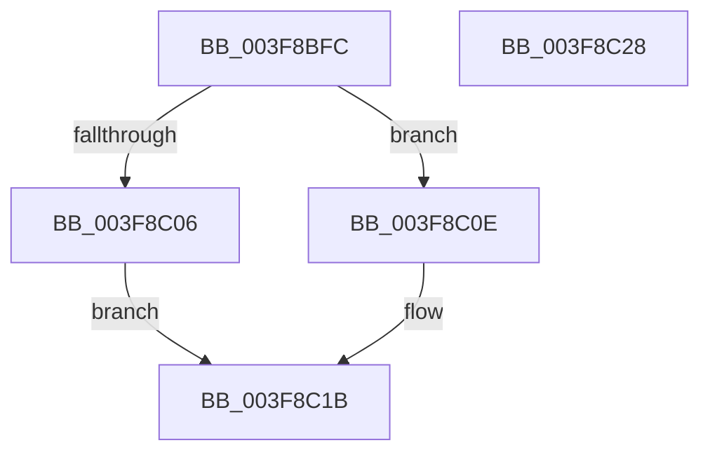

# MiUnmapLargePages

- RVA: `0x003F8BFC`–`0x003F8C29` (길이 `45` bytes)
- VA: `0x00000001403F8BFC`
- 실행 섹션: `.text`
- PDB 이름 있음: `예`; PDB Function 태그: `아니요`
- unwind 정보 RVA: `0x0005C788`
- 디코드: `13`개 명령, `45/45` bytes 표시
- 미해석 바이트: `0` (있으면 어셈블리에 `.byte`로 보존)

> 이 문서는 커널 이미지의 기계어와 PDB 기호를 분석해 생성했습니다. 4번과 5번은 함수 원형과 자료형을 바이너리 사용 방식에서 추정한 C 해석이며 원본 소스 복구 결과는 아닙니다.

## 1. Dependencies

- 직접 호출 지점: **1**; 고유 호출 대상: **1**
- 직접 호출자로 확인된 함수: **2**
- RIP 상대 이미지 참조: **0**

### Outgoing calls
- `0x003F8C1E` → [MiReturnSystemVa](../23/MiReturnSystemVa_function_002394C4.md) (function, `0x002394C4`)

### Direct callers
- [MiInsertInSystemSpace](../3B/MiInsertInSystemSpace_function_003B2F5C.md) at `0x003B35D6`
- [MiUnmapContiguousMemory](MiUnmapContiguousMemory_function_003F7908.md) at `0x003F7AE8`

### Static image references
- 디코드된 RIP-relative 메모리 참조가 없습니다.

## 2. Other-region calls and transfers

- 다른 실행 섹션으로 향하는 call: **0**
- 별도 외부 분기/꼬리 이동을 확인하지 못했습니다.

## 3. Assembly (complete function range)

```asm
003F8BFC  48 83 EC 28                     sub rsp, 0x28
003F8C00  41 83 F8 08                     cmp r8d, 8
003F8C04  75 08                           jne 0x1403f8c0e
003F8C06  41 B8 0C 00 00 00               mov r8d, 0xc
003F8C0C  EB 0D                           jmp 0x1403f8c1b
003F8C0E  41 83 F8 06                     cmp r8d, 6
003F8C12  B8 0A 00 00 00                  mov eax, 0xa
003F8C17  44 0F 44 C0                     cmove r8d, eax
003F8C1B  48 03 D1                        add rdx, rcx
003F8C1E  E8 A1 08 E4 FF                  call 0x1402394c4
003F8C23  48 83 C4 28                     add rsp, 0x28
003F8C27  C3                              ret
003F8C28  CC                              int3
```

## 4. C-style interpretation (structured pseudocode)

```c
__int64 __fastcall MiUnmapLargePages(__int64 a1, __int64 a2, int a3)
{
    __int64 result;
    __int64 v_rsp;

    v_rsp = (v_rsp) - (40);
    if (a3 != 8) goto loc_003F8C0E;
    goto loc_003F8C1B;
loc_003F8C0E:
    a3 = 12;
    if (12 == 6) { a3 = 10; }
loc_003F8C1B:
    a2 = (a2) + (a1);
    result = MiReturnSystemVa(a1, a2, a3, a4);
    v_rsp = (v_rsp) + (40);
    return result;
}
```

## 5. (Beta) C Style

```c
int64_t MiUnmapLargePages(int64_t Arg1, int64_t Arg2, int32_t Arg3)
{
    int64_t result;
    int64_t local_rsp;

    local_rsp = (local_rsp) - (40);
    if (Arg3 != 8) goto loc_003F8C0E;
    goto loc_003F8C1B;
loc_003F8C0E:
    Arg3 = 12;
    if (12 == 6) { Arg3 = 10; }
loc_003F8C1B:
    Arg2 = (Arg2) + (Arg1);
    result = MiReturnSystemVa(Arg1, Arg2, Arg3, a4);
    local_rsp = (local_rsp) + (40);
    return result;
}
```

## 6. Execution-region graph

[열기: 2D/3D 그래프와 함수 탐색 컨트롤 패널](../../../control-panel.html?section=text&rva=0x003F8BFC&view=graph)

- 2D 그래프는 위에서 아래로 흐르고, 3D 그래프는 빈 공간을 드래그해 회전합니다. Shift+드래그는 이동, 휠은 확대·축소, 함수 노드 선택은 대상 보고서 이동입니다.

### Static fallback


