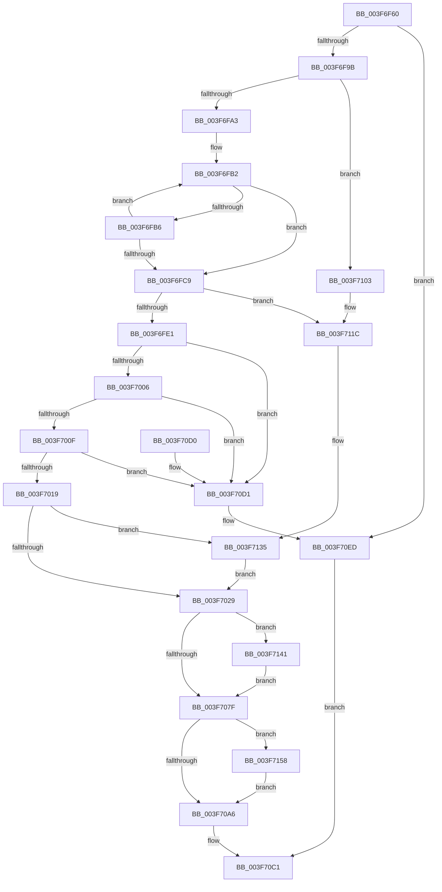

# MmFreeContiguousMemory

- RVA: `0x003F6F60`–`0x003F7172` (길이 `530` bytes)
- VA: `0x00000001403F6F60`
- 실행 섹션: `.text`
- PDB 이름 있음: `예`; PDB Function 태그: `아니요`
- unwind 정보 RVA: `0x000981B4`
- 디코드: `140`개 명령, `530/530` bytes 표시
- 미해석 바이트: `0` (있으면 어셈블리에 `.byte`로 보존)

> 이 문서는 커널 이미지의 기계어와 PDB 기호를 분석해 생성했습니다. 4번과 5번은 함수 원형과 자료형을 바이너리 사용 방식에서 추정한 C 해석이며 원본 소스 복구 결과는 아닙니다.

## 1. Dependencies

- 직접 호출 지점: **14**; 고유 호출 대상: **11**
- 직접 호출자로 확인된 함수: **21**
- RIP 상대 이미지 참조: **4**

### Outgoing calls
- `0x003F6F89` → [MiGetSystemRegionType](../28/MiGetSystemRegionType_function_0028EC80.md) (function, `0x0028EC80`)
- `0x003F6FAD` → [MiFillPteHierarchy](MiFillPteHierarchy_function_003F7F90.md) (function, `0x003F7F90`)
- `0x003F6FBD` → [MI_READ_PTE_LOCK_FREE](../28/MI_READ_PTE_LOCK_FREE_function_002828A0.md) (function, `0x002828A0`)
- `0x003F6FF0` → [ExRemovePoolTag](ExRemovePoolTag_function_003F7CBC.md) (function, `0x003F7CBC`)
- `0x003F7085` → [EtwTraceContFreeEvent](EtwTraceContFreeEvent_function_003F7C0C.md) (function, `0x003F7C0C`)
- `0x003F7093` → [MiUnmapContiguousMemory](MiUnmapContiguousMemory_function_003F7908.md) (function, `0x003F7908`)
- `0x003F70AF` → [MiFreeContiguousPages](MiFreeContiguousPages_function_003F7178.md) (function, `0x003F7178`)
- `0x003F70E7` → [KeBugCheckEx](../4F/KeBugCheckEx_function_004FD660.md) (function, `0x004FD660`)
- `0x003F70F2` → [EtwTraceContFreeEvent](EtwTraceContFreeEvent_function_003F7C0C.md) (function, `0x003F7C0C`)
- `0x003F70FC` → [ExFreePoolWithTag](../../poolcode/B8/ExFreePoolWithTag_function_00B82870.md) (function, `0x00B82870`)
- `0x003F7116` → [KeBugCheckEx](../4F/KeBugCheckEx_function_004FD660.md) (function, `0x004FD660`)
- `0x003F712F` → [KeBugCheckEx](../4F/KeBugCheckEx_function_004FD660.md) (function, `0x004FD660`)
- `0x003F714E` → [VfPtMiscPoolNotification](VfPtMiscPoolNotification_function_003FF310.md) (function, `0x003FF310`)
- `0x003F7168` → [MiLogPerfMemoryRangeEvent](../4D/MiLogPerfMemoryRangeEvent_function_004D9D7C.md) (function, `0x004D9D7C`)

### Direct callers
- [HalpAllocateDomainCommonBufferInternal](../3E/HalpAllocateDomainCommonBufferInternal_function_003E8B64.md) at `0x003E8D7E`
- [HalpAllocateDomainCommonBufferInternal](../3E/HalpAllocateDomainCommonBufferInternal_function_003E8B64.md) at `0x003E8D9F`
- [HalpAllocateDomainCommonBufferInternal](../3E/HalpAllocateDomainCommonBufferInternal_function_003E8B64.md) at `0x003E8FA2`
- [HalpAllocateCommonBufferDmaThin](../3E/HalpAllocateCommonBufferDmaThin_function_003E9788.md) at `0x003E9961`
- [HvlpFreeOverlayPages](HvlpFreeOverlayPages_function_003F67E0.md) at `0x003F67E4`
- [HalFreeCommonBufferDmaThin](HalFreeCommonBufferDmaThin_function_003F6800.md) at `0x003F68A0`
- [HalFreeCommonBufferV2](HalFreeCommonBufferV2_function_003F6F40.md) at `0x003F6F47`
- [HalpDmaAllocateMapRegisterFrame](../55/HalpDmaAllocateMapRegisterFrame_function_005506BC.md) at `0x00550792`
- [HalpDmaFreeChildAdapter](../55/HalpDmaFreeChildAdapter_function_00550E30.md) at `0x00550FD0`
- [HalpDmaFreeMapRegisterFrame](../55/HalpDmaFreeMapRegisterFrame_function_005510D4.md) at `0x00551180`
- [HalFreeCommonBufferV3](../55/HalFreeCommonBufferV3_function_00551A70.md) at `0x00551B27`
- [ExtEnvAllocatePhysicalMemory](../56/ExtEnvAllocatePhysicalMemory_function_00561124.md) at `0x00561208`
- [ExtEnvFreePhysicalMemory](../56/ExtEnvFreePhysicalMemory_function_00561360.md) at `0x005613DC`
- [HvlSetupPhysicalFaultNotificationQueue](../58/HvlSetupPhysicalFaultNotificationQueue_function_00584CE0.md) at `0x00584DDD`
- [IopInitializeInMemoryDumpData](../59/IopInitializeInMemoryDumpData_function_005957E0.md) at `0x0059595D`
- [DifMmFreeContiguousMemorySpecifyCacheWrapper](../63/DifMmFreeContiguousMemorySpecifyCacheWrapper_function_00635080.md) at `0x00635159`
- [DifMmFreeContiguousMemoryWrapper](../63/DifMmFreeContiguousMemoryWrapper_function_006351F0.md) at `0x006352B6`
- [sub_006EA22C](../6E/Unknown_function_006EA22C.md) at `0x006EA2B8`
- [sub_006EABA2](../6E/Unknown_function_006EABA2.md) at `0x006EAC74`
- [HalpDmaAllocateLocalContiguousPool](../../page/70/HalpDmaAllocateLocalContiguousPool_function_00708EE4.md) at `0x00709076`
- [HalpDmaGrowContiguousMapBuffers](../../page/AD/HalpDmaGrowContiguousMapBuffers_function_00AD6D14.md) at `0x00AD6DD3`
- [ViReleaseDmaAdapter](../../pagevrfy/B9/ViReleaseDmaAdapter_function_00B99A0C.md) at `0x00B99A71`
- [IommupHvInitializeLibrary](../../init/C2/IommupHvInitializeLibrary_function_00C25024.md) at `0x00C251BA`

### Static image references
- `0x003F7019` → RVA `0x00FC6C14` (`ALMOSTRO`; read)
- `0x003F7057` → RVA `0x00E30088` (`.data`; read)
- `0x003F706E` → RVA `0x00F04984` (`.data`; read)
- `0x003F7098` → RVA `0x00FC6B04` (`ALMOSTRO`; read)

## 2. Other-region calls and transfers

- 다른 실행 섹션으로 향하는 call: **1**
  - `0x003F70FC` → [ExFreePoolWithTag](../../poolcode/B8/ExFreePoolWithTag_function_00B82870.md) (`.text` → `POOLCODE`)
- 별도 외부 분기/꼬리 이동을 확인하지 못했습니다.

## 3. Assembly (complete function range)

```asm
003F6F60  40 55                           push rbp
003F6F62  53                              push rbx
003F6F63  56                              push rsi
003F6F64  57                              push rdi
003F6F65  41 54                           push r12
003F6F67  41 56                           push r14
003F6F69  41 57                           push r15
003F6F6B  48 8B EC                        mov rbp, rsp
003F6F6E  48 83 EC 50                     sub rsp, 0x50
003F6F72  83 65 48 00                     and dword ptr [rbp + 0x48], 0
003F6F76  0F 57 C0                        xorps xmm0, xmm0
003F6F79  48 83 65 50 00                  and qword ptr [rbp + 0x50], 0
003F6F7E  48 8B D9                        mov rbx, rcx
003F6F81  0F 11 45 E0                     movups xmmword ptr [rbp - 0x20], xmm0
003F6F85  0F 11 45 F0                     movups xmmword ptr [rbp - 0x10], xmm0
003F6F89  E8 F2 7C E9 FF                  call 0x14028ec80
003F6F8E  BF 04 00 00 00                  mov edi, 4
003F6F93  3B C7                           cmp eax, edi
003F6F95  0F 84 52 01 00 00               je 0x1403f70ed
003F6F9B  85 C0                           test eax, eax
003F6F9D  0F 84 60 01 00 00               je 0x1403f7103
003F6FA3  45 33 F6                        xor r14d, r14d
003F6FA6  48 8D 55 E0                     lea rdx, [rbp - 0x20]
003F6FAA  48 8B CB                        mov rcx, rbx
003F6FAD  E8 DE 0F 00 00                  call 0x1403f7f90
003F6FB2  85 FF                           test edi, edi
003F6FB4  74 13                           je 0x1403f6fc9
003F6FB6  FF CF                           dec edi
003F6FB8  48 8B 4C FD E0                  mov rcx, qword ptr [rbp + rdi*8 - 0x20]
003F6FBD  E8 DE B8 E8 FF                  call 0x1402828a0
003F6FC2  4C 8B F0                        mov r14, rax
003F6FC5  84 C0                           test al, al
003F6FC7  79 E9                           jns 0x1403f6fb2
003F6FC9  41 BF FF 0F 00 00               mov r15d, 0xfff
003F6FCF  BF 88 00 00 00                  mov edi, 0x88
003F6FD4  48 89 7D 58                     mov qword ptr [rbp + 0x58], rdi
003F6FD8  41 85 DF                        test r15d, ebx
003F6FDB  0F 85 3B 01 00 00               jne 0x1403f711c
003F6FE1  4C 8D 4D 58                     lea r9, [rbp + 0x58]
003F6FE5  48 8B CB                        mov rcx, rbx
003F6FE8  4C 8D 45 50                     lea r8, [rbp + 0x50]
003F6FEC  48 8D 55 48                     lea rdx, [rbp + 0x48]
003F6FF0  E8 C7 0C 00 00                  call 0x1403f7cbc
003F6FF5  48 8B 75 50                     mov rsi, qword ptr [rbp + 0x50]
003F6FF9  48 81 FE 00 10 00 00            cmp rsi, 0x1000
003F7000  0F 82 CB 00 00 00               jb 0x1403f70d1
003F7006  41 85 F7                        test r15d, esi
003F7009  0F 85 C2 00 00 00               jne 0x1403f70d1
003F700F  48 39 7D 58                     cmp qword ptr [rbp + 0x58], rdi
003F7013  0F 85 B8 00 00 00               jne 0x1403f70d1
003F7019  83 3D F4 FB BC 00 00            cmp dword ptr [rip + 0xbcfbf4], 0
003F7020  48 8B FE                        mov rdi, rsi
003F7023  0F 85 0C 01 00 00               jne 0x1403f7135
003F7029  49 C1 EE 0C                     shr r14, 0xc
003F702D  48 B8 FF FF FF FF FF 00 00 00   movabs rax, 0xffffffffff
003F7037  4C 23 F0                        and r14, rax
003F703A  48 C1 EF 0C                     shr rdi, 0xc
003F703E  4B 8D 14 76                     lea rdx, [r14 + r14*2]
003F7042  48 C1 E2 04                     shl rdx, 4
003F7046  48 B8 00 00 00 00 00 DE FF FF   movabs rax, 0xffffde0000000000
003F7050  48 03 D0                        add rdx, rax
003F7053  48 8B 42 28                     mov rax, qword ptr [rdx + 0x28]
003F7057  48 8B 0D 2A 90 A3 00            mov rcx, qword ptr [rip + 0xa3902a]
003F705E  48 C1 E8 2B                     shr rax, 0x2b
003F7062  25 FF 03 00 00                  and eax, 0x3ff
003F7067  4C 8B 24 C1                     mov r12, qword ptr [rcx + rax*8]
003F706B  8B 42 20                        mov eax, dword ptr [rdx + 0x20]
003F706E  83 3D 0F D9 B0 00 00            cmp dword ptr [rip + 0xb0d90f], 0
003F7075  4C 8B 7D 50                     mov r15, qword ptr [rbp + 0x50]
003F7079  0F 85 C2 00 00 00               jne 0x1403f7141
003F707F  49 8B D7                        mov rdx, r15
003F7082  48 8B CB                        mov rcx, rbx
003F7085  E8 82 0B 00 00                  call 0x1403f7c0c
003F708A  41 B0 01                        mov r8b, 1
003F708D  48 8B D6                        mov rdx, rsi
003F7090  48 8B CB                        mov rcx, rbx
003F7093  E8 70 08 00 00                  call 0x1403f7908
003F7098  8B 05 66 FA BC 00               mov eax, dword ptr [rip + 0xbcfa66]
003F709E  A8 01                           test al, 1
003F70A0  0F 85 B2 00 00 00               jne 0x1403f7158
003F70A6  45 33 C0                        xor r8d, r8d
003F70A9  48 8B D7                        mov rdx, rdi
003F70AC  49 8B CE                        mov rcx, r14
003F70AF  E8 C4 00 00 00                  call 0x1403f7178
003F70B4  48 F7 DF                        neg rdi
003F70B7  F0 49 0F C1 BC 24 C8 4C 00 00   lock xadd qword ptr [r12 + 0x4cc8], rdi
003F70C1  48 83 C4 50                     add rsp, 0x50
003F70C5  41 5F                           pop r15
003F70C7  41 5E                           pop r14
003F70C9  41 5C                           pop r12
003F70CB  5F                              pop rdi
003F70CC  5E                              pop rsi
003F70CD  5B                              pop rbx
003F70CE  5D                              pop rbp
003F70CF  C3                              ret
003F70D0  CC                              int3
003F70D1  8B 45 48                        mov eax, dword ptr [rbp + 0x48]
003F70D4  BA 60 00 00 00                  mov edx, 0x60
003F70D9  4C 8B CE                        mov r9, rsi
003F70DC  48 89 44 24 20                  mov qword ptr [rsp + 0x20], rax
003F70E1  4C 8B C3                        mov r8, rbx
003F70E4  8D 4A 62                        lea ecx, [rdx + 0x62]
003F70E7  E8 74 65 10 00                  call 0x1404fd660
003F70EC  CC                              int3
003F70ED  33 D2                           xor edx, edx
003F70EF  48 8B CB                        mov rcx, rbx
003F70F2  E8 15 0B 00 00                  call 0x1403f7c0c
003F70F7  33 D2                           xor edx, edx
003F70F9  48 8B CB                        mov rcx, rbx
003F70FC  E8 6F B7 78 00                  call 0x140b82870
003F7101  EB BE                           jmp 0x1403f70c1
003F7103  48 83 64 24 20 00               and qword ptr [rsp + 0x20], 0
003F7109  45 33 C9                        xor r9d, r9d
003F710C  4C 8B C3                        mov r8, rbx
003F710F  41 8D 51 62                     lea edx, [r9 + 0x62]
003F7113  8D 4A 60                        lea ecx, [rdx + 0x60]
003F7116  E8 45 65 10 00                  call 0x1404fd660
003F711B  CC                              int3
003F711C  48 83 64 24 20 00               and qword ptr [rsp + 0x20], 0
003F7122  45 33 C9                        xor r9d, r9d
003F7125  4C 8B C3                        mov r8, rbx
003F7128  41 8D 51 61                     lea edx, [r9 + 0x61]
003F712C  8D 4A 61                        lea ecx, [rdx + 0x61]
003F712F  E8 2C 65 10 00                  call 0x1404fd660
003F7134  CC                              int3
003F7135  48 81 C6 00 10 00 00            add rsi, 0x1000
003F713C  E9 E8 FE FF FF                  jmp 0x1403f7029
003F7141  44 8B 45 48                     mov r8d, dword ptr [rbp + 0x48]
003F7145  41 B1 01                        mov r9b, 1
003F7148  49 8B D7                        mov rdx, r15
003F714B  48 8B CB                        mov rcx, rbx
003F714E  E8 BD 81 00 00                  call 0x1403ff310
003F7153  E9 27 FF FF FF                  jmp 0x1403f707f
003F7158  33 D2                           xor edx, edx
003F715A  49 C1 EF 0C                     shr r15, 0xc
003F715E  4D 8B CF                        mov r9, r15
003F7161  48 8B CB                        mov rcx, rbx
003F7164  44 8D 42 0C                     lea r8d, [rdx + 0xc]
003F7168  E8 0F 2C 0E 00                  call 0x1404d9d7c
003F716D  E9 34 FF FF FF                  jmp 0x1403f70a6
```

## 4. C-style interpretation (structured pseudocode)

```c
__int64 __fastcall MmFreeContiguousMemory(__int64 a1)
{
    __int64 result;
    __int64 v_r14;
    __int64 v_r15;
    __int64 v_rdi;
    __int64 v_rsi;
    __int64 v_rsp;
    unsigned __int64 v_stack_m48;
    unsigned __int64 v_stack_m58;
    unsigned int v_stack_p10;
    unsigned __int64 v_stack_p18;
    unsigned __int64 v_stack_p20;

    v_rsp = (v_rsp) - (80);
    v_stack_m58 = v_xmm0;
    v_stack_m48 = v_xmm0;
    result = MiGetSystemRegionType(a1, a2, a3, a4);
    if (((unsigned int)(result)) == 4) goto loc_003F70ED;
    if ((unsigned int)(result) == 0) goto loc_003F7103;
    v_r14 = 0;
    result = MiFillPteHierarchy(a1, v_stack_m58, a3, a4);
loc_003F6FB2:
    if (4 == 0) goto loc_003F6FC9;
    v_rdi = (unsigned int)((4) - 1);
    result = MI_READ_PTE_LOCK_FREE(*(unsigned __int64 *)(v_rsp + v_rdi * 8 - 32), v_stack_m58, a3, a4);
    if (!sign_flag) goto loc_003F6FB2;
loc_003F6FC9:
    v_stack_p20 = 136;
    if ((((unsigned int)((unsigned int)(0xFFFULL))) & ((unsigned int)(a1))) != 0) goto loc_003F711C;
    result = ExRemovePoolTag(a1, v_stack_p10, v_stack_p18, v_stack_p20);
    if (v_stack_p18 < 0x1000ULL) goto loc_003F70D1;
    if ((((unsigned int)((unsigned int)(0xFFFULL))) & ((unsigned int)(v_stack_p18))) != 0) goto loc_003F70D1;
    if (v_stack_p20 != 136) goto loc_003F70D1;
    if ((*(unsigned int *)(v_rip + 12385268)) != 0) goto loc_003F7135;
loc_003F7029:
    v_r14 = (result) >> (12);
    v_r14 = (v_r14) & (result);
    v_rdi = (v_stack_p18) >> (12);
    a2 = (v_r14 + v_r14 * 2) << (4);
    a2 = (a2) + (result);
    result = (*(unsigned __int64 *)(a2 + 40)) >> (43);
    result = (unsigned int)((result) & (0x3FFULL));
    if ((*(unsigned int *)(v_rip + 11589903)) != 0) goto loc_003F7141;
loc_003F707F:
    result = EtwTraceContFreeEvent(a1, v_stack_p18, v_stack_p18, v_stack_p20);
    result = MiUnmapContiguousMemory(a1, v_stack_p18, 1, v_stack_p20);
    if ((((unsigned __int8)((unsigned int)(*(unsigned int *)(v_rip + 12384870)))) & (1)) != 0) goto loc_003F7158;
loc_003F70A6:
    a3 = 0;
    result = MiFreeContiguousPages(v_r14, v_rdi, a3, v_stack_p20);
    v_rdi = -(v_rdi);
loc_003F70C1:
    v_rsp = (v_rsp) + (80);
    return result;
loc_003F70D1:
    v_stack_p20 = (unsigned int)(v_stack_p10);
    result = KeBugCheckEx(96 + 98, 96, a1, v_stack_p18);
loc_003F70ED:
    a2 = 0;
    result = EtwTraceContFreeEvent(a1, a2, a1, v_stack_p18);
    a2 = 0;
    result = ExFreePoolWithTag(a1, a2, a1, v_stack_p18);
    goto loc_003F70C1;
loc_003F7103:
    a4 = 0;
    result = KeBugCheckEx(a4 + 98 + 96, a4 + 98, a1, a4);
loc_003F711C:
    a4 = 0;
    result = KeBugCheckEx(a4 + 97 + 97, a4 + 97, a1, a4);
loc_003F7135:
    v_rsi = (v_stack_p18) + (0x1000ULL);
    goto loc_003F7029;
loc_003F7141:
    result = VfPtMiscPoolNotification(a1, v_stack_p18, (unsigned int)(v_stack_p10), 1);
    goto loc_003F707F;
loc_003F7158:
    a2 = 0;
    v_r15 = (v_stack_p18) >> (12);
    result = MiLogPerfMemoryRangeEvent(a1, a2, a2 + 12, v_r15);
    goto loc_003F70A6;
}
```

## 5. (Beta) C Style

```c
int64_t MmFreeContiguousMemory(int64_t Arg1)
{
    int64_t result;
    int64_t local_r14;
    int64_t local_r15;
    int64_t local_rdi;
    int64_t local_rsi;
    int64_t local_rsp;
    uint64_t v_stack_m48;
    uint64_t v_stack_m58;
    uint32_t v_stack_p10;
    uint64_t v_stack_p18;
    uint64_t v_stack_p20;

    local_rsp = (local_rsp) - (80);
    v_stack_m58 = v_xmm0;
    v_stack_m48 = v_xmm0;
    result = MiGetSystemRegionType(Arg1, a2, a3, a4);
    if (((uint32_t)(result)) == 4) goto loc_003F70ED;
    if ((uint32_t)(result) == 0) goto loc_003F7103;
    local_r14 = 0;
    result = MiFillPteHierarchy(Arg1, v_stack_m58, a3, a4);
loc_003F6FB2:
    if (4 == 0) goto loc_003F6FC9;
    local_rdi = (uint32_t)((4) - 1);
    result = MI_READ_PTE_LOCK_FREE(*(uint64_t *)(local_rsp + local_rdi * 8 - 0x20), v_stack_m58, a3, a4);
    if (!sign_flag) goto loc_003F6FB2;
loc_003F6FC9:
    v_stack_p20 = 136;
    if ((((uint32_t)((uint32_t)(0xFFFULL))) & ((uint32_t)(Arg1))) != 0) goto loc_003F711C;
    result = ExRemovePoolTag(Arg1, v_stack_p10, v_stack_p18, v_stack_p20);
    if (v_stack_p18 < 0x1000ULL) goto loc_003F70D1;
    if ((((uint32_t)((uint32_t)(0xFFFULL))) & ((uint32_t)(v_stack_p18))) != 0) goto loc_003F70D1;
    if (v_stack_p20 != 136) goto loc_003F70D1;
    if ((*(uint32_t *)(v_rip + 0xBCFBF4)) != 0) goto loc_003F7135;
loc_003F7029:
    local_r14 = (result) >> (12);
    local_r14 = (local_r14) & (result);
    local_rdi = (v_stack_p18) >> (12);
    a2 = (local_r14 + local_r14 * 2) << (4);
    a2 = (a2) + (result);
    result = (*(uint64_t *)(a2 + 0x28)) >> (43);
    result = (uint32_t)((result) & (0x3FFULL));
    if ((*(uint32_t *)(v_rip + 0xB0D90F)) != 0) goto loc_003F7141;
loc_003F707F:
    result = EtwTraceContFreeEvent(Arg1, v_stack_p18, v_stack_p18, v_stack_p20);
    result = MiUnmapContiguousMemory(Arg1, v_stack_p18, 1, v_stack_p20);
    if ((((uint8_t)((uint32_t)(*(uint32_t *)(v_rip + 0xBCFA66)))) & (1)) != 0) goto loc_003F7158;
loc_003F70A6:
    a3 = 0;
    result = MiFreeContiguousPages(local_r14, local_rdi, a3, v_stack_p20);
    local_rdi = -(local_rdi);
loc_003F70C1:
    local_rsp = (local_rsp) + (80);
    return result;
loc_003F70D1:
    v_stack_p20 = (uint32_t)(v_stack_p10);
    result = KeBugCheckEx(96 + 98, 96, Arg1, v_stack_p18);
loc_003F70ED:
    a2 = 0;
    result = EtwTraceContFreeEvent(Arg1, a2, Arg1, v_stack_p18);
    a2 = 0;
    result = ExFreePoolWithTag(Arg1, a2, Arg1, v_stack_p18);
    goto loc_003F70C1;
loc_003F7103:
    a4 = 0;
    result = KeBugCheckEx(a4 + 98 + 96, a4 + 98, Arg1, a4);
loc_003F711C:
    a4 = 0;
    result = KeBugCheckEx(a4 + 97 + 97, a4 + 97, Arg1, a4);
loc_003F7135:
    local_rsi = (v_stack_p18) + (0x1000ULL);
    goto loc_003F7029;
loc_003F7141:
    result = VfPtMiscPoolNotification(Arg1, v_stack_p18, (uint32_t)(v_stack_p10), 1);
    goto loc_003F707F;
loc_003F7158:
    a2 = 0;
    local_r15 = (v_stack_p18) >> (12);
    result = MiLogPerfMemoryRangeEvent(Arg1, a2, a2 + 12, local_r15);
    goto loc_003F70A6;
}
```

## 6. Execution-region graph

[열기: 2D/3D 그래프와 함수 탐색 컨트롤 패널](../../../control-panel.html?section=text&rva=0x003F6F60&view=graph)

- 2D 그래프는 위에서 아래로 흐르고, 3D 그래프는 빈 공간을 드래그해 회전합니다. Shift+드래그는 이동, 휠은 확대·축소, 함수 노드 선택은 대상 보고서 이동입니다.

### Static fallback


