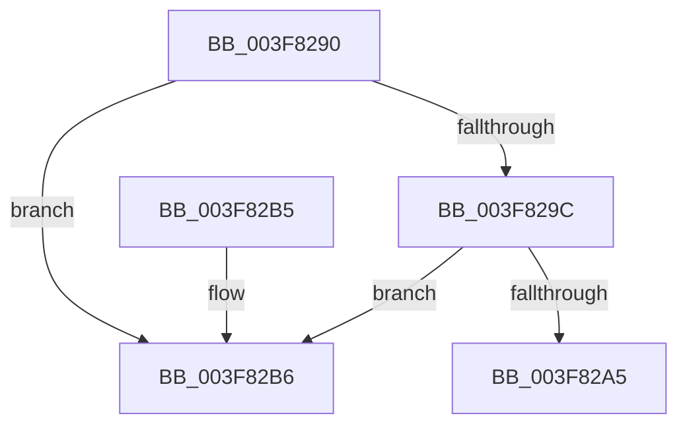

# MmFreePagesFromMdlEx

- RVA: `0x003F8290`–`0x003F82D4` (길이 `68` bytes)
- VA: `0x00000001403F8290`
- 실행 섹션: `.text`
- PDB 이름 있음: `예`; PDB Function 태그: `아니요`
- unwind 정보 RVA: `0x000982D0`
- 디코드: `19`개 명령, `68/68` bytes 표시
- 미해석 바이트: `0` (있으면 어셈블리에 `.byte`로 보존)

> 이 문서는 커널 이미지의 기계어와 PDB 기호를 분석해 생성했습니다. 4번과 5번은 함수 원형과 자료형을 바이너리 사용 방식에서 추정한 C 해석이며 원본 소스 복구 결과는 아닙니다.

## 1. Dependencies

- 직접 호출 지점: **2**; 고유 호출 대상: **2**
- 직접 호출자로 확인된 함수: **0**
- RIP 상대 이미지 참조: **0**

### Outgoing calls
- `0x003F82AB` → [MiFreePagesFromMdl](MiFreePagesFromMdl_function_003F8300.md) (function, `0x003F8300`)
- `0x003F82CE` → [KeBugCheckEx](../4F/KeBugCheckEx_function_004FD660.md) (function, `0x004FD660`)

### Direct callers
- 이 함수 시작 RVA로 연결되는 직접 call은 확인되지 않았습니다. 간접 호출은 완전히 역산할 수 없습니다.

### Static image references
- 디코드된 RIP-relative 메모리 참조가 없습니다.

## 2. Other-region calls and transfers

- 다른 실행 섹션으로 향하는 call: **0**
- 별도 외부 분기/꼬리 이동을 확인하지 못했습니다.

## 3. Assembly (complete function range)

```asm
003F8290  48 83 EC 38                     sub rsp, 0x38
003F8294  F7 C2 FE FF FF FF               test edx, 0xfffffffe
003F829A  75 1A                           jne 0x1403f82b6
003F829C  F7 41 28 FF 0F 00 00            test dword ptr [rcx + 0x28], 0xfff
003F82A3  75 11                           jne 0x1403f82b6
003F82A5  45 33 C9                        xor r9d, r9d
003F82A8  45 33 C0                        xor r8d, r8d
003F82AB  E8 50 00 00 00                  call 0x1403f8300
003F82B0  48 83 C4 38                     add rsp, 0x38
003F82B4  C3                              ret
003F82B5  CC                              int3
003F82B6  8B 41 28                        mov eax, dword ptr [rcx + 0x28]
003F82B9  4C 8B C1                        mov r8, rcx
003F82BC  44 8B CA                        mov r9d, edx
003F82BF  B9 1A 00 00 00                  mov ecx, 0x1a
003F82C4  BA 2E 12 00 00                  mov edx, 0x122e
003F82C9  48 89 44 24 20                  mov qword ptr [rsp + 0x20], rax
003F82CE  E8 8D 53 10 00                  call 0x1404fd660
003F82D3  CC                              int3
```

## 4. C-style interpretation (structured pseudocode)

```c
__int64 __fastcall MmFreePagesFromMdlEx(__int64 a1, int a2, int a3, int a4)
{
    __int64 result;
    __int64 v_rsp;
    unsigned __int64 v_stack_p20;

    v_rsp = (v_rsp) - (56);
    if (((a2) & (0xFFFFFFFEULL)) != 0) goto loc_003F82B6;
    if (((*(unsigned int *)(a1 + 40)) & (0xFFFULL)) != 0) goto loc_003F82B6;
    a4 = 0;
    a3 = 0;
    result = MiFreePagesFromMdl(a1, a2, a3, a4);
    v_rsp = (v_rsp) + (56);
    return result;
loc_003F82B6:
    v_stack_p20 = (unsigned int)(*(unsigned int *)(a1 + 40));
    result = KeBugCheckEx(26, (unsigned int)(0x122EULL), a1, (unsigned int)(a2));
    return result;
}
```

## 5. (Beta) C Style

```c
int64_t MmFreePagesFromMdlEx(void *Arg1, int32_t Arg2, int32_t Arg3, int32_t Arg4)
{
    uint8_t *arg1 = (uint8_t *)Arg1;

    int64_t result;
    int64_t local_rsp;
    uint64_t v_stack_p20;

    local_rsp = (local_rsp) - (56);
    if (((Arg2) & (0xFFFFFFFEULL)) != 0) goto loc_003F82B6;
    if (((*(uint32_t *)(arg1 + 0x28)) & (0xFFFULL)) != 0) goto loc_003F82B6;
    Arg4 = 0;
    Arg3 = 0;
    result = MiFreePagesFromMdl(Arg1, Arg2, Arg3, Arg4);
    local_rsp = (local_rsp) + (56);
    return result;
loc_003F82B6:
    v_stack_p20 = (uint32_t)(*(uint32_t *)(arg1 + 0x28));
    result = KeBugCheckEx(26, (uint32_t)(0x122EULL), Arg1, (uint32_t)(Arg2));
    return result;
}
```

### 관측된 메모리 오프셋

구조체 형식이 확인되지 않은 접근은 인자 기준의 오프셋으로만 기록했습니다.

| 기준 인자 | 오프셋 표현 | 폭 (bit) | 접근 |
|---|---:|---:|---|
| `Arg1` | `+ 0x28` | `32` | `R` |

## 6. Execution-region graph

[열기: 2D/3D 그래프와 함수 탐색 컨트롤 패널](../../../control-panel.html?section=text&rva=0x003F8290&view=graph)

- 2D 그래프는 위에서 아래로 흐르고, 3D 그래프는 빈 공간을 드래그해 회전합니다. Shift+드래그는 이동, 휠은 확대·축소, 함수 노드 선택은 대상 보고서 이동입니다.

### Static fallback


