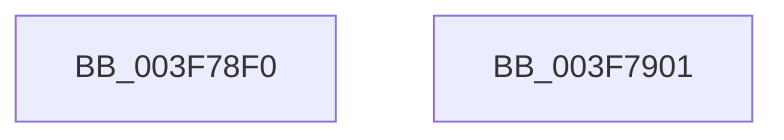

# MmUnmapIoSpace

- RVA: `0x003F78F0`–`0x003F7902` (길이 `18` bytes)
- VA: `0x00000001403F78F0`
- 실행 섹션: `.text`
- PDB 이름 있음: `예`; PDB Function 태그: `아니요`
- unwind 정보 RVA: `0x0005C788`
- 디코드: `6`개 명령, `18/18` bytes 표시
- 미해석 바이트: `0` (있으면 어셈블리에 `.byte`로 보존)

> 이 문서는 커널 이미지의 기계어와 PDB 기호를 분석해 생성했습니다. 4번과 5번은 함수 원형과 자료형을 바이너리 사용 방식에서 추정한 C 해석이며 원본 소스 복구 결과는 아닙니다.

## 1. Dependencies

- 직접 호출 지점: **1**; 고유 호출 대상: **1**
- 직접 호출자로 확인된 함수: **15**
- RIP 상대 이미지 참조: **0**

### Outgoing calls
- `0x003F78F7` → [MiUnmapContiguousMemory](MiUnmapContiguousMemory_function_003F7908.md) (function, `0x003F7908`)

### Direct callers
- [HalpDmaCvmMakeContiguousVirtualBufferPrivate](../../page/70/HalpDmaCvmMakeContiguousVirtualBufferPrivate_function_00709408.md) at `0x00709469`
- [HvlDeleteProcessor](../../page/71/HvlDeleteProcessor_function_00717FA4.md) at `0x0071800A`
- [WmipFindSMBiosStructure](../../page/7B/WmipFindSMBiosStructure_function_007B2944.md) at `0x007B2A2C`
- [WmipFindSysIdTable](../../page/7B/WmipFindSysIdTable_function_007B2A60.md) at `0x007B2B38`
- [WmipGetSMBiosEventlog](../../page/7B/WmipGetSMBiosEventlog_function_007B2B58.md) at `0x007B2BE7`
- [WmipGetSMBiosEventlog](../../page/7B/WmipGetSMBiosEventlog_function_007B2B58.md) at `0x007B2C72`
- [WmipGetSMBiosEventlog](../../page/7B/WmipGetSMBiosEventlog_function_007B2B58.md) at `0x007B2CD9`
- [WmipGetSMBiosEventlog](../../page/7B/WmipGetSMBiosEventlog_function_007B2B58.md) at `0x007B2CF6`
- [WmipGetSysIds](../../page/7B/WmipGetSysIds_function_007B2DB0.md) at `0x007B2FE0`
- [WmipParseSysIdTable](../../page/7B/WmipParseSysIdTable_function_007B3068.md) at `0x007B3222`
- [ExpGetSystemPlatformBinary](../../page/7C/ExpGetSystemPlatformBinary_function_007C3C18.md) at `0x007C407F`
- [WheapClearPoison](../../page/7D/WheapClearPoison_function_007D7DFC.md) at `0x007D7E70`
- [MiZeroHotAddMemory](../../page/7F/MiZeroHotAddMemory_function_007FB324.md) at `0x007FB41D`
- [WmipGetSMBiosTableData](../../page/A4/WmipGetSMBiosTableData_function_00A4F078.md) at `0x00A4F130`
- [HalpInitGenericErrorSourceEntry](../../pagelk/B5/HalpInitGenericErrorSourceEntry_function_00B5DF68.md) at `0x00B5E08A`
- [HalpInitGenericErrorSourceEntryV2](../../pagelk/B5/HalpInitGenericErrorSourceEntryV2_function_00B5E1D0.md) at `0x00B5E342`
- [PopGetHwConfigurationSignature](../../pagelk/B6/PopGetHwConfigurationSignature_function_00B6D5A4.md) at `0x00B6D6DC`
- [HalpFreeNvsBuffers](../../pagelk/B7/HalpFreeNvsBuffers_function_00B7BD18.md) at `0x00B7BD62`

### Static image references
- 디코드된 RIP-relative 메모리 참조가 없습니다.

## 2. Other-region calls and transfers

- 다른 실행 섹션으로 향하는 call: **0**
- 별도 외부 분기/꼬리 이동을 확인하지 못했습니다.

## 3. Assembly (complete function range)

```asm
003F78F0  48 83 EC 28                     sub rsp, 0x28
003F78F4  41 B0 01                        mov r8b, 1
003F78F7  E8 0C 00 00 00                  call 0x1403f7908
003F78FC  48 83 C4 28                     add rsp, 0x28
003F7900  C3                              ret
003F7901  CC                              int3
```

## 4. C-style interpretation (structured pseudocode)

```c
__int64 __fastcall MmUnmapIoSpace(void)
{
    __int64 result;
    __int64 v_rsp;

    v_rsp = (v_rsp) - (40);
    result = MiUnmapContiguousMemory(a1, a2, 1, a4);
    v_rsp = (v_rsp) + (40);
    return result;
}
```

## 5. (Beta) C Style

```c
void MmUnmapIoSpace(void)
{
    int64_t result;
    int64_t local_rsp;

    local_rsp = (local_rsp) - (40);
    result = MiUnmapContiguousMemory(a1, a2, 1, a4);
    local_rsp = (local_rsp) + (40);
    return result;
}
```

## 6. Execution-region graph

[열기: 2D/3D 그래프와 함수 탐색 컨트롤 패널](../../../control-panel.html?section=text&rva=0x003F78F0&view=graph)

- 2D 그래프는 위에서 아래로 흐르고, 3D 그래프는 빈 공간을 드래그해 회전합니다. Shift+드래그는 이동, 휠은 확대·축소, 함수 노드 선택은 대상 보고서 이동입니다.

### Static fallback


