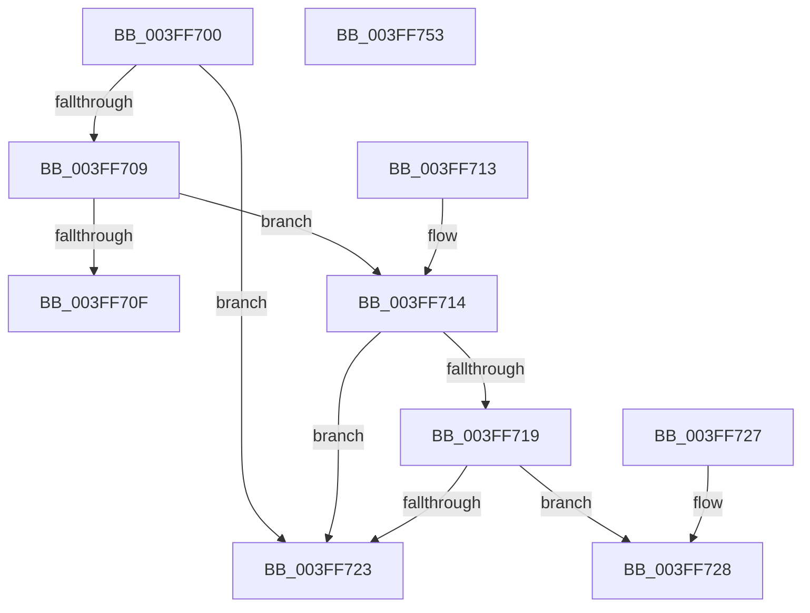

# NLS_UPCASE

- RVA: `0x003FF700`–`0x003FF754` (길이 `84` bytes)
- VA: `0x00000001403FF700`
- 실행 섹션: `.text`
- PDB 이름 있음: `예`; PDB Function 태그: `아니요`
- unwind 정보 RVA: `0x000DB714`
- 디코드: `31`개 명령, `84/84` bytes 표시
- 미해석 바이트: `0` (있으면 어셈블리에 `.byte`로 보존)

> 이 문서는 커널 이미지의 기계어와 PDB 기호를 분석해 생성했습니다. 4번과 5번은 함수 원형과 자료형을 바이너리 사용 방식에서 추정한 C 해석이며 원본 소스 복구 결과는 아닙니다.

## 1. Dependencies

- 직접 호출 지점: **0**; 고유 호출 대상: **0**
- 직접 호출자로 확인된 함수: **6**
- RIP 상대 이미지 참조: **0**

### Outgoing calls
- 직접 디코드된 call 명령이 없습니다.

### Direct callers
- [RtlSuffixUnicodeString](../../page/78/RtlSuffixUnicodeString_function_0078A780.md) at `0x0078A7E5`
- [RtlSuffixUnicodeString](../../page/78/RtlSuffixUnicodeString_function_0078A780.md) at `0x0078A7F5`
- [RtlUpcaseUnicodeToCustomCPN](../../page/78/RtlUpcaseUnicodeToCustomCPN_function_0078BF90.md) at `0x0078C00B`
- [RtlUpcaseUnicodeToCustomCPN](../../page/78/RtlUpcaseUnicodeToCustomCPN_function_0078BF90.md) at `0x0078C07E`
- [_CmOpenCommonClassRegKeyWorker](../../page/8F/_CmOpenCommonClassRegKeyWorker_function_008F0A1C.md) at `0x008F0C8F`
- [_CmOpenCommonClassRegKeyWorker](../../page/8F/_CmOpenCommonClassRegKeyWorker_function_008F0A1C.md) at `0x008F0C9E`
- [RtlIsValidOemCharacter](../../page/90/RtlIsValidOemCharacter_function_0090F5C0.md) at `0x0090F647`
- [RtlIsValidOemCharacter](../../page/90/RtlIsValidOemCharacter_function_0090F5C0.md) at `0x0090F68C`
- [RtlIsValidOemCharacter](../../page/90/RtlIsValidOemCharacter_function_0090F5C0.md) at `0x0090F6A3`
- [PnpGenerateDeviceIdsHash](../../page/A2/PnpGenerateDeviceIdsHash_function_00A2B120.md) at `0x00A2B1AD`
- [PiDevCfgResolveVariable](../../page/A8/PiDevCfgResolveVariable_function_00A81AB8.md) at `0x00A81B41`

### Static image references
- 디코드된 RIP-relative 메모리 참조가 없습니다.

## 2. Other-region calls and transfers

- 다른 실행 섹션으로 향하는 call: **0**
- 별도 외부 분기/꼬리 이동을 확인하지 못했습니다.

## 3. Assembly (complete function range)

```asm
003FF700  4C 8B C1                        mov r8, rcx
003FF703  66 83 FA 61                     cmp dx, 0x61
003FF707  72 1A                           jb 0x1403ff723
003FF709  66 83 FA 7A                     cmp dx, 0x7a
003FF70D  77 05                           ja 0x1403ff714
003FF70F  8D 42 E0                        lea eax, [rdx - 0x20]
003FF712  C3                              ret
003FF713  CC                              int3
003FF714  4D 85 C0                        test r8, r8
003FF717  74 0A                           je 0x1403ff723
003FF719  B8 C0 00 00 00                  mov eax, 0xc0
003FF71E  66 3B D0                        cmp dx, ax
003FF721  73 05                           jae 0x1403ff728
003FF723  0F B7 C2                        movzx eax, dx
003FF726  C3                              ret
003FF727  CC                              int3
003FF728  0F B7 C2                        movzx eax, dx
003FF72B  0F B7 CA                        movzx ecx, dx
003FF72E  48 C1 E9 08                     shr rcx, 8
003FF732  41 0F B7 14 48                  movzx edx, word ptr [r8 + rcx*2]
003FF737  8B C8                           mov ecx, eax
003FF739  C1 E9 04                        shr ecx, 4
003FF73C  83 E1 0F                        and ecx, 0xf
003FF73F  03 D1                           add edx, ecx
003FF741  8B C8                           mov ecx, eax
003FF743  83 E1 0F                        and ecx, 0xf
003FF746  41 0F B7 14 50                  movzx edx, word ptr [r8 + rdx*2]
003FF74B  03 D1                           add edx, ecx
003FF74D  66 41 03 04 50                  add ax, word ptr [r8 + rdx*2]
003FF752  C3                              ret
003FF753  CC                              int3
```

## 4. C-style interpretation (structured pseudocode)

```c
__int64 __fastcall NLS_UPCASE(__int64 a1, __int64 a2)
{
    __int64 result;

    if (((unsigned __int16)(a2)) < 97) goto loc_003FF723;
    if (((unsigned __int16)(a2)) > 122) goto loc_003FF714;
    return a2 - 32;
loc_003FF714:
    if (a1 == 0) goto loc_003FF723;
    if (((unsigned __int16)(a2)) >= 192) goto loc_003FF728;
loc_003FF723:
    return (unsigned __int16)(a2);
loc_003FF728:
    a1 = ((unsigned __int16)(a2)) >> (8);
    a1 = (unsigned int)(((unsigned int)((unsigned int)((unsigned __int16)(a2)))) >> (4));
    a1 = (unsigned int)((a1) & (15));
    a2 = (unsigned int)((*(unsigned __int16 *)(a1 + a1 * 2)) + ((unsigned int)(a1)));
    a1 = (unsigned int)(((unsigned int)((unsigned int)((unsigned __int16)(a2)))) & (15));
    a2 = (unsigned int)((*(unsigned __int16 *)(a1 + a2 * 2)) + ((unsigned int)(a1)));
    result = (unsigned __int16)(((unsigned __int16)(a2)) + (*(unsigned __int16 *)(a1 + a2 * 2)));
    return result;
}
```

## 5. (Beta) C Style

```c
int64_t NLS_UPCASE(int64_t Arg1, int64_t Arg2)
{
    int64_t result;

    if (((uint16_t)(Arg2)) < 97) goto loc_003FF723;
    if (((uint16_t)(Arg2)) > 122) goto loc_003FF714;
    return Arg2 - 32;
loc_003FF714:
    if (Arg1 == 0) goto loc_003FF723;
    if (((uint16_t)(Arg2)) >= 192) goto loc_003FF728;
loc_003FF723:
    return (uint16_t)(Arg2);
loc_003FF728:
    Arg1 = ((uint16_t)(Arg2)) >> (8);
    Arg1 = (uint32_t)(((uint32_t)((uint32_t)((uint16_t)(Arg2)))) >> (4));
    Arg1 = (uint32_t)((Arg1) & (15));
    Arg2 = (uint32_t)((*(uint16_t *)(Arg1 + Arg1 * 2)) + ((uint32_t)(Arg1)));
    Arg1 = (uint32_t)(((uint32_t)((uint32_t)((uint16_t)(Arg2)))) & (15));
    Arg2 = (uint32_t)((*(uint16_t *)(Arg1 + Arg2 * 2)) + ((uint32_t)(Arg1)));
    result = (uint16_t)(((uint16_t)(Arg2)) + (*(uint16_t *)(Arg1 + Arg2 * 2)));
    return result;
}
```

## 6. Execution-region graph

[열기: 2D/3D 그래프와 함수 탐색 컨트롤 패널](../../../control-panel.html?section=text&rva=0x003FF700&view=graph)

- 2D 그래프는 위에서 아래로 흐르고, 3D 그래프는 빈 공간을 드래그해 회전합니다. Shift+드래그는 이동, 휠은 확대·축소, 함수 노드 선택은 대상 보고서 이동입니다.

### Static fallback


