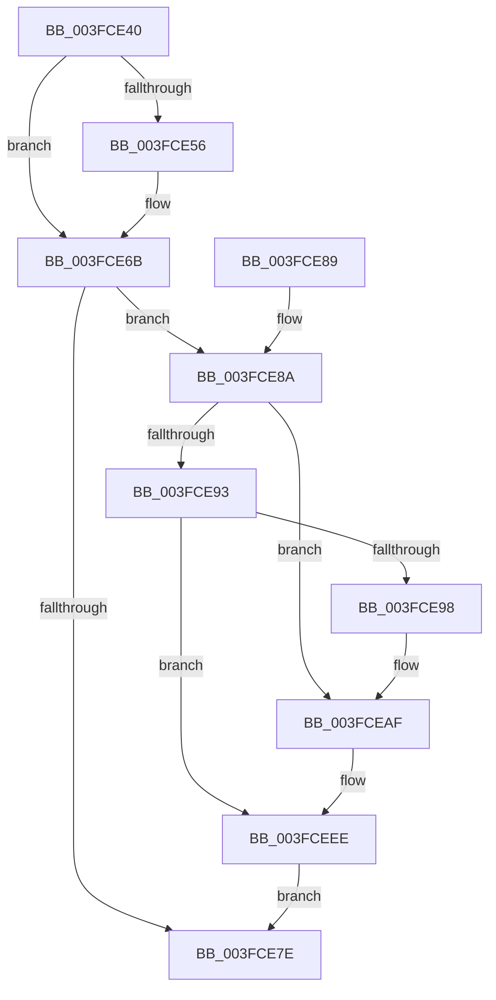

# ObDereferenceObjectDeferDelete

- RVA: `0x003FCE40`–`0x003FCEF9` (길이 `185` bytes)
- VA: `0x00000001403FCE40`
- 실행 섹션: `.text`
- PDB 이름 있음: `예`; PDB Function 태그: `아니요`
- unwind 정보 RVA: `0x00064814`
- 디코드: `50`개 명령, `185/185` bytes 표시
- 미해석 바이트: `0` (있으면 어셈블리에 `.byte`로 보존)

> 이 문서는 커널 이미지의 기계어와 PDB 기호를 분석해 생성했습니다. 4번과 5번은 함수 원형과 자료형을 바이너리 사용 방식에서 추정한 C 해석이며 원본 소스 복구 결과는 아닙니다.

## 1. Dependencies

- 직접 호출 지점: **4**; 고유 호출 대상: **3**
- 직접 호출자로 확인된 함수: **15**
- RIP 상대 이미지 참조: **3**

### Outgoing calls
- `0x003FCE66` → [ObpPushStackInfo](../21/ObpPushStackInfo_function_002109E4.md) (function, `0x002109E4`)
- `0x003FCEA9` → [KeBugCheckEx](../4F/KeBugCheckEx_function_004FD660.md) (function, `0x004FD660`)
- `0x003FCEE8` → [KeBugCheckEx](../4F/KeBugCheckEx_function_004FD660.md) (function, `0x004FD660`)
- `0x003FCEF2` → [ObpDeferObjectDeletion](../3A/ObpDeferObjectDeletion_function_003A2394.md) (function, `0x003A2394`)

### Direct callers
- [NtAlpcImpersonateClientContainerOfPort](../../page/74/NtAlpcImpersonateClientContainerOfPort_function_0074C1B0.md) at `0x0074C31F`
- [ObpCreateSymbolicLinkName](../../page/74/ObpCreateSymbolicLinkName_function_0074EB80.md) at `0x0074EF3B`
- [CmpCleanupTransactionState](../../page/84/CmpCleanupTransactionState_function_008428E0.md) at `0x008429F4`
- [CmpFreePostBlock](../../page/84/CmpFreePostBlock_function_00848560.md) at `0x0084859B`
- [CmpCloseKeyObject](../../page/86/CmpCloseKeyObject_function_00863AD0.md) at `0x00863CD0`
- [ObpLookupObjectName](../../page/89/ObpLookupObjectName_function_0089BE90.md) at `0x0089C78B`
- [ObpLookupObjectName](../../page/89/ObpLookupObjectName_function_0089BE90.md) at `0x0089CCB6`
- [ObpLookupObjectName](../../page/89/ObpLookupObjectName_function_0089BE90.md) at `0x0089DB3E`
- [NtQueryInformationFile](../../page/8A/NtQueryInformationFile_function_008AD630.md) at `0x008ADB56`
- [sub_008C742B](../../page/8C/Unknown_function_008C742B.md) at `0x008C7451`
- [CmpRunDownCmRM](../../page/9B/CmpRunDownCmRM_function_009B062C.md) at `0x009B0782`
- [CmpRunDownCmRM](../../page/9B/CmpRunDownCmRM_function_009B062C.md) at `0x009B07A6`
- [FsRtlpOplockFsctrlInternal](../../page/9F/FsRtlpOplockFsctrlInternal_function_009F1640.md) at `0x009F17CA`
- [FsRtlpOplockFsctrlInternal](../../page/9F/FsRtlpOplockFsctrlInternal_function_009F1640.md) at `0x009F18BB`
- [CmpDelayedDerefKeys](../../page/A2/CmpDelayedDerefKeys_function_00A23B88.md) at `0x00A23BB7`
- [ObpDeleteDirectoryObject](../../page/A7/ObpDeleteDirectoryObject_function_00A757A0.md) at `0x00A757C8`
- [ObpDeleteDirectoryObject](../../page/A7/ObpDeleteDirectoryObject_function_00A757A0.md) at `0x00A757FD`
- [ObpDeleteSymbolicLinkName](../../page/A7/ObpDeleteSymbolicLinkName_function_00A7BC80.md) at `0x00A7BDCD`
- [PfpServiceMainThreadBoostPrep](../../page/AC/PfpServiceMainThreadBoostPrep_function_00ACB08C.md) at `0x00ACB0EB`
- [PfpScenCtxScenarioSet](../../pagelk/B7/PfpScenCtxScenarioSet_function_00B7CFF0.md) at `0x00B7D142`

### Static image references
- `0x003FCE4A` → RVA `0x00FC5010` (`ALMOSTRO`; read)
- `0x003FCED3` → RVA `0x00FC6E4C` (`ALMOSTRO`; read)
- `0x003FCEDD` → RVA `0x00FC7800` (`ALMOSTRO`; read)

## 2. Other-region calls and transfers

- 다른 실행 섹션으로 향하는 call: **0**
- 별도 외부 분기/꼬리 이동을 확인하지 못했습니다.

## 3. Assembly (complete function range)

```asm
003FCE40  48 89 5C 24 08                  mov qword ptr [rsp + 8], rbx
003FCE45  57                              push rdi
003FCE46  48 83 EC 30                     sub rsp, 0x30
003FCE4A  83 3D BF 81 BC 00 00            cmp dword ptr [rip + 0xbc81bf], 0
003FCE51  48 8B F9                        mov rdi, rcx
003FCE54  74 15                           je 0x1403fce6b
003FCE56  33 D2                           xor edx, edx
003FCE58  41 B9 44 66 6C 74               mov r9d, 0x746c6644
003FCE5E  48 83 C1 D0                     add rcx, -0x30
003FCE62  44 8D 42 01                     lea r8d, [rdx + 1]
003FCE66  E8 79 3B E1 FF                  call 0x1402109e4
003FCE6B  48 C7 C0 FF FF FF FF            mov rax, 0xffffffffffffffff
003FCE72  F0 48 0F C1 47 D0               lock xadd qword ptr [rdi - 0x30], rax
003FCE78  48 83 E8 01                     sub rax, 1
003FCE7C  7E 0C                           jle 0x1403fce8a
003FCE7E  48 8B 5C 24 40                  mov rbx, qword ptr [rsp + 0x40]
003FCE83  48 83 C4 30                     add rsp, 0x30
003FCE87  5F                              pop rdi
003FCE88  C3                              ret
003FCE89  CC                              int3
003FCE8A  48 8B 4F D8                     mov rcx, qword ptr [rdi - 0x28]
003FCE8E  48 85 C9                        test rcx, rcx
003FCE91  75 1C                           jne 0x1403fceaf
003FCE93  48 85 C0                        test rax, rax
003FCE96  79 56                           jns 0x1403fceee
003FCE98  33 D2                           xor edx, edx
003FCE9A  48 89 44 24 20                  mov qword ptr [rsp + 0x20], rax
003FCE9F  44 8D 49 04                     lea r9d, [rcx + 4]
003FCEA3  4C 8B C7                        mov r8, rdi
003FCEA6  8D 4A 18                        lea ecx, [rdx + 0x18]
003FCEA9  E8 B2 07 10 00                  call 0x1404fd660
003FCEAE  CC                              int3
003FCEAF  41 B9 03 00 00 00               mov r9d, 3
003FCEB5  48 89 4C 24 20                  mov qword ptr [rsp + 0x20], rcx
003FCEBA  48 8D 47 D0                     lea rax, [rdi - 0x30]
003FCEBE  4C 8B C7                        mov r8, rdi
003FCEC1  48 C1 E8 08                     shr rax, 8
003FCEC5  0F B6 D0                        movzx edx, al
003FCEC8  0F B6 47 E8                     movzx eax, byte ptr [rdi - 0x18]
003FCECC  41 8D 49 15                     lea ecx, [r9 + 0x15]
003FCED0  48 33 D0                        xor rdx, rax
003FCED3  0F B6 05 72 9F BC 00            movzx eax, byte ptr [rip + 0xbc9f72]
003FCEDA  48 33 D0                        xor rdx, rax
003FCEDD  48 8D 05 1C A9 BC 00            lea rax, [rip + 0xbca91c]
003FCEE4  48 8B 14 D0                     mov rdx, qword ptr [rax + rdx*8]
003FCEE8  E8 73 07 10 00                  call 0x1404fd660
003FCEED  CC                              int3
003FCEEE  48 8D 4F D0                     lea rcx, [rdi - 0x30]
003FCEF2  E8 9D 54 FA FF                  call 0x1403a2394
003FCEF7  EB 85                           jmp 0x1403fce7e
```

## 4. C-style interpretation (structured pseudocode)

```c
__int64 __fastcall ObDereferenceObjectDeferDelete(__int64 a1, int a2)
{
    __int64 result;
    __int64 v_rsp;
    unsigned __int64 v_stack_p20;
    unsigned __int64 v_stack_p8;

    v_stack_p8 = v_rbx;
    v_rsp = (v_rsp) - (48);
    if ((*(unsigned int *)(v_rip + 12353983)) != 0) {
        a2 = 0;
        a4 = 0x746C6644ULL;
        a1 = (a1) + (-48);
        a3 = a2 + 1;
        result = ObpPushStackInfo(a1, a2, a3, a4);
    }
    result = (-1) - (1);
    if (condition_is_less_or_equal) goto loc_003FCE8A;
loc_003FCE7E:
    v_rsp = (v_rsp) + (48);
    return result;
loc_003FCE8A:
    if (*(unsigned __int64 *)(a1 - 40) != 0) goto loc_003FCEAF;
    if (!sign_flag) goto loc_003FCEEE;
    a2 = 0;
    v_stack_p20 = result;
    result = KeBugCheckEx(a2 + 24, a2, a1, *(unsigned __int64 *)(a1 - 40) + 4);
loc_003FCEAF:
    v_stack_p20 = a2 + 24;
    result = (a1 - 48) >> (8);
    a2 = ((unsigned __int8)(result)) ^ (*(unsigned __int8 *)(a1 - 24));
    a2 = (a2) ^ (*(unsigned __int8 *)(v_rip + 12361586));
    result = KeBugCheckEx(3 + 21, *(unsigned __int64 *)(v_rip + 12364060 + a2 * 8), a1, 3);
loc_003FCEEE:
    result = ObpDeferObjectDeletion(a1 - 48, *(unsigned __int64 *)(v_rip + 12364060 + a2 * 8), a1, 3);
    goto loc_003FCE7E;
}
```

## 5. (Beta) C Style

```c
int64_t ObDereferenceObjectDeferDelete(void *Arg1, int32_t Arg2)
{
    uint8_t *arg1 = (uint8_t *)Arg1;

    int64_t result;
    int64_t local_rsp;
    uint64_t v_stack_p20;
    uint64_t v_stack_p8;

    v_stack_p8 = local_rbx;
    local_rsp = (local_rsp) - (48);
    if ((*(uint32_t *)(v_rip + 0xBC81BF)) != 0) {
        Arg2 = 0;
        a4 = 0x746C6644ULL;
        Arg1 = (Arg1) + (-48);
        a3 = Arg2 + 1;
        result = ObpPushStackInfo(Arg1, Arg2, a3, a4);
    }
    result = (-1) - (1);
    if (condition_is_less_or_equal) goto loc_003FCE8A;
loc_003FCE7E:
    local_rsp = (local_rsp) + (48);
    return result;
loc_003FCE8A:
    if (*(uint64_t *)(arg1 - 0x28) != 0) goto loc_003FCEAF;
    if (!sign_flag) goto loc_003FCEEE;
    Arg2 = 0;
    v_stack_p20 = result;
    result = KeBugCheckEx(Arg2 + 24, Arg2, Arg1, *(uint64_t *)(arg1 - 0x28) + 4);
loc_003FCEAF:
    v_stack_p20 = Arg2 + 24;
    result = (Arg1 - 48) >> (8);
    Arg2 = ((uint8_t)(result)) ^ (*(uint8_t *)(arg1 - 0x18));
    Arg2 = (Arg2) ^ (*(uint8_t *)(v_rip + 0xBC9F72));
    result = KeBugCheckEx(3 + 21, *(uint64_t *)(v_rip + 0xBCA91C + Arg2 * 8), Arg1, 3);
loc_003FCEEE:
    result = ObpDeferObjectDeletion(Arg1 - 48, *(uint64_t *)(v_rip + 0xBCA91C + Arg2 * 8), Arg1, 3);
    goto loc_003FCE7E;
}
```

### 관측된 메모리 오프셋

구조체 형식이 확인되지 않은 접근은 인자 기준의 오프셋으로만 기록했습니다.

| 기준 인자 | 오프셋 표현 | 폭 (bit) | 접근 |
|---|---:|---:|---|
| `Arg1` | `- 0x30` | `64` | `R` |
| `Arg1` | `- 0x30` | `64` | `R/W` |
| `Arg1` | `- 0x28` | `64` | `R` |
| `Arg1` | `- 0x18` | `8` | `R` |

## 6. Execution-region graph

[열기: 2D/3D 그래프와 함수 탐색 컨트롤 패널](../../../control-panel.html?section=text&rva=0x003FCE40&view=graph)

- 2D 그래프는 위에서 아래로 흐르고, 3D 그래프는 빈 공간을 드래그해 회전합니다. Shift+드래그는 이동, 휠은 확대·축소, 함수 노드 선택은 대상 보고서 이동입니다.

### Static fallback


