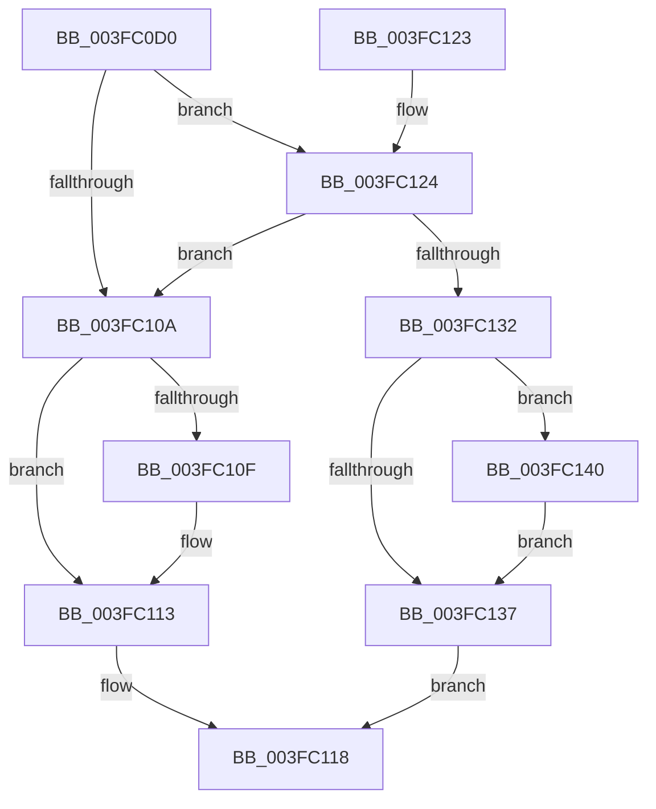

# PfLockSharedTryAcquire

- RVA: `0x003FC0D0`–`0x003FC14D` (길이 `125` bytes)
- VA: `0x00000001403FC0D0`
- 실행 섹션: `.text`
- PDB 이름 있음: `예`; PDB Function 태그: `아니요`
- unwind 정보 RVA: `0x00068270`
- 디코드: `38`개 명령, `125/125` bytes 표시
- 미해석 바이트: `0` (있으면 어셈블리에 `.byte`로 보존)

> 이 문서는 커널 이미지의 기계어와 PDB 기호를 분석해 생성했습니다. 4번과 5번은 함수 원형과 자료형을 바이너리 사용 방식에서 추정한 C 해석이며 원본 소스 복구 결과는 아닙니다.

## 1. Dependencies

- 직접 호출 지점: **4**; 고유 호출 대상: **4**
- 직접 호출자로 확인된 함수: **1**
- RIP 상대 이미지 참조: **0**

### Outgoing calls
- `0x003FC0F4` → [KeAbPreAcquire](../21/KeAbPreAcquire_function_00210230.md) (function, `0x00210230`)
- `0x003FC129` → [ExfTryAcquirePushLockSharedEx](ExfTryAcquirePushLockSharedEx_function_003FC210.md) (function, `0x003FC210`)
- `0x003FC137` → [KeLeaveCriticalRegion](../25/KeLeaveCriticalRegion_function_0025D8B0.md) (function, `0x0025D8B0`)
- `0x003FC146` → [KeAbPostReleaseEx](../26/KeAbPostReleaseEx_function_00262210.md) (function, `0x00262210`)

### Direct callers
- [PfCheckDeprioritizeFile](../../page/88/PfCheckDeprioritizeFile_function_00887F6C.md) at `0x00887FA7`
- [PfCheckDeprioritizeFile](../../page/88/PfCheckDeprioritizeFile_function_00887F6C.md) at `0x00887FEA`

### Static image references
- 디코드된 RIP-relative 메모리 참조가 없습니다.

## 2. Other-region calls and transfers

- 다른 실행 섹션으로 향하는 call: **0**
- 별도 외부 분기/꼬리 이동을 확인하지 못했습니다.

## 3. Assembly (complete function range)

```asm
003FC0D0  48 89 5C 24 08                  mov qword ptr [rsp + 8], rbx
003FC0D5  57                              push rdi
003FC0D6  48 83 EC 20                     sub rsp, 0x20
003FC0DA  65 48 8B 04 25 88 01 00 00      mov rax, qword ptr gs:[0x188]
003FC0E3  33 D2                           xor edx, edx
003FC0E5  48 8B F9                        mov rdi, rcx
003FC0E8  66 FF 88 E4 01 00 00            dec word ptr [rax + 0x1e4]
003FC0EF  44 8D 42 01                     lea r8d, [rdx + 1]
003FC0F3  90                              nop
003FC0F4  E8 37 41 E1 FF                  call 0x140210230
003FC0F9  48 8B D8                        mov rbx, rax
003FC0FC  B9 11 00 00 00                  mov ecx, 0x11
003FC101  33 C0                           xor eax, eax
003FC103  F0 48 0F B1 0F                  lock cmpxchg qword ptr [rdi], rcx
003FC108  75 1A                           jne 0x1403fc124
003FC10A  48 85 DB                        test rbx, rbx
003FC10D  74 04                           je 0x1403fc113
003FC10F  C6 43 0A 01                     mov byte ptr [rbx + 0xa], 1
003FC113  B8 01 00 00 00                  mov eax, 1
003FC118  48 8B 5C 24 30                  mov rbx, qword ptr [rsp + 0x30]
003FC11D  48 83 C4 20                     add rsp, 0x20
003FC121  5F                              pop rdi
003FC122  C3                              ret
003FC123  CC                              int3
003FC124  33 D2                           xor edx, edx
003FC126  48 8B CF                        mov rcx, rdi
003FC129  E8 E2 00 00 00                  call 0x1403fc210
003FC12E  84 C0                           test al, al
003FC130  75 D8                           jne 0x1403fc10a
003FC132  48 85 DB                        test rbx, rbx
003FC135  75 09                           jne 0x1403fc140
003FC137  E8 74 17 E6 FF                  call 0x14025d8b0
003FC13C  33 C0                           xor eax, eax
003FC13E  EB D8                           jmp 0x1403fc118
003FC140  48 8B D3                        mov rdx, rbx
003FC143  48 8B CF                        mov rcx, rdi
003FC146  E8 C5 60 E6 FF                  call 0x140262210
003FC14B  EB EA                           jmp 0x1403fc137
```

## 4. C-style interpretation (structured pseudocode)

```c
__int64 __fastcall PfLockSharedTryAcquire(__int64 a1, int a2)
{
    __int64 result;
    __int64 v_rsp;
    unsigned __int64 v_stack_p8;

    v_stack_p8 = v_rbx;
    v_rsp = (v_rsp) - (32);
    a2 = 0;
    result = KeAbPreAcquire(a1, a2, a2 + 1, a4);
    result = 0;
    if (condition_is_not_equal) goto loc_003FC124;
loc_003FC10A:
    if (0 != 0) {
        *(unsigned __int8 *)(result + 10) = 1;
    }
loc_003FC118:
    v_rsp = (v_rsp) + (32);
    return 1;
loc_003FC124:
    a2 = 0;
    result = ExfTryAcquirePushLockSharedEx(a1, a2, a2 + 1, a4);
    if ((unsigned __int8)(result) != 0) goto loc_003FC10A;
    if (v_stack_p8 != 0) goto loc_003FC140;
loc_003FC137:
    result = KeLeaveCriticalRegion(a1, a2, a2 + 1, a4);
    result = 0;
    goto loc_003FC118;
loc_003FC140:
    result = KeAbPostReleaseEx(a1, v_stack_p8, a2 + 1, a4);
    goto loc_003FC137;
}
```

## 5. (Beta) C Style

```c
int64_t PfLockSharedTryAcquire(void *Arg1, int32_t Arg2)
{
    uint8_t *arg1 = (uint8_t *)Arg1;

    int64_t result;
    int64_t local_rsp;
    uint64_t v_stack_p8;

    v_stack_p8 = local_rbx;
    local_rsp = (local_rsp) - (32);
    Arg2 = 0;
    result = KeAbPreAcquire(Arg1, Arg2, Arg2 + 1, a4);
    result = 0;
    if (condition_is_not_equal) goto loc_003FC124;
loc_003FC10A:
    if (0 != 0) {
        *(uint8_t *)(result + 0xA) = 1;
    }
loc_003FC118:
    local_rsp = (local_rsp) + (32);
    return 1;
loc_003FC124:
    Arg2 = 0;
    result = ExfTryAcquirePushLockSharedEx(Arg1, Arg2, Arg2 + 1, a4);
    if ((uint8_t)(result) != 0) goto loc_003FC10A;
    if (v_stack_p8 != 0) goto loc_003FC140;
loc_003FC137:
    result = KeLeaveCriticalRegion(Arg1, Arg2, Arg2 + 1, a4);
    result = 0;
    goto loc_003FC118;
loc_003FC140:
    result = KeAbPostReleaseEx(Arg1, v_stack_p8, Arg2 + 1, a4);
    goto loc_003FC137;
}
```

### 관측된 메모리 오프셋

구조체 형식이 확인되지 않은 접근은 인자 기준의 오프셋으로만 기록했습니다.

| 기준 인자 | 오프셋 표현 | 폭 (bit) | 접근 |
|---|---:|---:|---|
| `Arg1` | `+ 0x0` | `64` | `R` |

## 6. Execution-region graph

[열기: 2D/3D 그래프와 함수 탐색 컨트롤 패널](../../../control-panel.html?section=text&rva=0x003FC0D0&view=graph)

- 2D 그래프는 위에서 아래로 흐르고, 3D 그래프는 빈 공간을 드래그해 회전합니다. Shift+드래그는 이동, 휠은 확대·축소, 함수 노드 선택은 대상 보고서 이동입니다.

### Static fallback


