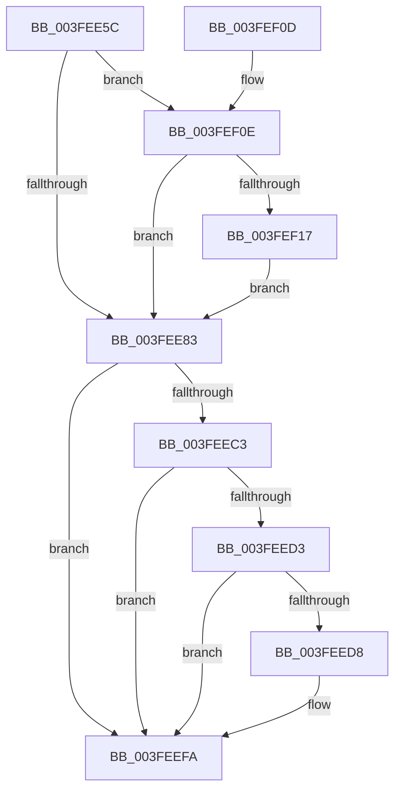

# PnpAllocateWatchdog

- RVA: `0x003FEE5C`–`0x003FEF23` (길이 `199` bytes)
- VA: `0x00000001403FEE5C`
- 실행 섹션: `.text`
- PDB 이름 있음: `예`; PDB Function 태그: `아니요`
- unwind 정보 RVA: `0x00099F60`
- 디코드: `51`개 명령, `199/199` bytes 표시
- 미해석 바이트: `0` (있으면 어셈블리에 `.byte`로 보존)

> 이 문서는 커널 이미지의 기계어와 PDB 기호를 분석해 생성했습니다. 4번과 5번은 함수 원형과 자료형을 바이너리 사용 방식에서 추정한 C 해석이며 원본 소스 복구 결과는 아닙니다.

## 1. Dependencies

- 직접 호출 지점: **2**; 고유 호출 대상: **2**
- 직접 호출자로 확인된 함수: **1**
- RIP 상대 이미지 참조: **4**

### Outgoing calls
- `0x003FEEB9` → [PnpWatchdogTimerAllocate](../../page/A2/PnpWatchdogTimerAllocate_function_00A26BFC.md) (function, `0x00A26BFC`)
- `0x003FEEF5` → [RtlCopyUnicodeString](RtlCopyUnicodeString_function_003FEF30.md) (function, `0x003FEF30`)

### Direct callers
- [PnpEnableWatchdog](../../page/8F/PnpEnableWatchdog_function_008FB5C8.md) at `0x008FB5DF`

### Static image references
- `0x003FEE83` → RVA `0x0072B8C0` (`PnpWatchdogFirstChanceCallback`; read)
- `0x003FEE99` → RVA `0x00F8CCD4` (`.data`; read)
- `0x003FEEA3` → RVA `0x005A67F0` (`PnpWatchdogSecondChanceCallback`; read)
- `0x003FEEAF` → RVA `0x00F8CCD0` (`.data`; read)

## 2. Other-region calls and transfers

- 다른 실행 섹션으로 향하는 call: **1**
  - `0x003FEEB9` → [PnpWatchdogTimerAllocate](../../page/A2/PnpWatchdogTimerAllocate_function_00A26BFC.md) (`.text` → `PAGE`)
- 별도 외부 분기/꼬리 이동을 확인하지 못했습니다.

## 3. Assembly (complete function range)

```asm
003FEE5C  48 89 5C 24 08                  mov qword ptr [rsp + 8], rbx
003FEE61  48 89 74 24 10                  mov qword ptr [rsp + 0x10], rsi
003FEE66  57                              push rdi
003FEE67  48 83 EC 50                     sub rsp, 0x50
003FEE6B  33 F6                           xor esi, esi
003FEE6D  48 8B D9                        mov rbx, rcx
003FEE70  48 89 74 24 28                  mov qword ptr [rsp + 0x28], rsi
003FEE75  8B FE                           mov edi, esi
003FEE77  8D 4E 38                        lea ecx, [rsi + 0x38]
003FEE7A  48 85 DB                        test rbx, rbx
003FEE7D  0F 85 8B 00 00 00               jne 0x1403fef0e
003FEE83  48 8D 05 36 CA 32 00            lea rax, [rip + 0x32ca36]
003FEE8A  48 89 4C 24 20                  mov qword ptr [rsp + 0x20], rcx
003FEE8F  48 89 44 24 30                  mov qword ptr [rsp + 0x30], rax
003FEE94  48 8D 4C 24 20                  lea rcx, [rsp + 0x20]
003FEE99  8B 05 35 DE B8 00               mov eax, dword ptr [rip + 0xb8de35]
003FEE9F  89 44 24 38                     mov dword ptr [rsp + 0x38], eax
003FEEA3  48 8D 05 46 79 1A 00            lea rax, [rip + 0x1a7946]
003FEEAA  48 89 44 24 40                  mov qword ptr [rsp + 0x40], rax
003FEEAF  8B 05 1B DE B8 00               mov eax, dword ptr [rip + 0xb8de1b]
003FEEB5  89 44 24 3C                     mov dword ptr [rsp + 0x3c], eax
003FEEB9  E8 3E 7D 62 00                  call 0x140a26bfc
003FEEBE  48 85 C0                        test rax, rax
003FEEC1  74 37                           je 0x1403feefa
003FEEC3  48 8D B8 8D 00 00 00            lea rdi, [rax + 0x8d]
003FEECA  48 89 47 08                     mov qword ptr [rdi + 8], rax
003FEECE  48 85 DB                        test rbx, rbx
003FEED1  74 27                           je 0x1403feefa
003FEED3  66 39 33                        cmp word ptr [rbx], si
003FEED6  76 22                           jbe 0x1403feefa
003FEED8  0F B7 53 02                     movzx edx, word ptr [rbx + 2]
003FEEDC  48 8D 4F 28                     lea rcx, [rdi + 0x28]
003FEEE0  0F 57 C0                        xorps xmm0, xmm0
003FEEE3  0F 11 01                        movups xmmword ptr [rcx], xmm0
003FEEE6  66 89 51 02                     mov word ptr [rcx + 2], dx
003FEEEA  48 8D 57 38                     lea rdx, [rdi + 0x38]
003FEEEE  48 89 51 08                     mov qword ptr [rcx + 8], rdx
003FEEF2  48 8B D3                        mov rdx, rbx
003FEEF5  E8 36 00 00 00                  call 0x1403fef30
003FEEFA  48 8B 5C 24 60                  mov rbx, qword ptr [rsp + 0x60]
003FEEFF  48 8B C7                        mov rax, rdi
003FEF02  48 8B 74 24 68                  mov rsi, qword ptr [rsp + 0x68]
003FEF07  48 83 C4 50                     add rsp, 0x50
003FEF0B  5F                              pop rdi
003FEF0C  C3                              ret
003FEF0D  CC                              int3
003FEF0E  66 39 33                        cmp word ptr [rbx], si
003FEF11  0F 86 6C FF FF FF               jbe 0x1403fee83
003FEF17  0F B7 43 02                     movzx eax, word ptr [rbx + 2]
003FEF1B  48 03 C8                        add rcx, rax
003FEF1E  E9 60 FF FF FF                  jmp 0x1403fee83
```

## 4. C-style interpretation (structured pseudocode)

```c
__int64 __fastcall PnpAllocateWatchdog(__int64 a1)
{
    __int64 result;
    __int64 v_rsi;
    __int64 v_rsp;
    unsigned __int64 v_stack_m18;
    unsigned int v_stack_m1C;
    unsigned int v_stack_m20;
    unsigned __int64 v_stack_m28;
    unsigned __int64 v_stack_m30;
    unsigned __int64 v_stack_m38;
    unsigned __int64 v_stack_p10;
    unsigned __int64 v_stack_p8;

    v_stack_p8 = v_rbx;
    v_stack_p10 = v_rsi;
    v_rsp = (v_rsp) - (80);
    v_rsi = 0;
    v_stack_m30 = 0;
    if (a1 != 0) goto loc_003FEF0E;
loc_003FEE83:
    v_stack_m38 = v_rsi + 56;
    v_stack_m28 = v_rip + 3328566;
    v_stack_m20 = (unsigned int)((unsigned int)(*(unsigned int *)(v_rip + 12115509)));
    v_stack_m18 = v_rip + 1734982;
    v_stack_m1C = (unsigned int)((unsigned int)(*(unsigned int *)(v_rip + 12115483)));
    result = PnpWatchdogTimerAllocate(v_stack_m38, a2, a3, a4);
    if (result == 0) goto loc_003FEEFA;
    *(unsigned __int64 *)(result + 141 + 8) = result;
    if (a1 == 0) goto loc_003FEEFA;
    if ((*(unsigned __int16 *)(a1)) >= = 0) {
        a2 = *(unsigned __int16 *)(a1 + 2);
        a1 = result + 141 + 40;
        *(unsigned __int64 *)(a1) = v_xmm0;
        *(unsigned __int16 *)(a1 + 2) = (unsigned __int16)(a2);
        a2 = result + 141 + 56;
        *(unsigned __int64 *)(a1 + 8) = a2;
        a2 = a1;
        result = RtlCopyUnicodeString(a1, a2, a3, a4);
    }
    v_rsp = (v_rsp) + (80);
    return result + 141;
loc_003FEF0E:
    if ((*(unsigned __int16 *)(v_stack_p8)) <= ((unsigned __int16)(v_stack_p10))) goto loc_003FEE83;
    a1 = (a1) + (*(unsigned __int16 *)(v_stack_p8 + 2));
    goto loc_003FEE83;
}
```

## 5. (Beta) C Style

```c
int64_t PnpAllocateWatchdog(int64_t Arg1)
{
    int64_t result;
    int64_t local_rsi;
    int64_t local_rsp;
    uint64_t v_stack_m18;
    uint32_t v_stack_m1C;
    uint32_t v_stack_m20;
    uint64_t v_stack_m28;
    uint64_t v_stack_m30;
    uint64_t v_stack_m38;
    uint64_t v_stack_p10;
    uint64_t v_stack_p8;

    v_stack_p8 = local_rbx;
    v_stack_p10 = local_rsi;
    local_rsp = (local_rsp) - (80);
    local_rsi = 0;
    v_stack_m30 = 0;
    if (Arg1 != 0) goto loc_003FEF0E;
loc_003FEE83:
    v_stack_m38 = local_rsi + 56;
    v_stack_m28 = v_rip + 3328566;
    v_stack_m20 = (uint32_t)((uint32_t)(*(uint32_t *)(v_rip + 0xB8DE35)));
    v_stack_m18 = v_rip + 1734982;
    v_stack_m1C = (uint32_t)((uint32_t)(*(uint32_t *)(v_rip + 0xB8DE1B)));
    result = PnpWatchdogTimerAllocate(v_stack_m38, a2, a3, a4);
    if (result == 0) goto loc_003FEEFA;
    *(uint64_t *)(result + 0x8D + 0x8) = result;
    if (Arg1 == 0) goto loc_003FEEFA;
    if ((*(uint16_t *)(Arg1)) >= = 0) {
        a2 = *(uint16_t *)(Arg1 + 0x2);
        Arg1 = result + 141 + 40;
        *(uint64_t *)(Arg1) = v_xmm0;
        *(uint16_t *)(Arg1 + 0x2) = (uint16_t)(a2);
        a2 = result + 141 + 56;
        *(uint64_t *)(Arg1 + 0x8) = a2;
        a2 = Arg1;
        result = RtlCopyUnicodeString(Arg1, a2, a3, a4);
    }
    local_rsp = (local_rsp) + (80);
    return result + 141;
loc_003FEF0E:
    if ((*(uint16_t *)(v_stack_p8)) <= ((uint16_t)(v_stack_p10))) goto loc_003FEE83;
    Arg1 = (Arg1) + (*(uint16_t *)(v_stack_p8 + 0x2));
    goto loc_003FEE83;
}
```

## 6. Execution-region graph

[열기: 2D/3D 그래프와 함수 탐색 컨트롤 패널](../../../control-panel.html?section=text&rva=0x003FEE5C&view=graph)

- 2D 그래프는 위에서 아래로 흐르고, 3D 그래프는 빈 공간을 드래그해 회전합니다. Shift+드래그는 이동, 휠은 확대·축소, 함수 노드 선택은 대상 보고서 이동입니다.

### Static fallback


