# PsEnterPriorityRegion

- RVA: `0x003F8CD0`–`0x003F8E85` (길이 `437` bytes)
- VA: `0x00000001403F8CD0`
- 실행 섹션: `.text`
- PDB 이름 있음: `예`; PDB Function 태그: `아니요`
- unwind 정보 RVA: `0x0009831C`
- 디코드: `101`개 명령, `437/437` bytes 표시
- 미해석 바이트: `0` (있으면 어셈블리에 `.byte`로 보존)

> 이 문서는 커널 이미지의 기계어와 PDB 기호를 분석해 생성했습니다. 4번과 5번은 함수 원형과 자료형을 바이너리 사용 방식에서 추정한 C 해석이며 원본 소스 복구 결과는 아닙니다.

## 1. Dependencies

- 직접 호출 지점: **9**; 고유 호출 대상: **8**
- 직접 호출자로 확인된 함수: **0**
- RIP 상대 이미지 참조: **4**

### Outgoing calls
- `0x003F8D3E` → [ExAllocatePool2](../../poolcode/B8/ExAllocatePool2_function_00B820F0.md) (function, `0x00B820F0`)
- `0x003F8D5C` → [RtlCaptureStackBackTrace](../2F/RtlCaptureStackBackTrace_function_002F9FF0.md) (function, `0x002F9FF0`)
- `0x003F8D7D` → [KeAcquireSpinLockRaiseToDpc](../20/KeAcquireSpinLockRaiseToDpc_function_00208470.md) (function, `0x00208470`)
- `0x003F8DDC` → [KiLowerIrqlProcessIrqlFlags](../4F/KiLowerIrqlProcessIrqlFlags_function_004F5698.md) (function, `0x004F5698`)
- `0x003F8E00` → [KiReleaseSpinLockInstrumented](../39/KiReleaseSpinLockInstrumented_function_00392EF0.md) (function, `0x00392EF0`)
- `0x003F8E46` → [KiAbThreadInsertList](../21/KiAbThreadInsertList_function_0021F0E0.md) (function, `0x0021F0E0`)
- `0x003F8E52` → [KiAbQueueAutoBoostDpc](../20/KiAbQueueAutoBoostDpc_function_002074D0.md) (function, `0x002074D0`)
- `0x003F8E67` → [KiLowerIrqlProcessIrqlFlags](../4F/KiLowerIrqlProcessIrqlFlags_function_004F5698.md) (function, `0x004F5698`)
- `0x003F8E7E` → [KiRaiseIrqlProcessIrqlFlags](../4F/KiRaiseIrqlProcessIrqlFlags_function_004F56FC.md) (function, `0x004F56FC`)

### Direct callers
- 이 함수 시작 RVA로 연결되는 직접 call은 확인되지 않았습니다. 간접 호출은 완전히 역산할 수 없습니다.

### Static image references
- `0x003F8CF3` → RVA `0x00FC6F88` (`ALMOSTRO`; read)
- `0x003F8DB9` → RVA `0x00FC6B06` (`ALMOSTRO`; read)
- `0x003F8DCB` → RVA `0x00FC6D20` (`ALMOSTRO`; read)
- `0x003F8DEA` → RVA `0x00F0DE58` (`.data`; read)

## 2. Other-region calls and transfers

- 다른 실행 섹션으로 향하는 call: **1**
  - `0x003F8D3E` → [ExAllocatePool2](../../poolcode/B8/ExAllocatePool2_function_00B820F0.md) (`.text` → `POOLCODE`)
- 별도 외부 분기/꼬리 이동을 확인하지 못했습니다.

## 3. Assembly (complete function range)

```asm
003F8CD0  48 89 5C 24 08                  mov qword ptr [rsp + 8], rbx
003F8CD5  48 89 6C 24 10                  mov qword ptr [rsp + 0x10], rbp
003F8CDA  48 89 74 24 18                  mov qword ptr [rsp + 0x18], rsi
003F8CDF  48 89 7C 24 20                  mov qword ptr [rsp + 0x20], rdi
003F8CE4  41 56                           push r14
003F8CE6  48 83 EC 20                     sub rsp, 0x20
003F8CEA  65 48 8B 3C 25 88 01 00 00      mov rdi, qword ptr gs:[0x188]
003F8CF3  83 3D 8E E2 BC 00 00            cmp dword ptr [rip + 0xbce28e], 0
003F8CFA  75 34                           jne 0x1403f8d30
003F8CFC  BB 01 00 00 00                  mov ebx, 1
003F8D01  F0 0F C1 9F E0 05 00 00         lock xadd dword ptr [rdi + 0x5e0], ebx
003F8D09  FF C3                           inc ebx
003F8D0B  83 FB 01                        cmp ebx, 1
003F8D0E  0F 84 F3 00 00 00               je 0x1403f8e07
003F8D14  48 8B 5C 24 30                  mov rbx, qword ptr [rsp + 0x30]
003F8D19  48 8B 6C 24 38                  mov rbp, qword ptr [rsp + 0x38]
003F8D1E  48 8B 74 24 40                  mov rsi, qword ptr [rsp + 0x40]
003F8D23  48 8B 7C 24 48                  mov rdi, qword ptr [rsp + 0x48]
003F8D28  48 83 C4 20                     add rsp, 0x20
003F8D2C  41 5E                           pop r14
003F8D2E  C3                              ret
003F8D2F  CC                              int3
003F8D30  BA 70 00 00 00                  mov edx, 0x70
003F8D35  41 B8 42 6F 6F 73               mov r8d, 0x736f6f42
003F8D3B  8D 4A D0                        lea ecx, [rdx - 0x30]
003F8D3E  E8 AD 93 78 00                  call 0x140b820f0
003F8D43  4C 8B F0                        mov r14, rax
003F8D46  BB 01 00 00 00                  mov ebx, 1
003F8D4B  48 85 C0                        test rax, rax
003F8D4E  74 26                           je 0x1403f8d76
003F8D50  4C 8D 40 10                     lea r8, [rax + 0x10]
003F8D54  45 33 C9                        xor r9d, r9d
003F8D57  8D 53 09                        lea edx, [rbx + 9]
003F8D5A  8B CB                           mov ecx, ebx
003F8D5C  E8 8F 12 F0 FF                  call 0x1402f9ff0
003F8D61  65 48 8B 0C 25 88 01 00 00      mov rcx, qword ptr gs:[0x188]
003F8D6A  49 89 4E 60                     mov qword ptr [r14 + 0x60], rcx
003F8D6E  49 C7 46 68 00 00 00 00         mov qword ptr [r14 + 0x68], 0
003F8D76  48 8D 8F 10 06 00 00            lea rcx, [rdi + 0x610]
003F8D7D  E8 EE F6 E0 FF                  call 0x140208470
003F8D82  0F B6 E8                        movzx ebp, al
003F8D85  F0 0F C1 9F E0 05 00 00         lock xadd dword ptr [rdi + 0x5e0], ebx
003F8D8D  FF C3                           inc ebx
003F8D8F  4D 85 F6                        test r14, r14
003F8D92  74 25                           je 0x1403f8db9
003F8D94  48 8D 87 F0 05 00 00            lea rax, [rdi + 0x5f0]
003F8D9B  48 8B 48 08                     mov rcx, qword ptr [rax + 8]
003F8D9F  48 39 01                        cmp qword ptr [rcx], rax
003F8DA2  74 07                           je 0x1403f8dab
003F8DA4  B9 03 00 00 00                  mov ecx, 3
003F8DA9  CD 29                           int 0x29
003F8DAB  49 89 06                        mov qword ptr [r14], rax
003F8DAE  49 89 4E 08                     mov qword ptr [r14 + 8], rcx
003F8DB2  4C 89 31                        mov qword ptr [rcx], r14
003F8DB5  4C 89 70 08                     mov qword ptr [rax + 8], r14
003F8DB9  F6 05 46 DD BC 00 01            test byte ptr [rip + 0xbcdd46], 1
003F8DC0  75 28                           jne 0x1403f8dea
003F8DC2  F0 48 83 A7 10 06 00 00 00      lock and qword ptr [rdi + 0x610], 0
003F8DCB  83 3D 4E DF BC 00 00            cmp dword ptr [rip + 0xbcdf4e], 0
003F8DD2  74 0D                           je 0x1403f8de1
003F8DD4  44 0F 20 C1                     mov rcx, cr8
003F8DD8  40 0F B6 D5                     movzx edx, bpl
003F8DDC  E8 B7 C8 0F 00                  call 0x1404f5698
003F8DE1  44 0F 22 C5                     mov cr8, rbp
003F8DE5  E9 21 FF FF FF                  jmp 0x1403f8d0b
003F8DEA  8B 05 68 50 B1 00               mov eax, dword ptr [rip + 0xb15068]
003F8DF0  85 C0                           test eax, eax
003F8DF2  75 CE                           jne 0x1403f8dc2
003F8DF4  48 8B 54 24 28                  mov rdx, qword ptr [rsp + 0x28]
003F8DF9  48 8D 8F 10 06 00 00            lea rcx, [rdi + 0x610]
003F8E00  E8 EB A0 F9 FF                  call 0x140392ef0
003F8E05  EB C4                           jmp 0x1403f8dcb
003F8E07  0F B6 87 18 03 00 00            movzx eax, byte ptr [rdi + 0x318]
003F8E0E  84 C0                           test al, al
003F8E10  0F 84 FE FE FF FF               je 0x1403f8d14
003F8E16  44 0F 20 C3                     mov rbx, cr8
003F8E1A  B8 02 00 00 00                  mov eax, 2
003F8E1F  44 0F 22 C0                     mov cr8, rax
003F8E23  83 3D F6 DE BC 00 00            cmp dword ptr [rip + 0xbcdef6], 0
003F8E2A  75 4C                           jne 0x1403f8e78
003F8E2C  65 48 8B 34 25 20 00 00 00      mov rsi, qword ptr gs:[0x20]
003F8E35  4C 8D 87 28 03 00 00            lea r8, [rdi + 0x328]
003F8E3C  48 8B CF                        mov rcx, rdi
003F8E3F  48 8D 96 78 91 00 00            lea rdx, [rsi + 0x9178]
003F8E46  E8 95 62 E2 FF                  call 0x14021f0e0
003F8E4B  85 C0                           test eax, eax
003F8E4D  74 08                           je 0x1403f8e57
003F8E4F  48 8B CE                        mov rcx, rsi
003F8E52  E8 79 E6 E0 FF                  call 0x1402074d0
003F8E57  83 3D C2 DE BC 00 00            cmp dword ptr [rip + 0xbcdec2], 0
003F8E5E  74 0C                           je 0x1403f8e6c
003F8E60  44 0F 20 C1                     mov rcx, cr8
003F8E64  0F B6 D3                        movzx edx, bl
003F8E67  E8 2C C8 0F 00                  call 0x1404f5698
003F8E6C  0F B6 C3                        movzx eax, bl
003F8E6F  44 0F 22 C0                     mov cr8, rax
003F8E73  E9 9C FE FF FF                  jmp 0x1403f8d14
003F8E78  0F B6 D0                        movzx edx, al
003F8E7B  0F B6 CB                        movzx ecx, bl
003F8E7E  E8 79 C8 0F 00                  call 0x1404f56fc
003F8E83  EB A7                           jmp 0x1403f8e2c
```

## 4. C-style interpretation (structured pseudocode)

```c
__int64 __fastcall PsEnterPriorityRegion(__int64 a1, __int64 a2, __int64 a3, int a4)
{
    __int64 result;
    __int64 v_rbx;
    __int64 v_rsp;
    unsigned __int64 v_stack_p10;
    unsigned __int64 v_stack_p18;
    unsigned __int64 v_stack_p20;
    unsigned __int64 v_stack_p28;
    unsigned __int64 v_stack_p8;

    v_stack_p8 = v_rbx;
    v_stack_p10 = v_rbp;
    v_stack_p18 = v_rsi;
    v_stack_p20 = v_rdi;
    v_rsp = (v_rsp) - (32);
    if ((*(unsigned int *)(v_rip + 12378766)) != 0) goto loc_003F8D30;
    v_rbx = (unsigned int)((1) + 1);
loc_003F8D0B:
    if (((unsigned int)(v_rbx)) == 1) goto loc_003F8E07;
loc_003F8D14:
    v_rsp = (v_rsp) + (32);
    return result;
loc_003F8D30:
    result = ExAllocatePool2(112 - 48, 112, (unsigned int)(0x736F6F42ULL), a4);
    if (result != 0) {
        a3 = result + 16;
        a4 = 0;
        a2 = 1 + 9;
        a1 = 1;
        result = RtlCaptureStackBackTrace(a1, a2, a3, a4);
        a1 = *(unsigned __int64 *)(gs_base + (0 + 392));
        *(unsigned __int64 *)(result + 96) = a1;
        *(unsigned __int64 *)(result + 104) = 0;
    }
    result = KeAcquireSpinLockRaiseToDpc(v_stack_p20 + 1552, a2, a3, a4);
    v_rbx = (unsigned int)((1) + 1);
    if (result == 0) goto loc_003F8DB9;
    if ((*(unsigned __int64 *)(*(unsigned __int64 *)(v_stack_p20 + 1520 + 8))) != (v_stack_p20 + 1520)) {
        a1 = 3;
    }
    *(unsigned __int64 *)(result) = v_stack_p20 + 1520;
    *(unsigned __int64 *)(result + 8) = a1;
    *(unsigned __int64 *)(a1) = result;
    *(unsigned __int64 *)(v_stack_p20 + 1520 + 8) = result;
loc_003F8DB9:
    if (((*(unsigned __int8 *)(v_rip + 12377414)) & (1)) != 0) goto loc_003F8DEA;
loc_003F8DC2:
loc_003F8DCB:
    result = v_stack_p20 + 1520;
    if ((*(unsigned int *)(v_rip + 12377934)) != 0) {
        a1 = v_cr8;
        a2 = (unsigned __int8)((unsigned __int8)(result));
        result = KiLowerIrqlProcessIrqlFlags(a1, a2, a3, a4);
    }
    goto loc_003F8D0B;
loc_003F8DEA:
    if ((unsigned int)((unsigned int)(*(unsigned int *)(v_rip + 11620456))) != 0) goto loc_003F8DC2;
    result = KiReleaseSpinLockInstrumented(v_stack_p20 + 1552, v_stack_p28, a3, a4);
    goto loc_003F8DCB;
loc_003F8E07:
    if ((unsigned __int8)(*(unsigned __int8 *)(v_stack_p20 + 792)) == 0) goto loc_003F8D14;
    if ((*(unsigned int *)(v_rip + 12377846)) != 0) goto loc_003F8E78;
loc_003F8E2C:
    result = KiAbThreadInsertList(v_stack_p20, *(unsigned __int64 *)(gs_base + (0 + 32)) + 37240, v_stack_p20 + 808, a4);
    if ((unsigned int)(result) != 0) {
        a1 = *(unsigned __int64 *)(gs_base + (0 + 32));
        result = KiAbQueueAutoBoostDpc(a1, *(unsigned __int64 *)(gs_base + (0 + 32)) + 37240, v_stack_p20 + 808, a4);
    }
    if ((*(unsigned int *)(v_rip + 12377794)) != 0) {
        a1 = 2;
        a2 = (unsigned __int8)((unsigned __int8)(result));
        result = KiLowerIrqlProcessIrqlFlags(a1, a2, v_stack_p20 + 808, a4);
    }
    goto loc_003F8D14;
loc_003F8E78:
    result = KiRaiseIrqlProcessIrqlFlags((unsigned __int8)((unsigned __int8)(result)), (unsigned __int8)((unsigned __int8)((unsigned __int8)(result))), v_stack_p20 + 808, a4);
    goto loc_003F8E2C;
}
```

## 5. (Beta) C Style

```c
int64_t PsEnterPriorityRegion(int64_t Arg1, int64_t Arg2, int64_t Arg3, int32_t Arg4)
{
    int64_t result;
    int64_t local_rbx;
    int64_t local_rsp;
    uint64_t v_stack_p10;
    uint64_t v_stack_p18;
    uint64_t v_stack_p20;
    uint64_t v_stack_p28;
    uint64_t v_stack_p8;

    v_stack_p8 = local_rbx;
    v_stack_p10 = local_rbp;
    v_stack_p18 = local_rsi;
    v_stack_p20 = local_rdi;
    local_rsp = (local_rsp) - (32);
    if ((*(uint32_t *)(v_rip + 0xBCE28E)) != 0) goto loc_003F8D30;
    local_rbx = (uint32_t)((1) + 1);
loc_003F8D0B:
    if (((uint32_t)(local_rbx)) == 1) goto loc_003F8E07;
loc_003F8D14:
    local_rsp = (local_rsp) + (32);
    return result;
loc_003F8D30:
    result = ExAllocatePool2(112 - 48, 112, (uint32_t)(0x736F6F42ULL), Arg4);
    if (result != 0) {
        Arg3 = result + 16;
        Arg4 = 0;
        Arg2 = 1 + 9;
        Arg1 = 1;
        result = RtlCaptureStackBackTrace(Arg1, Arg2, Arg3, Arg4);
        Arg1 = *(uint64_t *)(gs_base + (0 + 0x188));
        *(uint64_t *)(result + 0x60) = Arg1;
        *(uint64_t *)(result + 0x68) = 0;
    }
    result = KeAcquireSpinLockRaiseToDpc(v_stack_p20 + 1552, Arg2, Arg3, Arg4);
    local_rbx = (uint32_t)((1) + 1);
    if (result == 0) goto loc_003F8DB9;
    if ((*(uint64_t *)(*(uint64_t *)(v_stack_p20 + 0x5F0 + 0x8))) != (v_stack_p20 + 1520)) {
        Arg1 = 3;
    }
    *(uint64_t *)(result) = v_stack_p20 + 1520;
    *(uint64_t *)(result + 0x8) = Arg1;
    *(uint64_t *)(Arg1) = result;
    *(uint64_t *)(v_stack_p20 + 0x5F0 + 0x8) = result;
loc_003F8DB9:
    if (((*(uint8_t *)(v_rip + 0xBCDD46)) & (1)) != 0) goto loc_003F8DEA;
loc_003F8DC2:
loc_003F8DCB:
    result = v_stack_p20 + 1520;
    if ((*(uint32_t *)(v_rip + 0xBCDF4E)) != 0) {
        Arg1 = v_cr8;
        Arg2 = (uint8_t)((uint8_t)(result));
        result = KiLowerIrqlProcessIrqlFlags(Arg1, Arg2, Arg3, Arg4);
    }
    goto loc_003F8D0B;
loc_003F8DEA:
    if ((uint32_t)((uint32_t)(*(uint32_t *)(v_rip + 0xB15068))) != 0) goto loc_003F8DC2;
    result = KiReleaseSpinLockInstrumented(v_stack_p20 + 1552, v_stack_p28, Arg3, Arg4);
    goto loc_003F8DCB;
loc_003F8E07:
    if ((uint8_t)(*(uint8_t *)(v_stack_p20 + 0x318)) == 0) goto loc_003F8D14;
    if ((*(uint32_t *)(v_rip + 0xBCDEF6)) != 0) goto loc_003F8E78;
loc_003F8E2C:
    result = KiAbThreadInsertList(v_stack_p20, *(uint64_t *)(gs_base + (0 + 0x20)) + 37240, v_stack_p20 + 808, Arg4);
    if ((uint32_t)(result) != 0) {
        Arg1 = *(uint64_t *)(gs_base + (0 + 0x20));
        result = KiAbQueueAutoBoostDpc(Arg1, *(uint64_t *)(gs_base + (0 + 0x20)) + 37240, v_stack_p20 + 808, Arg4);
    }
    if ((*(uint32_t *)(v_rip + 0xBCDEC2)) != 0) {
        Arg1 = 2;
        Arg2 = (uint8_t)((uint8_t)(result));
        result = KiLowerIrqlProcessIrqlFlags(Arg1, Arg2, v_stack_p20 + 808, Arg4);
    }
    goto loc_003F8D14;
loc_003F8E78:
    result = KiRaiseIrqlProcessIrqlFlags((uint8_t)((uint8_t)(result)), (uint8_t)((uint8_t)((uint8_t)(result))), v_stack_p20 + 808, Arg4);
    goto loc_003F8E2C;
}
```

## 6. Execution-region graph

[열기: 2D/3D 그래프와 함수 탐색 컨트롤 패널](../../../control-panel.html?section=text&rva=0x003F8CD0&view=graph)

- 2D 그래프는 위에서 아래로 흐르고, 3D 그래프는 빈 공간을 드래그해 회전합니다. Shift+드래그는 이동, 휠은 확대·축소, 함수 노드 선택은 대상 보고서 이동입니다.

### Static fallback

```mermaid
flowchart TD
  bb_003F8CD0[BB_003F8CD0]
  bb_003F8CFC[BB_003F8CFC]
  bb_003F8D0B[BB_003F8D0B]
  bb_003F8D14[BB_003F8D14]
  bb_003F8D2F[BB_003F8D2F]
  bb_003F8D30[BB_003F8D30]
  bb_003F8D50[BB_003F8D50]
  bb_003F8D76[BB_003F8D76]
  bb_003F8D94[BB_003F8D94]
  bb_003F8DA4[BB_003F8DA4]
  bb_003F8DAB[BB_003F8DAB]
  bb_003F8DB9[BB_003F8DB9]
  bb_003F8DC2[BB_003F8DC2]
  bb_003F8DCB[BB_003F8DCB]
  bb_003F8DD4[BB_003F8DD4]
  bb_003F8DE1[BB_003F8DE1]
  bb_003F8DEA[BB_003F8DEA]
  bb_003F8DF4[BB_003F8DF4]
  bb_003F8E07[BB_003F8E07]
  bb_003F8E16[BB_003F8E16]
  bb_003F8E2C[BB_003F8E2C]
  bb_003F8E4F[BB_003F8E4F]
  bb_003F8E57[BB_003F8E57]
  bb_003F8E60[BB_003F8E60]
  bb_003F8E6C[BB_003F8E6C]
  bb_003F8E78[BB_003F8E78]
  bb_003F8CD0 -->|branch| bb_003F8D30
  bb_003F8CD0 -->|fallthrough| bb_003F8CFC
  bb_003F8CFC -->|flow| bb_003F8D0B
  bb_003F8D0B -->|branch| bb_003F8E07
  bb_003F8D0B -->|fallthrough| bb_003F8D14
  bb_003F8D2F -->|flow| bb_003F8D30
  bb_003F8D30 -->|branch| bb_003F8D76
  bb_003F8D30 -->|fallthrough| bb_003F8D50
  bb_003F8D50 -->|flow| bb_003F8D76
  bb_003F8D76 -->|branch| bb_003F8DB9
  bb_003F8D76 -->|fallthrough| bb_003F8D94
  bb_003F8D94 -->|branch| bb_003F8DAB
  bb_003F8D94 -->|fallthrough| bb_003F8DA4
  bb_003F8DA4 -->|flow| bb_003F8DAB
  bb_003F8DAB -->|flow| bb_003F8DB9
  bb_003F8DB9 -->|branch| bb_003F8DEA
  bb_003F8DB9 -->|fallthrough| bb_003F8DC2
  bb_003F8DC2 -->|flow| bb_003F8DCB
  bb_003F8DCB -->|branch| bb_003F8DE1
  bb_003F8DCB -->|fallthrough| bb_003F8DD4
  bb_003F8DD4 -->|flow| bb_003F8DE1
  bb_003F8DE1 -->|branch| bb_003F8D0B
  bb_003F8DEA -->|branch| bb_003F8DC2
  bb_003F8DEA -->|fallthrough| bb_003F8DF4
  bb_003F8DF4 -->|branch| bb_003F8DCB
  bb_003F8E07 -->|branch| bb_003F8D14
  bb_003F8E07 -->|fallthrough| bb_003F8E16
  bb_003F8E16 -->|branch| bb_003F8E78
  bb_003F8E16 -->|fallthrough| bb_003F8E2C
  bb_003F8E2C -->|branch| bb_003F8E57
  bb_003F8E2C -->|fallthrough| bb_003F8E4F
  bb_003F8E4F -->|flow| bb_003F8E57
  bb_003F8E57 -->|branch| bb_003F8E6C
  bb_003F8E57 -->|fallthrough| bb_003F8E60
  bb_003F8E60 -->|flow| bb_003F8E6C
  bb_003F8E6C -->|branch| bb_003F8D14
  bb_003F8E78 -->|branch| bb_003F8E2C
```


