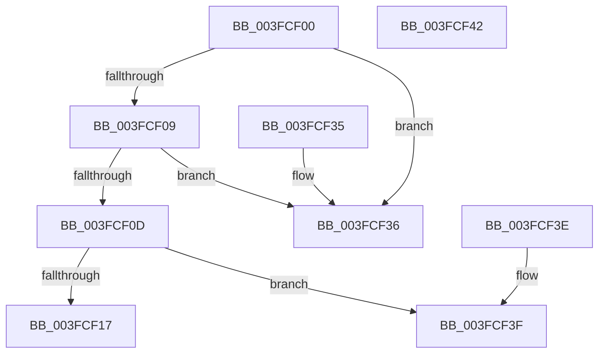

# PsQueryThreadStartAddress

- RVA: `0x003FCF00`–`0x003FCF43` (길이 `67` bytes)
- VA: `0x00000001403FCF00`
- 실행 섹션: `.text`
- PDB 이름 있음: `예`; PDB Function 태그: `아니요`
- unwind 정보 RVA: `0x000DB714`
- 디코드: `21`개 명령, `67/67` bytes 표시
- 미해석 바이트: `0` (있으면 어셈블리에 `.byte`로 보존)

> 이 문서는 커널 이미지의 기계어와 PDB 기호를 분석해 생성했습니다. 4번과 5번은 함수 원형과 자료형을 바이너리 사용 방식에서 추정한 C 해석이며 원본 소스 복구 결과는 아닙니다.

## 1. Dependencies

- 직접 호출 지점: **0**; 고유 호출 대상: **0**
- 직접 호출자로 확인된 함수: **2**
- RIP 상대 이미지 참조: **0**

### Outgoing calls
- 직접 디코드된 call 명령이 없습니다.

### Direct callers
- [sub_00B30C5A](../../page/B3/Unknown_function_00B30C5A.md) at `0x00B30EAF`
- [sub_00C19340](../../init/C1/Unknown_function_00C19340.md) at `0x00C1935F`

### Static image references
- 디코드된 RIP-relative 메모리 참조가 없습니다.

## 2. Other-region calls and transfers

- 다른 실행 섹션으로 향하는 call: **0**
- 별도 외부 분기/꼬리 이동을 확인하지 못했습니다.

## 3. Assembly (complete function range)

```asm
003FCF00  F7 41 74 00 04 00 00            test dword ptr [rcx + 0x74], 0x400
003FCF07  75 2D                           jne 0x1403fcf36
003FCF09  85 D2                           test edx, edx
003FCF0B  74 29                           je 0x1403fcf36
003FCF0D  8B 81 A8 05 00 00               mov eax, dword ptr [rcx + 0x5a8]
003FCF13  A8 08                           test al, 8
003FCF15  75 28                           jne 0x1403fcf3f
003FCF17  48 8B 91 E0 04 00 00            mov rdx, qword ptr [rcx + 0x4e0]
003FCF1E  F0 83 0C 24 00                  lock or dword ptr [rsp], 0
003FCF23  8B 81 A8 05 00 00               mov eax, dword ptr [rcx + 0x5a8]
003FCF29  A8 08                           test al, 8
003FCF2B  B8 00 00 00 00                  mov eax, 0
003FCF30  48 0F 44 C2                     cmove rax, rdx
003FCF34  C3                              ret
003FCF35  CC                              int3
003FCF36  48 8B 81 60 05 00 00            mov rax, qword ptr [rcx + 0x560]
003FCF3D  C3                              ret
003FCF3E  CC                              int3
003FCF3F  33 C0                           xor eax, eax
003FCF41  C3                              ret
003FCF42  CC                              int3
```

## 4. C-style interpretation (structured pseudocode)

```c
__int64 __fastcall PsQueryThreadStartAddress(__int64 a1, int a2)
{
    __int64 result;
    unsigned int v_stack_p0;

    if (((*(unsigned int *)(a1 + 116)) & (0x400ULL)) != 0) goto loc_003FCF36;
    if (a2 == 0) goto loc_003FCF36;
    if ((((unsigned __int8)((unsigned int)(*(unsigned int *)(a1 + 1448)))) & (8)) != 0) goto loc_003FCF3F;
    result = 0;
    if ((((unsigned __int8)((unsigned int)(*(unsigned int *)(a1 + 1448)))) & (8)) == 0) { result = *(unsigned __int64 *)(a1 + 1248); }
    return result;
loc_003FCF36:
    return *(unsigned __int64 *)(a1 + 1376);
loc_003FCF3F:
    result = 0;
    return result;
}
```

## 5. (Beta) C Style

```c
int64_t PsQueryThreadStartAddress(void *Arg1, int32_t Arg2)
{
    uint8_t *arg1 = (uint8_t *)Arg1;

    int64_t result;
    uint32_t v_stack_p0;

    if (((*(uint32_t *)(arg1 + 0x74)) & (0x400ULL)) != 0) goto loc_003FCF36;
    if (Arg2 == 0) goto loc_003FCF36;
    if ((((uint8_t)((uint32_t)(*(uint32_t *)(arg1 + 0x5A8)))) & (8)) != 0) goto loc_003FCF3F;
    result = 0;
    if ((((uint8_t)((uint32_t)(*(uint32_t *)(arg1 + 0x5A8)))) & (8)) == 0) { result = *(uint64_t *)(arg1 + 0x4E0); }
    return result;
loc_003FCF36:
    return *(uint64_t *)(arg1 + 0x560);
loc_003FCF3F:
    result = 0;
    return result;
}
```

### 관측된 메모리 오프셋

구조체 형식이 확인되지 않은 접근은 인자 기준의 오프셋으로만 기록했습니다.

| 기준 인자 | 오프셋 표현 | 폭 (bit) | 접근 |
|---|---:|---:|---|
| `Arg1` | `+ 0x74` | `32` | `R` |
| `Arg1` | `+ 0x4E0` | `64` | `R` |
| `Arg1` | `+ 0x560` | `64` | `R` |
| `Arg1` | `+ 0x5A8` | `32` | `R` |

## 6. Execution-region graph

[열기: 2D/3D 그래프와 함수 탐색 컨트롤 패널](../../../control-panel.html?section=text&rva=0x003FCF00&view=graph)

- 2D 그래프는 위에서 아래로 흐르고, 3D 그래프는 빈 공간을 드래그해 회전합니다. Shift+드래그는 이동, 휠은 확대·축소, 함수 노드 선택은 대상 보고서 이동입니다.

### Static fallback


