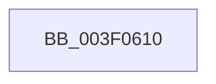

# RtlFindSetBits

- RVA: `0x003F0610`–`0x003F0646` (길이 `54` bytes)
- VA: `0x00000001403F0610`
- 실행 섹션: `.text`
- PDB 이름 있음: `예`; PDB Function 태그: `아니요`
- unwind 정보 RVA: `0x00096BF8`
- 디코드: `17`개 명령, `54/54` bytes 표시
- 미해석 바이트: `0` (있으면 어셈블리에 `.byte`로 보존)

> 이 문서는 커널 이미지의 기계어와 PDB 기호를 분석해 생성했습니다. 4번과 5번은 함수 원형과 자료형을 바이너리 사용 방식에서 추정한 C 해석이며 원본 소스 복구 결과는 아닙니다.

## 1. Dependencies

- 직접 호출 지점: **0**; 고유 호출 대상: **0**
- 직접 호출자로 확인된 함수: **5**
- RIP 상대 이미지 참조: **0**

### Outgoing calls
- 직접 디코드된 call 명령이 없습니다.

### Direct callers
- [SmcStorePlacementGet](../../page/7A/SmcStorePlacementGet_function_007AC400.md) at `0x007AC484`
- [SmcStorePlacementGet](../../page/7A/SmcStorePlacementGet_function_007AC400.md) at `0x007AC4B4`
- [HvpFindFreeCell](../../page/85/HvpFindFreeCell_function_00859920.md) at `0x008599C9`
- [HvpFindFreeCell](../../page/85/HvpFindFreeCell_function_00859920.md) at `0x00859A73`
- [sub_0085A2AA](../../page/85/Unknown_function_0085A2AA.md) at `0x0085A37C`
- [MiHandleDriverNonPagedSections](../../page/A4/MiHandleDriverNonPagedSections_function_00A4AEA8.md) at `0x00A4AF37`
- [EtwQueryPerformanceTraceInformation](../../page/AF/EtwQueryPerformanceTraceInformation_function_00AF28A4.md) at `0x00AF2C5F`

### Static image references
- 디코드된 RIP-relative 메모리 참조가 없습니다.

## 2. Other-region calls and transfers

- 다른 실행 섹션으로 향하는 call: **0**
- call이 아닌 외부 분기/꼬리 이동: **1**
  - `0x003F0640` → [sub_003F09C7](Unknown_function_003F09C7.md) (`tail-transfer`)

## 3. Assembly (complete function range)

```asm
003F0610  40 56                           push rsi
003F0612  41 54                           push r12
003F0614  41 55                           push r13
003F0616  41 56                           push r14
003F0618  48 83 EC 18                     sub rsp, 0x18
003F061C  44 8B 29                        mov r13d, dword ptr [rcx]
003F061F  45 33 DB                        xor r11d, r11d
003F0622  45 3B C5                        cmp r8d, r13d
003F0625  45 8B F3                        mov r14d, r11d
003F0628  45 8B E0                        mov r12d, r8d
003F062B  8B F2                           mov esi, edx
003F062D  45 0F 42 F0                     cmovb r14d, r8d
003F0631  4C 8B 41 08                     mov r8, qword ptr [rcx + 8]
003F0635  4C 89 44 24 40                  mov qword ptr [rsp + 0x40], r8
003F063A  45 8D 4D FF                     lea r9d, [r13 - 1]
003F063E  85 D2                           test edx, edx
003F0640  0F 84 81 03 00 00               je 0x1403f09c7
```

## 4. C-style interpretation (structured pseudocode)

```c
void __fastcall RtlFindSetBits(__int64 a1, int a2, int a3)
{
    __int64 v_r11;
    __int64 v_r14;
    __int64 v_rsp;
    unsigned __int64 v_stack_p8;

    v_rsp = (v_rsp) - (24);
    v_r11 = 0;
    v_r14 = 0;
    if (a3 < ((unsigned int)((unsigned int)(*(unsigned int *)(a1))))) { v_r14 = a3; }
    v_stack_p8 = *(unsigned __int64 *)(a1 + 8);
}
```

## 5. (Beta) C Style

```c
void RtlFindSetBits(void *Arg1, int32_t Arg2, int32_t Arg3)
{
    uint8_t *arg1 = (uint8_t *)Arg1;

    int64_t local_r11;
    int64_t local_r14;
    int64_t local_rsp;
    uint64_t v_stack_p8;

    local_rsp = (local_rsp) - (24);
    local_r11 = 0;
    local_r14 = 0;
    if (Arg3 < ((uint32_t)((uint32_t)(*(uint32_t *)(arg1))))) { local_r14 = Arg3; }
    v_stack_p8 = *(uint64_t *)(arg1 + 0x8);
}
```

### 관측된 메모리 오프셋

구조체 형식이 확인되지 않은 접근은 인자 기준의 오프셋으로만 기록했습니다.

| 기준 인자 | 오프셋 표현 | 폭 (bit) | 접근 |
|---|---:|---:|---|
| `Arg1` | `+ 0x0` | `32` | `R` |
| `Arg1` | `+ 0x8` | `64` | `R` |

## 6. Execution-region graph

[열기: 2D/3D 그래프와 함수 탐색 컨트롤 패널](../../../control-panel.html?section=text&rva=0x003F0610&view=graph)

- 2D 그래프는 위에서 아래로 흐르고, 3D 그래프는 빈 공간을 드래그해 회전합니다. Shift+드래그는 이동, 휠은 확대·축소, 함수 노드 선택은 대상 보고서 이동입니다.

### Static fallback


