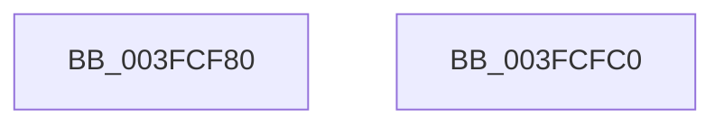

# RtlInitStrongEnumerationHashTable

- RVA: `0x003FCF80`–`0x003FCFC1` (길이 `65` bytes)
- VA: `0x00000001403FCF80`
- 실행 섹션: `.text`
- PDB 이름 있음: `예`; PDB Function 태그: `아니요`
- unwind 정보 RVA: `0x000697A4`
- 디코드: `20`개 명령, `65/65` bytes 표시
- 미해석 바이트: `0` (있으면 어셈블리에 `.byte`로 보존)

> 이 문서는 커널 이미지의 기계어와 PDB 기호를 분석해 생성했습니다. 4번과 5번은 함수 원형과 자료형을 바이너리 사용 방식에서 추정한 C 해석이며 원본 소스 복구 결과는 아닙니다.

## 1. Dependencies

- 직접 호출 지점: **1**; 고유 호출 대상: **1**
- 직접 호출자로 확인된 함수: **0**
- RIP 상대 이미지 참조: **0**

### Outgoing calls
- `0x003FCF99` → [RtlpPopulateContext](RtlpPopulateContext_function_003FCFD0.md) (function, `0x003FCFD0`)

### Direct callers
- 이 함수 시작 RVA로 연결되는 직접 call은 확인되지 않았습니다. 간접 호출은 완전히 역산할 수 없습니다.

### Static image references
- 디코드된 RIP-relative 메모리 참조가 없습니다.

## 2. Other-region calls and transfers

- 다른 실행 섹션으로 향하는 call: **0**
- 별도 외부 분기/꼬리 이동을 확인하지 못했습니다.

## 3. Assembly (complete function range)

```asm
003FCF80  40 53                           push rbx
003FCF82  48 83 EC 40                     sub rsp, 0x40
003FCF86  48 8B DA                        mov rbx, rdx
003FCF89  0F 57 C0                        xorps xmm0, xmm0
003FCF8C  48 8D 54 24 20                  lea rdx, [rsp + 0x20]
003FCF91  45 33 C0                        xor r8d, r8d
003FCF94  0F 11 44 24 20                  movups xmmword ptr [rsp + 0x20], xmm0
003FCF99  E8 32 00 00 00                  call 0x1403fcfd0
003FCF9E  33 D2                           xor edx, edx
003FCFA0  48 89 53 08                     mov qword ptr [rbx + 8], rdx
003FCFA4  48 89 53 10                     mov qword ptr [rbx + 0x10], rdx
003FCFA8  48 89 53 20                     mov qword ptr [rbx + 0x20], rdx
003FCFAC  48 8B 44 24 20                  mov rax, qword ptr [rsp + 0x20]
003FCFB1  48 89 43 18                     mov qword ptr [rbx + 0x18], rax
003FCFB5  48 89 03                        mov qword ptr [rbx], rax
003FCFB8  B0 01                           mov al, 1
003FCFBA  48 83 C4 40                     add rsp, 0x40
003FCFBE  5B                              pop rbx
003FCFBF  C3                              ret
003FCFC0  CC                              int3
```

## 4. C-style interpretation (structured pseudocode)

```c
__int64 __fastcall RtlInitStrongEnumerationHashTable(__int64 a1, __int64 a2, int a3)
{
    __int64 result;
    __int64 v_rsp;
    unsigned __int64 v_stack_m28;

    v_rsp = (v_rsp) - (64);
    a3 = 0;
    v_stack_m28 = v_xmm0;
    result = RtlpPopulateContext(a1, v_stack_m28, a3, a4);
    a2 = 0;
    *(unsigned __int64 *)(a2 + 8) = 0;
    *(unsigned __int64 *)(a2 + 16) = 0;
    *(unsigned __int64 *)(a2 + 32) = 0;
    *(unsigned __int64 *)(a2 + 24) = v_stack_m28;
    *(unsigned __int64 *)(a2) = v_stack_m28;
    v_rsp = (v_rsp) + (64);
    return 1;
}
```

## 5. (Beta) C Style

```c
int64_t RtlInitStrongEnumerationHashTable(int64_t Arg1, void *Arg2, int32_t Arg3)
{
    uint8_t *arg2 = (uint8_t *)Arg2;

    int64_t result;
    int64_t local_rsp;
    uint64_t v_stack_m28;

    local_rsp = (local_rsp) - (64);
    Arg3 = 0;
    v_stack_m28 = v_xmm0;
    result = RtlpPopulateContext(Arg1, v_stack_m28, Arg3, a4);
    Arg2 = 0;
    *(uint64_t *)(arg2 + 0x8) = 0;
    *(uint64_t *)(arg2 + 0x10) = 0;
    *(uint64_t *)(arg2 + 0x20) = 0;
    *(uint64_t *)(arg2 + 0x18) = v_stack_m28;
    *(uint64_t *)(arg2) = v_stack_m28;
    local_rsp = (local_rsp) + (64);
    return 1;
}
```

### 관측된 메모리 오프셋

구조체 형식이 확인되지 않은 접근은 인자 기준의 오프셋으로만 기록했습니다.

| 기준 인자 | 오프셋 표현 | 폭 (bit) | 접근 |
|---|---:|---:|---|
| `Arg2` | `+ 0x0` | `64` | `W` |
| `Arg2` | `+ 0x8` | `64` | `W` |
| `Arg2` | `+ 0x10` | `64` | `W` |
| `Arg2` | `+ 0x18` | `64` | `W` |
| `Arg2` | `+ 0x20` | `64` | `W` |

## 6. Execution-region graph

[열기: 2D/3D 그래프와 함수 탐색 컨트롤 패널](../../../control-panel.html?section=text&rva=0x003FCF80&view=graph)

- 2D 그래프는 위에서 아래로 흐르고, 3D 그래프는 빈 공간을 드래그해 회전합니다. Shift+드래그는 이동, 휠은 확대·축소, 함수 노드 선택은 대상 보고서 이동입니다.

### Static fallback


