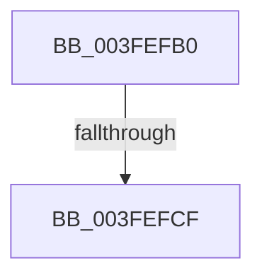

# RtlLookupElementGenericTableAvl

- RVA: `0x003FEFB0`–`0x003FEFD3` (길이 `35` bytes)
- VA: `0x00000001403FEFB0`
- 실행 섹션: `.text`
- PDB 이름 있음: `예`; PDB Function 태그: `아니요`
- unwind 정보 RVA: `0x00099FAC`
- 디코드: `12`개 명령, `35/35` bytes 표시
- 미해석 바이트: `0` (있으면 어셈블리에 `.byte`로 보존)

> 이 문서는 커널 이미지의 기계어와 PDB 기호를 분석해 생성했습니다. 4번과 5번은 함수 원형과 자료형을 바이너리 사용 방식에서 추정한 C 해석이며 원본 소스 복구 결과는 아닙니다.

## 1. Dependencies

- 직접 호출 지점: **0**; 고유 호출 대상: **0**
- 직접 호출자로 확인된 함수: **21**
- RIP 상대 이미지 참조: **0**

### Outgoing calls
- 직접 디코드된 call 명령이 없습니다.

### Direct callers
- [PiDqQueryApplyObjectEvent](../../page/8D/PiDqQueryApplyObjectEvent_function_008DDACC.md) at `0x008DDB38`
- [PiDqQueryApplyObjectEvent](../../page/8D/PiDqQueryApplyObjectEvent_function_008DDACC.md) at `0x008DDD3C`
- [sub_008DFC46](../../page/8D/Unknown_function_008DFC46.md) at `0x008DFC54`
- [sub_008E2AB2](../../page/8E/Unknown_function_008E2AB2.md) at `0x008E2BDB`
- [sub_008E41B3](../../page/8E/Unknown_function_008E41B3.md) at `0x008E4350`
- [sub_008E4A5E](../../page/8E/Unknown_function_008E4A5E.md) at `0x008E4B8B`
- [sub_008E5659](../../page/8E/Unknown_function_008E5659.md) at `0x008E569A`
- [PnpDeviceObjectFromDeviceInstanceWithTag](../../page/8E/PnpDeviceObjectFromDeviceInstanceWithTag_function_008E7490.md) at `0x008E74C0`
- [PiGetRelatedDevice](../../page/8E/PiGetRelatedDevice_function_008E846C.md) at `0x008E84DE`
- [PiPnpRtlObjectEventWorker](../../page/8F/PiPnpRtlObjectEventWorker_function_008F8630.md) at `0x008F8898`
- [PiSwFindBusRelations](../../page/8F/PiSwFindBusRelations_function_008F99A0.md) at `0x008F99CC`
- [PiSwStopDestroy](../../page/8F/PiSwStopDestroy_function_008FCA68.md) at `0x008FCAD6`
- [sub_00951483](../../page/95/Unknown_function_00951483.md) at `0x00951491`
- [PiLookupInDDBCache](../../page/99/PiLookupInDDBCache_function_0099AB78.md) at `0x0099AC30`
- [IopCleanupFileObjectIosbRange](../../page/9E/IopCleanupFileObjectIosbRange_function_009E88A8.md) at `0x009E88F9`
- [SshpCacheLookupBlocker](../../page/A2/SshpCacheLookupBlocker_function_00A2DF1C.md) at `0x00A2DF7D`
- [PiDcHandleDeviceEvent](../../page/A5/PiDcHandleDeviceEvent_function_00A503B8.md) at `0x00A50433`
- [PopPowerRequestTableLookupEntry](../../page/A7/PopPowerRequestTableLookupEntry_function_00A78864.md) at `0x00A78880`
- [PiUpdateDriverDBCache](../../page/A8/PiUpdateDriverDBCache_function_00A895CC.md) at `0x00A89677`
- [PiSwFindSwDevice](../../page/A9/PiSwFindSwDevice_function_00A9CA84.md) at `0x00A9CB33`
- [PopDirectedDripsUmMarkTestDevices](../../page/AC/PopDirectedDripsUmMarkTestDevices_function_00ACF828.md) at `0x00ACF8D1`
- [sub_00B1F154](../../page/B1/Unknown_function_00B1F154.md) at `0x00B1F161`

### Static image references
- 디코드된 RIP-relative 메모리 참조가 없습니다.

## 2. Other-region calls and transfers

- 다른 실행 섹션으로 향하는 call: **0**
- call이 아닌 외부 분기/꼬리 이동: **1**
  - `0x003FEFC9` → [sub_003FF05D + 0x1C](Unknown_function_003FF05D.md) (`tail-transfer`)

## 3. Assembly (complete function range)

```asm
003FEFB0  48 89 5C 24 20                  mov qword ptr [rsp + 0x20], rbx
003FEFB5  55                              push rbp
003FEFB6  56                              push rsi
003FEFB7  57                              push rdi
003FEFB8  48 83 EC 20                     sub rsp, 0x20
003FEFBC  33 F6                           xor esi, esi
003FEFBE  48 8B EA                        mov rbp, rdx
003FEFC1  8B DE                           mov ebx, esi
003FEFC3  48 8B F9                        mov rdi, rcx
003FEFC6  39 59 2C                        cmp dword ptr [rcx + 0x2c], ebx
003FEFC9  0F 84 AA 00 00 00               je 0x1403ff079
003FEFCF  48 8B 59 10                     mov rbx, qword ptr [rcx + 0x10]
```

## 4. C-style interpretation (structured pseudocode)

```c
void __fastcall RtlLookupElementGenericTableAvl(__int64 a1, __int64 a2)
{
    __int64 v_rsi;
    __int64 v_rsp;
    unsigned __int64 v_stack_p20;

    v_stack_p20 = v_rbx;
    v_rsp = (v_rsp) - (32);
    v_rsi = 0;
    return;
}
```

## 5. (Beta) C Style

```c
void RtlLookupElementGenericTableAvl(void *Arg1, int64_t Arg2)
{
    uint8_t *arg1 = (uint8_t *)Arg1;

    int64_t local_rsi;
    int64_t local_rsp;
    uint64_t v_stack_p20;

    v_stack_p20 = local_rbx;
    local_rsp = (local_rsp) - (32);
    local_rsi = 0;
    return;
}
```

### 관측된 메모리 오프셋

구조체 형식이 확인되지 않은 접근은 인자 기준의 오프셋으로만 기록했습니다.

| 기준 인자 | 오프셋 표현 | 폭 (bit) | 접근 |
|---|---:|---:|---|
| `Arg1` | `+ 0x10` | `64` | `R` |
| `Arg1` | `+ 0x2C` | `32` | `R` |

## 6. Execution-region graph

[열기: 2D/3D 그래프와 함수 탐색 컨트롤 패널](../../../control-panel.html?section=text&rva=0x003FEFB0&view=graph)

- 2D 그래프는 위에서 아래로 흐르고, 3D 그래프는 빈 공간을 드래그해 회전합니다. Shift+드래그는 이동, 휠은 확대·축소, 함수 노드 선택은 대상 보고서 이동입니다.

### Static fallback


