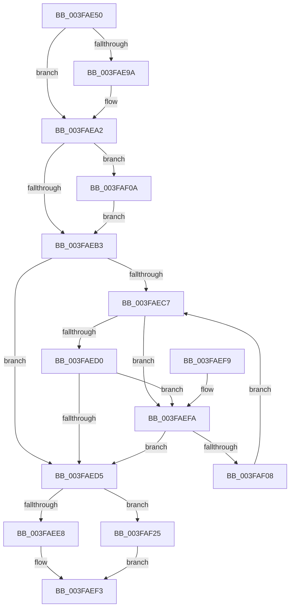

# RtlLookupEntryHashTable

- RVA: `0x003FAE50`–`0x003FAF29` (길이 `217` bytes)
- VA: `0x00000001403FAE50`
- 실행 섹션: `.text`
- PDB 이름 있음: `예`; PDB Function 태그: `아니요`
- unwind 정보 RVA: `0x0007DF94`
- 디코드: `70`개 명령, `217/217` bytes 표시
- 미해석 바이트: `0` (있으면 어셈블리에 `.byte`로 보존)

> 이 문서는 커널 이미지의 기계어와 PDB 기호를 분석해 생성했습니다. 4번과 5번은 함수 원형과 자료형을 바이너리 사용 방식에서 추정한 C 해석이며 원본 소스 복구 결과는 아닙니다.

## 1. Dependencies

- 직접 호출 지점: **0**; 고유 호출 대상: **0**
- 직접 호출자로 확인된 함수: **6**
- RIP 상대 이미지 참조: **0**

### Outgoing calls
- 직접 디코드된 call 명령이 없습니다.

### Direct callers
- [SepRmReferenceFindCap](../3A/SepRmReferenceFindCap_function_003A58EC.md) at `0x003A594B`
- [SepFindMatchingAntiTamperEntry](../60/SepFindMatchingAntiTamperEntry_function_0060ADE4.md) at `0x0060AE2B`
- [SepFindMatchingLuidEntry](../../page/7A/SepFindMatchingLuidEntry_function_007A2814.md) at `0x007A2859`
- [SepFindSharedSidEntry](../../page/7A/SepFindSharedSidEntry_function_007A3148.md) at `0x007A3194`
- [SepFindMatchingCachedHandlesEntry](../../page/9A/SepFindMatchingCachedHandlesEntry_function_009A9698.md) at `0x009A96D0`
- [SepFindMatchingLowBoxNumberEntry](../../page/A7/SepFindMatchingLowBoxNumberEntry_function_00A74544.md) at `0x00A74592`

### Static image references
- 디코드된 RIP-relative 메모리 참조가 없습니다.

## 2. Other-region calls and transfers

- 다른 실행 섹션으로 향하는 call: **0**
- 별도 외부 분기/꼬리 이동을 확인하지 못했습니다.

## 3. Assembly (complete function range)

```asm
003FAE50  40 53                           push rbx
003FAE52  48 83 EC 20                     sub rsp, 0x20
003FAE56  4C 8B D9                        mov r11, rcx
003FAE59  48 8D 1C 24                     lea rbx, [rsp]
003FAE5D  8B 49 04                        mov ecx, dword ptr [rcx + 4]
003FAE60  8B C2                           mov eax, edx
003FAE62  4D 85 C0                        test r8, r8
003FAE65  4C 8B CA                        mov r9, rdx
003FAE68  49 0F 45 D8                     cmovne rbx, r8
003FAE6C  D3 E8                           shr eax, cl
003FAE6E  69 C8 6D 4E C6 41               imul ecx, eax, 0x41c64e6d
003FAE74  69 C0 CD 0D 01 00               imul eax, eax, 0x10dcd
003FAE7A  81 C1 39 30 00 00               add ecx, 0x3039
003FAE80  FF C0                           inc eax
003FAE82  C1 E9 10                        shr ecx, 0x10
003FAE85  25 00 00 FF FF                  and eax, 0xffff0000
003FAE8A  0B C8                           or ecx, eax
003FAE8C  41 8B 43 10                     mov eax, dword ptr [r11 + 0x10]
003FAE90  8B D0                           mov edx, eax
003FAE92  23 D1                           and edx, ecx
003FAE94  41 3B 53 0C                     cmp edx, dword ptr [r11 + 0xc]
003FAE98  73 08                           jae 0x1403faea2
003FAE9A  8D 14 00                        lea edx, [rax + rax]
003FAE9D  83 CA 01                        or edx, 1
003FAEA0  23 D1                           and edx, ecx
003FAEA2  4D 8B 53 20                     mov r10, qword ptr [r11 + 0x20]
003FAEA6  45 33 C0                        xor r8d, r8d
003FAEA9  41 81 7B 08 80 00 00 00         cmp dword ptr [r11 + 8], 0x80
003FAEB1  77 57                           ja 0x1403faf0a
003FAEB3  8B CA                           mov ecx, edx
003FAEB5  48 C1 E1 04                     shl rcx, 4
003FAEB9  49 03 CA                        add rcx, r10
003FAEBC  4C 8B D1                        mov r10, rcx
003FAEBF  48 8B 11                        mov rdx, qword ptr [rcx]
003FAEC2  48 3B D1                        cmp rdx, rcx
003FAEC5  74 0E                           je 0x1403faed5
003FAEC7  48 8B 42 10                     mov rax, qword ptr [rdx + 0x10]
003FAECB  48 85 C0                        test rax, rax
003FAECE  74 2A                           je 0x1403faefa
003FAED0  49 3B C1                        cmp rax, r9
003FAED3  72 25                           jb 0x1403faefa
003FAED5  48 89 0B                        mov qword ptr [rbx], rcx
003FAED8  4C 89 53 08                     mov qword ptr [rbx + 8], r10
003FAEDC  4C 89 4B 10                     mov qword ptr [rbx + 0x10], r9
003FAEE0  49 8B 12                        mov rdx, qword ptr [r10]
003FAEE3  48 3B CA                        cmp rcx, rdx
003FAEE6  74 3D                           je 0x1403faf25
003FAEE8  4C 39 4A 10                     cmp qword ptr [rdx + 0x10], r9
003FAEEC  4C 0F 44 C2                     cmove r8, rdx
003FAEF0  49 8B C0                        mov rax, r8
003FAEF3  48 83 C4 20                     add rsp, 0x20
003FAEF7  5B                              pop rbx
003FAEF8  C3                              ret
003FAEF9  CC                              int3
003FAEFA  48 8B 02                        mov rax, qword ptr [rdx]
003FAEFD  4C 8B D2                        mov r10, rdx
003FAF00  48 8B D0                        mov rdx, rax
003FAF03  48 3B C1                        cmp rax, rcx
003FAF06  74 CD                           je 0x1403faed5
003FAF08  EB BD                           jmp 0x1403faec7
003FAF0A  8D 82 80 00 00 00               lea eax, [rdx + 0x80]
003FAF10  BA 01 00 00 00                  mov edx, 1
003FAF15  0F BD C8                        bsr ecx, eax
003FAF18  D3 E2                           shl edx, cl
003FAF1A  33 D0                           xor edx, eax
003FAF1C  8D 41 F9                        lea eax, [rcx - 7]
003FAF1F  4D 8B 14 C2                     mov r10, qword ptr [r10 + rax*8]
003FAF23  EB 8E                           jmp 0x1403faeb3
003FAF25  33 C0                           xor eax, eax
003FAF27  EB CA                           jmp 0x1403faef3
```

## 4. C-style interpretation (structured pseudocode)

```c
__int64 __fastcall RtlLookupEntryHashTable(__int64 a1, __int64 a2, __int64 a3)
{
    __int64 result;
    __int64 v_rbx;
    __int64 v_rsp;
    unsigned __int64 v_stack_m28;

    v_rsp = (v_rsp) - (32);
    v_rbx = v_stack_m28;
    if (a3 != 0) { v_rbx = a3; }
    result = (unsigned int)(((unsigned int)((unsigned int)(a2))) >> ((unsigned __int8)((unsigned int)(*(unsigned int *)(a1 + 4)))));
    a1 = (unsigned int)(((unsigned int)(*(unsigned int *)(a1 + 4))) * ((unsigned int)(result)));
    result = (unsigned int)((result) * ((unsigned int)(result)));
    a1 = (unsigned int)((a1) + (0x3039ULL));
    result = (unsigned int)((result) + 1);
    a1 = (unsigned int)((a1) >> (16));
    result = (unsigned int)((result) & (0xFFFF0000ULL));
    a1 = (unsigned int)((a1) | ((unsigned int)(result)));
    a2 = (unsigned int)(((unsigned int)((unsigned int)((unsigned int)(*(unsigned int *)(a1 + 16))))) & ((unsigned int)(a1)));
    if (((unsigned int)(a2)) < (*(unsigned int *)(a1 + 12))) {
        a2 = (unsigned int)(*(unsigned int *)(a1 + 16)) + (unsigned int)(*(unsigned int *)(a1 + 16)) * 1;
        a2 = (unsigned int)((a2) | (1));
        a2 = (unsigned int)((a2) & ((unsigned int)(a1)));
    }
    a3 = 0;
    if ((*(unsigned int *)(a1 + 8)) > 128) goto loc_003FAF0A;
loc_003FAEB3:
    a1 = ((unsigned int)((unsigned int)(a2))) << (4);
    a1 = (a1) + (*(unsigned __int64 *)(a1 + 32));
    if ((*(unsigned __int64 *)(a1)) == a1) goto loc_003FAED5;
loc_003FAEC7:
    if (*(unsigned __int64 *)(*(unsigned __int64 *)(a1) + 16) == 0) goto loc_003FAEFA;
    if ((*(unsigned __int64 *)(*(unsigned __int64 *)(a1) + 16)) < a2) goto loc_003FAEFA;
loc_003FAED5:
    *(unsigned __int64 *)(v_rbx) = a1;
    *(unsigned __int64 *)(v_rbx + 8) = a1;
    *(unsigned __int64 *)(v_rbx + 16) = a2;
    if (a1 == (*(unsigned __int64 *)(a1))) goto loc_003FAF25;
    if ((*(unsigned __int64 *)(*(unsigned __int64 *)(a1) + 16)) == a2) { a3 = *(unsigned __int64 *)(a1); }
loc_003FAEF3:
    v_rsp = (v_rsp) + (32);
    return a3;
loc_003FAEFA:
    if ((*(unsigned __int64 *)(*(unsigned __int64 *)(a1))) == a1) goto loc_003FAED5;
    goto loc_003FAEC7;
loc_003FAF0A:
    a2 = (unsigned int)((1) << ((unsigned __int8)(a1)));
    a2 = (unsigned int)((a2) ^ ((unsigned int)(*(unsigned __int64 *)(*(unsigned __int64 *)(a1)) + 128)));
    goto loc_003FAEB3;
loc_003FAF25:
    result = 0;
    goto loc_003FAEF3;
}
```

## 5. (Beta) C Style

```c
int64_t RtlLookupEntryHashTable(void *Arg1, int64_t Arg2, int64_t Arg3)
{
    uint8_t *arg1 = (uint8_t *)Arg1;

    int64_t result;
    int64_t local_rbx;
    int64_t local_rsp;
    uint64_t v_stack_m28;

    local_rsp = (local_rsp) - (32);
    local_rbx = v_stack_m28;
    if (Arg3 != 0) { local_rbx = Arg3; }
    result = (uint32_t)(((uint32_t)((uint32_t)(Arg2))) >> ((uint8_t)((uint32_t)(*(uint32_t *)(arg1 + 0x4)))));
    Arg1 = (uint32_t)(((uint32_t)(*(uint32_t *)(arg1 + 0x4))) * ((uint32_t)(result)));
    result = (uint32_t)((result) * ((uint32_t)(result)));
    Arg1 = (uint32_t)((Arg1) + (0x3039ULL));
    result = (uint32_t)((result) + 1);
    Arg1 = (uint32_t)((Arg1) >> (16));
    result = (uint32_t)((result) & (0xFFFF0000ULL));
    Arg1 = (uint32_t)((Arg1) | ((uint32_t)(result)));
    Arg2 = (uint32_t)(((uint32_t)((uint32_t)((uint32_t)(*(uint32_t *)(arg1 + 0x10))))) & ((uint32_t)(Arg1)));
    if (((uint32_t)(Arg2)) < (*(uint32_t *)(arg1 + 0xC))) {
        Arg2 = (uint32_t)(*(uint32_t *)(arg1 + 0x10)) + (uint32_t)(*(uint32_t *)(arg1 + 0x10)) * 1;
        Arg2 = (uint32_t)((Arg2) | (1));
        Arg2 = (uint32_t)((Arg2) & ((uint32_t)(Arg1)));
    }
    Arg3 = 0;
    if ((*(uint32_t *)(arg1 + 0x8)) > 128) goto loc_003FAF0A;
loc_003FAEB3:
    Arg1 = ((uint32_t)((uint32_t)(Arg2))) << (4);
    Arg1 = (Arg1) + (*(uint64_t *)(arg1 + 0x20));
    if ((*(uint64_t *)(arg1)) == Arg1) goto loc_003FAED5;
loc_003FAEC7:
    if (*(uint64_t *)(*(uint64_t *)(arg1) + 0x10) == 0) goto loc_003FAEFA;
    if ((*(uint64_t *)(*(uint64_t *)(arg1) + 0x10)) < Arg2) goto loc_003FAEFA;
loc_003FAED5:
    *(void **)(local_rbx) = Arg1;
    *(void **)(local_rbx + 0x8) = Arg1;
    *(uint64_t *)(local_rbx + 0x10) = Arg2;
    if (Arg1 == (*(uint64_t *)(arg1))) goto loc_003FAF25;
    if ((*(uint64_t *)(*(uint64_t *)(arg1) + 0x10)) == Arg2) { Arg3 = *(uint64_t *)(arg1); }
loc_003FAEF3:
    local_rsp = (local_rsp) + (32);
    return Arg3;
loc_003FAEFA:
    if ((*(uint64_t *)(*(uint64_t *)(arg1))) == Arg1) goto loc_003FAED5;
    goto loc_003FAEC7;
loc_003FAF0A:
    Arg2 = (uint32_t)((1) << ((uint8_t)(Arg1)));
    Arg2 = (uint32_t)((Arg2) ^ ((uint32_t)(*(uint64_t *)(*(uint64_t *)(arg1)) + 128)));
    goto loc_003FAEB3;
loc_003FAF25:
    result = 0;
    goto loc_003FAEF3;
}
```

### 관측된 메모리 오프셋

구조체 형식이 확인되지 않은 접근은 인자 기준의 오프셋으로만 기록했습니다.

| 기준 인자 | 오프셋 표현 | 폭 (bit) | 접근 |
|---|---:|---:|---|
| `Arg1` | `+ 0x4` | `32` | `R` |
| `Arg1` | `+ 0x8` | `32` | `R` |
| `Arg1` | `+ 0xC` | `32` | `R` |
| `Arg1` | `+ 0x10` | `32` | `R` |
| `Arg1` | `+ 0x20` | `64` | `R` |

## 6. Execution-region graph

[열기: 2D/3D 그래프와 함수 탐색 컨트롤 패널](../../../control-panel.html?section=text&rva=0x003FAE50&view=graph)

- 2D 그래프는 위에서 아래로 흐르고, 3D 그래프는 빈 공간을 드래그해 회전합니다. Shift+드래그는 이동, 휠은 확대·축소, 함수 노드 선택은 대상 보고서 이동입니다.

### Static fallback


