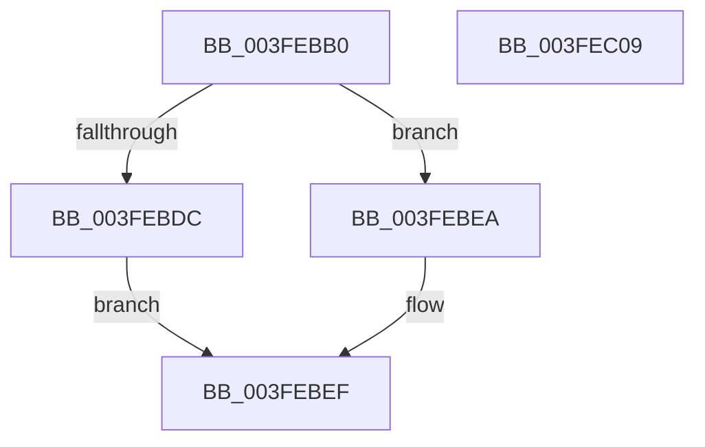

# RtlPcToFileName

- RVA: `0x003FEBB0`–`0x003FEC0A` (길이 `90` bytes)
- VA: `0x00000001403FEBB0`
- 실행 섹션: `.text`
- PDB 이름 있음: `예`; PDB Function 태그: `아니요`
- unwind 정보 RVA: `0x00060BC4`
- 디코드: `27`개 명령, `90/90` bytes 표시
- 미해석 바이트: `0` (있으면 어셈블리에 `.byte`로 보존)

> 이 문서는 커널 이미지의 기계어와 PDB 기호를 분석해 생성했습니다. 4번과 5번은 함수 원형과 자료형을 바이너리 사용 방식에서 추정한 C 해석이며 원본 소스 복구 결과는 아닙니다.

## 1. Dependencies

- 직접 호출 지점: **4**; 고유 호출 대상: **4**
- 직접 호출자로 확인된 함수: **4**
- RIP 상대 이미지 참조: **0**

### Outgoing calls
- `0x003FEBC5` → [MmLockLoadedModuleListShared](../2F/MmLockLoadedModuleListShared_function_002F21E4.md) (function, `0x002F21E4`)
- `0x003FEBD0` → [MmFindDataTableEntryByAddress](../2A/MmFindDataTableEntryByAddress_function_002A3C0C.md) (function, `0x002A3C0C`)
- `0x003FEBE3` → [RtlCopyUnicodeString](RtlCopyUnicodeString_function_003FEF30.md) (function, `0x003FEF30`)
- `0x003FEBF2` → [MmUnlockLoadedModuleListShared](../2F/MmUnlockLoadedModuleListShared_function_002F2230.md) (function, `0x002F2230`)

### Direct callers
- [KiLogSingleDpcSoftTimeoutEvent](../5B/KiLogSingleDpcSoftTimeoutEvent_function_005B5D50.md) at `0x005B5DB7`
- [EtwTimLogControlProtectionKernelModeReturnMismatch](../65/EtwTimLogControlProtectionKernelModeReturnMismatch_function_00651E84.md) at `0x00651F2E`
- [EtwTimLogControlProtectionKernelModeReturnMismatch](../65/EtwTimLogControlProtectionKernelModeReturnMismatch_function_00651E84.md) at `0x00651FD1`
- [KitLogFeatureUsage](../65/KitLogFeatureUsage_function_0065C030.md) at `0x0065C0F0`
- [PoRegisterPowerSettingCallback](../../page/A8/PoRegisterPowerSettingCallback_function_00A82150.md) at `0x00A82224`

### Static image references
- 디코드된 RIP-relative 메모리 참조가 없습니다.

## 2. Other-region calls and transfers

- 다른 실행 섹션으로 향하는 call: **0**
- 별도 외부 분기/꼬리 이동을 확인하지 못했습니다.

## 3. Assembly (complete function range)

```asm
003FEBB0  48 89 5C 24 08                  mov qword ptr [rsp + 8], rbx
003FEBB5  48 89 74 24 10                  mov qword ptr [rsp + 0x10], rsi
003FEBBA  57                              push rdi
003FEBBB  48 83 EC 20                     sub rsp, 0x20
003FEBBF  48 8B F2                        mov rsi, rdx
003FEBC2  48 8B D9                        mov rbx, rcx
003FEBC5  E8 1A 36 EF FF                  call 0x1402f21e4
003FEBCA  48 8B CB                        mov rcx, rbx
003FEBCD  40 8A F8                        mov dil, al
003FEBD0  E8 37 50 EA FF                  call 0x1402a3c0c
003FEBD5  33 DB                           xor ebx, ebx
003FEBD7  48 85 C0                        test rax, rax
003FEBDA  74 0E                           je 0x1403febea
003FEBDC  48 8D 50 58                     lea rdx, [rax + 0x58]
003FEBE0  48 8B CE                        mov rcx, rsi
003FEBE3  E8 48 03 00 00                  call 0x1403fef30
003FEBE8  EB 05                           jmp 0x1403febef
003FEBEA  BB 25 02 00 C0                  mov ebx, 0xc0000225
003FEBEF  40 8A CF                        mov cl, dil
003FEBF2  E8 39 36 EF FF                  call 0x1402f2230
003FEBF7  48 8B 74 24 38                  mov rsi, qword ptr [rsp + 0x38]
003FEBFC  8B C3                           mov eax, ebx
003FEBFE  48 8B 5C 24 30                  mov rbx, qword ptr [rsp + 0x30]
003FEC03  48 83 C4 20                     add rsp, 0x20
003FEC07  5F                              pop rdi
003FEC08  C3                              ret
003FEC09  CC                              int3
```

## 4. C-style interpretation (structured pseudocode)

```c
__int64 __fastcall RtlPcToFileName(__int64 a1, __int64 a2)
{
    __int64 result;
    __int64 v_rbx;
    __int64 v_rsp;
    unsigned __int64 v_stack_p10;
    unsigned __int64 v_stack_p8;

    v_stack_p8 = v_rbx;
    v_stack_p10 = v_rsi;
    v_rsp = (v_rsp) - (32);
    result = MmLockLoadedModuleListShared(a1, a2, a3, a4);
    result = MmFindDataTableEntryByAddress(a1, a2, a3, a4);
    v_rbx = 0;
    if (result == 0) goto loc_003FEBEA;
    result = RtlCopyUnicodeString(a2, result + 88, a3, a4);
    goto loc_003FEBEF;
loc_003FEBEA:
loc_003FEBEF:
    result = MmUnlockLoadedModuleListShared((unsigned __int8)((unsigned __int8)(result)), result + 88, a3, a4);
    v_rsp = (v_rsp) + (32);
    return (unsigned int)((unsigned int)((unsigned int)(0xC0000225ULL)));
}
```

## 5. (Beta) C Style

```c
int64_t RtlPcToFileName(int64_t Arg1, int64_t Arg2)
{
    int64_t result;
    int64_t local_rbx;
    int64_t local_rsp;
    uint64_t v_stack_p10;
    uint64_t v_stack_p8;

    v_stack_p8 = local_rbx;
    v_stack_p10 = local_rsi;
    local_rsp = (local_rsp) - (32);
    result = MmLockLoadedModuleListShared(Arg1, Arg2, a3, a4);
    result = MmFindDataTableEntryByAddress(Arg1, Arg2, a3, a4);
    local_rbx = 0;
    if (result == 0) goto loc_003FEBEA;
    result = RtlCopyUnicodeString(Arg2, result + 88, a3, a4);
    goto loc_003FEBEF;
loc_003FEBEA:
loc_003FEBEF:
    result = MmUnlockLoadedModuleListShared((uint8_t)((uint8_t)(result)), result + 88, a3, a4);
    local_rsp = (local_rsp) + (32);
    return (uint32_t)((uint32_t)((uint32_t)(0xC0000225ULL)));
}
```

## 6. Execution-region graph

[열기: 2D/3D 그래프와 함수 탐색 컨트롤 패널](../../../control-panel.html?section=text&rva=0x003FEBB0&view=graph)

- 2D 그래프는 위에서 아래로 흐르고, 3D 그래프는 빈 공간을 드래그해 회전합니다. Shift+드래그는 이동, 휠은 확대·축소, 함수 노드 선택은 대상 보고서 이동입니다.

### Static fallback


