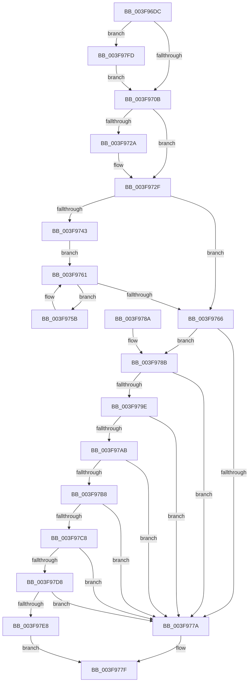

# RtlScrubMemory

- RVA: `0x003F96DC`–`0x003F980F` (길이 `307` bytes)
- VA: `0x00000001403F96DC`
- 실행 섹션: `.text`
- PDB 이름 있음: `예`; PDB Function 태그: `아니요`
- unwind 정보 RVA: `0x00098410`
- 디코드: `96`개 명령, `307/307` bytes 표시
- 미해석 바이트: `0` (있으면 어셈블리에 `.byte`로 보존)

> 이 문서는 커널 이미지의 기계어와 PDB 기호를 분석해 생성했습니다. 4번과 5번은 함수 원형과 자료형을 바이너리 사용 방식에서 추정한 C 해석이며 원본 소스 복구 결과는 아닙니다.

## 1. Dependencies

- 직접 호출 지점: **8**; 고유 호출 대상: **5**
- 직접 호출자로 확인된 함수: **1**
- RIP 상대 이미지 참조: **0**

### Outgoing calls
- `0x003F9770` → [RtlCompareMemoryUlong](../6B/RtlCompareMemoryUlong_function_006BA6F0.md) (function, `0x006BA6F0`)
- `0x003F9795` → [RtlpGenericMATSPlusWorker](RtlpGenericMATSPlusWorker_function_003F9818.md) (function, `0x003F9818`)
- `0x003F97A2` → [RtlpGenericMATSPlusWorker](RtlpGenericMATSPlusWorker_function_003F9818.md) (function, `0x003F9818`)
- `0x003F97AF` → [RtlpGenericInverseCouplingWorker](RtlpGenericInverseCouplingWorker_function_003F9928.md) (function, `0x003F9928`)
- `0x003F97BF` → [RtlpGenericInverseCouplingWorker](RtlpGenericInverseCouplingWorker_function_003F9928.md) (function, `0x003F9928`)
- `0x003F97CF` → [RtlpGenericStrideWorker](RtlpGenericStrideWorker_function_003F9C48.md) (function, `0x003F9C48`)
- `0x003F97DF` → [RtlpGenericStrideWorker](RtlpGenericStrideWorker_function_003F9C48.md) (function, `0x003F9C48`)
- `0x003F97EB` → [RtlpGenericRandomPatternWorker](RtlpGenericRandomPatternWorker_function_003F9ED0.md) (function, `0x003F9ED0`)

### Direct callers
- [MiScrubPage](MiScrubPage_function_003F954C.md) at `0x003F9681`

### Static image references
- 디코드된 RIP-relative 메모리 참조가 없습니다.

## 2. Other-region calls and transfers

- 다른 실행 섹션으로 향하는 call: **0**
- 별도 외부 분기/꼬리 이동을 확인하지 못했습니다.

## 3. Assembly (complete function range)

```asm
003F96DC  48 89 5C 24 08                  mov qword ptr [rsp + 8], rbx
003F96E1  57                              push rdi
003F96E2  48 83 EC 30                     sub rsp, 0x30
003F96E6  48 8B D9                        mov rbx, rcx
003F96E9  0F 31                           rdtsc
003F96EB  48 C1 E2 20                     shl rdx, 0x20
003F96EF  4C 8B D1                        mov r10, rcx
003F96F2  48 0B C2                        or rax, rdx
003F96F5  41 B9 00 04 00 00               mov r9d, 0x400
003F96FB  4C 8B C0                        mov r8, rax
003F96FE  49 C1 E8 04                     shr r8, 4
003F9702  F6 C1 04                        test cl, 4
003F9705  0F 85 F2 00 00 00               jne 0x1403f97fd
003F970B  41 8B C0                        mov eax, r8d
003F970E  49 8B C9                        mov rcx, r9
003F9711  48 C1 E0 20                     shl rax, 0x20
003F9715  49 8B FA                        mov rdi, r10
003F9718  48 D1 E9                        shr rcx, 1
003F971B  41 8B D0                        mov edx, r8d
003F971E  48 0B C2                        or rax, rdx
003F9721  F3 48 AB                        rep stosq qword ptr [rdi], rax
003F9724  41 F6 C1 01                     test r9b, 1
003F9728  74 05                           je 0x1403f972f
003F972A  47 89 44 8A FC                  mov dword ptr [r10 + r9*4 - 4], r8d
003F972F  65 48 8B 04 25 20 00 00 00      mov rax, qword ptr gs:[0x20]
003F9738  8B 90 E8 00 00 00               mov edx, dword ptr [rax + 0xe8]
003F973E  48 85 D2                        test rdx, rdx
003F9741  74 23                           je 0x1403f9766
003F9743  F0 83 0C 24 00                  lock or dword ptr [rsp], 0
003F9748  48 8D 4A FF                     lea rcx, [rdx - 1]
003F974C  48 F7 D1                        not rcx
003F974F  48 8D BB 00 10 00 00            lea rdi, [rbx + 0x1000]
003F9756  48 23 CB                        and rcx, rbx
003F9759  EB 06                           jmp 0x1403f9761
003F975B  0F AE 39                        clflush byte ptr [rcx]
003F975E  48 03 CA                        add rcx, rdx
003F9761  48 3B CF                        cmp rcx, rdi
003F9764  72 F5                           jb 0x1403f975b
003F9766  BF 00 10 00 00                  mov edi, 0x1000
003F976B  48 8B CB                        mov rcx, rbx
003F976E  8B D7                           mov edx, edi
003F9770  E8 7B 0F 2C 00                  call 0x1406ba6f0
003F9775  48 3B C7                        cmp rax, rdi
003F9778  74 11                           je 0x1403f978b
003F977A  B8 09 07 00 C0                  mov eax, 0xc0000709
003F977F  48 8B 5C 24 40                  mov rbx, qword ptr [rsp + 0x40]
003F9784  48 83 C4 30                     add rsp, 0x30
003F9788  5F                              pop rdi
003F9789  C3                              ret
003F978A  CC                              int3
003F978B  83 CF FF                        or edi, 0xffffffff
003F978E  4C 8B C3                        mov r8, rbx
003F9791  8B D7                           mov edx, edi
003F9793  33 C9                           xor ecx, ecx
003F9795  E8 7E 00 00 00                  call 0x1403f9818
003F979A  84 C0                           test al, al
003F979C  74 DC                           je 0x1403f977a
003F979E  33 D2                           xor edx, edx
003F97A0  8B CF                           mov ecx, edi
003F97A2  E8 71 00 00 00                  call 0x1403f9818
003F97A7  84 C0                           test al, al
003F97A9  74 CF                           je 0x1403f977a
003F97AB  8B D7                           mov edx, edi
003F97AD  33 C9                           xor ecx, ecx
003F97AF  E8 74 01 00 00                  call 0x1403f9928
003F97B4  84 C0                           test al, al
003F97B6  74 C2                           je 0x1403f977a
003F97B8  4C 8B C3                        mov r8, rbx
003F97BB  33 D2                           xor edx, edx
003F97BD  8B CF                           mov ecx, edi
003F97BF  E8 64 01 00 00                  call 0x1403f9928
003F97C4  84 C0                           test al, al
003F97C6  74 B2                           je 0x1403f977a
003F97C8  4C 8B CB                        mov r9, rbx
003F97CB  8B D7                           mov edx, edi
003F97CD  33 C9                           xor ecx, ecx
003F97CF  E8 74 04 00 00                  call 0x1403f9c48
003F97D4  84 C0                           test al, al
003F97D6  74 A2                           je 0x1403f977a
003F97D8  4C 8B CB                        mov r9, rbx
003F97DB  33 D2                           xor edx, edx
003F97DD  8B CF                           mov ecx, edi
003F97DF  E8 64 04 00 00                  call 0x1403f9c48
003F97E4  84 C0                           test al, al
003F97E6  74 92                           je 0x1403f977a
003F97E8  48 8B CB                        mov rcx, rbx
003F97EB  E8 E0 06 00 00                  call 0x1403f9ed0
003F97F0  F6 D8                           neg al
003F97F2  1B C0                           sbb eax, eax
003F97F4  F7 D0                           not eax
003F97F6  25 09 07 00 C0                  and eax, 0xc0000709
003F97FB  EB 82                           jmp 0x1403f977f
003F97FD  44 89 01                        mov dword ptr [rcx], r8d
003F9800  4C 8D 51 04                     lea r10, [rcx + 4]
003F9804  41 B9 FF 03 00 00               mov r9d, 0x3ff
003F980A  E9 FC FE FF FF                  jmp 0x1403f970b
```

## 4. C-style interpretation (structured pseudocode)

```c
__int64 __fastcall RtlScrubMemory(__int64 a1, __int64 a2)
{
    __int64 result;
    __int64 v_rdi;
    __int64 v_rsp;
    unsigned int v_stack_m38;
    unsigned __int64 v_stack_p8;

    v_stack_p8 = v_rbx;
    v_rsp = (v_rsp) - (48);
    a2 = (a2) << (32);
    result = (result) | (a2);
    a3 = (result) >> (4);
    if ((((unsigned __int8)(a1)) & (4)) != 0) goto loc_003F97FD;
loc_003F970B:
    result = ((unsigned int)((unsigned int)(a3))) << (32);
    a1 = ((unsigned int)(0x400ULL)) >> (1);
    result = (result) | ((unsigned int)((unsigned int)(a3)));
    if ((((unsigned __int8)((unsigned int)(0x400ULL))) & (1)) != 0) {
        *(unsigned int *)(a1 + (unsigned int)(0x400ULL) * 4 - 4) = (unsigned int)(a3);
    }
    if ((unsigned int)(*(unsigned int *)(*(unsigned __int64 *)(gs_base + (0 + 32)) + 232)) == 0) goto loc_003F9766;
    a1 = ~((unsigned int)(*(unsigned int *)(*(unsigned __int64 *)(gs_base + (0 + 32)) + 232)) - 1);
    a1 = (a1) & (a1);
    goto loc_003F9761;
loc_003F975B:
    a1 = (a1) + ((unsigned int)(*(unsigned int *)(*(unsigned __int64 *)(gs_base + (0 + 32)) + 232)));
loc_003F9761:
    if (a1 < (a1 + 4096)) goto loc_003F975B;
loc_003F9766:
    result = RtlCompareMemoryUlong(a1, (unsigned int)((unsigned int)((unsigned int)(0x1000ULL))), a3, (unsigned int)(0x400ULL));
    if (result == ((unsigned int)(0x1000ULL))) goto loc_003F978B;
loc_003F977A:
loc_003F977F:
    v_rsp = (v_rsp) + (48);
    return (unsigned int)(0xC0000709ULL);
loc_003F978B:
    v_rdi = (unsigned int)(((unsigned int)(0x1000ULL)) | (0xFFFFFFFFULL));
    a1 = 0;
    result = RtlpGenericMATSPlusWorker(a1, (unsigned int)((unsigned int)(v_rdi)), v_stack_p8, (unsigned int)(0x400ULL));
    if ((unsigned __int8)(result) == 0) goto loc_003F977A;
    a2 = 0;
    result = RtlpGenericMATSPlusWorker((unsigned int)((unsigned int)(v_rdi)), a2, v_stack_p8, (unsigned int)(0x400ULL));
    if ((unsigned __int8)(result) == 0) goto loc_003F977A;
    a1 = 0;
    result = RtlpGenericInverseCouplingWorker(a1, (unsigned int)((unsigned int)(v_rdi)), v_stack_p8, (unsigned int)(0x400ULL));
    if ((unsigned __int8)(result) == 0) goto loc_003F977A;
    a2 = 0;
    result = RtlpGenericInverseCouplingWorker((unsigned int)((unsigned int)(v_rdi)), a2, v_stack_p8, (unsigned int)(0x400ULL));
    if ((unsigned __int8)(result) == 0) goto loc_003F977A;
    a1 = 0;
    result = RtlpGenericStrideWorker(a1, (unsigned int)((unsigned int)(v_rdi)), v_stack_p8, v_stack_p8);
    if ((unsigned __int8)(result) == 0) goto loc_003F977A;
    a2 = 0;
    result = RtlpGenericStrideWorker((unsigned int)((unsigned int)(v_rdi)), a2, v_stack_p8, v_stack_p8);
    if ((unsigned __int8)(result) == 0) goto loc_003F977A;
    result = RtlpGenericRandomPatternWorker(v_stack_p8, a2, v_stack_p8, v_stack_p8);
    result = (unsigned __int8)(-(result));
    result = (unsigned int)(~(result));
    result = (unsigned int)((result) & (0xC0000709ULL));
    goto loc_003F977F;
loc_003F97FD:
    *(unsigned int *)(v_stack_p8) = (unsigned int)(v_stack_p8);
    goto loc_003F970B;
}
```

## 5. (Beta) C Style

```c
int64_t RtlScrubMemory(void *Arg1, int64_t Arg2)
{
    uint8_t *arg1 = (uint8_t *)Arg1;

    int64_t result;
    int64_t local_rdi;
    int64_t local_rsp;
    uint32_t v_stack_m38;
    uint64_t v_stack_p8;

    v_stack_p8 = local_rbx;
    local_rsp = (local_rsp) - (48);
    Arg2 = (Arg2) << (32);
    result = (result) | (Arg2);
    a3 = (result) >> (4);
    if ((((uint8_t)(Arg1)) & (4)) != 0) goto loc_003F97FD;
loc_003F970B:
    result = ((uint32_t)((uint32_t)(a3))) << (32);
    Arg1 = ((uint32_t)(0x400ULL)) >> (1);
    result = (result) | ((uint32_t)((uint32_t)(a3)));
    if ((((uint8_t)((uint32_t)(0x400ULL))) & (1)) != 0) {
        *(uint32_t *)(arg1 + (uint32_t)(0x400ULL) * 4 - 0x4) = (uint32_t)(a3);
    }
    if ((uint32_t)(*(uint32_t *)(*(uint64_t *)(gs_base + (0 + 0x20)) + 0xE8)) == 0) goto loc_003F9766;
    Arg1 = ~((uint32_t)(*(uint32_t *)(*(uint64_t *)(gs_base + (0 + 0x20)) + 0xE8)) - 1);
    Arg1 = (Arg1) & (Arg1);
    goto loc_003F9761;
loc_003F975B:
    Arg1 = (Arg1) + ((uint32_t)(*(uint32_t *)(*(uint64_t *)(gs_base + (0 + 0x20)) + 0xE8)));
loc_003F9761:
    if (Arg1 < (Arg1 + 4096)) goto loc_003F975B;
loc_003F9766:
    result = RtlCompareMemoryUlong(Arg1, (uint32_t)((uint32_t)((uint32_t)(0x1000ULL))), a3, (uint32_t)(0x400ULL));
    if (result == ((uint32_t)(0x1000ULL))) goto loc_003F978B;
loc_003F977A:
loc_003F977F:
    local_rsp = (local_rsp) + (48);
    return (uint32_t)(0xC0000709ULL);
loc_003F978B:
    local_rdi = (uint32_t)(((uint32_t)(0x1000ULL)) | (0xFFFFFFFFULL));
    Arg1 = 0;
    result = RtlpGenericMATSPlusWorker(Arg1, (uint32_t)((uint32_t)(local_rdi)), v_stack_p8, (uint32_t)(0x400ULL));
    if ((uint8_t)(result) == 0) goto loc_003F977A;
    Arg2 = 0;
    result = RtlpGenericMATSPlusWorker((uint32_t)((uint32_t)(local_rdi)), Arg2, v_stack_p8, (uint32_t)(0x400ULL));
    if ((uint8_t)(result) == 0) goto loc_003F977A;
    Arg1 = 0;
    result = RtlpGenericInverseCouplingWorker(Arg1, (uint32_t)((uint32_t)(local_rdi)), v_stack_p8, (uint32_t)(0x400ULL));
    if ((uint8_t)(result) == 0) goto loc_003F977A;
    Arg2 = 0;
    result = RtlpGenericInverseCouplingWorker((uint32_t)((uint32_t)(local_rdi)), Arg2, v_stack_p8, (uint32_t)(0x400ULL));
    if ((uint8_t)(result) == 0) goto loc_003F977A;
    Arg1 = 0;
    result = RtlpGenericStrideWorker(Arg1, (uint32_t)((uint32_t)(local_rdi)), v_stack_p8, v_stack_p8);
    if ((uint8_t)(result) == 0) goto loc_003F977A;
    Arg2 = 0;
    result = RtlpGenericStrideWorker((uint32_t)((uint32_t)(local_rdi)), Arg2, v_stack_p8, v_stack_p8);
    if ((uint8_t)(result) == 0) goto loc_003F977A;
    result = RtlpGenericRandomPatternWorker(v_stack_p8, Arg2, v_stack_p8, v_stack_p8);
    result = (uint8_t)(-(result));
    result = (uint32_t)(~(result));
    result = (uint32_t)((result) & (0xC0000709ULL));
    goto loc_003F977F;
loc_003F97FD:
    *(uint32_t *)(v_stack_p8) = (uint32_t)(v_stack_p8);
    goto loc_003F970B;
}
```

### 관측된 메모리 오프셋

구조체 형식이 확인되지 않은 접근은 인자 기준의 오프셋으로만 기록했습니다.

| 기준 인자 | 오프셋 표현 | 폭 (bit) | 접근 |
|---|---:|---:|---|
| `Arg1` | `+ 0x1000` | `64` | `R` |

## 6. Execution-region graph

[열기: 2D/3D 그래프와 함수 탐색 컨트롤 패널](../../../control-panel.html?section=text&rva=0x003F96DC&view=graph)

- 2D 그래프는 위에서 아래로 흐르고, 3D 그래프는 빈 공간을 드래그해 회전합니다. Shift+드래그는 이동, 휠은 확대·축소, 함수 노드 선택은 대상 보고서 이동입니다.

### Static fallback


