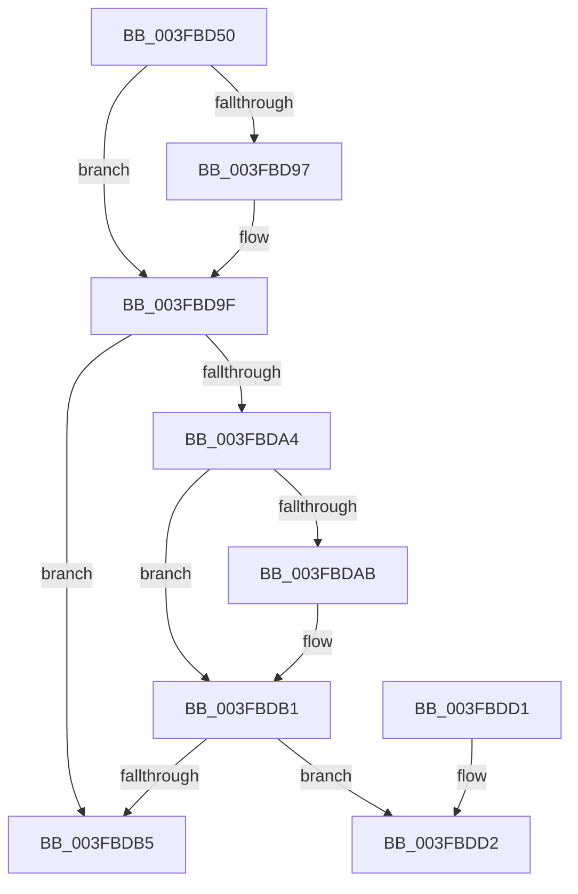

# RtlSidDominates

- RVA: `0x003FBD50`–`0x003FBDD9` (길이 `137` bytes)
- VA: `0x00000001403FBD50`
- 실행 섹션: `.text`
- PDB 이름 있음: `예`; PDB Function 태그: `아니요`
- unwind 정보 RVA: `0x000997D0`
- 디코드: `41`개 명령, `137/137` bytes 표시
- 미해석 바이트: `0` (있으면 어셈블리에 `.byte`로 보존)

> 이 문서는 커널 이미지의 기계어와 PDB 기호를 분석해 생성했습니다. 4번과 5번은 함수 원형과 자료형을 바이너리 사용 방식에서 추정한 C 해석이며 원본 소스 복구 결과는 아닙니다.

## 1. Dependencies

- 직접 호출 지점: **1**; 고유 호출 대상: **1**
- 직접 호출자로 확인된 함수: **7**
- RIP 상대 이미지 참조: **1**

### Outgoing calls
- `0x003FBDC2` → [_security_check_cookie](../6A/_security_check_cookie_function_006AC640.md) (function, `0x006AC640`)

### Direct callers
- [SepMandatorySubProcessToken](../4C/SepMandatorySubProcessToken_function_004C0B88.md) at `0x004C0D25`
- [sub_008BBC01](../../page/8B/Unknown_function_008BBC01.md) at `0x008BBD5F`
- [sub_008BC3C4](../../page/8B/Unknown_function_008BC3C4.md) at `0x008BC440`
- [sub_008CC5C2](../../page/8C/Unknown_function_008CC5C2.md) at `0x008CC600`
- [RtlpNewSecurityObject](../../page/92/RtlpNewSecurityObject_function_0092AB50.md) at `0x0092BB83`
- [SepAdjustPrivileges](../../page/9C/SepAdjustPrivileges_function_009C8DFC.md) at `0x009C8EEB`
- [SepAdjustPrivileges](../../page/9C/SepAdjustPrivileges_function_009C8DFC.md) at `0x009C8F17`
- [SeIsTokenAssignableToProcess](../../page/A3/SeIsTokenAssignableToProcess_function_00A3B2C0.md) at `0x00A3B3D7`

### Static image references
- `0x003FBD5A` → RVA `0x00E0A740` (`.data`; read)

## 2. Other-region calls and transfers

- 다른 실행 섹션으로 향하는 call: **0**
- 별도 외부 분기/꼬리 이동을 확인하지 못했습니다.

## 3. Assembly (complete function range)

```asm
003FBD50  40 56                           push rsi
003FBD52  41 56                           push r14
003FBD54  41 57                           push r15
003FBD56  48 83 EC 30                     sub rsp, 0x30
003FBD5A  48 8B 05 DF E9 A0 00            mov rax, qword ptr [rip + 0xa0e9df]
003FBD61  48 33 C4                        xor rax, rsp
003FBD64  48 89 44 24 28                  mov qword ptr [rsp + 0x28], rax
003FBD69  41 C6 00 00                     mov byte ptr [r8], 0
003FBD6D  48 8B F2                        mov rsi, rdx
003FBD70  44 8B 49 02                     mov r9d, dword ptr [rcx + 2]
003FBD74  4C 8B F1                        mov r14, rcx
003FBD77  C7 44 24 20 00 00 00 00         mov dword ptr [rsp + 0x20], 0
003FBD7F  4D 8B F8                        mov r15, r8
003FBD82  8B 54 24 20                     mov edx, dword ptr [rsp + 0x20]
003FBD86  66 C7 44 24 24 00 10            mov word ptr [rsp + 0x24], 0x1000
003FBD8D  0F B7 4C 24 24                  movzx ecx, word ptr [rsp + 0x24]
003FBD92  44 2B CA                        sub r9d, edx
003FBD95  75 08                           jne 0x1403fbd9f
003FBD97  45 0F B7 4E 06                  movzx r9d, word ptr [r14 + 6]
003FBD9C  44 2B C9                        sub r9d, ecx
003FBD9F  45 85 C9                        test r9d, r9d
003FBDA2  75 11                           jne 0x1403fbdb5
003FBDA4  8B 46 02                        mov eax, dword ptr [rsi + 2]
003FBDA7  2B C2                           sub eax, edx
003FBDA9  75 06                           jne 0x1403fbdb1
003FBDAB  0F B7 46 06                     movzx eax, word ptr [rsi + 6]
003FBDAF  2B C1                           sub eax, ecx
003FBDB1  85 C0                           test eax, eax
003FBDB3  74 1D                           je 0x1403fbdd2
003FBDB5  B8 0D 00 00 C0                  mov eax, 0xc000000d
003FBDBA  48 8B 4C 24 28                  mov rcx, qword ptr [rsp + 0x28]
003FBDBF  48 33 CC                        xor rcx, rsp
003FBDC2  E8 79 08 2B 00                  call 0x1406ac640
003FBDC7  48 83 C4 30                     add rsp, 0x30
003FBDCB  41 5F                           pop r15
003FBDCD  41 5E                           pop r14
003FBDCF  5E                              pop rsi
003FBDD0  C3                              ret
003FBDD1  CC                              int3
003FBDD2  41 0F B7 0E                     movzx ecx, word ptr [r14]
003FBDD6  0F B7 06                        movzx eax, word ptr [rsi]
```

## 4. C-style interpretation (structured pseudocode)

```c
__int64 __fastcall RtlSidDominates(__int64 a1, __int64 a2, __int64 a3)
{
    __int64 result;
    __int64 v_rsp;
    unsigned __int64 v_stack_m20;
    unsigned __int16 v_stack_m24;
    unsigned int v_stack_m28;

    v_rsp = (v_rsp) - (48);
    result = (*(unsigned __int64 *)(v_rip + 10545631)) ^ (v_rsp);
    v_stack_m20 = result;
    *(unsigned __int8 *)(a3) = 0;
    v_stack_m28 = 0;
    v_stack_m24 = 0x1000ULL;
    a4 = (unsigned int)(((unsigned int)(*(unsigned int *)(a1 + 2))) - ((unsigned int)((unsigned int)(v_stack_m28))));
    if (!(condition_is_not_equal)) {
        a4 = *(unsigned __int16 *)(a1 + 6);
        a4 = (unsigned int)((a4) - ((unsigned int)(v_stack_m24)));
    }
    if ((unsigned int)(a4) != 0) goto loc_003FBDB5;
    result = (unsigned int)(((unsigned int)(*(unsigned int *)(a2 + 2))) - ((unsigned int)((unsigned int)(v_stack_m28))));
    if (!(condition_is_not_equal)) {
        result = *(unsigned __int16 *)(a2 + 6);
        result = (unsigned int)((result) - ((unsigned int)(v_stack_m24)));
    }
    if ((unsigned int)(result) == 0) goto loc_003FBDD2;
loc_003FBDB5:
    a1 = (v_stack_m20) ^ (v_rsp);
    result = _security_check_cookie(a1, (unsigned int)(v_stack_m28), a3, a4);
    v_rsp = (v_rsp) + (48);
    return result;
loc_003FBDD2:
    return *(unsigned __int16 *)(a2);
}
```

## 5. (Beta) C Style

```c
int64_t RtlSidDominates(void *Arg1, void *Arg2, void *Arg3)
{
    uint8_t *arg1 = (uint8_t *)Arg1;
    uint8_t *arg2 = (uint8_t *)Arg2;
    uint8_t *arg3 = (uint8_t *)Arg3;

    int64_t result;
    int64_t local_rsp;
    uint64_t v_stack_m20;
    uint16_t v_stack_m24;
    uint32_t v_stack_m28;

    local_rsp = (local_rsp) - (48);
    result = (*(uint64_t *)(v_rip + 0xA0E9DF)) ^ (local_rsp);
    v_stack_m20 = result;
    *(uint8_t *)(arg3) = 0;
    v_stack_m28 = 0;
    v_stack_m24 = 0x1000ULL;
    a4 = (uint32_t)(((uint32_t)(*(uint32_t *)(arg1 + 0x2))) - ((uint32_t)((uint32_t)(v_stack_m28))));
    if (!(condition_is_not_equal)) {
        a4 = *(uint16_t *)(arg1 + 0x6);
        a4 = (uint32_t)((a4) - ((uint32_t)(v_stack_m24)));
    }
    if ((uint32_t)(a4) != 0) goto loc_003FBDB5;
    result = (uint32_t)(((uint32_t)(*(uint32_t *)(arg2 + 0x2))) - ((uint32_t)((uint32_t)(v_stack_m28))));
    if (!(condition_is_not_equal)) {
        result = *(uint16_t *)(arg2 + 0x6);
        result = (uint32_t)((result) - ((uint32_t)(v_stack_m24)));
    }
    if ((uint32_t)(result) == 0) goto loc_003FBDD2;
loc_003FBDB5:
    Arg1 = (v_stack_m20) ^ (local_rsp);
    result = _security_check_cookie(Arg1, (uint32_t)(v_stack_m28), Arg3, a4);
    local_rsp = (local_rsp) + (48);
    return result;
loc_003FBDD2:
    return *(uint16_t *)(arg2);
}
```

### 관측된 메모리 오프셋

구조체 형식이 확인되지 않은 접근은 인자 기준의 오프셋으로만 기록했습니다.

| 기준 인자 | 오프셋 표현 | 폭 (bit) | 접근 |
|---|---:|---:|---|
| `Arg1` | `+ 0x0` | `16` | `R` |
| `Arg1` | `+ 0x2` | `32` | `R` |
| `Arg1` | `+ 0x6` | `16` | `R` |
| `Arg2` | `+ 0x0` | `16` | `R` |
| `Arg2` | `+ 0x2` | `32` | `R` |
| `Arg2` | `+ 0x6` | `16` | `R` |
| `Arg3` | `+ 0x0` | `8` | `W` |

## 6. Execution-region graph

[열기: 2D/3D 그래프와 함수 탐색 컨트롤 패널](../../../control-panel.html?section=text&rva=0x003FBD50&view=graph)

- 2D 그래프는 위에서 아래로 흐르고, 3D 그래프는 빈 공간을 드래그해 회전합니다. Shift+드래그는 이동, 휠은 확대·축소, 함수 노드 선택은 대상 보고서 이동입니다.

### Static fallback


