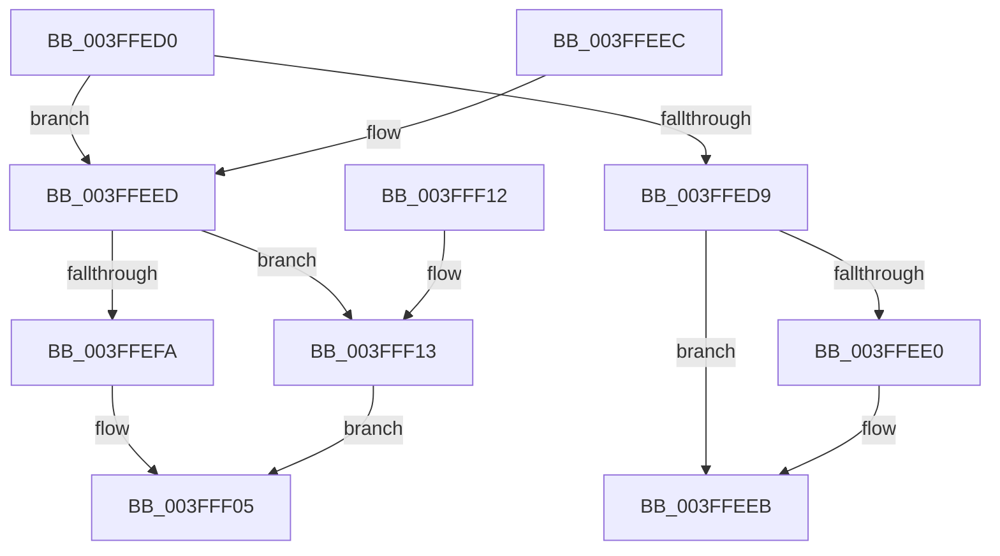

# RtlTimelineBitmapUpdate

- RVA: `0x003FFED0`–`0x003FFF1A` (길이 `74` bytes)
- VA: `0x00000001403FFED0`
- 실행 섹션: `.text`
- PDB 이름 있음: `예`; PDB Function 태그: `아니요`
- unwind 정보 RVA: `0x000DB714`
- 디코드: `28`개 명령, `74/74` bytes 표시
- 미해석 바이트: `0` (있으면 어셈블리에 `.byte`로 보존)

> 이 문서는 커널 이미지의 기계어와 PDB 기호를 분석해 생성했습니다. 4번과 5번은 함수 원형과 자료형을 바이너리 사용 방식에서 추정한 C 해석이며 원본 소스 복구 결과는 아닙니다.

## 1. Dependencies

- 직접 호출 지점: **0**; 고유 호출 대상: **0**
- 직접 호출자로 확인된 함수: **1**
- RIP 상대 이미지 참조: **0**

### Outgoing calls
- 직접 디코드된 call 명령이 없습니다.

### Direct callers
- [PoEnergyContextUpdateComponentPower](../../page/98/PoEnergyContextUpdateComponentPower_function_0098CA08.md) at `0x0098CACF`
- [PoEnergyContextUpdateComponentPower](../../page/98/PoEnergyContextUpdateComponentPower_function_0098CA08.md) at `0x0098CB0C`
- [PoEnergyContextUpdateComponentPower](../../page/98/PoEnergyContextUpdateComponentPower_function_0098CA08.md) at `0x0098CB66`
- [PoEnergyContextUpdateComponentPower](../../page/98/PoEnergyContextUpdateComponentPower_function_0098CA08.md) at `0x0098CD86`

### Static image references
- 디코드된 RIP-relative 메모리 참조가 없습니다.

## 2. Other-region calls and transfers

- 다른 실행 섹션으로 향하는 call: **0**
- 별도 외부 분기/꼬리 이동을 확인하지 못했습니다.

## 3. Assembly (complete function range)

```asm
003FFED0  4C 8B C1                        mov r8, rcx
003FFED3  8B 09                           mov ecx, dword ptr [rcx]
003FFED5  3B D1                           cmp edx, ecx
003FFED7  77 14                           ja 0x1403ffeed
003FFED9  2B CA                           sub ecx, edx
003FFEDB  83 F9 20                        cmp ecx, 0x20
003FFEDE  73 0B                           jae 0x1403ffeeb
003FFEE0  B8 01 00 00 00                  mov eax, 1
003FFEE5  D3 E0                           shl eax, cl
003FFEE7  41 09 40 04                     or dword ptr [r8 + 4], eax
003FFEEB  C3                              ret
003FFEEC  CC                              int3
003FFEED  8B C2                           mov eax, edx
003FFEEF  89 54 24 08                     mov dword ptr [rsp + 8], edx
003FFEF3  2B C1                           sub eax, ecx
003FFEF5  83 F8 20                        cmp eax, 0x20
003FFEF8  73 19                           jae 0x1403fff13
003FFEFA  8B C8                           mov ecx, eax
003FFEFC  41 8B 40 04                     mov eax, dword ptr [r8 + 4]
003FFF00  D3 E0                           shl eax, cl
003FFF02  83 C8 01                        or eax, 1
003FFF05  89 44 24 0C                     mov dword ptr [rsp + 0xc], eax
003FFF09  48 8B 44 24 08                  mov rax, qword ptr [rsp + 8]
003FFF0E  49 89 00                        mov qword ptr [r8], rax
003FFF11  C3                              ret
003FFF12  CC                              int3
003FFF13  B8 01 00 00 00                  mov eax, 1
003FFF18  EB EB                           jmp 0x1403fff05
```

## 4. C-style interpretation (structured pseudocode)

```c
__int64 __fastcall RtlTimelineBitmapUpdate(__int64 a1, int a2)
{
    __int64 result;
    unsigned int v_stack_p8;
    unsigned int v_stack_pC;

    if (a2 > ((unsigned int)((unsigned int)(*(unsigned int *)(a1))))) goto loc_003FFEED;
    a1 = (unsigned int)(((unsigned int)(*(unsigned int *)(a1))) - (a2));
    if (((unsigned int)(a1)) < 32) {
        result = 1;
        result = (unsigned int)((result) << ((unsigned __int8)(a1)));
    }
    return result;
loc_003FFEED:
    v_stack_p8 = a2;
    result = (unsigned int)(((unsigned int)(a2)) - ((unsigned int)(a1)));
    if (((unsigned int)(result)) >= 32) goto loc_003FFF13;
    result = (unsigned int)(((unsigned int)(*(unsigned int *)(a1 + 4))) << ((unsigned __int8)((unsigned int)((unsigned int)(result)))));
    result = (unsigned int)((result) | (1));
loc_003FFF05:
    v_stack_pC = (unsigned int)(result);
    *(unsigned __int64 *)(a1) = v_stack_p8;
    return v_stack_p8;
loc_003FFF13:
    goto loc_003FFF05;
}
```

## 5. (Beta) C Style

```c
int64_t RtlTimelineBitmapUpdate(void *Arg1, int32_t Arg2)
{
    uint8_t *arg1 = (uint8_t *)Arg1;

    int64_t result;
    uint32_t v_stack_p8;
    uint32_t v_stack_pC;

    if (Arg2 > ((uint32_t)((uint32_t)(*(uint32_t *)(arg1))))) goto loc_003FFEED;
    Arg1 = (uint32_t)(((uint32_t)(*(uint32_t *)(arg1))) - (Arg2));
    if (((uint32_t)(Arg1)) < 32) {
        result = 1;
        result = (uint32_t)((result) << ((uint8_t)(Arg1)));
    }
    return result;
loc_003FFEED:
    v_stack_p8 = Arg2;
    result = (uint32_t)(((uint32_t)(Arg2)) - ((uint32_t)(Arg1)));
    if (((uint32_t)(result)) >= 32) goto loc_003FFF13;
    result = (uint32_t)(((uint32_t)(*(uint32_t *)(arg1 + 0x4))) << ((uint8_t)((uint32_t)((uint32_t)(result)))));
    result = (uint32_t)((result) | (1));
loc_003FFF05:
    v_stack_pC = (uint32_t)(result);
    *(uint64_t *)(arg1) = v_stack_p8;
    return v_stack_p8;
loc_003FFF13:
    goto loc_003FFF05;
}
```

### 관측된 메모리 오프셋

구조체 형식이 확인되지 않은 접근은 인자 기준의 오프셋으로만 기록했습니다.

| 기준 인자 | 오프셋 표현 | 폭 (bit) | 접근 |
|---|---:|---:|---|
| `Arg1` | `+ 0x0` | `32` | `R` |
| `Arg1` | `+ 0x0` | `64` | `W` |
| `Arg1` | `+ 0x4` | `32` | `R` |
| `Arg1` | `+ 0x4` | `32` | `R/W` |

## 6. Execution-region graph

[열기: 2D/3D 그래프와 함수 탐색 컨트롤 패널](../../../control-panel.html?section=text&rva=0x003FFED0&view=graph)

- 2D 그래프는 위에서 아래로 흐르고, 3D 그래프는 빈 공간을 드래그해 회전합니다. Shift+드래그는 이동, 휠은 확대·축소, 함수 노드 선택은 대상 보고서 이동입니다.

### Static fallback


