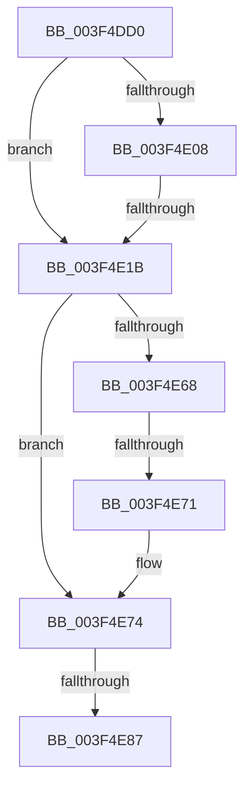

# RtlpCopyExtendedContext

- RVA: `0x003F4DD0`–`0x003F4E8A` (길이 `186` bytes)
- VA: `0x00000001403F4DD0`
- 실행 섹션: `.text`
- PDB 이름 있음: `예`; PDB Function 태그: `예`
- unwind 정보 RVA: `0x000973C8`
- 디코드: `47`개 명령, `186/186` bytes 표시
- 미해석 바이트: `0` (있으면 어셈블리에 `.byte`로 보존)

> 이 문서는 커널 이미지의 기계어와 PDB 기호를 분석해 생성했습니다. 4번과 5번은 함수 원형과 자료형을 바이너리 사용 방식에서 추정한 C 해석이며 원본 소스 복구 결과는 아닙니다.

## 1. Dependencies

- 직접 호출 지점: **0**; 고유 호출 대상: **0**
- 직접 호출자로 확인된 함수: **4**
- RIP 상대 이미지 참조: **0**

### Outgoing calls
- 직접 디코드된 call 명령이 없습니다.

### Direct callers
- [KiDispatchException](../3D/KiDispatchException_function_003D7650.md) at `0x003D7B7F`
- [RtlCopyExtendedContext](../5E/RtlCopyExtendedContext_function_005E8610.md) at `0x005E862A`
- [RtlpWriteExtendedContext](../../page/8D/RtlpWriteExtendedContext_function_008D4A5C.md) at `0x008D4BB4`
- [RtlpReadExtendedContext](../../page/8D/RtlpReadExtendedContext_function_008D61D0.md) at `0x008D62CD`

### Static image references
- 디코드된 RIP-relative 메모리 참조가 없습니다.

## 2. Other-region calls and transfers

- 다른 실행 섹션으로 향하는 call: **0**
- call이 아닌 외부 분기/꼬리 이동: **3**
  - `0x003F4E15` → [sub_003F5144 + 0x19](Unknown_function_003F5144.md) (`tail-transfer`)
  - `0x003F4E6B` → [sub_003F5144 + 0x12](Unknown_function_003F5144.md) (`tail-transfer`)
  - `0x003F4E81` → [sub_003F5144](Unknown_function_003F5144.md) (`tail-transfer`)

## 3. Assembly (complete function range)

```asm
003F4DD0  48 89 5C 24 10                  mov qword ptr [rsp + 0x10], rbx
003F4DD5  48 89 6C 24 18                  mov qword ptr [rsp + 0x18], rbp
003F4DDA  56                              push rsi
003F4DDB  41 56                           push r14
003F4DDD  41 57                           push r15
003F4DDF  48 83 EC 30                     sub rsp, 0x30
003F4DE3  45 8B D1                        mov r10d, r9d
003F4DE6  48 8B F2                        mov rsi, rdx
003F4DE9  41 8B C2                        mov eax, r10d
003F4DEC  4D 8B C8                        mov r9, r8
003F4DEF  25 80 FF FF 27                  and eax, 0x27ffff80
003F4DF4  0F B6 E9                        movzx ebp, cl
003F4DF7  48 BB D8 03 00 00 80 F7 FF FF   movabs rbx, 0xfffff780000003d8
003F4E01  3D 00 00 01 00                  cmp eax, 0x10000
003F4E06  74 13                           je 0x1403f4e1b
003F4E08  41 8B C2                        mov eax, r10d
003F4E0B  25 20 FF FF 07                  and eax, 0x7ffff20
003F4E10  3D 00 00 10 00                  cmp eax, 0x100000
003F4E15  0F 85 42 03 00 00               jne 0x1403f515d
003F4E1B  45 8B C2                        mov r8d, r10d
003F4E1E  41 8B C2                        mov eax, r10d
003F4E21  25 40 00 10 00                  and eax, 0x100040
003F4E26  41 81 E0 20 00 40 00            and r8d, 0x400020
003F4E2D  3D 40 00 10 00                  cmp eax, 0x100040
003F4E32  41 BE 01 00 00 00               mov r14d, 1
003F4E38  41 8B C2                        mov eax, r10d
003F4E3B  0F 95 C2                        setne dl
003F4E3E  25 40 00 01 00                  and eax, 0x10040
003F4E43  3D 40 00 01 00                  cmp eax, 0x10040
003F4E48  45 8D 5E 02                     lea r11d, [r14 + 2]
003F4E4C  0F 95 C0                        setne al
003F4E4F  45 33 FF                        xor r15d, r15d
003F4E52  22 D0                           and dl, al
003F4E54  41 8B CF                        mov ecx, r15d
003F4E57  41 81 F8 20 00 40 00            cmp r8d, 0x400020
003F4E5E  0F B6 C2                        movzx eax, dl
003F4E61  0F 45 C8                        cmovne ecx, eax
003F4E64  84 C9                           test cl, cl
003F4E66  75 0C                           jne 0x1403f4e74
003F4E68  4C 39 3B                        cmp qword ptr [rbx], r15
003F4E6B  0F 84 E5 02 00 00               je 0x1403f5156
003F4E71  45 8B F3                        mov r14d, r11d
003F4E74  41 8B C2                        mov eax, r10d
003F4E77  25 80 00 10 00                  and eax, 0x100080
003F4E7C  3D 80 00 10 00                  cmp eax, 0x100080
003F4E81  0F 84 BD 02 00 00               je 0x1403f5144
003F4E87  4D 85 C9                        test r9, r9
```

## 4. C-style interpretation (structured pseudocode)

```c
__int64 __fastcall RtlpCopyExtendedContext(unsigned __int8 a1, __int64 a2, __int64 a3, int a4)
{
    __int64 result;
    __int64 v_r15;
    __int64 v_rsp;
    unsigned __int64 v_stack_p10;
    unsigned __int64 v_stack_p18;

    v_stack_p10 = v_rbx;
    v_stack_p18 = v_rbp;
    v_rsp = (v_rsp) - (48);
    result = (unsigned int)(((unsigned int)((unsigned int)((unsigned int)(a4)))) & (0x27FFFF80ULL));
    if (((unsigned int)(result)) == 0x10000ULL) goto loc_003F4E1B;
    result = (unsigned int)(((unsigned int)((unsigned int)((unsigned int)(a4)))) & (0x7FFFF20ULL));
loc_003F4E1B:
    result = (unsigned int)(((unsigned int)((unsigned int)((unsigned int)(a4)))) & (0x100040ULL));
    a3 = (unsigned int)(((unsigned int)((unsigned int)((unsigned int)(a4)))) & (0x400020ULL));
    a2 = (((unsigned int)(result)) != 0x100040ULL) ? 1 : 0;
    result = (unsigned int)(((unsigned int)((unsigned int)((unsigned int)(a4)))) & (0x10040ULL));
    result = (((unsigned int)(result)) != 0x10040ULL) ? 1 : 0;
    v_r15 = 0;
    a2 = (unsigned __int8)((a2) & ((unsigned __int8)(result)));
    a1 = 0;
    if (((unsigned int)(a3)) != 0x400020ULL) { a1 = (unsigned int)((unsigned __int8)(a2)); }
    if (a1 != 0) goto loc_003F4E74;
loc_003F4E74:
    result = (unsigned int)(((unsigned int)((unsigned int)((unsigned int)(a4)))) & (0x100080ULL));
    return result;
}
```

## 5. (Beta) C Style

```c
int64_t RtlpCopyExtendedContext(uint8_t Arg1, int64_t Arg2, int64_t Arg3, int32_t Arg4)
{
    int64_t result;
    int64_t local_r15;
    int64_t local_rsp;
    uint64_t v_stack_p10;
    uint64_t v_stack_p18;

    v_stack_p10 = local_rbx;
    v_stack_p18 = local_rbp;
    local_rsp = (local_rsp) - (48);
    result = (uint32_t)(((uint32_t)((uint32_t)((uint32_t)(Arg4)))) & (0x27FFFF80ULL));
    if (((uint32_t)(result)) == 0x10000ULL) goto loc_003F4E1B;
    result = (uint32_t)(((uint32_t)((uint32_t)((uint32_t)(Arg4)))) & (0x7FFFF20ULL));
loc_003F4E1B:
    result = (uint32_t)(((uint32_t)((uint32_t)((uint32_t)(Arg4)))) & (0x100040ULL));
    Arg3 = (uint32_t)(((uint32_t)((uint32_t)((uint32_t)(Arg4)))) & (0x400020ULL));
    Arg2 = (((uint32_t)(result)) != 0x100040ULL) ? 1 : 0;
    result = (uint32_t)(((uint32_t)((uint32_t)((uint32_t)(Arg4)))) & (0x10040ULL));
    result = (((uint32_t)(result)) != 0x10040ULL) ? 1 : 0;
    local_r15 = 0;
    Arg2 = (uint8_t)((Arg2) & ((uint8_t)(result)));
    Arg1 = 0;
    if (((uint32_t)(Arg3)) != 0x400020ULL) { Arg1 = (uint32_t)((uint8_t)(Arg2)); }
    if (Arg1 != 0) goto loc_003F4E74;
loc_003F4E74:
    result = (uint32_t)(((uint32_t)((uint32_t)((uint32_t)(Arg4)))) & (0x100080ULL));
    return result;
}
```

## 6. Execution-region graph

[열기: 2D/3D 그래프와 함수 탐색 컨트롤 패널](../../../control-panel.html?section=text&rva=0x003F4DD0&view=graph)

- 2D 그래프는 위에서 아래로 흐르고, 3D 그래프는 빈 공간을 드래그해 회전합니다. Shift+드래그는 이동, 휠은 확대·축소, 함수 노드 선택은 대상 보고서 이동입니다.

### Static fallback


