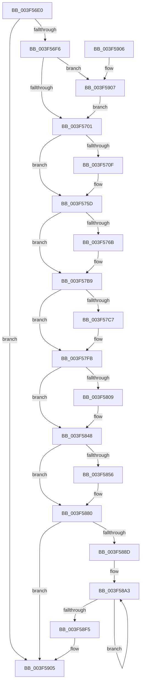

# RtlpCopyLegacyContextX86

- RVA: `0x003F56E0`–`0x003F591B` (길이 `571` bytes)
- VA: `0x00000001403F56E0`
- 실행 섹션: `.text`
- PDB 이름 있음: `예`; PDB Function 태그: `아니요`
- unwind 정보 RVA: `0x000DB714`
- 디코드: `132`개 명령, `571/571` bytes 표시
- 미해석 바이트: `0` (있으면 어셈블리에 `.byte`로 보존)

> 이 문서는 커널 이미지의 기계어와 PDB 기호를 분석해 생성했습니다. 4번과 5번은 함수 원형과 자료형을 바이너리 사용 방식에서 추정한 C 해석이며 원본 소스 복구 결과는 아닙니다.

## 1. Dependencies

- 직접 호출 지점: **0**; 고유 호출 대상: **0**
- 직접 호출자로 확인된 함수: **2**
- RIP 상대 이미지 참조: **0**

### Outgoing calls
- 직접 디코드된 call 명령이 없습니다.

### Direct callers
- [sub_003F512F](Unknown_function_003F512F.md) at `0x003F5136`
- [RtlpCopyLegacyContext](RtlpCopyLegacyContext_function_003F54A0.md) at `0x003F56BC`

### Static image references
- 디코드된 RIP-relative 메모리 참조가 없습니다.

## 2. Other-region calls and transfers

- 다른 실행 섹션으로 향하는 call: **0**
- 별도 외부 분기/꼬리 이동을 확인하지 못했습니다.

## 3. Assembly (complete function range)

```asm
003F56E0  41 8B C0                        mov eax, r8d
003F56E3  41 BA FF FF FF 67               mov r10d, 0x67ffffff
003F56E9  41 23 C2                        and eax, r10d
003F56EC  89 02                           mov dword ptr [rdx], eax
003F56EE  84 C9                           test cl, cl
003F56F0  0F 84 0F 02 00 00               je 0x1403f5905
003F56F6  41 0F BA E0 1E                  bt r8d, 0x1e
003F56FB  0F 82 06 02 00 00               jb 0x1403f5907
003F5701  B9 01 00 01 00                  mov ecx, 0x10001
003F5706  41 8B C0                        mov eax, r8d
003F5709  23 C1                           and eax, ecx
003F570B  3B C1                           cmp eax, ecx
003F570D  75 4E                           jne 0x1403f575d
003F570F  41 8B 81 B4 00 00 00            mov eax, dword ptr [r9 + 0xb4]
003F5716  89 82 B4 00 00 00               mov dword ptr [rdx + 0xb4], eax
003F571C  41 8B 81 B8 00 00 00            mov eax, dword ptr [r9 + 0xb8]
003F5723  89 82 B8 00 00 00               mov dword ptr [rdx + 0xb8], eax
003F5729  41 8B 81 BC 00 00 00            mov eax, dword ptr [r9 + 0xbc]
003F5730  89 82 BC 00 00 00               mov dword ptr [rdx + 0xbc], eax
003F5736  41 8B 81 C0 00 00 00            mov eax, dword ptr [r9 + 0xc0]
003F573D  89 82 C0 00 00 00               mov dword ptr [rdx + 0xc0], eax
003F5743  41 8B 81 C4 00 00 00            mov eax, dword ptr [r9 + 0xc4]
003F574A  89 82 C4 00 00 00               mov dword ptr [rdx + 0xc4], eax
003F5750  41 8B 81 C8 00 00 00            mov eax, dword ptr [r9 + 0xc8]
003F5757  89 82 C8 00 00 00               mov dword ptr [rdx + 0xc8], eax
003F575D  B9 02 00 01 00                  mov ecx, 0x10002
003F5762  41 8B C0                        mov eax, r8d
003F5765  23 C1                           and eax, ecx
003F5767  3B C1                           cmp eax, ecx
003F5769  75 4E                           jne 0x1403f57b9
003F576B  41 8B 81 9C 00 00 00            mov eax, dword ptr [r9 + 0x9c]
003F5772  89 82 9C 00 00 00               mov dword ptr [rdx + 0x9c], eax
003F5778  41 8B 81 A0 00 00 00            mov eax, dword ptr [r9 + 0xa0]
003F577F  89 82 A0 00 00 00               mov dword ptr [rdx + 0xa0], eax
003F5785  41 8B 81 A4 00 00 00            mov eax, dword ptr [r9 + 0xa4]
003F578C  89 82 A4 00 00 00               mov dword ptr [rdx + 0xa4], eax
003F5792  41 8B 81 AC 00 00 00            mov eax, dword ptr [r9 + 0xac]
003F5799  89 82 AC 00 00 00               mov dword ptr [rdx + 0xac], eax
003F579F  41 8B 81 A8 00 00 00            mov eax, dword ptr [r9 + 0xa8]
003F57A6  89 82 A8 00 00 00               mov dword ptr [rdx + 0xa8], eax
003F57AC  41 8B 81 B0 00 00 00            mov eax, dword ptr [r9 + 0xb0]
003F57B3  89 82 B0 00 00 00               mov dword ptr [rdx + 0xb0], eax
003F57B9  B9 04 00 01 00                  mov ecx, 0x10004
003F57BE  41 8B C0                        mov eax, r8d
003F57C1  23 C1                           and eax, ecx
003F57C3  3B C1                           cmp eax, ecx
003F57C5  75 34                           jne 0x1403f57fb
003F57C7  41 8B 81 8C 00 00 00            mov eax, dword ptr [r9 + 0x8c]
003F57CE  89 82 8C 00 00 00               mov dword ptr [rdx + 0x8c], eax
003F57D4  41 8B 81 90 00 00 00            mov eax, dword ptr [r9 + 0x90]
003F57DB  89 82 90 00 00 00               mov dword ptr [rdx + 0x90], eax
003F57E1  41 8B 81 94 00 00 00            mov eax, dword ptr [r9 + 0x94]
003F57E8  89 82 94 00 00 00               mov dword ptr [rdx + 0x94], eax
003F57EE  41 8B 81 98 00 00 00            mov eax, dword ptr [r9 + 0x98]
003F57F5  89 82 98 00 00 00               mov dword ptr [rdx + 0x98], eax
003F57FB  B9 08 00 01 00                  mov ecx, 0x10008
003F5800  41 8B C0                        mov eax, r8d
003F5803  23 C1                           and eax, ecx
003F5805  3B C1                           cmp eax, ecx
003F5807  75 3F                           jne 0x1403f5848
003F5809  41 0F 10 41 1C                  movups xmm0, xmmword ptr [r9 + 0x1c]
003F580E  0F 11 42 1C                     movups xmmword ptr [rdx + 0x1c], xmm0
003F5812  41 0F 10 49 2C                  movups xmm1, xmmword ptr [r9 + 0x2c]
003F5817  0F 11 4A 2C                     movups xmmword ptr [rdx + 0x2c], xmm1
003F581B  41 0F 10 41 3C                  movups xmm0, xmmword ptr [r9 + 0x3c]
003F5820  0F 11 42 3C                     movups xmmword ptr [rdx + 0x3c], xmm0
003F5824  41 0F 10 49 4C                  movups xmm1, xmmword ptr [r9 + 0x4c]
003F5829  0F 11 4A 4C                     movups xmmword ptr [rdx + 0x4c], xmm1
003F582D  41 0F 10 41 5C                  movups xmm0, xmmword ptr [r9 + 0x5c]
003F5832  0F 11 42 5C                     movups xmmword ptr [rdx + 0x5c], xmm0
003F5836  41 0F 10 49 6C                  movups xmm1, xmmword ptr [r9 + 0x6c]
003F583B  0F 11 4A 6C                     movups xmmword ptr [rdx + 0x6c], xmm1
003F583F  41 0F 10 41 7C                  movups xmm0, xmmword ptr [r9 + 0x7c]
003F5844  0F 11 42 7C                     movups xmmword ptr [rdx + 0x7c], xmm0
003F5848  B9 10 00 01 00                  mov ecx, 0x10010
003F584D  41 8B C0                        mov eax, r8d
003F5850  23 C1                           and eax, ecx
003F5852  3B C1                           cmp eax, ecx
003F5854  75 2A                           jne 0x1403f5880
003F5856  41 8B 41 04                     mov eax, dword ptr [r9 + 4]
003F585A  89 42 04                        mov dword ptr [rdx + 4], eax
003F585D  41 8B 41 08                     mov eax, dword ptr [r9 + 8]
003F5861  89 42 08                        mov dword ptr [rdx + 8], eax
003F5864  41 8B 41 0C                     mov eax, dword ptr [r9 + 0xc]
003F5868  89 42 0C                        mov dword ptr [rdx + 0xc], eax
003F586B  41 8B 41 10                     mov eax, dword ptr [r9 + 0x10]
003F586F  89 42 10                        mov dword ptr [rdx + 0x10], eax
003F5872  41 8B 41 14                     mov eax, dword ptr [r9 + 0x14]
003F5876  89 42 14                        mov dword ptr [rdx + 0x14], eax
003F5879  41 8B 41 18                     mov eax, dword ptr [r9 + 0x18]
003F587D  89 42 18                        mov dword ptr [rdx + 0x18], eax
003F5880  B8 20 00 01 00                  mov eax, 0x10020
003F5885  44 23 C0                        and r8d, eax
003F5888  44 3B C0                        cmp r8d, eax
003F588B  75 78                           jne 0x1403f5905
003F588D  B8 02 00 00 00                  mov eax, 2
003F5892  48 81 C2 CC 00 00 00            add rdx, 0xcc
003F5899  49 81 C1 CC 00 00 00            add r9, 0xcc
003F58A0  8D 48 7E                        lea ecx, [rax + 0x7e]
003F58A3  41 0F 10 01                     movups xmm0, xmmword ptr [r9]
003F58A7  0F 11 02                        movups xmmword ptr [rdx], xmm0
003F58AA  41 0F 10 49 10                  movups xmm1, xmmword ptr [r9 + 0x10]
003F58AF  0F 11 4A 10                     movups xmmword ptr [rdx + 0x10], xmm1
003F58B3  41 0F 10 41 20                  movups xmm0, xmmword ptr [r9 + 0x20]
003F58B8  0F 11 42 20                     movups xmmword ptr [rdx + 0x20], xmm0
003F58BC  41 0F 10 49 30                  movups xmm1, xmmword ptr [r9 + 0x30]
003F58C1  0F 11 4A 30                     movups xmmword ptr [rdx + 0x30], xmm1
003F58C5  41 0F 10 41 40                  movups xmm0, xmmword ptr [r9 + 0x40]
003F58CA  0F 11 42 40                     movups xmmword ptr [rdx + 0x40], xmm0
003F58CE  41 0F 10 49 50                  movups xmm1, xmmword ptr [r9 + 0x50]
003F58D3  0F 11 4A 50                     movups xmmword ptr [rdx + 0x50], xmm1
003F58D7  41 0F 10 41 60                  movups xmm0, xmmword ptr [r9 + 0x60]
003F58DC  0F 11 42 60                     movups xmmword ptr [rdx + 0x60], xmm0
003F58E0  48 03 D1                        add rdx, rcx
003F58E3  41 0F 10 49 70                  movups xmm1, xmmword ptr [r9 + 0x70]
003F58E8  4C 03 C9                        add r9, rcx
003F58EB  0F 11 4A F0                     movups xmmword ptr [rdx - 0x10], xmm1
003F58EF  48 83 E8 01                     sub rax, 1
003F58F3  75 AE                           jne 0x1403f58a3
003F58F5  41 0F 10 01                     movups xmm0, xmmword ptr [r9]
003F58F9  0F 11 02                        movups xmmword ptr [rdx], xmm0
003F58FC  41 0F 10 49 10                  movups xmm1, xmmword ptr [r9 + 0x10]
003F5901  0F 11 4A 10                     movups xmmword ptr [rdx + 0x10], xmm1
003F5905  C3                              ret
003F5906  CC                              int3
003F5907  41 8B 01                        mov eax, dword ptr [r9]
003F590A  8B C8                           mov ecx, eax
003F590C  41 33 C8                        xor ecx, r8d
003F590F  41 23 CA                        and ecx, r10d
003F5912  33 C8                           xor ecx, eax
003F5914  89 0A                           mov dword ptr [rdx], ecx
003F5916  E9 E6 FD FF FF                  jmp 0x1403f5701
```

## 4. C-style interpretation (structured pseudocode)

```c
__int64 __fastcall RtlpCopyLegacyContextX86(unsigned __int8 a1, __int64 a2, int a3, __int64 a4)
{
    __int64 result;

    result = (unsigned int)(((unsigned int)(a3)) & ((unsigned int)((unsigned int)(0x67FFFFFFULL))));
    *(unsigned int *)(a2) = (unsigned int)(result);
    if (a1 == 0) goto loc_003F5905;
    if (condition_is_below) goto loc_003F5907;
loc_003F5701:
    result = (unsigned int)(((unsigned int)(a3)) & ((unsigned int)((unsigned int)(0x10001ULL))));
    if (((unsigned int)(result)) == ((unsigned int)((unsigned int)(0x10001ULL)))) {
        result = *(unsigned int *)(a4 + 180);
        *(unsigned int *)(a2 + 180) = (unsigned int)(result);
        result = *(unsigned int *)(a4 + 184);
        *(unsigned int *)(a2 + 184) = (unsigned int)(result);
        result = *(unsigned int *)(a4 + 188);
        *(unsigned int *)(a2 + 188) = (unsigned int)(result);
        result = *(unsigned int *)(a4 + 192);
        *(unsigned int *)(a2 + 192) = (unsigned int)(result);
        result = *(unsigned int *)(a4 + 196);
        *(unsigned int *)(a2 + 196) = (unsigned int)(result);
        result = *(unsigned int *)(a4 + 200);
        *(unsigned int *)(a2 + 200) = (unsigned int)(result);
    }
    result = (unsigned int)(((unsigned int)(a3)) & ((unsigned int)((unsigned int)(0x10002ULL))));
    if (((unsigned int)(result)) == ((unsigned int)((unsigned int)(0x10002ULL)))) {
        result = *(unsigned int *)(a4 + 156);
        *(unsigned int *)(a2 + 156) = (unsigned int)(result);
        result = *(unsigned int *)(a4 + 160);
        *(unsigned int *)(a2 + 160) = (unsigned int)(result);
        result = *(unsigned int *)(a4 + 164);
        *(unsigned int *)(a2 + 164) = (unsigned int)(result);
        result = *(unsigned int *)(a4 + 172);
        *(unsigned int *)(a2 + 172) = (unsigned int)(result);
        result = *(unsigned int *)(a4 + 168);
        *(unsigned int *)(a2 + 168) = (unsigned int)(result);
        result = *(unsigned int *)(a4 + 176);
        *(unsigned int *)(a2 + 176) = (unsigned int)(result);
    }
    result = (unsigned int)(((unsigned int)(a3)) & ((unsigned int)((unsigned int)(0x10004ULL))));
    if (((unsigned int)(result)) == ((unsigned int)((unsigned int)(0x10004ULL)))) {
        result = *(unsigned int *)(a4 + 140);
        *(unsigned int *)(a2 + 140) = (unsigned int)(result);
        result = *(unsigned int *)(a4 + 144);
        *(unsigned int *)(a2 + 144) = (unsigned int)(result);
        result = *(unsigned int *)(a4 + 148);
        *(unsigned int *)(a2 + 148) = (unsigned int)(result);
        result = *(unsigned int *)(a4 + 152);
        *(unsigned int *)(a2 + 152) = (unsigned int)(result);
    }
    result = (unsigned int)(((unsigned int)(a3)) & ((unsigned int)((unsigned int)(0x10008ULL))));
    if (((unsigned int)(result)) == ((unsigned int)((unsigned int)(0x10008ULL)))) {
        *(unsigned __int64 *)(a2 + 28) = v_xmm0;
        *(unsigned __int64 *)(a2 + 44) = v_xmm1;
        *(unsigned __int64 *)(a2 + 60) = v_xmm0;
        *(unsigned __int64 *)(a2 + 76) = v_xmm1;
        *(unsigned __int64 *)(a2 + 92) = v_xmm0;
        *(unsigned __int64 *)(a2 + 108) = v_xmm1;
        *(unsigned __int64 *)(a2 + 124) = v_xmm0;
    }
    result = (unsigned int)(((unsigned int)(a3)) & ((unsigned int)((unsigned int)(0x10010ULL))));
    if (((unsigned int)(result)) == ((unsigned int)((unsigned int)(0x10010ULL)))) {
        result = *(unsigned int *)(a4 + 4);
        *(unsigned int *)(a2 + 4) = (unsigned int)(result);
        result = *(unsigned int *)(a4 + 8);
        *(unsigned int *)(a2 + 8) = (unsigned int)(result);
        result = *(unsigned int *)(a4 + 12);
        *(unsigned int *)(a2 + 12) = (unsigned int)(result);
        result = *(unsigned int *)(a4 + 16);
        *(unsigned int *)(a2 + 16) = (unsigned int)(result);
        result = *(unsigned int *)(a4 + 20);
        *(unsigned int *)(a2 + 20) = (unsigned int)(result);
        result = *(unsigned int *)(a4 + 24);
        *(unsigned int *)(a2 + 24) = (unsigned int)(result);
    }
    a3 = (unsigned int)((a3) & ((unsigned int)((unsigned int)(0x10020ULL))));
    if (a3 != ((unsigned int)((unsigned int)(0x10020ULL)))) goto loc_003F5905;
    a2 = (a2) + (204);
    a4 = (a4) + (204);
loc_003F58A3:
    *(unsigned __int64 *)(a2) = v_xmm0;
    *(unsigned __int64 *)(a2 + 16) = v_xmm1;
    *(unsigned __int64 *)(a2 + 32) = v_xmm0;
    *(unsigned __int64 *)(a2 + 48) = v_xmm1;
    *(unsigned __int64 *)(a2 + 64) = v_xmm0;
    *(unsigned __int64 *)(a2 + 80) = v_xmm1;
    *(unsigned __int64 *)(a2 + 96) = v_xmm0;
    a2 = (a2) + (2 + 126);
    a4 = (a4) + (2 + 126);
    *(unsigned __int64 *)(a2 - 16) = v_xmm1;
    result = (2) - (1);
    if (condition_is_not_equal) goto loc_003F58A3;
    *(unsigned __int64 *)(a2) = v_xmm0;
    *(unsigned __int64 *)(a2 + 16) = v_xmm1;
loc_003F5905:
    return result;
loc_003F5907:
    a1 = (unsigned int)(((unsigned int)((unsigned int)((unsigned int)(*(unsigned int *)(a4))))) ^ (a3));
    a1 = (unsigned int)((a1) & ((unsigned int)((unsigned int)(0x67FFFFFFULL))));
    a1 = (unsigned int)((a1) ^ ((unsigned int)((unsigned int)(*(unsigned int *)(a4)))));
    *(unsigned int *)(a2) = a1;
    goto loc_003F5701;
}
```

## 5. (Beta) C Style

```c
int64_t RtlpCopyLegacyContextX86(uint8_t Arg1, void *Arg2, int32_t Arg3, void *Arg4)
{
    uint8_t *arg2 = (uint8_t *)Arg2;
    uint8_t *arg4 = (uint8_t *)Arg4;

    int64_t result;

    result = (uint32_t)(((uint32_t)(Arg3)) & ((uint32_t)((uint32_t)(0x67FFFFFFULL))));
    *(uint32_t *)(arg2) = (uint32_t)(result);
    if (Arg1 == 0) goto loc_003F5905;
    if (condition_is_below) goto loc_003F5907;
loc_003F5701:
    result = (uint32_t)(((uint32_t)(Arg3)) & ((uint32_t)((uint32_t)(0x10001ULL))));
    if (((uint32_t)(result)) == ((uint32_t)((uint32_t)(0x10001ULL)))) {
        result = *(uint32_t *)(arg4 + 0xB4);
        *(uint32_t *)(arg2 + 0xB4) = (uint32_t)(result);
        result = *(uint32_t *)(arg4 + 0xB8);
        *(uint32_t *)(arg2 + 0xB8) = (uint32_t)(result);
        result = *(uint32_t *)(arg4 + 0xBC);
        *(uint32_t *)(arg2 + 0xBC) = (uint32_t)(result);
        result = *(uint32_t *)(arg4 + 0xC0);
        *(uint32_t *)(arg2 + 0xC0) = (uint32_t)(result);
        result = *(uint32_t *)(arg4 + 0xC4);
        *(uint32_t *)(arg2 + 0xC4) = (uint32_t)(result);
        result = *(uint32_t *)(arg4 + 0xC8);
        *(uint32_t *)(arg2 + 0xC8) = (uint32_t)(result);
    }
    result = (uint32_t)(((uint32_t)(Arg3)) & ((uint32_t)((uint32_t)(0x10002ULL))));
    if (((uint32_t)(result)) == ((uint32_t)((uint32_t)(0x10002ULL)))) {
        result = *(uint32_t *)(arg4 + 0x9C);
        *(uint32_t *)(arg2 + 0x9C) = (uint32_t)(result);
        result = *(uint32_t *)(arg4 + 0xA0);
        *(uint32_t *)(arg2 + 0xA0) = (uint32_t)(result);
        result = *(uint32_t *)(arg4 + 0xA4);
        *(uint32_t *)(arg2 + 0xA4) = (uint32_t)(result);
        result = *(uint32_t *)(arg4 + 0xAC);
        *(uint32_t *)(arg2 + 0xAC) = (uint32_t)(result);
        result = *(uint32_t *)(arg4 + 0xA8);
        *(uint32_t *)(arg2 + 0xA8) = (uint32_t)(result);
        result = *(uint32_t *)(arg4 + 0xB0);
        *(uint32_t *)(arg2 + 0xB0) = (uint32_t)(result);
    }
    result = (uint32_t)(((uint32_t)(Arg3)) & ((uint32_t)((uint32_t)(0x10004ULL))));
    if (((uint32_t)(result)) == ((uint32_t)((uint32_t)(0x10004ULL)))) {
        result = *(uint32_t *)(arg4 + 0x8C);
        *(uint32_t *)(arg2 + 0x8C) = (uint32_t)(result);
        result = *(uint32_t *)(arg4 + 0x90);
        *(uint32_t *)(arg2 + 0x90) = (uint32_t)(result);
        result = *(uint32_t *)(arg4 + 0x94);
        *(uint32_t *)(arg2 + 0x94) = (uint32_t)(result);
        result = *(uint32_t *)(arg4 + 0x98);
        *(uint32_t *)(arg2 + 0x98) = (uint32_t)(result);
    }
    result = (uint32_t)(((uint32_t)(Arg3)) & ((uint32_t)((uint32_t)(0x10008ULL))));
    if (((uint32_t)(result)) == ((uint32_t)((uint32_t)(0x10008ULL)))) {
        *(uint64_t *)(arg2 + 0x1C) = v_xmm0;
        *(uint64_t *)(arg2 + 0x2C) = v_xmm1;
        *(uint64_t *)(arg2 + 0x3C) = v_xmm0;
        *(uint64_t *)(arg2 + 0x4C) = v_xmm1;
        *(uint64_t *)(arg2 + 0x5C) = v_xmm0;
        *(uint64_t *)(arg2 + 0x6C) = v_xmm1;
        *(uint64_t *)(arg2 + 0x7C) = v_xmm0;
    }
    result = (uint32_t)(((uint32_t)(Arg3)) & ((uint32_t)((uint32_t)(0x10010ULL))));
    if (((uint32_t)(result)) == ((uint32_t)((uint32_t)(0x10010ULL)))) {
        result = *(uint32_t *)(arg4 + 0x4);
        *(uint32_t *)(arg2 + 0x4) = (uint32_t)(result);
        result = *(uint32_t *)(arg4 + 0x8);
        *(uint32_t *)(arg2 + 0x8) = (uint32_t)(result);
        result = *(uint32_t *)(arg4 + 0xC);
        *(uint32_t *)(arg2 + 0xC) = (uint32_t)(result);
        result = *(uint32_t *)(arg4 + 0x10);
        *(uint32_t *)(arg2 + 0x10) = (uint32_t)(result);
        result = *(uint32_t *)(arg4 + 0x14);
        *(uint32_t *)(arg2 + 0x14) = (uint32_t)(result);
        result = *(uint32_t *)(arg4 + 0x18);
        *(uint32_t *)(arg2 + 0x18) = (uint32_t)(result);
    }
    Arg3 = (uint32_t)((Arg3) & ((uint32_t)((uint32_t)(0x10020ULL))));
    if (Arg3 != ((uint32_t)((uint32_t)(0x10020ULL)))) goto loc_003F5905;
    Arg2 = (Arg2) + (204);
    Arg4 = (Arg4) + (204);
loc_003F58A3:
    *(uint64_t *)(arg2) = v_xmm0;
    *(uint64_t *)(arg2 + 0x10) = v_xmm1;
    *(uint64_t *)(arg2 + 0x20) = v_xmm0;
    *(uint64_t *)(arg2 + 0x30) = v_xmm1;
    *(uint64_t *)(arg2 + 0x40) = v_xmm0;
    *(uint64_t *)(arg2 + 0x50) = v_xmm1;
    *(uint64_t *)(arg2 + 0x60) = v_xmm0;
    Arg2 = (Arg2) + (2 + 126);
    Arg4 = (Arg4) + (2 + 126);
    *(uint64_t *)(arg2 - 0x10) = v_xmm1;
    result = (2) - (1);
    if (condition_is_not_equal) goto loc_003F58A3;
    *(uint64_t *)(arg2) = v_xmm0;
    *(uint64_t *)(arg2 + 0x10) = v_xmm1;
loc_003F5905:
    return result;
loc_003F5907:
    Arg1 = (uint32_t)(((uint32_t)((uint32_t)((uint32_t)(*(uint32_t *)(arg4))))) ^ (Arg3));
    Arg1 = (uint32_t)((Arg1) & ((uint32_t)((uint32_t)(0x67FFFFFFULL))));
    Arg1 = (uint32_t)((Arg1) ^ ((uint32_t)((uint32_t)(*(uint32_t *)(arg4)))));
    *(uint32_t *)(arg2) = Arg1;
    goto loc_003F5701;
}
```

### 관측된 메모리 오프셋

구조체 형식이 확인되지 않은 접근은 인자 기준의 오프셋으로만 기록했습니다.

| 기준 인자 | 오프셋 표현 | 폭 (bit) | 접근 |
|---|---:|---:|---|
| `Arg2` | `- 0x10` | `128` | `R` |
| `Arg2` | `+ 0x0` | `32` | `W` |
| `Arg2` | `+ 0x0` | `128` | `R` |
| `Arg2` | `+ 0x4` | `32` | `W` |
| `Arg2` | `+ 0x8` | `32` | `W` |
| `Arg2` | `+ 0xC` | `32` | `W` |
| `Arg2` | `+ 0x10` | `32` | `W` |
| `Arg2` | `+ 0x10` | `128` | `R` |
| `Arg2` | `+ 0x14` | `32` | `W` |
| `Arg2` | `+ 0x18` | `32` | `W` |
| `Arg2` | `+ 0x1C` | `128` | `R` |
| `Arg2` | `+ 0x20` | `128` | `R` |
| `Arg2` | `+ 0x2C` | `128` | `R` |
| `Arg2` | `+ 0x30` | `128` | `R` |
| `Arg2` | `+ 0x3C` | `128` | `R` |
| `Arg2` | `+ 0x40` | `128` | `R` |
| `Arg2` | `+ 0x4C` | `128` | `R` |
| `Arg2` | `+ 0x50` | `128` | `R` |
| `Arg2` | `+ 0x5C` | `128` | `R` |
| `Arg2` | `+ 0x60` | `128` | `R` |
| `Arg2` | `+ 0x6C` | `128` | `R` |
| `Arg2` | `+ 0x7C` | `128` | `R` |
| `Arg2` | `+ 0x8C` | `32` | `W` |
| `Arg2` | `+ 0x90` | `32` | `W` |
| `Arg2` | `+ 0x94` | `32` | `W` |
| `Arg2` | `+ 0x98` | `32` | `W` |
| `Arg2` | `+ 0x9C` | `32` | `W` |
| `Arg2` | `+ 0xA0` | `32` | `W` |
| `Arg2` | `+ 0xA4` | `32` | `W` |
| `Arg2` | `+ 0xA8` | `32` | `W` |
| `Arg2` | `+ 0xAC` | `32` | `W` |
| `Arg2` | `+ 0xB0` | `32` | `W` |

추가 오프셋 44개는 표에서 생략했습니다.

## 6. Execution-region graph

[열기: 2D/3D 그래프와 함수 탐색 컨트롤 패널](../../../control-panel.html?section=text&rva=0x003F56E0&view=graph)

- 2D 그래프는 위에서 아래로 흐르고, 3D 그래프는 빈 공간을 드래그해 회전합니다. Shift+드래그는 이동, 휠은 확대·축소, 함수 노드 선택은 대상 보고서 이동입니다.

### Static fallback


