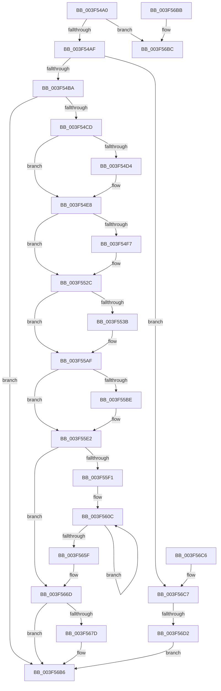

# RtlpCopyLegacyContext

- RVA: `0x003F54A0`–`0x003F56D9` (길이 `569` bytes)
- VA: `0x00000001403F54A0`
- 실행 섹션: `.text`
- PDB 이름 있음: `예`; PDB Function 태그: `예`
- unwind 정보 RVA: `0x0009746C`
- 디코드: `121`개 명령, `569/569` bytes 표시
- 미해석 바이트: `0` (있으면 어셈블리에 `.byte`로 보존)

> 이 문서는 커널 이미지의 기계어와 PDB 기호를 분석해 생성했습니다. 4번과 5번은 함수 원형과 자료형을 바이너리 사용 방식에서 추정한 C 해석이며 원본 소스 복구 결과는 아닙니다.

## 1. Dependencies

- 직접 호출 지점: **2**; 고유 호출 대상: **2**
- 직접 호출자로 확인된 함수: **1**
- RIP 상대 이미지 참조: **0**

### Outgoing calls
- `0x003F56BC` → [RtlpCopyLegacyContextX86](RtlpCopyLegacyContextX86_function_003F56E0.md) (function, `0x003F56E0`)
- `0x003F56D2` → [RtlpCopyLegacyContextArm](../5E/RtlpCopyLegacyContextArm_function_005E8684.md) (function, `0x005E8684`)

### Direct callers
- [RtlCopyContext](../../page/8D/RtlCopyContext_function_008D5940.md) at `0x008D59FD`

### Static image references
- 디코드된 RIP-relative 메모리 참조가 없습니다.

## 2. Other-region calls and transfers

- 다른 실행 섹션으로 향하는 call: **0**
- call이 아닌 외부 분기/꼬리 이동: **1**
  - `0x003F56CC` → [sub_006EB37C](../6E/Unknown_function_006EB37C.md) (`tail-transfer`)

## 3. Assembly (complete function range)

```asm
003F54A0  48 83 EC 28                     sub rsp, 0x28
003F54A4  41 0F BA E0 10                  bt r8d, 0x10
003F54A9  0F 82 0D 02 00 00               jb 0x1403f56bc
003F54AF  41 0F BA E0 14                  bt r8d, 0x14
003F54B4  0F 83 0D 02 00 00               jae 0x1403f56c7
003F54BA  41 8B C0                        mov eax, r8d
003F54BD  25 FF FF FF 67                  and eax, 0x67ffffff
003F54C2  89 42 30                        mov dword ptr [rdx + 0x30], eax
003F54C5  84 C9                           test cl, cl
003F54C7  0F 84 E9 01 00 00               je 0x1403f56b6
003F54CD  41 0F BA E0 1E                  bt r8d, 0x1e
003F54D2  73 14                           jae 0x1403f54e8
003F54D4  41 8B 41 30                     mov eax, dword ptr [r9 + 0x30]
003F54D8  8B C8                           mov ecx, eax
003F54DA  41 33 C8                        xor ecx, r8d
003F54DD  81 E1 FF FF FF 67               and ecx, 0x67ffffff
003F54E3  33 C8                           xor ecx, eax
003F54E5  89 4A 30                        mov dword ptr [rdx + 0x30], ecx
003F54E8  41 8B C0                        mov eax, r8d
003F54EB  25 01 00 10 00                  and eax, 0x100001
003F54F0  3D 01 00 10 00                  cmp eax, 0x100001
003F54F5  75 35                           jne 0x1403f552c
003F54F7  49 8B 81 F8 00 00 00            mov rax, qword ptr [r9 + 0xf8]
003F54FE  48 89 82 F8 00 00 00            mov qword ptr [rdx + 0xf8], rax
003F5505  41 0F B7 41 38                  movzx eax, word ptr [r9 + 0x38]
003F550A  66 89 42 38                     mov word ptr [rdx + 0x38], ax
003F550E  41 0F B7 41 42                  movzx eax, word ptr [r9 + 0x42]
003F5513  66 89 42 42                     mov word ptr [rdx + 0x42], ax
003F5517  49 8B 81 98 00 00 00            mov rax, qword ptr [r9 + 0x98]
003F551E  48 89 82 98 00 00 00            mov qword ptr [rdx + 0x98], rax
003F5525  41 8B 41 44                     mov eax, dword ptr [r9 + 0x44]
003F5529  89 42 44                        mov dword ptr [rdx + 0x44], eax
003F552C  41 8B C0                        mov eax, r8d
003F552F  25 02 00 10 00                  and eax, 0x100002
003F5534  3D 02 00 10 00                  cmp eax, 0x100002
003F5539  75 74                           jne 0x1403f55af
003F553B  41 0F 10 41 78                  movups xmm0, xmmword ptr [r9 + 0x78]
003F5540  0F 11 42 78                     movups xmmword ptr [rdx + 0x78], xmm0
003F5544  41 0F 10 89 88 00 00 00         movups xmm1, xmmword ptr [r9 + 0x88]
003F554C  0F 11 8A 88 00 00 00            movups xmmword ptr [rdx + 0x88], xmm1
003F5553  41 0F 10 81 A0 00 00 00         movups xmm0, xmmword ptr [r9 + 0xa0]
003F555B  0F 11 82 A0 00 00 00            movups xmmword ptr [rdx + 0xa0], xmm0
003F5562  41 0F 10 89 B0 00 00 00         movups xmm1, xmmword ptr [r9 + 0xb0]
003F556A  0F 11 8A B0 00 00 00            movups xmmword ptr [rdx + 0xb0], xmm1
003F5571  41 0F 10 81 C0 00 00 00         movups xmm0, xmmword ptr [r9 + 0xc0]
003F5579  0F 11 82 C0 00 00 00            movups xmmword ptr [rdx + 0xc0], xmm0
003F5580  41 0F 10 89 D0 00 00 00         movups xmm1, xmmword ptr [r9 + 0xd0]
003F5588  0F 11 8A D0 00 00 00            movups xmmword ptr [rdx + 0xd0], xmm1
003F558F  41 0F 10 81 E0 00 00 00         movups xmm0, xmmword ptr [r9 + 0xe0]
003F5597  0F 11 82 E0 00 00 00            movups xmmword ptr [rdx + 0xe0], xmm0
003F559E  F2 41 0F 10 89 F0 00 00 00      movsd xmm1, qword ptr [r9 + 0xf0]
003F55A7  F2 0F 11 8A F0 00 00 00         movsd qword ptr [rdx + 0xf0], xmm1
003F55AF  41 8B C0                        mov eax, r8d
003F55B2  25 04 00 10 00                  and eax, 0x100004
003F55B7  3D 04 00 10 00                  cmp eax, 0x100004
003F55BC  75 24                           jne 0x1403f55e2
003F55BE  41 0F B7 41 40                  movzx eax, word ptr [r9 + 0x40]
003F55C3  66 89 42 40                     mov word ptr [rdx + 0x40], ax
003F55C7  41 0F B7 41 3E                  movzx eax, word ptr [r9 + 0x3e]
003F55CC  66 89 42 3E                     mov word ptr [rdx + 0x3e], ax
003F55D0  41 0F B7 41 3C                  movzx eax, word ptr [r9 + 0x3c]
003F55D5  66 89 42 3C                     mov word ptr [rdx + 0x3c], ax
003F55D9  41 0F B7 41 3A                  movzx eax, word ptr [r9 + 0x3a]
003F55DE  66 89 42 3A                     mov word ptr [rdx + 0x3a], ax
003F55E2  41 8B C0                        mov eax, r8d
003F55E5  25 08 00 10 00                  and eax, 0x100008
003F55EA  3D 08 00 10 00                  cmp eax, 0x100008
003F55EF  75 7C                           jne 0x1403f566d
003F55F1  41 8B 41 34                     mov eax, dword ptr [r9 + 0x34]
003F55F5  49 8D 89 00 01 00 00            lea rcx, [r9 + 0x100]
003F55FC  89 42 34                        mov dword ptr [rdx + 0x34], eax
003F55FF  41 BA 03 00 00 00               mov r10d, 3
003F5605  48 8D 82 00 01 00 00            lea rax, [rdx + 0x100]
003F560C  48 8D 80 80 00 00 00            lea rax, [rax + 0x80]
003F5613  0F 10 01                        movups xmm0, xmmword ptr [rcx]
003F5616  48 8D 89 80 00 00 00            lea rcx, [rcx + 0x80]
003F561D  0F 11 40 80                     movups xmmword ptr [rax - 0x80], xmm0
003F5621  0F 10 49 90                     movups xmm1, xmmword ptr [rcx - 0x70]
003F5625  0F 11 48 90                     movups xmmword ptr [rax - 0x70], xmm1
003F5629  0F 10 41 A0                     movups xmm0, xmmword ptr [rcx - 0x60]
003F562D  0F 11 40 A0                     movups xmmword ptr [rax - 0x60], xmm0
003F5631  0F 10 49 B0                     movups xmm1, xmmword ptr [rcx - 0x50]
003F5635  0F 11 48 B0                     movups xmmword ptr [rax - 0x50], xmm1
003F5639  0F 10 41 C0                     movups xmm0, xmmword ptr [rcx - 0x40]
003F563D  0F 11 40 C0                     movups xmmword ptr [rax - 0x40], xmm0
003F5641  0F 10 49 D0                     movups xmm1, xmmword ptr [rcx - 0x30]
003F5645  0F 11 48 D0                     movups xmmword ptr [rax - 0x30], xmm1
003F5649  0F 10 41 E0                     movups xmm0, xmmword ptr [rcx - 0x20]
003F564D  0F 11 40 E0                     movups xmmword ptr [rax - 0x20], xmm0
003F5651  0F 10 49 F0                     movups xmm1, xmmword ptr [rcx - 0x10]
003F5655  0F 11 48 F0                     movups xmmword ptr [rax - 0x10], xmm1
003F5659  49 83 EA 01                     sub r10, 1
003F565D  75 AD                           jne 0x1403f560c
003F565F  0F 10 01                        movups xmm0, xmmword ptr [rcx]
003F5662  0F 11 00                        movups xmmword ptr [rax], xmm0
003F5665  0F 10 49 10                     movups xmm1, xmmword ptr [rcx + 0x10]
003F5669  0F 11 48 10                     movups xmmword ptr [rax + 0x10], xmm1
003F566D  41 81 E0 10 00 10 00            and r8d, 0x100010
003F5674  41 81 F8 10 00 10 00            cmp r8d, 0x100010
003F567B  75 39                           jne 0x1403f56b6
003F567D  41 0F 10 41 48                  movups xmm0, xmmword ptr [r9 + 0x48]
003F5682  0F 11 42 48                     movups xmmword ptr [rdx + 0x48], xmm0
003F5686  41 0F 10 49 58                  movups xmm1, xmmword ptr [r9 + 0x58]
003F568B  0F 11 4A 58                     movups xmmword ptr [rdx + 0x58], xmm1
003F568F  41 0F 10 41 68                  movups xmm0, xmmword ptr [r9 + 0x68]
003F5694  0F 11 42 68                     movups xmmword ptr [rdx + 0x68], xmm0
003F5698  41 0F 10 81 B0 04 00 00         movups xmm0, xmmword ptr [r9 + 0x4b0]
003F56A0  0F 11 82 B0 04 00 00            movups xmmword ptr [rdx + 0x4b0], xmm0
003F56A7  41 0F 10 89 C0 04 00 00         movups xmm1, xmmword ptr [r9 + 0x4c0]
003F56AF  0F 11 8A C0 04 00 00            movups xmmword ptr [rdx + 0x4c0], xmm1
003F56B6  48 83 C4 28                     add rsp, 0x28
003F56BA  C3                              ret
003F56BB  CC                              int3
003F56BC  E8 1F 00 00 00                  call 0x1403f56e0
003F56C1  48 83 C4 28                     add rsp, 0x28
003F56C5  C3                              ret
003F56C6  CC                              int3
003F56C7  41 0F BA E0 15                  bt r8d, 0x15
003F56CC  0F 83 AA 5C 2F 00               jae 0x1406eb37c
003F56D2  E8 AD 2F 1F 00                  call 0x1405e8684
003F56D7  EB DD                           jmp 0x1403f56b6
```

## 4. C-style interpretation (structured pseudocode)

```c
__int64 __fastcall RtlpCopyLegacyContext(unsigned __int8 a1, __int64 a2, int a3, __int64 a4)
{
    __int64 result;
    __int64 v_r10;
    __int64 v_rsp;

    v_rsp = (v_rsp) - (40);
    if (condition_is_below) goto loc_003F56BC;
    if (condition_is_above_or_equal) goto loc_003F56C7;
    result = (unsigned int)(((unsigned int)(a3)) & (0x67FFFFFFULL));
    *(unsigned int *)(a2 + 48) = (unsigned int)(result);
    if (a1 == 0) goto loc_003F56B6;
    if (!(condition_is_above_or_equal)) {
        result = *(unsigned int *)(a4 + 48);
        a1 = (unsigned int)(result);
        a1 = (unsigned int)((a1) ^ (a3));
        a1 = (unsigned int)((a1) & (0x67FFFFFFULL));
        a1 = (unsigned int)((a1) ^ ((unsigned int)(result)));
        *(unsigned int *)(a2 + 48) = a1;
    }
    result = (unsigned int)(((unsigned int)(a3)) & (0x100001ULL));
    if (((unsigned int)(result)) == 0x100001ULL) {
        result = *(unsigned __int64 *)(a4 + 248);
        *(unsigned __int64 *)(a2 + 248) = result;
        result = *(unsigned __int16 *)(a4 + 56);
        *(unsigned __int16 *)(a2 + 56) = (unsigned __int16)(result);
        result = *(unsigned __int16 *)(a4 + 66);
        *(unsigned __int16 *)(a2 + 66) = (unsigned __int16)(result);
        result = *(unsigned __int64 *)(a4 + 152);
        *(unsigned __int64 *)(a2 + 152) = result;
        result = *(unsigned int *)(a4 + 68);
        *(unsigned int *)(a2 + 68) = (unsigned int)(result);
    }
    result = (unsigned int)(((unsigned int)(a3)) & (0x100002ULL));
    if (((unsigned int)(result)) == 0x100002ULL) {
        *(unsigned __int64 *)(a2 + 120) = v_xmm0;
        *(unsigned __int64 *)(a2 + 136) = v_xmm1;
        *(unsigned __int64 *)(a2 + 160) = v_xmm0;
        *(unsigned __int64 *)(a2 + 176) = v_xmm1;
        *(unsigned __int64 *)(a2 + 192) = v_xmm0;
        *(unsigned __int64 *)(a2 + 208) = v_xmm1;
        *(unsigned __int64 *)(a2 + 224) = v_xmm0;
        *(unsigned __int64 *)(a2 + 240) = v_xmm1;
    }
    result = (unsigned int)(((unsigned int)(a3)) & (0x100004ULL));
    if (((unsigned int)(result)) == 0x100004ULL) {
        result = *(unsigned __int16 *)(a4 + 64);
        *(unsigned __int16 *)(a2 + 64) = (unsigned __int16)(result);
        result = *(unsigned __int16 *)(a4 + 62);
        *(unsigned __int16 *)(a2 + 62) = (unsigned __int16)(result);
        result = *(unsigned __int16 *)(a4 + 60);
        *(unsigned __int16 *)(a2 + 60) = (unsigned __int16)(result);
        result = *(unsigned __int16 *)(a4 + 58);
        *(unsigned __int16 *)(a2 + 58) = (unsigned __int16)(result);
    }
    result = (unsigned int)(((unsigned int)(a3)) & (0x100008ULL));
    if (((unsigned int)(result)) != 0x100008ULL) goto loc_003F566D;
    *(unsigned int *)(a2 + 52) = (unsigned int)((unsigned int)(*(unsigned int *)(a4 + 52)));
loc_003F560C:
    *(unsigned __int64 *)(a2 + 256 + 128 - 128) = v_xmm0;
    *(unsigned __int64 *)(a2 + 256 + 128 - 112) = v_xmm1;
    *(unsigned __int64 *)(a2 + 256 + 128 - 96) = v_xmm0;
    *(unsigned __int64 *)(a2 + 256 + 128 - 80) = v_xmm1;
    *(unsigned __int64 *)(a2 + 256 + 128 - 64) = v_xmm0;
    *(unsigned __int64 *)(a2 + 256 + 128 - 48) = v_xmm1;
    *(unsigned __int64 *)(a2 + 256 + 128 - 32) = v_xmm0;
    *(unsigned __int64 *)(a2 + 256 + 128 - 16) = v_xmm1;
    v_r10 = (3) - (1);
    if (condition_is_not_equal) goto loc_003F560C;
    *(unsigned __int64 *)(a2 + 256 + 128) = v_xmm0;
    *(unsigned __int64 *)(a2 + 256 + 128 + 16) = v_xmm1;
loc_003F566D:
    a3 = (unsigned int)((a3) & (0x100010ULL));
    if (a3 == 0x100010ULL) {
        *(unsigned __int64 *)(a2 + 72) = v_xmm0;
        *(unsigned __int64 *)(a2 + 88) = v_xmm1;
        *(unsigned __int64 *)(a2 + 104) = v_xmm0;
        *(unsigned __int64 *)(a2 + 1200) = v_xmm0;
        *(unsigned __int64 *)(a2 + 1216) = v_xmm1;
    }
    v_rsp = (v_rsp) + (40);
    return a2 + 256 + 128;
loc_003F56BC:
    result = RtlpCopyLegacyContextX86(a4 + 256 + 128, a2, a3, a4);
    v_rsp = (v_rsp) + (40);
    return result;
loc_003F56C7:
    result = RtlpCopyLegacyContextArm(a4 + 256 + 128, a2, a3, a4);
    goto loc_003F56B6;
}
```

## 5. (Beta) C Style

```c
int64_t RtlpCopyLegacyContext(uint8_t Arg1, void *Arg2, int32_t Arg3, void *Arg4)
{
    uint8_t *arg2 = (uint8_t *)Arg2;
    uint8_t *arg4 = (uint8_t *)Arg4;

    int64_t result;
    int64_t local_r10;
    int64_t local_rsp;

    local_rsp = (local_rsp) - (40);
    if (condition_is_below) goto loc_003F56BC;
    if (condition_is_above_or_equal) goto loc_003F56C7;
    result = (uint32_t)(((uint32_t)(Arg3)) & (0x67FFFFFFULL));
    *(uint32_t *)(arg2 + 0x30) = (uint32_t)(result);
    if (Arg1 == 0) goto loc_003F56B6;
    if (!(condition_is_above_or_equal)) {
        result = *(uint32_t *)(arg4 + 0x30);
        Arg1 = (uint32_t)(result);
        Arg1 = (uint32_t)((Arg1) ^ (Arg3));
        Arg1 = (uint32_t)((Arg1) & (0x67FFFFFFULL));
        Arg1 = (uint32_t)((Arg1) ^ ((uint32_t)(result)));
        *(uint32_t *)(arg2 + 0x30) = Arg1;
    }
    result = (uint32_t)(((uint32_t)(Arg3)) & (0x100001ULL));
    if (((uint32_t)(result)) == 0x100001ULL) {
        result = *(uint64_t *)(arg4 + 0xF8);
        *(uint64_t *)(arg2 + 0xF8) = result;
        result = *(uint16_t *)(arg4 + 0x38);
        *(uint16_t *)(arg2 + 0x38) = (uint16_t)(result);
        result = *(uint16_t *)(arg4 + 0x42);
        *(uint16_t *)(arg2 + 0x42) = (uint16_t)(result);
        result = *(uint64_t *)(arg4 + 0x98);
        *(uint64_t *)(arg2 + 0x98) = result;
        result = *(uint32_t *)(arg4 + 0x44);
        *(uint32_t *)(arg2 + 0x44) = (uint32_t)(result);
    }
    result = (uint32_t)(((uint32_t)(Arg3)) & (0x100002ULL));
    if (((uint32_t)(result)) == 0x100002ULL) {
        *(uint64_t *)(arg2 + 0x78) = v_xmm0;
        *(uint64_t *)(arg2 + 0x88) = v_xmm1;
        *(uint64_t *)(arg2 + 0xA0) = v_xmm0;
        *(uint64_t *)(arg2 + 0xB0) = v_xmm1;
        *(uint64_t *)(arg2 + 0xC0) = v_xmm0;
        *(uint64_t *)(arg2 + 0xD0) = v_xmm1;
        *(uint64_t *)(arg2 + 0xE0) = v_xmm0;
        *(uint64_t *)(arg2 + 0xF0) = v_xmm1;
    }
    result = (uint32_t)(((uint32_t)(Arg3)) & (0x100004ULL));
    if (((uint32_t)(result)) == 0x100004ULL) {
        result = *(uint16_t *)(arg4 + 0x40);
        *(uint16_t *)(arg2 + 0x40) = (uint16_t)(result);
        result = *(uint16_t *)(arg4 + 0x3E);
        *(uint16_t *)(arg2 + 0x3E) = (uint16_t)(result);
        result = *(uint16_t *)(arg4 + 0x3C);
        *(uint16_t *)(arg2 + 0x3C) = (uint16_t)(result);
        result = *(uint16_t *)(arg4 + 0x3A);
        *(uint16_t *)(arg2 + 0x3A) = (uint16_t)(result);
    }
    result = (uint32_t)(((uint32_t)(Arg3)) & (0x100008ULL));
    if (((uint32_t)(result)) != 0x100008ULL) goto loc_003F566D;
    *(uint32_t *)(arg2 + 0x34) = (uint32_t)((uint32_t)(*(uint32_t *)(arg4 + 0x34)));
loc_003F560C:
    *(uint64_t *)(arg2 + 0x100 + 0x80 - 0x80) = v_xmm0;
    *(uint64_t *)(arg2 + 0x100 + 0x80 - 0x70) = v_xmm1;
    *(uint64_t *)(arg2 + 0x100 + 0x80 - 0x60) = v_xmm0;
    *(uint64_t *)(arg2 + 0x100 + 0x80 - 0x50) = v_xmm1;
    *(uint64_t *)(arg2 + 0x100 + 0x80 - 0x40) = v_xmm0;
    *(uint64_t *)(arg2 + 0x100 + 0x80 - 0x30) = v_xmm1;
    *(uint64_t *)(arg2 + 0x100 + 0x80 - 0x20) = v_xmm0;
    *(uint64_t *)(arg2 + 0x100 + 0x80 - 0x10) = v_xmm1;
    local_r10 = (3) - (1);
    if (condition_is_not_equal) goto loc_003F560C;
    *(uint64_t *)(arg2 + 0x100 + 0x80) = v_xmm0;
    *(uint64_t *)(arg2 + 0x100 + 0x80 + 0x10) = v_xmm1;
loc_003F566D:
    Arg3 = (uint32_t)((Arg3) & (0x100010ULL));
    if (Arg3 == 0x100010ULL) {
        *(uint64_t *)(arg2 + 0x48) = v_xmm0;
        *(uint64_t *)(arg2 + 0x58) = v_xmm1;
        *(uint64_t *)(arg2 + 0x68) = v_xmm0;
        *(uint64_t *)(arg2 + 0x4B0) = v_xmm0;
        *(uint64_t *)(arg2 + 0x4C0) = v_xmm1;
    }
    local_rsp = (local_rsp) + (40);
    return Arg2 + 256 + 128;
loc_003F56BC:
    result = RtlpCopyLegacyContextX86(Arg4 + 256 + 128, Arg2, Arg3, Arg4);
    local_rsp = (local_rsp) + (40);
    return result;
loc_003F56C7:
    result = RtlpCopyLegacyContextArm(Arg4 + 256 + 128, Arg2, Arg3, Arg4);
    goto loc_003F56B6;
}
```

### 관측된 메모리 오프셋

구조체 형식이 확인되지 않은 접근은 인자 기준의 오프셋으로만 기록했습니다.

| 기준 인자 | 오프셋 표현 | 폭 (bit) | 접근 |
|---|---:|---:|---|
| `Arg2` | `- 0x80` | `128` | `R` |
| `Arg2` | `- 0x70` | `128` | `R` |
| `Arg2` | `- 0x60` | `128` | `R` |
| `Arg2` | `- 0x50` | `128` | `R` |
| `Arg2` | `- 0x40` | `128` | `R` |
| `Arg2` | `- 0x30` | `128` | `R` |
| `Arg2` | `- 0x20` | `128` | `R` |
| `Arg2` | `- 0x10` | `128` | `R` |
| `Arg2` | `+ 0x0` | `128` | `R` |
| `Arg2` | `+ 0x10` | `128` | `R` |
| `Arg2` | `+ 0x30` | `32` | `W` |
| `Arg2` | `+ 0x34` | `32` | `W` |
| `Arg2` | `+ 0x38` | `16` | `W` |
| `Arg2` | `+ 0x3A` | `16` | `W` |
| `Arg2` | `+ 0x3C` | `16` | `W` |
| `Arg2` | `+ 0x3E` | `16` | `W` |
| `Arg2` | `+ 0x40` | `16` | `W` |
| `Arg2` | `+ 0x42` | `16` | `W` |
| `Arg2` | `+ 0x44` | `32` | `W` |
| `Arg2` | `+ 0x48` | `128` | `R` |
| `Arg2` | `+ 0x58` | `128` | `R` |
| `Arg2` | `+ 0x68` | `128` | `R` |
| `Arg2` | `+ 0x78` | `128` | `R` |
| `Arg2` | `+ 0x80` | `64` | `R` |
| `Arg2` | `+ 0x88` | `128` | `R` |
| `Arg2` | `+ 0x98` | `64` | `W` |
| `Arg2` | `+ 0xA0` | `128` | `R` |
| `Arg2` | `+ 0xB0` | `128` | `R` |
| `Arg2` | `+ 0xC0` | `128` | `R` |
| `Arg2` | `+ 0xD0` | `128` | `R` |
| `Arg2` | `+ 0xE0` | `128` | `R` |
| `Arg2` | `+ 0xF0` | `64` | `W` |

추가 오프셋 39개는 표에서 생략했습니다.

## 6. Execution-region graph

[열기: 2D/3D 그래프와 함수 탐색 컨트롤 패널](../../../control-panel.html?section=text&rva=0x003F54A0&view=graph)

- 2D 그래프는 위에서 아래로 흐르고, 3D 그래프는 빈 공간을 드래그해 회전합니다. Shift+드래그는 이동, 휠은 확대·축소, 함수 노드 선택은 대상 보고서 이동입니다.

### Static fallback


