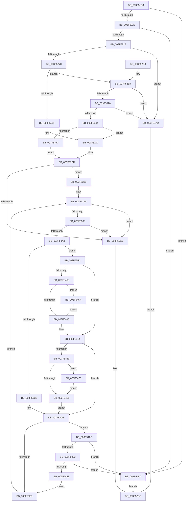

# RtlpCopyXStateChunk

- RVA: `0x003F51D4`–`0x003F5491` (길이 `701` bytes)
- VA: `0x00000001403F51D4`
- 실행 섹션: `.text`
- PDB 이름 있음: `예`; PDB Function 태그: `아니요`
- unwind 정보 RVA: `0x00097450`
- 디코드: `183`개 명령, `701/701` bytes 표시
- 미해석 바이트: `0` (있으면 어셈블리에 `.byte`로 보존)

> 이 문서는 커널 이미지의 기계어와 PDB 기호를 분석해 생성했습니다. 4번과 5번은 함수 원형과 자료형을 바이너리 사용 방식에서 추정한 C 해석이며 원본 소스 복구 결과는 아닙니다.

## 1. Dependencies

- 직접 호출 지점: **2**; 고유 호출 대상: **2**
- 직접 호출자로 확인된 함수: **4**
- RIP 상대 이미지 참조: **0**

### Outgoing calls
- `0x003F52A2` → [memset](../6C/memset_function_006C6C40.md) (function, `0x006C6C40`)
- `0x003F544B` → [memcpy](../6C/memcpy_function_006C6840.md) (function, `0x006C6840`)

### Direct callers
- [sub_003F4E8A](Unknown_function_003F4E8A.md) at `0x003F5100`
- [RtlCopyContext](../../page/8D/RtlCopyContext_function_008D5940.md) at `0x008D5A5C`
- [RtlpWow64CtxFromAmd64](../../page/A1/RtlpWow64CtxFromAmd64_function_00A12394.md) at `0x00A125DB`
- [RtlpWow64CtxToAmd64](../../page/A6/RtlpWow64CtxToAmd64_function_00A67188.md) at `0x00A67320`

### Static image references
- 디코드된 RIP-relative 메모리 참조가 없습니다.

## 2. Other-region calls and transfers

- 다른 실행 섹션으로 향하는 call: **0**
- 별도 외부 분기/꼬리 이동을 확인하지 못했습니다.

## 3. Assembly (complete function range)

```asm
003F51D4  48 89 5C 24 10                  mov qword ptr [rsp + 0x10], rbx
003F51D9  88 4C 24 08                     mov byte ptr [rsp + 8], cl
003F51DD  55                              push rbp
003F51DE  56                              push rsi
003F51DF  57                              push rdi
003F51E0  41 54                           push r12
003F51E2  41 55                           push r13
003F51E4  41 56                           push r14
003F51E6  41 57                           push r15
003F51E8  48 83 EC 50                     sub rsp, 0x50
003F51EC  45 8B 50 14                     mov r10d, dword ptr [r8 + 0x14]
003F51F0  BE 40 00 00 00                  mov esi, 0x40
003F51F5  48 8B 84 24 B0 00 00 00         mov rax, qword ptr [rsp + 0xb0]
003F51FD  8B DE                           mov ebx, esi
003F51FF  44 89 54 24 20                  mov dword ptr [rsp + 0x20], r10d
003F5204  44 8B FE                        mov r15d, esi
003F5207  44 8B F6                        mov r14d, esi
003F520A  44 8B EE                        mov r13d, esi
003F520D  8B 48 14                        mov ecx, dword ptr [rax + 0x14]
003F5210  89 8C 24 A0 00 00 00            mov dword ptr [rsp + 0xa0], ecx
003F5217  44 3B D6                        cmp r10d, esi
003F521A  0F 82 67 02 00 00               jb 0x1403f5487
003F5220  3B CE                           cmp ecx, esi
003F5222  0F 82 5F 02 00 00               jb 0x1403f5487
003F5228  4D 63 50 10                     movsxd r10, dword ptr [r8 + 0x10]
003F522C  49 B8 F0 05 00 00 80 F7 FF FF   movabs r8, 0xfffff780000005f0
003F5236  48 63 48 10                     movsxd rcx, dword ptr [rax + 0x10]
003F523A  4C 03 D2                        add r10, rdx
003F523D  49 03 C9                        add rcx, r9
003F5240  4C 89 54 24 38                  mov qword ptr [rsp + 0x38], r10
003F5245  48 B8 D8 03 00 00 80 F7 FF FF   movabs rax, 0xfffff780000003d8
003F524F  48 89 4C 24 40                  mov qword ptr [rsp + 0x40], rcx
003F5254  4D 8B 00                        mov r8, qword ptr [r8]
003F5257  48 8B 29                        mov rbp, qword ptr [rcx]
003F525A  4C 0B 00                        or r8, qword ptr [rax]
003F525D  48 83 E5 FC                     and rbp, 0xfffffffffffffffc
003F5261  49 8B C0                        mov rax, r8
003F5264  48 F7 D0                        not rax
003F5267  48 85 C5                        test rbp, rax
003F526A  0F 85 0D 02 00 00               jne 0x1403f547d
003F5270  48 83 64 24 30 00               and qword ptr [rsp + 0x30], 0
003F5276  8D 7E C2                        lea edi, [rsi - 0x3e]
003F5279  A1 EC 03 00 00 80 F7 FF FF      movabs eax, dword ptr [0xfffff780000003ec]
003F5282  45 33 C9                        xor r9d, r9d
003F5285  4C 89 4C 24 28                  mov qword ptr [rsp + 0x28], r9
003F528A  40 84 C7                        test dil, al
003F528D  75 5A                           jne 0x1403f52e9
003F528F  44 88 8C 24 B0 00 00 00         mov byte ptr [rsp + 0xb0], r9b
003F5297  4C 8B C6                        mov r8, rsi
003F529A  33 D2                           xor edx, edx
003F529C  49 8B CA                        mov rcx, r10
003F529F  4D 8B E1                        mov r12, r9
003F52A2  E8 99 19 2D 00                  call 0x1406c6c40
003F52A7  4C 8B 54 24 38                  mov r10, qword ptr [rsp + 0x38]
003F52AC  48 8B F5                        mov rsi, rbp
003F52AF  4C 8B 4C 24 28                  mov r9, qword ptr [rsp + 0x28]
003F52B4  4C 8B 5C 24 30                  mov r11, qword ptr [rsp + 0x30]
003F52B9  4D 89 62 08                     mov qword ptr [r10 + 8], r12
003F52BD  49 89 2A                        mov qword ptr [r10], rbp
003F52C0  80 BC 24 90 00 00 00 01         cmp byte ptr [rsp + 0x90], 1
003F52C8  0F 84 B7 00 00 00               je 0x1403f5385
003F52CE  33 C0                           xor eax, eax
003F52D0  48 8B 9C 24 98 00 00 00         mov rbx, qword ptr [rsp + 0x98]
003F52D8  48 83 C4 50                     add rsp, 0x50
003F52DC  41 5F                           pop r15
003F52DE  41 5E                           pop r14
003F52E0  41 5D                           pop r13
003F52E2  41 5C                           pop r12
003F52E4  5F                              pop rdi
003F52E5  5E                              pop rsi
003F52E6  5D                              pop rbp
003F52E7  C3                              ret
003F52E8  CC                              int3
003F52E9  4C 8B 49 08                     mov r9, qword ptr [rcx + 8]
003F52ED  48 B8 03 00 00 00 00 00 00 80   movabs rax, 0x8000000000000003
003F52F7  4C 0B C0                        or r8, rax
003F52FA  C6 84 24 B0 00 00 00 01         mov byte ptr [rsp + 0xb0], 1
003F5302  49 BB F8 05 00 00 80 F7 FF FF   movabs r11, 0xfffff780000005f8
003F530C  4C 89 4C 24 28                  mov qword ptr [rsp + 0x28], r9
003F5311  49 8B C0                        mov rax, r8
003F5314  48 F7 D0                        not rax
003F5317  4D 8B 1B                        mov r11, qword ptr [r11]
003F531A  4C 89 5C 24 30                  mov qword ptr [rsp + 0x30], r11
003F531F  49 85 C1                        test r9, rax
003F5322  0F 85 55 01 00 00               jne 0x1403f547d
003F5328  49 8B C1                        mov rax, r9
003F532B  48 F7 D0                        not rax
003F532E  48 85 C5                        test rbp, rax
003F5331  0F 94 C1                        sete cl
003F5334  49 0F BA E1 3F                  bt r9, 0x3f
003F5339  0F 92 C0                        setb al
003F533C  84 C8                           test al, cl
003F533E  0F 84 39 01 00 00               je 0x1403f547d
003F5344  4D 8B 62 08                     mov r12, qword ptr [r10 + 8]
003F5348  49 8B 0A                        mov rcx, qword ptr [r10]
003F534B  4D 23 C4                        and r8, r12
003F534E  49 8B C4                        mov rax, r12
003F5351  48 23 C1                        and rax, rcx
003F5354  48 3B C1                        cmp rax, rcx
003F5357  0F 94 C2                        sete dl
003F535A  49 0F BA E4 3F                  bt r12, 0x3f
003F535F  0F 92 C0                        setb al
003F5362  33 C9                           xor ecx, ecx
003F5364  22 D0                           and dl, al
003F5366  4D 3B C4                        cmp r8, r12
003F5369  0F B6 C2                        movzx eax, dl
003F536C  0F 44 C8                        cmove ecx, eax
003F536F  84 C9                           test cl, cl
003F5371  0F 84 20 FF FF FF               je 0x1403f5297
003F5377  49 8B F4                        mov rsi, r12
003F537A  48 23 F5                        and rsi, rbp
003F537D  48 8B EE                        mov rbp, rsi
003F5380  E9 38 FF FF FF                  jmp 0x1403f52bd
003F5385  8B AC 24 A0 00 00 00            mov ebp, dword ptr [rsp + 0xa0]
003F538C  49 B8 04 06 00 00 80 F7 FF FF   movabs r8, 0xfffff78000000604
003F5396  48 85 F6                        test rsi, rsi
003F5399  0F 84 2F FF FF FF               je 0x1403f52ce
003F539F  83 FF 40                        cmp edi, 0x40
003F53A2  0F 83 26 FF FF FF               jae 0x1403f52ce
003F53A8  80 BC 24 B0 00 00 00 00         cmp byte ptr [rsp + 0xb0], 0
003F53B0  75 42                           jne 0x1403f53f4
003F53B2  8B C7                           mov eax, edi
003F53B4  48 BB F0 03 00 00 80 F7 FF FF   movabs rbx, 0xfffff780000003f0
003F53BE  48 B9 F4 03 00 00 80 F7 FF FF   movabs rcx, 0xfffff780000003f4
003F53C8  8B 1C C3                        mov ebx, dword ptr [rbx + rax*8]
003F53CB  44 8B 3C C1                     mov r15d, dword ptr [rcx + rax*8]
003F53CF  81 EB 00 02 00 00               sub ebx, 0x200
003F53D5  44 03 FB                        add r15d, ebx
003F53D8  44 8B F3                        mov r14d, ebx
003F53DB  45 8B EF                        mov r13d, r15d
003F53DE  8B C7                           mov eax, edi
003F53E0  48 0F A3 C6                     bt rsi, rax
003F53E4  72 46                           jb 0x1403f542c
003F53E6  4C 8B 4C 24 28                  mov r9, qword ptr [rsp + 0x28]
003F53EB  FF C7                           inc edi
003F53ED  4C 8B 5C 24 30                  mov r11, qword ptr [rsp + 0x30]
003F53F2  EB A2                           jmp 0x1403f5396
003F53F4  8B CF                           mov ecx, edi
003F53F6  BA 01 00 00 00                  mov edx, 1
003F53FB  48 D3 E2                        shl rdx, cl
003F53FE  49 85 D1                        test r9, rdx
003F5401  74 11                           je 0x1403f5414
003F5403  41 8B DF                        mov ebx, r15d
003F5406  49 85 D3                        test r11, rdx
003F5409  75 5F                           jne 0x1403f546a
003F540B  8B C7                           mov eax, edi
003F540D  45 8B 3C 80                     mov r15d, dword ptr [r8 + rax*4]
003F5411  44 03 FB                        add r15d, ebx
003F5414  49 85 D4                        test r12, rdx
003F5417  74 C5                           je 0x1403f53de
003F5419  45 8B F5                        mov r14d, r13d
003F541C  49 85 D3                        test r11, rdx
003F541F  75 52                           jne 0x1403f5473
003F5421  8B C7                           mov eax, edi
003F5423  45 8B 2C 80                     mov r13d, dword ptr [r8 + rax*4]
003F5427  45 03 EE                        add r13d, r14d
003F542A  EB B2                           jmp 0x1403f53de
003F542C  44 3B 6C 24 20                  cmp r13d, dword ptr [rsp + 0x20]
003F5431  77 54                           ja 0x1403f5487
003F5433  44 3B FD                        cmp r15d, ebp
003F5436  77 4F                           ja 0x1403f5487
003F5438  45 8B C7                        mov r8d, r15d
003F543B  8B D3                           mov edx, ebx
003F543D  48 03 54 24 40                  add rdx, qword ptr [rsp + 0x40]
003F5442  44 2B C3                        sub r8d, ebx
003F5445  41 8B CE                        mov ecx, r14d
003F5448  49 03 CA                        add rcx, r10
003F544B  E8 F0 13 2D 00                  call 0x1406c6840
003F5450  4C 8B 54 24 38                  mov r10, qword ptr [rsp + 0x38]
003F5455  49 B8 04 06 00 00 80 F7 FF FF   movabs r8, 0xfffff78000000604
003F545F  8B C7                           mov eax, edi
003F5461  48 0F B3 C6                     btr rsi, rax
003F5465  E9 7C FF FF FF                  jmp 0x1403f53e6
003F546A  41 8D 5F 3F                     lea ebx, [r15 + 0x3f]
003F546E  83 E3 C0                        and ebx, 0xffffffc0
003F5471  EB 98                           jmp 0x1403f540b
003F5473  45 8D 75 3F                     lea r14d, [r13 + 0x3f]
003F5477  41 83 E6 C0                     and r14d, 0xffffffc0
003F547B  EB A4                           jmp 0x1403f5421
003F547D  B8 0D 00 00 C0                  mov eax, 0xc000000d
003F5482  E9 49 FE FF FF                  jmp 0x1403f52d0
003F5487  B8 05 00 00 80                  mov eax, 0x80000005
003F548C  E9 3F FE FF FF                  jmp 0x1403f52d0
```

## 4. C-style interpretation (structured pseudocode)

```c
__int64 __fastcall RtlpCopyXStateChunk(unsigned __int8 a1, __int64 a2, __int64 a3, __int64 a4, unsigned __int8 a5)
{
    __int64 result;
    __int64 v_r10;
    __int64 v_r13;
    __int64 v_r14;
    __int64 v_r15;
    __int64 v_rbp;
    __int64 v_rbx;
    __int64 v_rdi;
    __int64 v_rsi;
    __int64 v_rsp;
    unsigned __int64 v_stack_m48;
    unsigned __int64 v_stack_m50;
    unsigned __int64 v_stack_m58;
    unsigned __int64 v_stack_m60;
    unsigned int v_stack_m68;
    unsigned __int64 v_stack_p10;
    unsigned int v_stack_p18;
    unsigned int v_stack_p20;
    unsigned __int8 v_stack_p28;
    unsigned __int64 v_stack_p30;
    unsigned __int64 v_stack_p38;
    unsigned __int64 v_stack_p40;
    unsigned __int8 v_stack_p8;
    unsigned int v_stack_pA0;
    unsigned __int8 v_stack_pB0;

    v_stack_p10 = v_rbx;
    v_stack_p8 = a1;
    v_rsp = (v_rsp) - (80);
    v_stack_m68 = (unsigned int)((unsigned int)(*(unsigned int *)(a3 + 20)));
    v_stack_p18 = (unsigned int)((unsigned int)(*(unsigned int *)(a5 + 20)));
    if (((unsigned int)((unsigned int)(*(unsigned int *)(a3 + 20)))) < 64) goto loc_003F5487;
    if (((unsigned int)((unsigned int)(*(unsigned int *)(a5 + 20)))) < 64) goto loc_003F5487;
    v_r10 = ((int)(*(unsigned int *)(a3 + 16))) + (a2);
    a1 = ((int)(*(unsigned int *)(a5 + 16))) + (a4);
    v_stack_m50 = v_r10;
    v_stack_m48 = a1;
    a3 = (*(unsigned __int64 *)(a3)) | (*(unsigned __int64 *)(a5));
    v_rbp = (*(unsigned __int64 *)(a1)) & (-4);
    result = ~(a3);
    if (((v_rbp) & (result)) != 0) goto loc_003F547D;
    a4 = 0;
    v_stack_m60 = 0;
    if ((((unsigned __int8)(64 - 62)) & ((unsigned __int8)(result))) != 0) goto loc_003F52E9;
    v_stack_p28 = 0;
loc_003F5297:
    a2 = 0;
    result = memset(v_r10, a2, 64, a4);
    *(unsigned __int64 *)(v_stack_m50 + 8) = 0;
loc_003F52BD:
    *(unsigned __int64 *)(v_stack_m50) = v_rbp;
    if (v_stack_p8 == 1) goto loc_003F5385;
loc_003F52CE:
    result = 0;
loc_003F52D0:
    v_rsp = (v_rsp) + (80);
    return result;
loc_003F52E9:
    a3 = (64) | (0);
    v_stack_pB0 = 1;
    v_stack_p28 = *(unsigned __int64 *)(v_r10 + 8);
    result = ~(a3);
    v_stack_p30 = *(unsigned __int64 *)(v_stack_m58);
    if (((*(unsigned __int64 *)(v_r10 + 8)) & (result)) != 0) goto loc_003F547D;
    result = ~(*(unsigned __int64 *)(v_r10 + 8));
    a1 = (((v_rbp) & (result)) == 0) ? 1 : 0;
    result = (condition_is_below) ? 1 : 0;
    if ((((unsigned __int8)(result)) & (a1)) == 0) goto loc_003F547D;
    a3 = (a3) & (*(unsigned __int64 *)(v_stack_m50 + 8));
    result = (*(unsigned __int64 *)(v_stack_m50 + 8)) & (*(unsigned __int64 *)(v_stack_m50));
    a2 = (result == (*(unsigned __int64 *)(v_stack_m50))) ? 1 : 0;
    result = (result < (*(unsigned __int64 *)(v_stack_m50))) ? 1 : 0;
    a1 = 0;
    a2 = (unsigned __int8)((a2) & ((unsigned __int8)(result)));
    if (a3 == (*(unsigned __int64 *)(v_stack_m50 + 8))) { a1 = (unsigned int)((unsigned __int8)(a2)); }
    if (a1 == 0) goto loc_003F5297;
    v_rsi = (*(unsigned __int64 *)(v_stack_m50 + 8)) & (v_rbp);
    goto loc_003F52BD;
loc_003F5385:
loc_003F5396:
    if (v_rsi == 0) goto loc_003F52CE;
    if (((unsigned int)(64 - 62)) >= 64) goto loc_003F52CE;
    if (a5 != 0) goto loc_003F53F4;
    v_rbx = (unsigned int)(((unsigned int)(*(unsigned int *)(v_stack_p10 + (unsigned int)((unsigned int)(64 - 62)) * 8))) - (512));
    v_r15 = (unsigned int)(((unsigned int)(*(unsigned int *)(a1 + (unsigned int)((unsigned int)(64 - 62)) * 8))) + ((unsigned int)(v_rbx)));
loc_003F53DE:
    if (condition_is_below) goto loc_003F542C;
loc_003F53E6:
    v_rdi = (unsigned int)((64 - 62) + 1);
    goto loc_003F5396;
loc_003F53F4:
    a2 = (1) << ((unsigned __int8)((unsigned int)((unsigned int)(v_rdi))));
    if (((v_stack_p28) & (a2)) == 0) goto loc_003F5414;
    if (((v_stack_p30) & (a2)) != 0) goto loc_003F546A;
loc_003F540B:
    v_r15 = (unsigned int)(((unsigned int)(*(unsigned int *)(a3 + (unsigned int)((unsigned int)(v_rdi)) * 4))) + ((unsigned int)((unsigned int)((unsigned int)(v_r15)))));
loc_003F5414:
    if (((*(unsigned __int64 *)(v_stack_m50 + 8)) & (a2)) == 0) goto loc_003F53DE;
    if (((v_stack_p30) & (a2)) != 0) goto loc_003F5473;
loc_003F5421:
    v_r13 = (unsigned int)(((unsigned int)(*(unsigned int *)(a3 + (unsigned int)((unsigned int)(v_rdi)) * 4))) + ((unsigned int)((unsigned int)((unsigned int)((unsigned int)((unsigned int)(v_r15)))))));
    goto loc_003F53DE;
loc_003F542C:
    if (((unsigned int)(v_r13)) > v_stack_p20) goto loc_003F5487;
    if (((unsigned int)(v_r15)) > ((unsigned int)((unsigned int)(v_stack_pA0)))) goto loc_003F5487;
    a2 = ((unsigned int)((unsigned int)((unsigned int)((unsigned int)(v_r15))))) + (v_stack_p40);
    a3 = (unsigned int)(((unsigned int)((unsigned int)(v_r15))) - ((unsigned int)((unsigned int)((unsigned int)(v_r15)))));
    a1 = ((unsigned int)((unsigned int)((unsigned int)((unsigned int)((unsigned int)((unsigned int)(v_r15))))))) + (v_stack_m50);
    result = memcpy(a1, a2, a3, v_stack_p28);
    goto loc_003F53E6;
loc_003F546A:
    v_rbx = (unsigned int)((v_r15 + 63) & (0xFFFFFFC0ULL));
    goto loc_003F540B;
loc_003F5473:
    v_r14 = (unsigned int)((v_r13 + 63) & (0xFFFFFFC0ULL));
    goto loc_003F5421;
loc_003F547D:
    goto loc_003F52D0;
loc_003F5487:
    goto loc_003F52D0;
}
```

## 5. (Beta) C Style

```c
int64_t RtlpCopyXStateChunk(uint8_t Arg1, int64_t Arg2, void *Arg3, int64_t Arg4, void *Arg5)
{
    uint8_t *arg3 = (uint8_t *)Arg3;
    uint8_t *arg5 = (uint8_t *)Arg5;

    int64_t result;
    int64_t local_r10;
    int64_t local_r13;
    int64_t local_r14;
    int64_t local_r15;
    int64_t local_rbp;
    int64_t local_rbx;
    int64_t local_rdi;
    int64_t local_rsi;
    int64_t local_rsp;
    uint64_t v_stack_m48;
    uint64_t v_stack_m50;
    uint64_t v_stack_m58;
    uint64_t v_stack_m60;
    uint32_t v_stack_m68;
    uint64_t v_stack_p10;
    uint32_t v_stack_p18;
    uint32_t v_stack_p20;
    uint8_t v_stack_p28;
    uint64_t v_stack_p30;
    uint64_t v_stack_p38;
    uint64_t v_stack_p40;
    uint8_t v_stack_p8;
    uint32_t v_stack_pA0;
    uint8_t v_stack_pB0;

    v_stack_p10 = local_rbx;
    v_stack_p8 = Arg1;
    local_rsp = (local_rsp) - (80);
    v_stack_m68 = (uint32_t)((uint32_t)(*(uint32_t *)(arg3 + 0x14)));
    v_stack_p18 = (uint32_t)((uint32_t)(*(uint32_t *)(arg5 + 0x14)));
    if (((uint32_t)((uint32_t)(*(uint32_t *)(arg3 + 0x14)))) < 64) goto loc_003F5487;
    if (((uint32_t)((uint32_t)(*(uint32_t *)(arg5 + 0x14)))) < 64) goto loc_003F5487;
    local_r10 = ((int32_t)(*(uint32_t *)(arg3 + 0x10))) + (Arg2);
    Arg1 = ((int32_t)(*(uint32_t *)(arg5 + 0x10))) + (Arg4);
    v_stack_m50 = local_r10;
    v_stack_m48 = Arg1;
    Arg3 = (*(uint64_t *)(arg3)) | (*(uint64_t *)(arg5));
    local_rbp = (*(uint64_t *)(Arg1)) & (-4);
    result = ~(Arg3);
    if (((local_rbp) & (result)) != 0) goto loc_003F547D;
    Arg4 = 0;
    v_stack_m60 = 0;
    if ((((uint8_t)(64 - 62)) & ((uint8_t)(result))) != 0) goto loc_003F52E9;
    v_stack_p28 = 0;
loc_003F5297:
    Arg2 = 0;
    result = memset(local_r10, Arg2, 64, Arg4);
    *(uint64_t *)(v_stack_m50 + 0x8) = 0;
loc_003F52BD:
    *(uint64_t *)(v_stack_m50) = local_rbp;
    if (v_stack_p8 == 1) goto loc_003F5385;
loc_003F52CE:
    result = 0;
loc_003F52D0:
    local_rsp = (local_rsp) + (80);
    return result;
loc_003F52E9:
    Arg3 = (64) | (0);
    v_stack_pB0 = 1;
    v_stack_p28 = *(uint64_t *)(local_r10 + 0x8);
    result = ~(Arg3);
    v_stack_p30 = *(uint64_t *)(v_stack_m58);
    if (((*(uint64_t *)(local_r10 + 0x8)) & (result)) != 0) goto loc_003F547D;
    result = ~(*(uint64_t *)(local_r10 + 0x8));
    Arg1 = (((local_rbp) & (result)) == 0) ? 1 : 0;
    result = (condition_is_below) ? 1 : 0;
    if ((((uint8_t)(result)) & (Arg1)) == 0) goto loc_003F547D;
    Arg3 = (Arg3) & (*(uint64_t *)(v_stack_m50 + 0x8));
    result = (*(uint64_t *)(v_stack_m50 + 0x8)) & (*(uint64_t *)(v_stack_m50));
    Arg2 = (result == (*(uint64_t *)(v_stack_m50))) ? 1 : 0;
    result = (result < (*(uint64_t *)(v_stack_m50))) ? 1 : 0;
    Arg1 = 0;
    Arg2 = (uint8_t)((Arg2) & ((uint8_t)(result)));
    if (Arg3 == (*(uint64_t *)(v_stack_m50 + 0x8))) { Arg1 = (uint32_t)((uint8_t)(Arg2)); }
    if (Arg1 == 0) goto loc_003F5297;
    local_rsi = (*(uint64_t *)(v_stack_m50 + 0x8)) & (local_rbp);
    goto loc_003F52BD;
loc_003F5385:
loc_003F5396:
    if (local_rsi == 0) goto loc_003F52CE;
    if (((uint32_t)(64 - 62)) >= 64) goto loc_003F52CE;
    if (Arg5 != NULL) goto loc_003F53F4;
    local_rbx = (uint32_t)(((uint32_t)(*(uint32_t *)(v_stack_p10 + (uint32_t)((uint32_t)(64 - 0x3E)) * 8))) - (512));
    local_r15 = (uint32_t)(((uint32_t)(*(uint32_t *)(Arg1 + (uint32_t)((uint32_t)(64 - 0x3E)) * 8))) + ((uint32_t)(local_rbx)));
loc_003F53DE:
    if (condition_is_below) goto loc_003F542C;
loc_003F53E6:
    local_rdi = (uint32_t)((64 - 62) + 1);
    goto loc_003F5396;
loc_003F53F4:
    Arg2 = (1) << ((uint8_t)((uint32_t)((uint32_t)(local_rdi))));
    if (((v_stack_p28) & (Arg2)) == 0) goto loc_003F5414;
    if (((v_stack_p30) & (Arg2)) != 0) goto loc_003F546A;
loc_003F540B:
    local_r15 = (uint32_t)(((uint32_t)(*(uint32_t *)(arg3 + (uint32_t)((uint32_t)(local_rdi)) * 4))) + ((uint32_t)((uint32_t)((uint32_t)(local_r15)))));
loc_003F5414:
    if (((*(uint64_t *)(v_stack_m50 + 0x8)) & (Arg2)) == 0) goto loc_003F53DE;
    if (((v_stack_p30) & (Arg2)) != 0) goto loc_003F5473;
loc_003F5421:
    local_r13 = (uint32_t)(((uint32_t)(*(uint32_t *)(arg3 + (uint32_t)((uint32_t)(local_rdi)) * 4))) + ((uint32_t)((uint32_t)((uint32_t)((uint32_t)((uint32_t)(local_r15)))))));
    goto loc_003F53DE;
loc_003F542C:
    if (((uint32_t)(local_r13)) > v_stack_p20) goto loc_003F5487;
    if (((uint32_t)(local_r15)) > ((uint32_t)((uint32_t)(v_stack_pA0)))) goto loc_003F5487;
    Arg2 = ((uint32_t)((uint32_t)((uint32_t)((uint32_t)(local_r15))))) + (v_stack_p40);
    Arg3 = (uint32_t)(((uint32_t)((uint32_t)(local_r15))) - ((uint32_t)((uint32_t)((uint32_t)(local_r15)))));
    Arg1 = ((uint32_t)((uint32_t)((uint32_t)((uint32_t)((uint32_t)((uint32_t)(local_r15))))))) + (v_stack_m50);
    result = memcpy(Arg1, Arg2, Arg3, v_stack_p28);
    goto loc_003F53E6;
loc_003F546A:
    local_rbx = (uint32_t)((local_r15 + 63) & (0xFFFFFFC0ULL));
    goto loc_003F540B;
loc_003F5473:
    local_r14 = (uint32_t)((local_r13 + 63) & (0xFFFFFFC0ULL));
    goto loc_003F5421;
loc_003F547D:
    goto loc_003F52D0;
loc_003F5487:
    goto loc_003F52D0;
}
```

### 관측된 메모리 오프셋

구조체 형식이 확인되지 않은 접근은 인자 기준의 오프셋으로만 기록했습니다.

| 기준 인자 | 오프셋 표현 | 폭 (bit) | 접근 |
|---|---:|---:|---|
| `Arg3` | `+ 0x10` | `32` | `R` |
| `Arg3` | `+ 0x14` | `32` | `R` |
| `Arg5` | `+ 0x10` | `32` | `R` |
| `Arg5` | `+ 0x14` | `32` | `R` |

## 6. Execution-region graph

[열기: 2D/3D 그래프와 함수 탐색 컨트롤 패널](../../../control-panel.html?section=text&rva=0x003F51D4&view=graph)

- 2D 그래프는 위에서 아래로 흐르고, 3D 그래프는 빈 공간을 드래그해 회전합니다. Shift+드래그는 이동, 휠은 확대·축소, 함수 노드 선택은 대상 보고서 이동입니다.

### Static fallback


