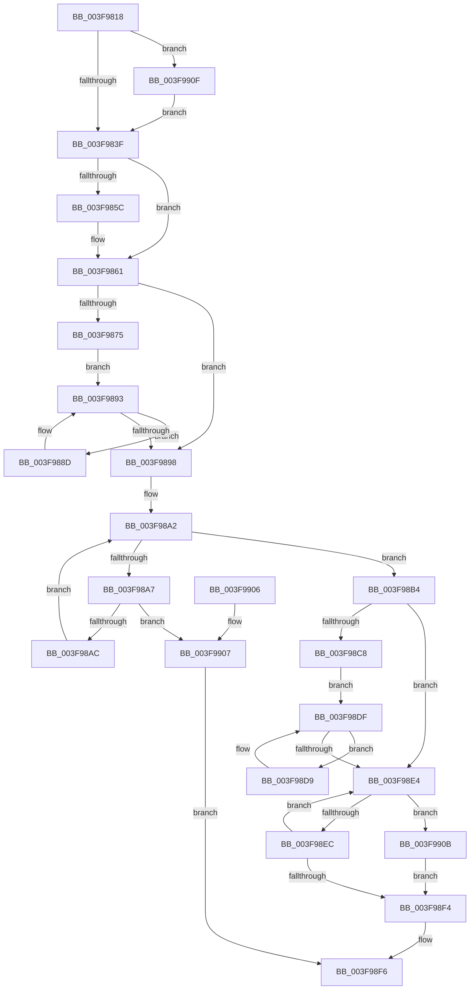

# RtlpGenericMATSPlusWorker

- RVA: `0x003F9818`–`0x003F9921` (길이 `265` bytes)
- VA: `0x00000001403F9818`
- 실행 섹션: `.text`
- PDB 이름 있음: `예`; PDB Function 태그: `아니요`
- unwind 정보 RVA: `0x00098420`
- 디코드: `76`개 명령, `265/265` bytes 표시
- 미해석 바이트: `0` (있으면 어셈블리에 `.byte`로 보존)

> 이 문서는 커널 이미지의 기계어와 PDB 기호를 분석해 생성했습니다. 4번과 5번은 함수 원형과 자료형을 바이너리 사용 방식에서 추정한 C 해석이며 원본 소스 복구 결과는 아닙니다.

## 1. Dependencies

- 직접 호출 지점: **0**; 고유 호출 대상: **0**
- 직접 호출자로 확인된 함수: **1**
- RIP 상대 이미지 참조: **0**

### Outgoing calls
- 직접 디코드된 call 명령이 없습니다.

### Direct callers
- [RtlScrubMemory](RtlScrubMemory_function_003F96DC.md) at `0x003F9795`
- [RtlScrubMemory](RtlScrubMemory_function_003F96DC.md) at `0x003F97A2`

### Static image references
- 디코드된 RIP-relative 메모리 참조가 없습니다.

## 2. Other-region calls and transfers

- 다른 실행 섹션으로 향하는 call: **0**
- 별도 외부 분기/꼬리 이동을 확인하지 못했습니다.

## 3. Assembly (complete function range)

```asm
003F9818  48 89 5C 24 08                  mov qword ptr [rsp + 8], rbx
003F981D  48 89 74 24 10                  mov qword ptr [rsp + 0x10], rsi
003F9822  48 89 7C 24 18                  mov qword ptr [rsp + 0x18], rdi
003F9827  44 8B D1                        mov r10d, ecx
003F982A  8B F2                           mov esi, edx
003F982C  4D 8B D8                        mov r11, r8
003F982F  41 B9 00 04 00 00               mov r9d, 0x400
003F9835  41 F6 C0 04                     test r8b, 4
003F9839  0F 85 D0 00 00 00               jne 0x1403f990f
003F983F  49 8B C2                        mov rax, r10
003F9842  49 8B C9                        mov rcx, r9
003F9845  48 C1 E0 20                     shl rax, 0x20
003F9849  B3 01                           mov bl, 1
003F984B  49 0B C2                        or rax, r10
003F984E  48 D1 E9                        shr rcx, 1
003F9851  49 8B FB                        mov rdi, r11
003F9854  F3 48 AB                        rep stosq qword ptr [rdi], rax
003F9857  44 84 CB                        test bl, r9b
003F985A  74 05                           je 0x1403f9861
003F985C  47 89 54 8B FC                  mov dword ptr [r11 + r9*4 - 4], r10d
003F9861  65 48 8B 04 25 20 00 00 00      mov rax, qword ptr gs:[0x20]
003F986A  8B 90 E8 00 00 00               mov edx, dword ptr [rax + 0xe8]
003F9870  48 85 D2                        test rdx, rdx
003F9873  74 23                           je 0x1403f9898
003F9875  F0 83 0C 24 00                  lock or dword ptr [rsp], 0
003F987A  48 8D 4A FF                     lea rcx, [rdx - 1]
003F987E  48 F7 D1                        not rcx
003F9881  49 8D B8 00 10 00 00            lea rdi, [r8 + 0x1000]
003F9888  49 23 C8                        and rcx, r8
003F988B  EB 06                           jmp 0x1403f9893
003F988D  0F AE 39                        clflush byte ptr [rcx]
003F9890  48 03 CA                        add rcx, rdx
003F9893  48 3B CF                        cmp rcx, rdi
003F9896  72 F5                           jb 0x1403f988d
003F9898  49 8B D0                        mov rdx, r8
003F989B  49 8D 88 00 10 00 00            lea rcx, [r8 + 0x1000]
003F98A2  48 3B D1                        cmp rdx, rcx
003F98A5  73 0D                           jae 0x1403f98b4
003F98A7  44 39 12                        cmp dword ptr [rdx], r10d
003F98AA  75 5B                           jne 0x1403f9907
003F98AC  89 32                           mov dword ptr [rdx], esi
003F98AE  48 83 C2 04                     add rdx, 4
003F98B2  EB EE                           jmp 0x1403f98a2
003F98B4  65 48 8B 04 25 20 00 00 00      mov rax, qword ptr gs:[0x20]
003F98BD  8B B8 E8 00 00 00               mov edi, dword ptr [rax + 0xe8]
003F98C3  48 85 FF                        test rdi, rdi
003F98C6  74 1C                           je 0x1403f98e4
003F98C8  F0 83 0C 24 00                  lock or dword ptr [rsp], 0
003F98CD  48 8D 57 FF                     lea rdx, [rdi - 1]
003F98D1  48 F7 D2                        not rdx
003F98D4  49 23 D0                        and rdx, r8
003F98D7  EB 06                           jmp 0x1403f98df
003F98D9  0F AE 3A                        clflush byte ptr [rdx]
003F98DC  48 03 D7                        add rdx, rdi
003F98DF  48 3B D1                        cmp rdx, rcx
003F98E2  72 F5                           jb 0x1403f98d9
003F98E4  48 83 E9 04                     sub rcx, 4
003F98E8  39 31                           cmp dword ptr [rcx], esi
003F98EA  75 1F                           jne 0x1403f990b
003F98EC  44 89 11                        mov dword ptr [rcx], r10d
003F98EF  49 3B C8                        cmp rcx, r8
003F98F2  75 F0                           jne 0x1403f98e4
003F98F4  8A C3                           mov al, bl
003F98F6  48 8B 5C 24 08                  mov rbx, qword ptr [rsp + 8]
003F98FB  48 8B 74 24 10                  mov rsi, qword ptr [rsp + 0x10]
003F9900  48 8B 7C 24 18                  mov rdi, qword ptr [rsp + 0x18]
003F9905  C3                              ret
003F9906  CC                              int3
003F9907  32 C0                           xor al, al
003F9909  EB EB                           jmp 0x1403f98f6
003F990B  32 DB                           xor bl, bl
003F990D  EB E5                           jmp 0x1403f98f4
003F990F  45 89 10                        mov dword ptr [r8], r10d
003F9912  4D 8D 58 04                     lea r11, [r8 + 4]
003F9916  41 B9 FF 03 00 00               mov r9d, 0x3ff
003F991C  E9 1E FF FF FF                  jmp 0x1403f983f
```

## 4. C-style interpretation (structured pseudocode)

```c
__int64 __fastcall RtlpGenericMATSPlusWorker(int a1, int a2, __int64 a3)
{
    __int64 result;
    __int64 v_rbx;
    unsigned int v_stack_p0;
    unsigned __int64 v_stack_p10;
    unsigned __int64 v_stack_p18;
    unsigned __int64 v_stack_p8;

    v_stack_p8 = v_rbx;
    v_stack_p10 = v_rsi;
    v_stack_p18 = v_rdi;
    if ((((unsigned __int8)(a3)) & (4)) != 0) goto loc_003F990F;
loc_003F983F:
    result = ((unsigned int)(a1)) << (32);
    result = (result) | ((unsigned int)(a1));
    a1 = ((unsigned int)(0x400ULL)) >> (1);
    if (((1) & ((unsigned __int8)((unsigned int)(0x400ULL)))) != 0) {
        *(unsigned int *)(a3 + (unsigned int)(0x400ULL) * 4 - 4) = (unsigned int)((unsigned int)(a1));
    }
    if ((unsigned int)(*(unsigned int *)(*(unsigned __int64 *)(gs_base + (0 + 32)) + 232)) == 0) goto loc_003F9898;
    a1 = ~((unsigned int)(*(unsigned int *)(*(unsigned __int64 *)(gs_base + (0 + 32)) + 232)) - 1);
    a1 = (a1) & (a3);
    goto loc_003F9893;
loc_003F988D:
    a1 = (a1) + ((unsigned int)(*(unsigned int *)(*(unsigned __int64 *)(gs_base + (0 + 32)) + 232)));
loc_003F9893:
    if (a1 < (a3 + 4096)) goto loc_003F988D;
loc_003F9898:
loc_003F98A2:
    if (a3 >= (a3 + 4096)) goto loc_003F98B4;
    if ((*(unsigned int *)(a3)) != ((unsigned int)((unsigned int)(a1)))) goto loc_003F9907;
    *(unsigned int *)(a3) = (unsigned int)((unsigned int)(a2));
    a2 = (a3) + (4);
    goto loc_003F98A2;
loc_003F98B4:
    if ((unsigned int)(*(unsigned int *)(*(unsigned __int64 *)(gs_base + (0 + 32)) + 232)) == 0) goto loc_003F98E4;
    a2 = ~((unsigned int)(*(unsigned int *)(*(unsigned __int64 *)(gs_base + (0 + 32)) + 232)) - 1);
    a2 = (a2) & (a3);
    goto loc_003F98DF;
loc_003F98D9:
    a2 = (a2) + ((unsigned int)(*(unsigned int *)(*(unsigned __int64 *)(gs_base + (0 + 32)) + 232)));
loc_003F98DF:
    if (a2 < (a3 + 4096)) goto loc_003F98D9;
loc_003F98E4:
    a1 = (a3 + 4096) - (4);
    if ((*(unsigned int *)(a1)) != ((unsigned int)((unsigned int)(a2)))) goto loc_003F990B;
    *(unsigned int *)(a1) = (unsigned int)((unsigned int)(a1));
    if (a1 != a3) goto loc_003F98E4;
loc_003F98F4:
loc_003F98F6:
    return 1;
loc_003F9907:
    result = 0;
    goto loc_003F98F6;
loc_003F990B:
    v_rbx = 0;
    goto loc_003F98F4;
loc_003F990F:
    *(unsigned int *)(a3) = (unsigned int)((unsigned int)(a1));
    goto loc_003F983F;
}
```

## 5. (Beta) C Style

```c
int64_t RtlpGenericMATSPlusWorker(int32_t Arg1, int32_t Arg2, int64_t Arg3)
{
    int64_t result;
    int64_t local_rbx;
    uint32_t v_stack_p0;
    uint64_t v_stack_p10;
    uint64_t v_stack_p18;
    uint64_t v_stack_p8;

    v_stack_p8 = local_rbx;
    v_stack_p10 = local_rsi;
    v_stack_p18 = local_rdi;
    if ((((uint8_t)(Arg3)) & (4)) != 0) goto loc_003F990F;
loc_003F983F:
    result = ((uint32_t)(Arg1)) << (32);
    result = (result) | ((uint32_t)(Arg1));
    Arg1 = ((uint32_t)(0x400ULL)) >> (1);
    if (((1) & ((uint8_t)((uint32_t)(0x400ULL)))) != 0) {
        *(uint32_t *)(Arg3 + (uint32_t)(0x400ULL) * 4 - 0x4) = (uint32_t)((uint32_t)(Arg1));
    }
    if ((uint32_t)(*(uint32_t *)(*(uint64_t *)(gs_base + (0 + 0x20)) + 0xE8)) == 0) goto loc_003F9898;
    Arg1 = ~((uint32_t)(*(uint32_t *)(*(uint64_t *)(gs_base + (0 + 0x20)) + 0xE8)) - 1);
    Arg1 = (Arg1) & (Arg3);
    goto loc_003F9893;
loc_003F988D:
    Arg1 = (Arg1) + ((uint32_t)(*(uint32_t *)(*(uint64_t *)(gs_base + (0 + 0x20)) + 0xE8)));
loc_003F9893:
    if (Arg1 < (Arg3 + 4096)) goto loc_003F988D;
loc_003F9898:
loc_003F98A2:
    if (Arg3 >= (Arg3 + 4096)) goto loc_003F98B4;
    if ((*(uint32_t *)(Arg3)) != ((uint32_t)((uint32_t)(Arg1)))) goto loc_003F9907;
    *(uint32_t *)(Arg3) = (uint32_t)((uint32_t)(Arg2));
    Arg2 = (Arg3) + (4);
    goto loc_003F98A2;
loc_003F98B4:
    if ((uint32_t)(*(uint32_t *)(*(uint64_t *)(gs_base + (0 + 0x20)) + 0xE8)) == 0) goto loc_003F98E4;
    Arg2 = ~((uint32_t)(*(uint32_t *)(*(uint64_t *)(gs_base + (0 + 0x20)) + 0xE8)) - 1);
    Arg2 = (Arg2) & (Arg3);
    goto loc_003F98DF;
loc_003F98D9:
    Arg2 = (Arg2) + ((uint32_t)(*(uint32_t *)(*(uint64_t *)(gs_base + (0 + 0x20)) + 0xE8)));
loc_003F98DF:
    if (Arg2 < (Arg3 + 4096)) goto loc_003F98D9;
loc_003F98E4:
    Arg1 = (Arg3 + 4096) - (4);
    if ((*(uint32_t *)(Arg1)) != ((uint32_t)((uint32_t)(Arg2)))) goto loc_003F990B;
    *(uint32_t *)(Arg1) = (uint32_t)((uint32_t)(Arg1));
    if (Arg1 != Arg3) goto loc_003F98E4;
loc_003F98F4:
loc_003F98F6:
    return 1;
loc_003F9907:
    result = 0;
    goto loc_003F98F6;
loc_003F990B:
    local_rbx = 0;
    goto loc_003F98F4;
loc_003F990F:
    *(uint32_t *)(Arg3) = (uint32_t)((uint32_t)(Arg1));
    goto loc_003F983F;
}
```

## 6. Execution-region graph

[열기: 2D/3D 그래프와 함수 탐색 컨트롤 패널](../../../control-panel.html?section=text&rva=0x003F9818&view=graph)

- 2D 그래프는 위에서 아래로 흐르고, 3D 그래프는 빈 공간을 드래그해 회전합니다. Shift+드래그는 이동, 휠은 확대·축소, 함수 노드 선택은 대상 보고서 이동입니다.

### Static fallback


