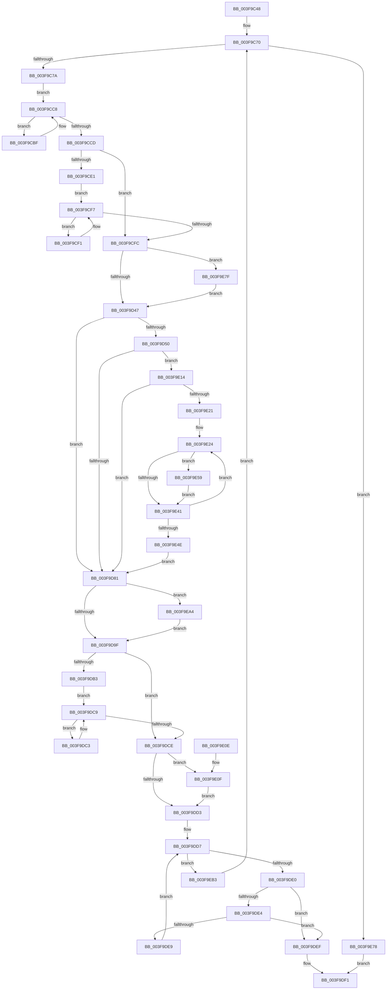

# RtlpGenericStrideWorker

- RVA: `0x003F9C48`–`0x003F9EBB` (길이 `627` bytes)
- VA: `0x00000001403F9C48`
- 실행 섹션: `.text`
- PDB 이름 있음: `예`; PDB Function 태그: `아니요`
- unwind 정보 RVA: `0x00098454`
- 디코드: `185`개 명령, `627/627` bytes 표시
- 미해석 바이트: `0` (있으면 어셈블리에 `.byte`로 보존)

> 이 문서는 커널 이미지의 기계어와 PDB 기호를 분석해 생성했습니다. 4번과 5번은 함수 원형과 자료형을 바이너리 사용 방식에서 추정한 C 해석이며 원본 소스 복구 결과는 아닙니다.

## 1. Dependencies

- 직접 호출 지점: **0**; 고유 호출 대상: **0**
- 직접 호출자로 확인된 함수: **1**
- RIP 상대 이미지 참조: **0**

### Outgoing calls
- 직접 디코드된 call 명령이 없습니다.

### Direct callers
- [RtlScrubMemory](RtlScrubMemory_function_003F96DC.md) at `0x003F97CF`
- [RtlScrubMemory](RtlScrubMemory_function_003F96DC.md) at `0x003F97DF`

### Static image references
- 디코드된 RIP-relative 메모리 참조가 없습니다.

## 2. Other-region calls and transfers

- 다른 실행 섹션으로 향하는 call: **0**
- 별도 외부 분기/꼬리 이동을 확인하지 못했습니다.

## 3. Assembly (complete function range)

```asm
003F9C48  48 8B C4                        mov rax, rsp
003F9C4B  48 89 58 08                     mov qword ptr [rax + 8], rbx
003F9C4F  48 89 68 10                     mov qword ptr [rax + 0x10], rbp
003F9C53  48 89 70 18                     mov qword ptr [rax + 0x18], rsi
003F9C57  48 89 78 20                     mov qword ptr [rax + 0x20], rdi
003F9C5B  41 54                           push r12
003F9C5D  41 55                           push r13
003F9C5F  41 56                           push r14
003F9C61  41 57                           push r15
003F9C63  33 FF                           xor edi, edi
003F9C65  44 8B E2                        mov r12d, edx
003F9C68  44 8B F7                        mov r14d, edi
003F9C6B  4D 8B D9                        mov r11, r9
003F9C6E  8B F1                           mov esi, ecx
003F9C70  41 83 FE 06                     cmp r14d, 6
003F9C74  0F 83 FE 01 00 00               jae 0x1403f9e78
003F9C7A  47 8D 2C 36                     lea r13d, [r14 + r14]
003F9C7E  4D 8B FB                        mov r15, r11
003F9C81  49 C1 EF 02                     shr r15, 2
003F9C85  4D 8D 8B 00 10 00 00            lea r9, [r11 + 0x1000]
003F9C8C  48 B8 AB AA AA AA AA AA AA AA   movabs rax, 0xaaaaaaaaaaaaaaab
003F9C96  41 8B ED                        mov ebp, r13d
003F9C99  49 F7 E7                        mul r15
003F9C9C  48 C1 EA 03                     shr rdx, 3
003F9CA0  48 8D 04 52                     lea rax, [rdx + rdx*2]
003F9CA4  48 C1 E0 02                     shl rax, 2
003F9CA8  4C 2B F8                        sub r15, rax
003F9CAB  41 2B EF                        sub ebp, r15d
003F9CAE  8B CD                           mov ecx, ebp
003F9CB0  45 3B FD                        cmp r15d, r13d
003F9CB3  8D 45 0C                        lea eax, [rbp + 0xc]
003F9CB6  0F 47 C8                        cmova ecx, eax
003F9CB9  49 8D 0C 8B                     lea rcx, [r11 + rcx*4]
003F9CBD  EB 09                           jmp 0x1403f9cc8
003F9CBF  89 31                           mov dword ptr [rcx], esi
003F9CC1  89 71 04                        mov dword ptr [rcx + 4], esi
003F9CC4  48 83 C1 30                     add rcx, 0x30
003F9CC8  49 3B C9                        cmp rcx, r9
003F9CCB  72 F2                           jb 0x1403f9cbf
003F9CCD  65 48 8B 04 25 20 00 00 00      mov rax, qword ptr gs:[0x20]
003F9CD6  8B 90 E8 00 00 00               mov edx, dword ptr [rax + 0xe8]
003F9CDC  48 85 D2                        test rdx, rdx
003F9CDF  74 1B                           je 0x1403f9cfc
003F9CE1  F0 09 3C 24                     lock or dword ptr [rsp], edi
003F9CE5  48 8D 4A FF                     lea rcx, [rdx - 1]
003F9CE9  48 F7 D1                        not rcx
003F9CEC  49 23 CB                        and rcx, r11
003F9CEF  EB 06                           jmp 0x1403f9cf7
003F9CF1  0F AE 39                        clflush byte ptr [rcx]
003F9CF4  48 03 CA                        add rcx, rdx
003F9CF7  49 3B C9                        cmp rcx, r9
003F9CFA  72 F5                           jb 0x1403f9cf1
003F9CFC  45 3B FD                        cmp r15d, r13d
003F9CFF  8D 45 0C                        lea eax, [rbp + 0xc]
003F9D02  8B CD                           mov ecx, ebp
003F9D04  41 BA 00 10 00 00               mov r10d, 0x1000
003F9D0A  0F 47 C8                        cmova ecx, eax
003F9D0D  4D 8B C3                        mov r8, r11
003F9D10  48 8D 0C 8D 00 00 00 00         lea rcx, [rcx*4]
003F9D18  4A 8D 04 19                     lea rax, [rcx + r11]
003F9D1C  49 3B C1                        cmp rax, r9
003F9D1F  4C 0F 46 D1                     cmovbe r10, rcx
003F9D23  4D 03 D3                        add r10, r11
003F9D26  49 8B D2                        mov rdx, r10
003F9D29  49 2B D3                        sub rdx, r11
003F9D2C  48 83 C2 03                     add rdx, 3
003F9D30  48 8B C2                        mov rax, rdx
003F9D33  48 C1 E8 02                     shr rax, 2
003F9D37  4D 3B DA                        cmp r11, r10
003F9D3A  48 0F 47 C7                     cmova rax, rdi
003F9D3E  48 85 C0                        test rax, rax
003F9D41  0F 85 38 01 00 00               jne 0x1403f9e7f
003F9D47  49 83 C0 08                     add r8, 8
003F9D4B  4D 3B D1                        cmp r10, r9
003F9D4E  73 31                           jae 0x1403f9d81
003F9D50  B8 AB AA AA AA                  mov eax, 0xaaaaaaab
003F9D55  49 8B C9                        mov rcx, r9
003F9D58  49 2B CA                        sub rcx, r10
003F9D5B  49 8B D9                        mov rbx, r9
003F9D5E  48 C1 F9 02                     sar rcx, 2
003F9D62  F7 E1                           mul ecx
003F9D64  C1 EA 03                        shr edx, 3
003F9D67  8D 04 52                        lea eax, [rdx + rdx*2]
003F9D6A  C1 E0 02                        shl eax, 2
003F9D6D  2B C8                           sub ecx, eax
003F9D6F  8B C1                           mov eax, ecx
003F9D71  48 C1 E0 02                     shl rax, 2
003F9D75  48 2B D8                        sub rbx, rax
003F9D78  4C 3B D3                        cmp r10, rbx
003F9D7B  0F 85 93 00 00 00               jne 0x1403f9e14
003F9D81  49 8B C9                        mov rcx, r9
003F9D84  49 2B C8                        sub rcx, r8
003F9D87  48 83 C1 03                     add rcx, 3
003F9D8B  48 C1 E9 02                     shr rcx, 2
003F9D8F  4D 3B C1                        cmp r8, r9
003F9D92  48 0F 47 CF                     cmova rcx, rdi
003F9D96  48 85 C9                        test rcx, rcx
003F9D99  0F 85 05 01 00 00               jne 0x1403f9ea4
003F9D9F  65 48 8B 04 25 20 00 00 00      mov rax, qword ptr gs:[0x20]
003F9DA8  8B 90 E8 00 00 00               mov edx, dword ptr [rax + 0xe8]
003F9DAE  48 85 D2                        test rdx, rdx
003F9DB1  74 1B                           je 0x1403f9dce
003F9DB3  F0 09 3C 24                     lock or dword ptr [rsp], edi
003F9DB7  48 8D 4A FF                     lea rcx, [rdx - 1]
003F9DBB  48 F7 D1                        not rcx
003F9DBE  49 23 CB                        and rcx, r11
003F9DC1  EB 06                           jmp 0x1403f9dc9
003F9DC3  0F AE 39                        clflush byte ptr [rcx]
003F9DC6  48 03 CA                        add rcx, rdx
003F9DC9  49 3B C9                        cmp rcx, r9
003F9DCC  72 F5                           jb 0x1403f9dc3
003F9DCE  45 3B FD                        cmp r15d, r13d
003F9DD1  77 3C                           ja 0x1403f9e0f
003F9DD3  49 8D 0C AB                     lea rcx, [r11 + rbp*4]
003F9DD7  49 3B C9                        cmp rcx, r9
003F9DDA  0F 83 D3 00 00 00               jae 0x1403f9eb3
003F9DE0  39 31                           cmp dword ptr [rcx], esi
003F9DE2  75 0B                           jne 0x1403f9def
003F9DE4  39 71 04                        cmp dword ptr [rcx + 4], esi
003F9DE7  75 06                           jne 0x1403f9def
003F9DE9  48 83 C1 30                     add rcx, 0x30
003F9DED  EB E8                           jmp 0x1403f9dd7
003F9DEF  32 C0                           xor al, al
003F9DF1  48 8B 5C 24 28                  mov rbx, qword ptr [rsp + 0x28]
003F9DF6  48 8B 6C 24 30                  mov rbp, qword ptr [rsp + 0x30]
003F9DFB  48 8B 74 24 38                  mov rsi, qword ptr [rsp + 0x38]
003F9E00  48 8B 7C 24 40                  mov rdi, qword ptr [rsp + 0x40]
003F9E05  41 5F                           pop r15
003F9E07  41 5E                           pop r14
003F9E09  41 5D                           pop r13
003F9E0B  41 5C                           pop r12
003F9E0D  C3                              ret
003F9E0E  CC                              int3
003F9E0F  83 C5 0C                        add ebp, 0xc
003F9E12  EB BF                           jmp 0x1403f9dd3
003F9E14  49 83 C2 30                     add r10, 0x30
003F9E18  4C 3B C3                        cmp r8, rbx
003F9E1B  0F 83 60 FF FF FF               jae 0x1403f9d81
003F9E21  45 33 ED                        xor r13d, r13d
003F9E24  49 8B D2                        mov rdx, r10
003F9E27  49 2B D0                        sub rdx, r8
003F9E2A  48 83 C2 03                     add rdx, 3
003F9E2E  48 8B C2                        mov rax, rdx
003F9E31  48 C1 E8 02                     shr rax, 2
003F9E35  4D 3B C2                        cmp r8, r10
003F9E38  49 0F 47 C5                     cmova rax, r13
003F9E3C  48 85 C0                        test rax, rax
003F9E3F  75 18                           jne 0x1403f9e59
003F9E41  49 83 C0 08                     add r8, 8
003F9E45  49 83 C2 30                     add r10, 0x30
003F9E49  4C 3B C3                        cmp r8, rbx
003F9E4C  72 D6                           jb 0x1403f9e24
003F9E4E  47 8D 2C 36                     lea r13d, [r14 + r14]
003F9E52  33 FF                           xor edi, edi
003F9E54  E9 28 FF FF FF                  jmp 0x1403f9d81
003F9E59  48 83 E2 FC                     and rdx, 0xfffffffffffffffc
003F9E5D  49 8B F8                        mov rdi, r8
003F9E60  4D 3B C2                        cmp r8, r10
003F9E63  49 8B C4                        mov rax, r12
003F9E66  49 0F 47 D5                     cmova rdx, r13
003F9E6A  48 8B CA                        mov rcx, rdx
003F9E6D  48 C1 E9 02                     shr rcx, 2
003F9E71  F3 AB                           rep stosd dword ptr [rdi], eax
003F9E73  4C 03 C2                        add r8, rdx
003F9E76  EB C9                           jmp 0x1403f9e41
003F9E78  B0 01                           mov al, 1
003F9E7A  E9 72 FF FF FF                  jmp 0x1403f9df1
003F9E7F  48 83 E2 FC                     and rdx, 0xfffffffffffffffc
003F9E83  49 8B C4                        mov rax, r12
003F9E86  4D 3B DA                        cmp r11, r10
003F9E89  48 0F 47 D7                     cmova rdx, rdi
003F9E8D  49 8B FB                        mov rdi, r11
003F9E90  48 8B CA                        mov rcx, rdx
003F9E93  48 C1 E9 02                     shr rcx, 2
003F9E97  F3 AB                           rep stosd dword ptr [rdi], eax
003F9E99  33 FF                           xor edi, edi
003F9E9B  4E 8D 04 1A                     lea r8, [rdx + r11]
003F9E9F  E9 A3 FE FF FF                  jmp 0x1403f9d47
003F9EA4  49 8B C4                        mov rax, r12
003F9EA7  49 8B F8                        mov rdi, r8
003F9EAA  F3 AB                           rep stosd dword ptr [rdi], eax
003F9EAC  33 FF                           xor edi, edi
003F9EAE  E9 EC FE FF FF                  jmp 0x1403f9d9f
003F9EB3  41 FF C6                        inc r14d
003F9EB6  E9 B5 FD FF FF                  jmp 0x1403f9c70
```

## 4. C-style interpretation (structured pseudocode)

```c
__int64 __fastcall RtlpGenericStrideWorker(int a1, __int64 a2, __int64 a3, __int64 a4)
{
    __int64 result;
    __int64 v_r10;
    __int64 v_r13;
    __int64 v_r14;
    __int64 v_r15;
    __int64 v_rbp;
    __int64 v_rbx;
    __int64 v_rdi;
    unsigned int v_stack_m20;
    unsigned __int64 v_stack_p10;
    unsigned __int64 v_stack_p18;
    unsigned __int64 v_stack_p20;
    unsigned __int64 v_stack_p8;

    *(unsigned __int64 *)(v_rsp + 8) = v_rbx;
    *(unsigned __int64 *)(v_rsp + 16) = v_rbp;
    *(unsigned __int64 *)(v_rsp + 24) = v_rsi;
    *(unsigned __int64 *)(v_rsp + 32) = v_rdi;
    v_rdi = 0;
loc_003F9C70:
    if (0 >= 6) goto loc_003F9E78;
    v_r15 = (a4) >> (2);
    a2 = (a2) >> (3);
    result = (a2 + a2 * 2) << (2);
    v_r15 = (v_r15) - (result);
    v_rbp = (unsigned int)(((unsigned int)((unsigned int)(0 + 0 * 1))) - ((unsigned int)(v_r15)));
    a1 = (unsigned int)((unsigned int)(v_rbp));
    if (((unsigned int)(v_r15)) > ((unsigned int)(0 + 0 * 1))) { a1 = (unsigned int)(v_rbp + 12); }
    goto loc_003F9CC8;
loc_003F9CBF:
    *(unsigned int *)(a4 + a1 * 4) = (unsigned int)((unsigned int)(a1));
    *(unsigned int *)(a4 + a1 * 4 + 4) = (unsigned int)((unsigned int)(a1));
    a1 = (a4 + a1 * 4) + (48);
loc_003F9CC8:
    if (a1 < (a4 + 4096)) goto loc_003F9CBF;
    if ((unsigned int)(*(unsigned int *)(*(unsigned __int64 *)(gs_base + (0 + 32)) + 232)) == 0) goto loc_003F9CFC;
    a1 = ~((unsigned int)(*(unsigned int *)(*(unsigned __int64 *)(gs_base + (0 + 32)) + 232)) - 1);
    a1 = (a1) & (a4);
    goto loc_003F9CF7;
loc_003F9CF1:
    a1 = (a1) + ((unsigned int)(*(unsigned int *)(*(unsigned __int64 *)(gs_base + (0 + 32)) + 232)));
loc_003F9CF7:
    if (a1 < (a4 + 4096)) goto loc_003F9CF1;
loc_003F9CFC:
    a1 = (unsigned int)((unsigned int)(v_rbp));
    if (((unsigned int)(v_r15)) > ((unsigned int)(0 + 0 * 1))) { a1 = (unsigned int)(v_rbp + 12); }
    v_r10 = (unsigned int)(0x1000ULL);
    if ((a1 * 4 + a4 * 1) <= (a4 + 4096)) { v_r10 = a1 * 4; }
    v_r10 = (v_r10) + (a4);
    a2 = (v_r10) - (a4);
    a2 = (a2) + (3);
    result = (a2) >> (2);
    if (a4 > v_r10) { result = 0; }
    if (result != 0) goto loc_003F9E7F;
loc_003F9D47:
    a3 = (a4) + (8);
    if (v_r10 >= (a4 + 4096)) goto loc_003F9D81;
    a1 = (a4 + 4096) - (v_r10);
    a1 = (a1) >> (2);
    a2 = (unsigned int)((a2) >> (3));
    result = (unsigned int)((a2 + a2 * 2) << (2));
    a1 = (unsigned int)((a1) - ((unsigned int)(result)));
    result = ((unsigned int)(a1)) << (2);
    v_rbx = (a4 + 4096) - (result);
    if (v_r10 != v_rbx) goto loc_003F9E14;
loc_003F9D81:
    a1 = (a4 + 4096) - (a3);
    a1 = (a1) + (3);
    a1 = (a1) >> (2);
    if (a3 > (a4 + 4096)) { a1 = 0; }
    if (a1 != 0) goto loc_003F9EA4;
loc_003F9D9F:
    if ((unsigned int)(*(unsigned int *)(*(unsigned __int64 *)(gs_base + (0 + 32)) + 232)) == 0) goto loc_003F9DCE;
    a1 = ~((unsigned int)(*(unsigned int *)(*(unsigned __int64 *)(gs_base + (0 + 32)) + 232)) - 1);
    a1 = (a1) & (a4);
    goto loc_003F9DC9;
loc_003F9DC3:
    a1 = (a1) + ((unsigned int)(*(unsigned int *)(*(unsigned __int64 *)(gs_base + (0 + 32)) + 232)));
loc_003F9DC9:
    if (a1 < (a4 + 4096)) goto loc_003F9DC3;
loc_003F9DCE:
    if (((unsigned int)(v_r15)) > ((unsigned int)(0 + 0 * 1))) goto loc_003F9E0F;
loc_003F9DD3:
loc_003F9DD7:
    if ((a4 + v_rbp * 4) >= (a4 + 4096)) goto loc_003F9EB3;
    if ((*(unsigned int *)(a4 + v_rbp * 4)) != ((unsigned int)((unsigned int)(a1)))) goto loc_003F9DEF;
    if ((*(unsigned int *)(a4 + v_rbp * 4 + 4)) != ((unsigned int)((unsigned int)(a1)))) goto loc_003F9DEF;
    a1 = (a4 + v_rbp * 4) + (48);
    goto loc_003F9DD7;
loc_003F9DEF:
    result = 0;
loc_003F9DF1:
    return result;
loc_003F9E0F:
    v_rbp = (unsigned int)((v_stack_p10) + (12));
    goto loc_003F9DD3;
loc_003F9E14:
    v_r10 = (v_r10) + (48);
    if (a3 >= v_stack_p8) goto loc_003F9D81;
    v_r13 = 0;
loc_003F9E24:
    a2 = (v_r10) - (a3);
    a2 = (a2) + (3);
    result = (a2) >> (2);
    if (a3 > v_r10) { result = 0; }
    if (result != 0) goto loc_003F9E59;
loc_003F9E41:
    a3 = (a3) + (8);
    v_r10 = (v_r10) + (48);
    if (a3 < v_stack_p8) goto loc_003F9E24;
    v_rdi = 0;
    goto loc_003F9D81;
loc_003F9E59:
    a2 = (a2) & (-4);
    if (a3 > v_r10) { a2 = 0 + 0 * 1; }
    a1 = (a2) >> (2);
    a3 = (a3) + (a2);
    goto loc_003F9E41;
loc_003F9E78:
    goto loc_003F9DF1;
loc_003F9E7F:
    a2 = (a2) & (-4);
    if (a4 > v_r10) { a2 = a3; }
    a1 = (a2) >> (2);
    v_rdi = 0;
    goto loc_003F9D47;
loc_003F9EA4:
    v_rdi = 0;
    goto loc_003F9D9F;
loc_003F9EB3:
    v_r14 = (unsigned int)((0) + 1);
    goto loc_003F9C70;
}
```

## 5. (Beta) C Style

```c
int64_t RtlpGenericStrideWorker(int32_t Arg1, int64_t Arg2, int64_t Arg3, int64_t Arg4)
{
    int64_t result;
    int64_t local_r10;
    int64_t local_r13;
    int64_t local_r14;
    int64_t local_r15;
    int64_t local_rbp;
    int64_t local_rbx;
    int64_t local_rdi;
    uint32_t v_stack_m20;
    uint64_t v_stack_p10;
    uint64_t v_stack_p18;
    uint64_t v_stack_p20;
    uint64_t v_stack_p8;

    *(uint64_t *)(local_rsp + 0x8) = local_rbx;
    *(uint64_t *)(local_rsp + 0x10) = local_rbp;
    *(uint64_t *)(local_rsp + 0x18) = local_rsi;
    *(uint64_t *)(local_rsp + 0x20) = local_rdi;
    local_rdi = 0;
loc_003F9C70:
    if (0 >= 6) goto loc_003F9E78;
    local_r15 = (Arg4) >> (2);
    Arg2 = (Arg2) >> (3);
    result = (Arg2 + Arg2 * 2) << (2);
    local_r15 = (local_r15) - (result);
    local_rbp = (uint32_t)(((uint32_t)((uint32_t)(0 + 0 * 1))) - ((uint32_t)(local_r15)));
    Arg1 = (uint32_t)((uint32_t)(local_rbp));
    if (((uint32_t)(local_r15)) > ((uint32_t)(0 + 0 * 1))) { Arg1 = (uint32_t)(local_rbp + 12); }
    goto loc_003F9CC8;
loc_003F9CBF:
    *(uint32_t *)(Arg4 + Arg1 * 4) = (uint32_t)((uint32_t)(Arg1));
    *(uint32_t *)(Arg4 + Arg1 * 4 + 0x4) = (uint32_t)((uint32_t)(Arg1));
    Arg1 = (Arg4 + Arg1 * 4) + (48);
loc_003F9CC8:
    if (Arg1 < (Arg4 + 4096)) goto loc_003F9CBF;
    if ((uint32_t)(*(uint32_t *)(*(uint64_t *)(gs_base + (0 + 0x20)) + 0xE8)) == 0) goto loc_003F9CFC;
    Arg1 = ~((uint32_t)(*(uint32_t *)(*(uint64_t *)(gs_base + (0 + 0x20)) + 0xE8)) - 1);
    Arg1 = (Arg1) & (Arg4);
    goto loc_003F9CF7;
loc_003F9CF1:
    Arg1 = (Arg1) + ((uint32_t)(*(uint32_t *)(*(uint64_t *)(gs_base + (0 + 0x20)) + 0xE8)));
loc_003F9CF7:
    if (Arg1 < (Arg4 + 4096)) goto loc_003F9CF1;
loc_003F9CFC:
    Arg1 = (uint32_t)((uint32_t)(local_rbp));
    if (((uint32_t)(local_r15)) > ((uint32_t)(0 + 0 * 1))) { Arg1 = (uint32_t)(local_rbp + 12); }
    local_r10 = (uint32_t)(0x1000ULL);
    if ((Arg1 * 4 + Arg4 * 1) <= (Arg4 + 4096)) { local_r10 = Arg1 * 4; }
    local_r10 = (local_r10) + (Arg4);
    Arg2 = (local_r10) - (Arg4);
    Arg2 = (Arg2) + (3);
    result = (Arg2) >> (2);
    if (Arg4 > local_r10) { result = 0; }
    if (result != 0) goto loc_003F9E7F;
loc_003F9D47:
    Arg3 = (Arg4) + (8);
    if (local_r10 >= (Arg4 + 4096)) goto loc_003F9D81;
    Arg1 = (Arg4 + 4096) - (local_r10);
    Arg1 = (Arg1) >> (2);
    Arg2 = (uint32_t)((Arg2) >> (3));
    result = (uint32_t)((Arg2 + Arg2 * 2) << (2));
    Arg1 = (uint32_t)((Arg1) - ((uint32_t)(result)));
    result = ((uint32_t)(Arg1)) << (2);
    local_rbx = (Arg4 + 4096) - (result);
    if (local_r10 != local_rbx) goto loc_003F9E14;
loc_003F9D81:
    Arg1 = (Arg4 + 4096) - (Arg3);
    Arg1 = (Arg1) + (3);
    Arg1 = (Arg1) >> (2);
    if (Arg3 > (Arg4 + 4096)) { Arg1 = 0; }
    if (Arg1 != 0) goto loc_003F9EA4;
loc_003F9D9F:
    if ((uint32_t)(*(uint32_t *)(*(uint64_t *)(gs_base + (0 + 0x20)) + 0xE8)) == 0) goto loc_003F9DCE;
    Arg1 = ~((uint32_t)(*(uint32_t *)(*(uint64_t *)(gs_base + (0 + 0x20)) + 0xE8)) - 1);
    Arg1 = (Arg1) & (Arg4);
    goto loc_003F9DC9;
loc_003F9DC3:
    Arg1 = (Arg1) + ((uint32_t)(*(uint32_t *)(*(uint64_t *)(gs_base + (0 + 0x20)) + 0xE8)));
loc_003F9DC9:
    if (Arg1 < (Arg4 + 4096)) goto loc_003F9DC3;
loc_003F9DCE:
    if (((uint32_t)(local_r15)) > ((uint32_t)(0 + 0 * 1))) goto loc_003F9E0F;
loc_003F9DD3:
loc_003F9DD7:
    if ((Arg4 + local_rbp * 4) >= (Arg4 + 4096)) goto loc_003F9EB3;
    if ((*(uint32_t *)(Arg4 + local_rbp * 4)) != ((uint32_t)((uint32_t)(Arg1)))) goto loc_003F9DEF;
    if ((*(uint32_t *)(Arg4 + local_rbp * 4 + 0x4)) != ((uint32_t)((uint32_t)(Arg1)))) goto loc_003F9DEF;
    Arg1 = (Arg4 + local_rbp * 4) + (48);
    goto loc_003F9DD7;
loc_003F9DEF:
    result = 0;
loc_003F9DF1:
    return result;
loc_003F9E0F:
    local_rbp = (uint32_t)((v_stack_p10) + (12));
    goto loc_003F9DD3;
loc_003F9E14:
    local_r10 = (local_r10) + (48);
    if (Arg3 >= v_stack_p8) goto loc_003F9D81;
    local_r13 = 0;
loc_003F9E24:
    Arg2 = (local_r10) - (Arg3);
    Arg2 = (Arg2) + (3);
    result = (Arg2) >> (2);
    if (Arg3 > local_r10) { result = 0; }
    if (result != 0) goto loc_003F9E59;
loc_003F9E41:
    Arg3 = (Arg3) + (8);
    local_r10 = (local_r10) + (48);
    if (Arg3 < v_stack_p8) goto loc_003F9E24;
    local_rdi = 0;
    goto loc_003F9D81;
loc_003F9E59:
    Arg2 = (Arg2) & (-4);
    if (Arg3 > local_r10) { Arg2 = 0 + 0 * 1; }
    Arg1 = (Arg2) >> (2);
    Arg3 = (Arg3) + (Arg2);
    goto loc_003F9E41;
loc_003F9E78:
    goto loc_003F9DF1;
loc_003F9E7F:
    Arg2 = (Arg2) & (-4);
    if (Arg4 > local_r10) { Arg2 = Arg3; }
    Arg1 = (Arg2) >> (2);
    local_rdi = 0;
    goto loc_003F9D47;
loc_003F9EA4:
    local_rdi = 0;
    goto loc_003F9D9F;
loc_003F9EB3:
    local_r14 = (uint32_t)((0) + 1);
    goto loc_003F9C70;
}
```

## 6. Execution-region graph

[열기: 2D/3D 그래프와 함수 탐색 컨트롤 패널](../../../control-panel.html?section=text&rva=0x003F9C48&view=graph)

- 2D 그래프는 위에서 아래로 흐르고, 3D 그래프는 빈 공간을 드래그해 회전합니다. Shift+드래그는 이동, 휠은 확대·축소, 함수 노드 선택은 대상 보고서 이동입니다.

### Static fallback


