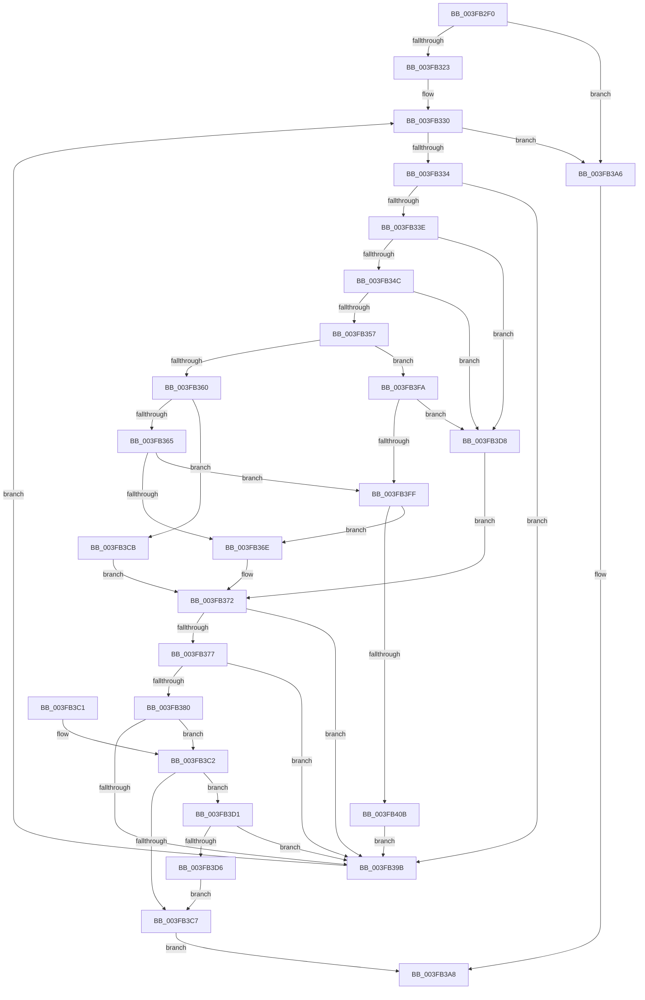

# RtlpOwnerAcesPresent

- RVA: `0x003FB2F0`–`0x003FB40D` (길이 `285` bytes)
- VA: `0x00000001403FB2F0`
- 실행 섹션: `.text`
- PDB 이름 있음: `예`; PDB Function 태그: `아니요`
- unwind 정보 RVA: `0x00069B38`
- 디코드: `86`개 명령, `285/285` bytes 표시
- 미해석 바이트: `0` (있으면 어셈블리에 `.byte`로 보존)

> 이 문서는 커널 이미지의 기계어와 PDB 기호를 분석해 생성했습니다. 4번과 5번은 함수 원형과 자료형을 바이너리 사용 방식에서 추정한 C 해석이며 원본 소스 복구 결과는 아닙니다.

## 1. Dependencies

- 직접 호출 지점: **1**; 고유 호출 대상: **1**
- 직접 호출자로 확인된 함수: **4**
- RIP 상대 이미지 참조: **1**

### Outgoing calls
- `0x003FB392` → [memcmp](../6C/memcmp_function_006C6B10.md) (function, `0x006C6B10`)

### Direct callers
- [SeAccessCheckWithHint](../3A/SeAccessCheckWithHint_function_003A6C30.md) at `0x003A70AA`
- [SeAccessCheckByType](../44/SeAccessCheckByType_function_00440BC8.md) at `0x004418C9`
- [SepCommonAccessCheckEx](../47/SepCommonAccessCheckEx_function_0047602C.md) at `0x00476727`
- [RtlpNewSecurityObject](../../page/92/RtlpNewSecurityObject_function_0092AB50.md) at `0x0092C3B9`

### Static image references
- `0x003FB308` → RVA `0x00FD9AA0` (`PAGEDATA`; read)

## 2. Other-region calls and transfers

- 다른 실행 섹션으로 향하는 call: **0**
- 별도 외부 분기/꼬리 이동을 확인하지 못했습니다.

## 3. Assembly (complete function range)

```asm
003FB2F0  48 89 5C 24 08                  mov qword ptr [rsp + 8], rbx
003FB2F5  48 89 6C 24 10                  mov qword ptr [rsp + 0x10], rbp
003FB2FA  48 89 74 24 18                  mov qword ptr [rsp + 0x18], rsi
003FB2FF  57                              push rdi
003FB300  41 56                           push r14
003FB302  41 57                           push r15
003FB304  48 83 EC 20                     sub rsp, 0x20
003FB308  48 8B 05 91 E7 BD 00            mov rax, qword ptr [rip + 0xbde791]
003FB30F  44 0F B6 F9                     movzx r15d, cl
003FB313  4C 8B B0 00 02 00 00            mov r14, qword ptr [rax + 0x200]
003FB31A  48 85 D2                        test rdx, rdx
003FB31D  0F 84 83 00 00 00               je 0x1403fb3a6
003FB323  0F B7 6A 04                     movzx ebp, word ptr [rdx + 4]
003FB327  48 8D 5A 08                     lea rbx, [rdx + 8]
003FB32B  33 FF                           xor edi, edi
003FB32D  0F 1F 00                        nop dword ptr [rax]
003FB330  3B FD                           cmp edi, ebp
003FB332  73 72                           jae 0x1403fb3a6
003FB334  0F B6 73 01                     movzx esi, byte ptr [rbx + 1]
003FB338  40 F6 C6 08                     test sil, 8
003FB33C  75 5D                           jne 0x1403fb39b
003FB33E  0F B6 0B                        movzx ecx, byte ptr [rbx]
003FB341  8D 41 FB                        lea eax, [rcx - 5]
003FB344  3C 03                           cmp al, 3
003FB346  0F 86 8C 00 00 00               jbe 0x1403fb3d8
003FB34C  8D 41 F5                        lea eax, [rcx - 0xb]
003FB34F  3C 01                           cmp al, 1
003FB351  0F 86 81 00 00 00               jbe 0x1403fb3d8
003FB357  80 F9 0F                        cmp cl, 0xf
003FB35A  0F 83 9A 00 00 00               jae 0x1403fb3fa
003FB360  80 F9 04                        cmp cl, 4
003FB363  74 66                           je 0x1403fb3cb
003FB365  80 F9 0B                        cmp cl, 0xb
003FB368  0F 83 91 00 00 00               jae 0x1403fb3ff
003FB36E  48 8D 4B 08                     lea rcx, [rbx + 8]
003FB372  48 85 C9                        test rcx, rcx
003FB375  74 24                           je 0x1403fb39b
003FB377  0F B7 01                        movzx eax, word ptr [rcx]
003FB37A  66 41 3B 06                     cmp ax, word ptr [r14]
003FB37E  75 1B                           jne 0x1403fb39b
003FB380  44 8B C0                        mov r8d, eax
003FB383  49 8B D6                        mov rdx, r14
003FB386  49 C1 E8 08                     shr r8, 8
003FB38A  4E 8D 04 85 08 00 00 00         lea r8, [r8*4 + 8]
003FB392  E8 79 B7 2C 00                  call 0x1406c6b10
003FB397  85 C0                           test eax, eax
003FB399  74 27                           je 0x1403fb3c2
003FB39B  0F B7 43 02                     movzx eax, word ptr [rbx + 2]
003FB39F  FF C7                           inc edi
003FB3A1  48 03 D8                        add rbx, rax
003FB3A4  EB 8A                           jmp 0x1403fb330
003FB3A6  32 C0                           xor al, al
003FB3A8  48 8B 5C 24 40                  mov rbx, qword ptr [rsp + 0x40]
003FB3AD  48 8B 6C 24 48                  mov rbp, qword ptr [rsp + 0x48]
003FB3B2  48 8B 74 24 50                  mov rsi, qword ptr [rsp + 0x50]
003FB3B7  48 83 C4 20                     add rsp, 0x20
003FB3BB  41 5F                           pop r15
003FB3BD  41 5E                           pop r14
003FB3BF  5F                              pop rdi
003FB3C0  C3                              ret
003FB3C1  CC                              int3
003FB3C2  45 84 FF                        test r15b, r15b
003FB3C5  75 0A                           jne 0x1403fb3d1
003FB3C7  B0 01                           mov al, 1
003FB3C9  EB DD                           jmp 0x1403fb3a8
003FB3CB  48 8D 4B 0C                     lea rcx, [rbx + 0xc]
003FB3CF  EB A1                           jmp 0x1403fb372
003FB3D1  41 84 F7                        test r15b, sil
003FB3D4  74 C5                           je 0x1403fb39b
003FB3D6  EB EF                           jmp 0x1403fb3c7
003FB3D8  8B 4B 08                        mov ecx, dword ptr [rbx + 8]
003FB3DB  8B C1                           mov eax, ecx
003FB3DD  83 E0 02                        and eax, 2
003FB3E0  83 E1 01                        and ecx, 1
003FB3E3  48 C1 E0 03                     shl rax, 3
003FB3E7  48 83 C8 0C                     or rax, 0xc
003FB3EB  48 C1 E1 04                     shl rcx, 4
003FB3EF  48 03 C3                        add rax, rbx
003FB3F2  48 03 C8                        add rcx, rax
003FB3F5  E9 78 FF FF FF                  jmp 0x1403fb372
003FB3FA  80 F9 10                        cmp cl, 0x10
003FB3FD  76 D9                           jbe 0x1403fb3d8
003FB3FF  80 E9 0D                        sub cl, 0xd
003FB402  80 F9 01                        cmp cl, 1
003FB405  0F 86 63 FF FF FF               jbe 0x1403fb36e
003FB40B  EB 8E                           jmp 0x1403fb39b
```

## 4. C-style interpretation (structured pseudocode)

```c
__int64 __fastcall RtlpOwnerAcesPresent(unsigned __int8 a1, __int64 a2)
{
    __int64 result;
    __int64 v_rbx;
    __int64 v_rdi;
    __int64 v_rsp;
    unsigned __int64 v_stack_p10;
    unsigned __int64 v_stack_p18;
    unsigned __int64 v_stack_p8;

    v_stack_p8 = v_rbx;
    v_stack_p10 = v_rbp;
    v_stack_p18 = v_rsi;
    v_rsp = (v_rsp) - (32);
    if (a2 == 0) goto loc_003FB3A6;
    v_rdi = 0;
loc_003FB330:
    if (0 >= ((unsigned int)(*(unsigned __int16 *)(a2 + 4)))) goto loc_003FB3A6;
    if ((((unsigned __int8)(*(unsigned __int8 *)(a2 + 8 + 1))) & (8)) != 0) goto loc_003FB39B;
    if (((unsigned __int8)(*(unsigned __int8 *)(a2 + 8) - 5)) <= 3) goto loc_003FB3D8;
    if (((unsigned __int8)(*(unsigned __int8 *)(a2 + 8) - 11)) <= 1) goto loc_003FB3D8;
    if (((unsigned __int8)(*(unsigned __int8 *)(a2 + 8))) >= 15) goto loc_003FB3FA;
    if (((unsigned __int8)(*(unsigned __int8 *)(a2 + 8))) == 4) goto loc_003FB3CB;
    if (((unsigned __int8)(*(unsigned __int8 *)(a2 + 8))) >= 11) goto loc_003FB3FF;
loc_003FB36E:
loc_003FB372:
    if (a2 + 8 + 8 == 0) goto loc_003FB39B;
    if (((unsigned __int16)(*(unsigned __int16 *)(a2 + 8 + 8))) != (*(unsigned __int16 *)(*(unsigned __int64 *)(*(unsigned __int64 *)(v_rip + 12445585) + 512)))) goto loc_003FB39B;
    a3 = ((unsigned int)((unsigned int)(*(unsigned __int16 *)(a2 + 8 + 8)))) >> (8);
    result = memcmp(a2 + 8 + 8, *(unsigned __int64 *)(*(unsigned __int64 *)(v_rip + 12445585) + 512), a3 * 4 + 8, a4);
    if ((unsigned int)(result) == 0) goto loc_003FB3C2;
loc_003FB39B:
    v_rdi = (unsigned int)((v_rdi) + 1);
    v_rbx = (a2 + 8) + (*(unsigned __int16 *)(a2 + 8 + 2));
    goto loc_003FB330;
loc_003FB3A6:
    result = 0;
loc_003FB3A8:
    v_rsp = (v_rsp) + (32);
    return result;
loc_003FB3C2:
    if (a1 != 0) goto loc_003FB3D1;
loc_003FB3C7:
    goto loc_003FB3A8;
loc_003FB3CB:
    goto loc_003FB372;
loc_003FB3D1:
    if (((a1) & ((unsigned __int8)(v_stack_p18))) == 0) goto loc_003FB39B;
    goto loc_003FB3C7;
loc_003FB3D8:
    result = (unsigned int)(((unsigned int)((unsigned int)((unsigned int)(*(unsigned int *)(v_stack_p8 + 8))))) & (2));
    a1 = (unsigned int)(((unsigned int)(*(unsigned int *)(v_stack_p8 + 8))) & (1));
    result = (result) << (3);
    result = (result) | (12);
    a1 = (a1) << (4);
    result = (result) + (v_stack_p8);
    a1 = (a1) + (result);
    goto loc_003FB372;
loc_003FB3FA:
    if (a1 <= 16) goto loc_003FB3D8;
loc_003FB3FF:
    a1 = (unsigned __int8)((a1) - (13));
    if (a1 <= 1) goto loc_003FB36E;
    goto loc_003FB39B;
}
```

## 5. (Beta) C Style

```c
int64_t RtlpOwnerAcesPresent(uint8_t Arg1, int64_t Arg2)
{
    int64_t result;
    int64_t local_rbx;
    int64_t local_rdi;
    int64_t local_rsp;
    uint64_t v_stack_p10;
    uint64_t v_stack_p18;
    uint64_t v_stack_p8;

    v_stack_p8 = local_rbx;
    v_stack_p10 = local_rbp;
    v_stack_p18 = local_rsi;
    local_rsp = (local_rsp) - (32);
    if (Arg2 == 0) goto loc_003FB3A6;
    local_rdi = 0;
loc_003FB330:
    if (0 >= ((uint32_t)(*(uint16_t *)(Arg2 + 0x4)))) goto loc_003FB3A6;
    if ((((uint8_t)(*(uint8_t *)(Arg2 + 0x8 + 0x1))) & (8)) != 0) goto loc_003FB39B;
    if (((uint8_t)(*(uint8_t *)(Arg2 + 0x8) - 5)) <= 3) goto loc_003FB3D8;
    if (((uint8_t)(*(uint8_t *)(Arg2 + 0x8) - 11)) <= 1) goto loc_003FB3D8;
    if (((uint8_t)(*(uint8_t *)(Arg2 + 0x8))) >= 15) goto loc_003FB3FA;
    if (((uint8_t)(*(uint8_t *)(Arg2 + 0x8))) == 4) goto loc_003FB3CB;
    if (((uint8_t)(*(uint8_t *)(Arg2 + 0x8))) >= 11) goto loc_003FB3FF;
loc_003FB36E:
loc_003FB372:
    if (Arg2 + 8 + 8 == 0) goto loc_003FB39B;
    if (((uint16_t)(*(uint16_t *)(Arg2 + 0x8 + 0x8))) != (*(uint16_t *)(*(uint64_t *)(*(uint64_t *)(v_rip + 0xBDE791) + 0x200)))) goto loc_003FB39B;
    a3 = ((uint32_t)((uint32_t)(*(uint16_t *)(Arg2 + 0x8 + 0x8)))) >> (8);
    result = memcmp(Arg2 + 8 + 8, *(uint64_t *)(*(uint64_t *)(v_rip + 0xBDE791) + 0x200), a3 * 4 + 8, a4);
    if ((uint32_t)(result) == 0) goto loc_003FB3C2;
loc_003FB39B:
    local_rdi = (uint32_t)((local_rdi) + 1);
    local_rbx = (Arg2 + 8) + (*(uint16_t *)(Arg2 + 0x8 + 0x2));
    goto loc_003FB330;
loc_003FB3A6:
    result = 0;
loc_003FB3A8:
    local_rsp = (local_rsp) + (32);
    return result;
loc_003FB3C2:
    if (Arg1 != 0) goto loc_003FB3D1;
loc_003FB3C7:
    goto loc_003FB3A8;
loc_003FB3CB:
    goto loc_003FB372;
loc_003FB3D1:
    if (((Arg1) & ((uint8_t)(v_stack_p18))) == 0) goto loc_003FB39B;
    goto loc_003FB3C7;
loc_003FB3D8:
    result = (uint32_t)(((uint32_t)((uint32_t)((uint32_t)(*(uint32_t *)(v_stack_p8 + 0x8))))) & (2));
    Arg1 = (uint32_t)(((uint32_t)(*(uint32_t *)(v_stack_p8 + 0x8))) & (1));
    result = (result) << (3);
    result = (result) | (12);
    Arg1 = (Arg1) << (4);
    result = (result) + (v_stack_p8);
    Arg1 = (Arg1) + (result);
    goto loc_003FB372;
loc_003FB3FA:
    if (Arg1 <= 16) goto loc_003FB3D8;
loc_003FB3FF:
    Arg1 = (uint8_t)((Arg1) - (13));
    if (Arg1 <= 1) goto loc_003FB36E;
    goto loc_003FB39B;
}
```

## 6. Execution-region graph

[열기: 2D/3D 그래프와 함수 탐색 컨트롤 패널](../../../control-panel.html?section=text&rva=0x003FB2F0&view=graph)

- 2D 그래프는 위에서 아래로 흐르고, 3D 그래프는 빈 공간을 드래그해 회전합니다. Shift+드래그는 이동, 휠은 확대·축소, 함수 노드 선택은 대상 보고서 이동입니다.

### Static fallback


