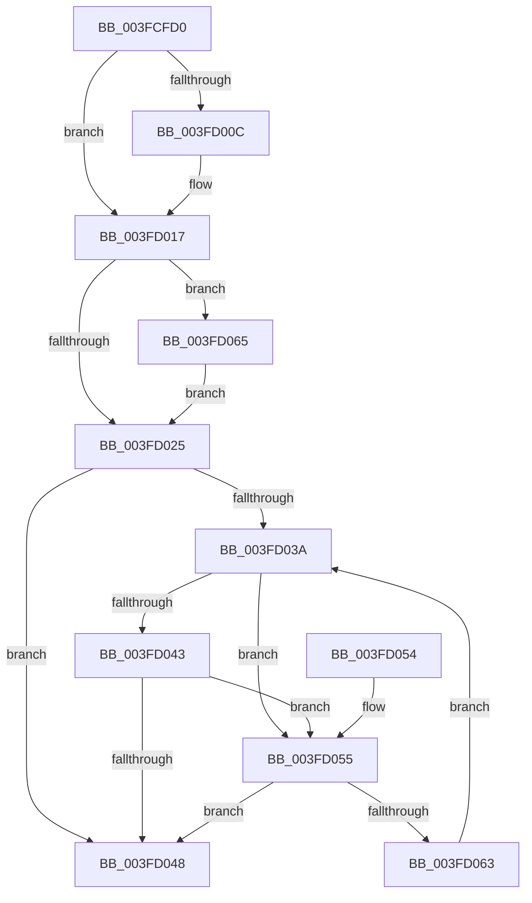

# RtlpPopulateContext

- RVA: `0x003FCFD0`–`0x003FD08C` (길이 `188` bytes)
- VA: `0x00000001403FCFD0`
- 실행 섹션: `.text`
- PDB 이름 있음: `예`; PDB Function 태그: `아니요`
- unwind 정보 RVA: `0x000DB714`
- 디코드: `55`개 명령, `188/188` bytes 표시
- 미해석 바이트: `0` (있으면 어셈블리에 `.byte`로 보존)

> 이 문서는 커널 이미지의 기계어와 PDB 기호를 분석해 생성했습니다. 4번과 5번은 함수 원형과 자료형을 바이너리 사용 방식에서 추정한 C 해석이며 원본 소스 복구 결과는 아닙니다.

## 1. Dependencies

- 직접 호출 지점: **0**; 고유 호출 대상: **0**
- 직접 호출자로 확인된 함수: **3**
- RIP 상대 이미지 참조: **0**

### Outgoing calls
- 직접 디코드된 call 명령이 없습니다.

### Direct callers
- [RtlRemoveEntryHashTable](../2E/RtlRemoveEntryHashTable_function_002EEF00.md) at `0x002EEF56`
- [RtlInitStrongEnumerationHashTable](RtlInitStrongEnumerationHashTable_function_003FCF80.md) at `0x003FCF99`
- [RtlInsertEntryHashTable](../43/RtlInsertEntryHashTable_function_00437660.md) at `0x00437794`

### Static image references
- 디코드된 RIP-relative 메모리 참조가 없습니다.

## 2. Other-region calls and transfers

- 다른 실행 섹션으로 향하는 call: **0**
- 별도 외부 분기/꼬리 이동을 확인하지 못했습니다.

## 3. Assembly (complete function range)

```asm
003FCFD0  4C 8B D1                        mov r10, rcx
003FCFD3  41 8B C0                        mov eax, r8d
003FCFD6  8B 49 04                        mov ecx, dword ptr [rcx + 4]
003FCFD9  4D 8B C8                        mov r9, r8
003FCFDC  D3 E8                           shr eax, cl
003FCFDE  69 C8 6D 4E C6 41               imul ecx, eax, 0x41c64e6d
003FCFE4  69 C0 CD 0D 01 00               imul eax, eax, 0x10dcd
003FCFEA  81 C1 39 30 00 00               add ecx, 0x3039
003FCFF0  FF C0                           inc eax
003FCFF2  C1 E9 10                        shr ecx, 0x10
003FCFF5  25 00 00 FF FF                  and eax, 0xffff0000
003FCFFA  0B C8                           or ecx, eax
003FCFFC  41 8B 42 10                     mov eax, dword ptr [r10 + 0x10]
003FD000  44 8B C0                        mov r8d, eax
003FD003  44 23 C1                        and r8d, ecx
003FD006  45 3B 42 0C                     cmp r8d, dword ptr [r10 + 0xc]
003FD00A  73 0B                           jae 0x1403fd017
003FD00C  44 8D 04 00                     lea r8d, [rax + rax]
003FD010  41 83 C8 01                     or r8d, 1
003FD014  44 23 C1                        and r8d, ecx
003FD017  41 81 7A 08 80 00 00 00         cmp dword ptr [r10 + 8], 0x80
003FD01F  4D 8B 5A 20                     mov r11, qword ptr [r10 + 0x20]
003FD023  77 40                           ja 0x1403fd065
003FD025  41 8B C8                        mov ecx, r8d
003FD028  48 C1 E1 04                     shl rcx, 4
003FD02C  49 03 CB                        add rcx, r11
003FD02F  4C 8B D1                        mov r10, rcx
003FD032  4C 8B 01                        mov r8, qword ptr [rcx]
003FD035  4C 3B C1                        cmp r8, rcx
003FD038  74 0E                           je 0x1403fd048
003FD03A  49 8B 40 10                     mov rax, qword ptr [r8 + 0x10]
003FD03E  48 85 C0                        test rax, rax
003FD041  74 12                           je 0x1403fd055
003FD043  49 3B C1                        cmp rax, r9
003FD046  72 0D                           jb 0x1403fd055
003FD048  48 89 0A                        mov qword ptr [rdx], rcx
003FD04B  4C 89 52 08                     mov qword ptr [rdx + 8], r10
003FD04F  4C 89 4A 10                     mov qword ptr [rdx + 0x10], r9
003FD053  C3                              ret
003FD054  CC                              int3
003FD055  49 8B 00                        mov rax, qword ptr [r8]
003FD058  4D 8B D0                        mov r10, r8
003FD05B  4C 8B C0                        mov r8, rax
003FD05E  48 3B C1                        cmp rax, rcx
003FD061  74 E5                           je 0x1403fd048
003FD063  EB D5                           jmp 0x1403fd03a
003FD065  41 8D 80 80 00 00 00            lea eax, [r8 + 0x80]
003FD06C  C7 44 24 08 00 00 00 00         mov dword ptr [rsp + 8], 0
003FD074  0F BD C8                        bsr ecx, eax
003FD077  41 B8 01 00 00 00               mov r8d, 1
003FD07D  41 D3 E0                        shl r8d, cl
003FD080  44 33 C0                        xor r8d, eax
003FD083  8D 41 F9                        lea eax, [rcx - 7]
003FD086  4D 8B 1C C3                     mov r11, qword ptr [r11 + rax*8]
003FD08A  EB 99                           jmp 0x1403fd025
```

## 4. C-style interpretation (structured pseudocode)

```c
__int64 __fastcall RtlpPopulateContext(__int64 a1, __int64 a2, __int64 a3)
{
    __int64 result;
    unsigned int v_stack_p8;

    result = (unsigned int)(((unsigned int)((unsigned int)(a3))) >> ((unsigned __int8)((unsigned int)(*(unsigned int *)(a1 + 4)))));
    a1 = (unsigned int)(((unsigned int)(*(unsigned int *)(a1 + 4))) * ((unsigned int)(result)));
    result = (unsigned int)((result) * ((unsigned int)(result)));
    a1 = (unsigned int)((a1) + (0x3039ULL));
    result = (unsigned int)((result) + 1);
    a1 = (unsigned int)((a1) >> (16));
    result = (unsigned int)((result) & (0xFFFF0000ULL));
    a1 = (unsigned int)((a1) | ((unsigned int)(result)));
    a3 = (unsigned int)(((unsigned int)((unsigned int)((unsigned int)(*(unsigned int *)(a1 + 16))))) & ((unsigned int)(a1)));
    if (((unsigned int)(a3)) < (*(unsigned int *)(a1 + 12))) {
        a3 = (unsigned int)(*(unsigned int *)(a1 + 16)) + (unsigned int)(*(unsigned int *)(a1 + 16)) * 1;
        a3 = (unsigned int)((a3) | (1));
        a3 = (unsigned int)((a3) & ((unsigned int)(a1)));
    }
    if ((*(unsigned int *)(a1 + 8)) > 128) goto loc_003FD065;
loc_003FD025:
    a1 = ((unsigned int)((unsigned int)(a3))) << (4);
    a1 = (a1) + (*(unsigned __int64 *)(a1 + 32));
    if ((*(unsigned __int64 *)(a1)) == a1) goto loc_003FD048;
loc_003FD03A:
    if (*(unsigned __int64 *)(*(unsigned __int64 *)(a1) + 16) == 0) goto loc_003FD055;
    if ((*(unsigned __int64 *)(*(unsigned __int64 *)(a1) + 16)) < a3) goto loc_003FD055;
loc_003FD048:
    *(unsigned __int64 *)(a2) = a1;
    *(unsigned __int64 *)(a2 + 8) = a1;
    *(unsigned __int64 *)(a2 + 16) = a3;
    return *(unsigned __int64 *)(*(unsigned __int64 *)(a1) + 16);
loc_003FD055:
    if ((*(unsigned __int64 *)(*(unsigned __int64 *)(a1))) == a1) goto loc_003FD048;
    goto loc_003FD03A;
loc_003FD065:
    v_stack_p8 = 0;
    a3 = (unsigned int)((1) << ((unsigned __int8)(a1)));
    a3 = (unsigned int)((a3) ^ ((unsigned int)(*(unsigned __int64 *)(*(unsigned __int64 *)(a1)) + 128)));
    goto loc_003FD025;
}
```

## 5. (Beta) C Style

```c
int64_t RtlpPopulateContext(void *Arg1, void *Arg2, int64_t Arg3)
{
    uint8_t *arg1 = (uint8_t *)Arg1;
    uint8_t *arg2 = (uint8_t *)Arg2;

    int64_t result;
    uint32_t v_stack_p8;

    result = (uint32_t)(((uint32_t)((uint32_t)(Arg3))) >> ((uint8_t)((uint32_t)(*(uint32_t *)(arg1 + 0x4)))));
    Arg1 = (uint32_t)(((uint32_t)(*(uint32_t *)(arg1 + 0x4))) * ((uint32_t)(result)));
    result = (uint32_t)((result) * ((uint32_t)(result)));
    Arg1 = (uint32_t)((Arg1) + (0x3039ULL));
    result = (uint32_t)((result) + 1);
    Arg1 = (uint32_t)((Arg1) >> (16));
    result = (uint32_t)((result) & (0xFFFF0000ULL));
    Arg1 = (uint32_t)((Arg1) | ((uint32_t)(result)));
    Arg3 = (uint32_t)(((uint32_t)((uint32_t)((uint32_t)(*(uint32_t *)(arg1 + 0x10))))) & ((uint32_t)(Arg1)));
    if (((uint32_t)(Arg3)) < (*(uint32_t *)(arg1 + 0xC))) {
        Arg3 = (uint32_t)(*(uint32_t *)(arg1 + 0x10)) + (uint32_t)(*(uint32_t *)(arg1 + 0x10)) * 1;
        Arg3 = (uint32_t)((Arg3) | (1));
        Arg3 = (uint32_t)((Arg3) & ((uint32_t)(Arg1)));
    }
    if ((*(uint32_t *)(arg1 + 0x8)) > 128) goto loc_003FD065;
loc_003FD025:
    Arg1 = ((uint32_t)((uint32_t)(Arg3))) << (4);
    Arg1 = (Arg1) + (*(uint64_t *)(arg1 + 0x20));
    if ((*(uint64_t *)(arg1)) == Arg1) goto loc_003FD048;
loc_003FD03A:
    if (*(uint64_t *)(*(uint64_t *)(arg1) + 0x10) == 0) goto loc_003FD055;
    if ((*(uint64_t *)(*(uint64_t *)(arg1) + 0x10)) < Arg3) goto loc_003FD055;
loc_003FD048:
    *(void **)(arg2) = Arg1;
    *(void **)(arg2 + 0x8) = Arg1;
    *(uint64_t *)(arg2 + 0x10) = Arg3;
    return *(uint64_t *)(*(uint64_t *)(arg1) + 0x10);
loc_003FD055:
    if ((*(uint64_t *)(*(uint64_t *)(arg1))) == Arg1) goto loc_003FD048;
    goto loc_003FD03A;
loc_003FD065:
    v_stack_p8 = 0;
    Arg3 = (uint32_t)((1) << ((uint8_t)(Arg1)));
    Arg3 = (uint32_t)((Arg3) ^ ((uint32_t)(*(uint64_t *)(*(uint64_t *)(arg1)) + 128)));
    goto loc_003FD025;
}
```

### 관측된 메모리 오프셋

구조체 형식이 확인되지 않은 접근은 인자 기준의 오프셋으로만 기록했습니다.

| 기준 인자 | 오프셋 표현 | 폭 (bit) | 접근 |
|---|---:|---:|---|
| `Arg1` | `+ 0x4` | `32` | `R` |
| `Arg1` | `+ 0x8` | `32` | `R` |
| `Arg1` | `+ 0xC` | `32` | `R` |
| `Arg1` | `+ 0x10` | `32` | `R` |
| `Arg1` | `+ 0x20` | `64` | `R` |
| `Arg2` | `+ 0x0` | `64` | `W` |
| `Arg2` | `+ 0x8` | `64` | `W` |
| `Arg2` | `+ 0x10` | `64` | `W` |

## 6. Execution-region graph

[열기: 2D/3D 그래프와 함수 탐색 컨트롤 패널](../../../control-panel.html?section=text&rva=0x003FCFD0&view=graph)

- 2D 그래프는 위에서 아래로 흐르고, 3D 그래프는 빈 공간을 드래그해 회전합니다. Shift+드래그는 이동, 휠은 확대·축소, 함수 노드 선택은 대상 보고서 이동입니다.

### Static fallback


