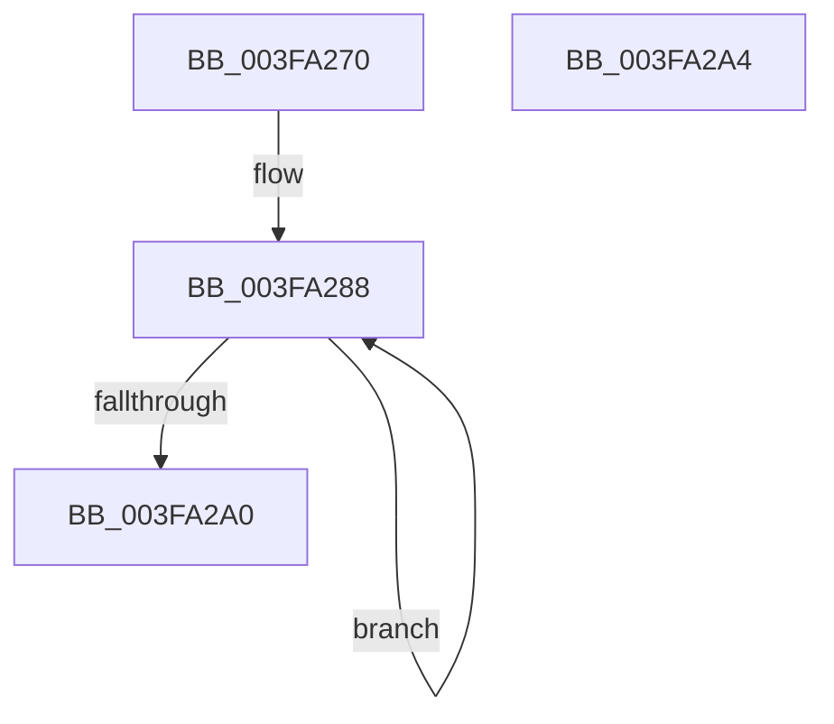

# RtlpSeedGlfsr

- RVA: `0x003FA270`–`0x003FA2A5` (길이 `53` bytes)
- VA: `0x00000001403FA270`
- 실행 섹션: `.text`
- PDB 이름 있음: `예`; PDB Function 태그: `아니요`
- unwind 정보 RVA: `0x000DB714`
- 디코드: `18`개 명령, `53/53` bytes 표시
- 미해석 바이트: `0` (있으면 어셈블리에 `.byte`로 보존)

> 이 문서는 커널 이미지의 기계어와 PDB 기호를 분석해 생성했습니다. 4번과 5번은 함수 원형과 자료형을 바이너리 사용 방식에서 추정한 C 해석이며 원본 소스 복구 결과는 아닙니다.

## 1. Dependencies

- 직접 호출 지점: **0**; 고유 호출 대상: **0**
- 직접 호출자로 확인된 함수: **1**
- RIP 상대 이미지 참조: **1**

### Outgoing calls
- 직접 디코드된 call 명령이 없습니다.

### Direct callers
- [RtlpGenericRandomPatternWorker](RtlpGenericRandomPatternWorker_function_003F9ED0.md) at `0x003F9EFE`

### Static image references
- `0x003FA276` → RVA `0x003FA270` (`RtlpSeedGlfsr`; read)

## 2. Other-region calls and transfers

- 다른 실행 섹션으로 향하는 call: **0**
- 별도 외부 분기/꼬리 이동을 확인하지 못했습니다.

## 3. Assembly (complete function range)

```asm
003FA270  0F 31                           rdtsc
003FA272  48 C1 E2 20                     shl rdx, 0x20
003FA276  4C 8D 05 F3 FF FF FF            lea r8, [rip - 0xd]
003FA27D  4D 8B 00                        mov r8, qword ptr [r8]
003FA280  48 0B C2                        or rax, rdx
003FA283  33 C9                           xor ecx, ecx
003FA285  44 8B C8                        mov r9d, eax
003FA288  BA 01 00 00 00                  mov edx, 1
003FA28D  48 D3 E2                        shl rdx, cl
003FA290  49 23 D1                        and rdx, r9
003FA293  48 D3 E2                        shl rdx, cl
003FA296  FF C1                           inc ecx
003FA298  4C 33 C2                        xor r8, rdx
003FA29B  83 F9 20                        cmp ecx, 0x20
003FA29E  72 E8                           jb 0x1403fa288
003FA2A0  49 8B C0                        mov rax, r8
003FA2A3  C3                              ret
003FA2A4  CC                              int3
```

## 4. C-style interpretation (structured pseudocode)

```c
__int64 __fastcall RtlpSeedGlfsr(int a1, __int64 a2)
{
    __int64 result;

    a2 = (a2) << (32);
    result = (result) | (a2);
    a1 = 0;
loc_003FA288:
    a2 = (1) << (0);
    a2 = (a2) & ((unsigned int)((unsigned int)(result)));
    a2 = (a2) << (0);
    a1 = (unsigned int)((a1) + 1);
    a3 = (*(unsigned __int64 *)(v_rip - 13)) ^ (a2);
    if (a1 < 32) goto loc_003FA288;
    return a3;
}
```

## 5. (Beta) C Style

```c
int64_t RtlpSeedGlfsr(int32_t Arg1, int64_t Arg2)
{
    int64_t result;

    Arg2 = (Arg2) << (32);
    result = (result) | (Arg2);
    Arg1 = 0;
loc_003FA288:
    Arg2 = (1) << (0);
    Arg2 = (Arg2) & ((uint32_t)((uint32_t)(result)));
    Arg2 = (Arg2) << (0);
    Arg1 = (uint32_t)((Arg1) + 1);
    a3 = (*(uint64_t *)(v_rip - 0xD)) ^ (Arg2);
    if (Arg1 < 32) goto loc_003FA288;
    return a3;
}
```

## 6. Execution-region graph

[열기: 2D/3D 그래프와 함수 탐색 컨트롤 패널](../../../control-panel.html?section=text&rva=0x003FA270&view=graph)

- 2D 그래프는 위에서 아래로 흐르고, 3D 그래프는 빈 공간을 드래그해 회전합니다. Shift+드래그는 이동, 휠은 확대·축소, 함수 노드 선택은 대상 보고서 이동입니다.

### Static fallback


