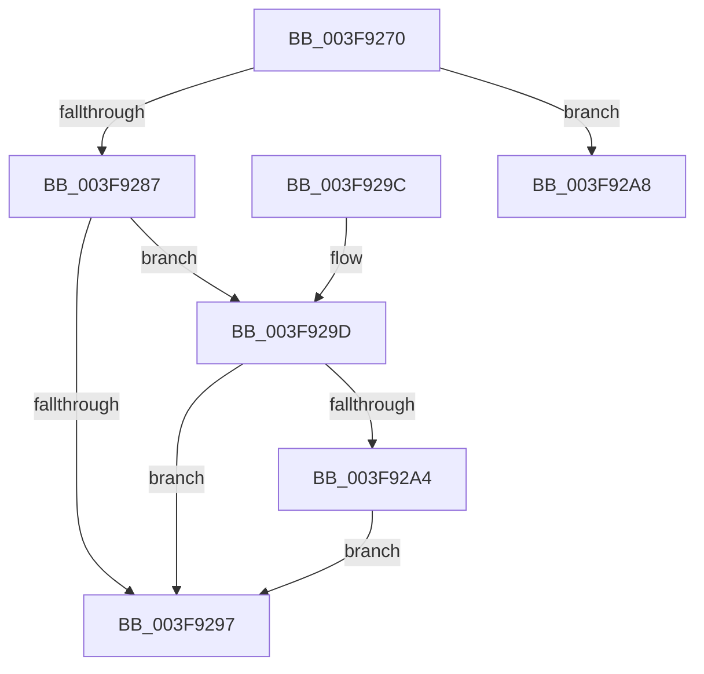

# RtlpUnwindOpSlots

- RVA: `0x003F9270`–`0x003F92B3` (길이 `67` bytes)
- VA: `0x00000001403F9270`
- 실행 섹션: `.text`
- PDB 이름 있음: `예`; PDB Function 태그: `아니요`
- unwind 정보 RVA: `0x000983A8`
- 디코드: `21`개 명령, `67/67` bytes 표시
- 미해석 바이트: `0` (있으면 어셈블리에 `.byte`로 보존)

> 이 문서는 커널 이미지의 기계어와 PDB 기호를 분석해 생성했습니다. 4번과 5번은 함수 원형과 자료형을 바이너리 사용 방식에서 추정한 C 해석이며 원본 소스 복구 결과는 아닙니다.

## 1. Dependencies

- 직접 호출 지점: **1**; 고유 호출 대상: **1**
- 직접 호출자로 확인된 함수: **3**
- RIP 상대 이미지 참조: **1**

### Outgoing calls
- `0x003F92AD` → [RtlRaiseStatus](../2F/RtlRaiseStatus_function_002F6A50.md) (function, `0x002F6A50`)

### Direct callers
- [RtlpxVirtualUnwind](../2F/RtlpxVirtualUnwind_function_002F5110.md) at `0x002F5AC9`
- [RtlpUnwindEpilogue](RtlpUnwindEpilogue_function_003F8E90.md) at `0x003F8F43`
- [RtlIsSpecialUnwind](../5E/RtlIsSpecialUnwind_function_005EECF4.md) at `0x005EED25`

### Static image references
- `0x003F9287` → RVA `0x00013098` (`.rdata`; read)

## 2. Other-region calls and transfers

- 다른 실행 섹션으로 향하는 call: **0**
- 별도 외부 분기/꼬리 이동을 확인하지 못했습니다.

## 3. Assembly (complete function range)

```asm
003F9270  66 89 4C 24 08                  mov word ptr [rsp + 8], cx
003F9275  48 83 EC 28                     sub rsp, 0x28
003F9279  0F B7 D1                        movzx edx, cx
003F927C  C1 EA 08                        shr edx, 8
003F927F  83 E2 0F                        and edx, 0xf
003F9282  83 FA 0B                        cmp edx, 0xb
003F9285  73 21                           jae 0x1403f92a8
003F9287  48 8D 0D 0A 9E C1 FF            lea rcx, [rip - 0x3e61f6]
003F928E  0F B6 04 0A                     movzx eax, byte ptr [rdx + rcx]
003F9292  83 FA 01                        cmp edx, 1
003F9295  74 06                           je 0x1403f929d
003F9297  48 83 C4 28                     add rsp, 0x28
003F929B  C3                              ret
003F929C  CC                              int3
003F929D  F6 44 24 31 F0                  test byte ptr [rsp + 0x31], 0xf0
003F92A2  74 F3                           je 0x1403f9297
003F92A4  FF C0                           inc eax
003F92A6  EB EF                           jmp 0x1403f9297
003F92A8  B9 FF 00 00 C0                  mov ecx, 0xc00000ff
003F92AD  E8 9E D7 EF FF                  call 0x1402f6a50
003F92B2  CC                              int3
```

## 4. C-style interpretation (structured pseudocode)

```c
__int64 __fastcall RtlpUnwindOpSlots(unsigned __int16 a1)
{
    __int64 result;
    __int64 v_rsp;
    unsigned __int8 v_stack_p31;
    unsigned __int16 v_stack_p8;

    v_stack_p8 = a1;
    v_rsp = (v_rsp) - (40);
    a2 = (unsigned int)((a1) >> (8));
    a2 = (unsigned int)((a2) & (15));
    if (((unsigned int)(a2)) >= 11) goto loc_003F92A8;
    if (((unsigned int)(a2)) == 1) goto loc_003F929D;
loc_003F9297:
    v_rsp = (v_rsp) + (40);
    return *(unsigned __int8 *)(a2 + v_rip - 4088310 * 1);
loc_003F929D:
    if (((v_stack_p31) & (240)) == 0) goto loc_003F9297;
    result = (unsigned int)((*(unsigned __int8 *)(a2 + v_rip - 4088310 * 1)) + 1);
    goto loc_003F9297;
loc_003F92A8:
    result = RtlRaiseStatus((unsigned int)(0xC00000FFULL), a2, a3, a4);
    return result;
}
```

## 5. (Beta) C Style

```c
int64_t RtlpUnwindOpSlots(uint16_t Arg1)
{
    int64_t result;
    int64_t local_rsp;
    uint8_t v_stack_p31;
    uint16_t v_stack_p8;

    v_stack_p8 = Arg1;
    local_rsp = (local_rsp) - (40);
    a2 = (uint32_t)((Arg1) >> (8));
    a2 = (uint32_t)((a2) & (15));
    if (((uint32_t)(a2)) >= 11) goto loc_003F92A8;
    if (((uint32_t)(a2)) == 1) goto loc_003F929D;
loc_003F9297:
    local_rsp = (local_rsp) + (40);
    return *(uint8_t *)(a2 + v_rip - 0x3E61F6 * 1);
loc_003F929D:
    if (((v_stack_p31) & (240)) == 0) goto loc_003F9297;
    result = (uint32_t)((*(uint8_t *)(a2 + v_rip - 0x3E61F6 * 1)) + 1);
    goto loc_003F9297;
loc_003F92A8:
    result = RtlRaiseStatus((uint32_t)(0xC00000FFULL), a2, a3, a4);
    return result;
}
```

## 6. Execution-region graph

[열기: 2D/3D 그래프와 함수 탐색 컨트롤 패널](../../../control-panel.html?section=text&rva=0x003F9270&view=graph)

- 2D 그래프는 위에서 아래로 흐르고, 3D 그래프는 빈 공간을 드래그해 회전합니다. Shift+드래그는 이동, 휠은 확대·축소, 함수 노드 선택은 대상 보고서 이동입니다.

### Static fallback


