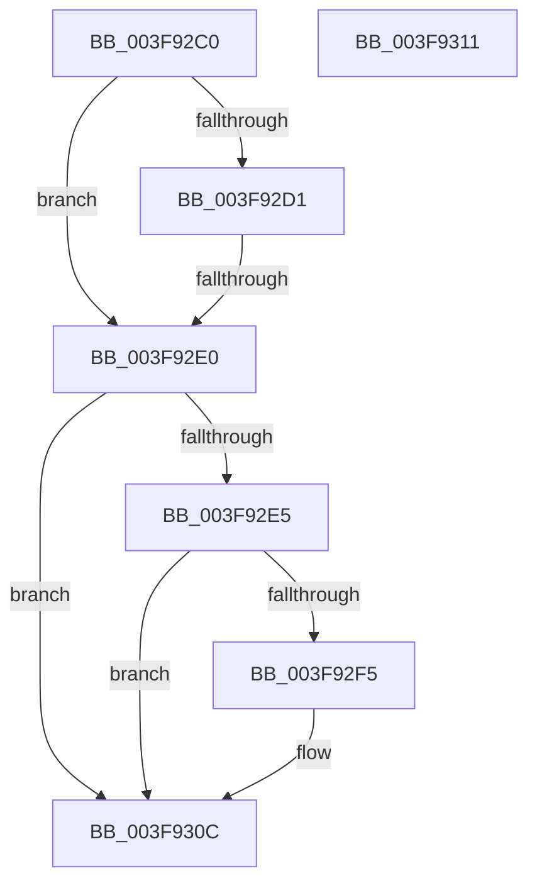

# RtlpVirtualPopShadowStack

- RVA: `0x003F92C0`–`0x003F9312` (길이 `82` bytes)
- VA: `0x00000001403F92C0`
- 실행 섹션: `.text`
- PDB 이름 있음: `예`; PDB Function 태그: `아니요`
- unwind 정보 RVA: `0x000983B4`
- 디코드: `22`개 명령, `82/82` bytes 표시
- 미해석 바이트: `0` (있으면 어셈블리에 `.byte`로 보존)

> 이 문서는 커널 이미지의 기계어와 PDB 기호를 분석해 생성했습니다. 4번과 5번은 함수 원형과 자료형을 바이너리 사용 방식에서 추정한 C 해석이며 원본 소스 복구 결과는 아닙니다.

## 1. Dependencies

- 직접 호출 지점: **0**; 고유 호출 대상: **0**
- 직접 호출자로 확인된 함수: **2**
- RIP 상대 이미지 참조: **0**

### Outgoing calls
- 직접 디코드된 call 명령이 없습니다.

### Direct callers
- [RtlpxVirtualUnwind](../2F/RtlpxVirtualUnwind_function_002F5110.md) at `0x002F56A0`
- [RtlpxVirtualUnwind](../2F/RtlpxVirtualUnwind_function_002F5110.md) at `0x002F5A4B`
- [RtlpUnwindEpilogue](RtlpUnwindEpilogue_function_003F8E90.md) at `0x003F90B9`

### Static image references
- 디코드된 RIP-relative 메모리 참조가 없습니다.

## 2. Other-region calls and transfers

- 다른 실행 섹션으로 향하는 call: **0**
- call이 아닌 외부 분기/꼬리 이동: **1**
  - `0x003F92DE` → [sub_003F9312](Unknown_function_003F9312.md) (`tail-transfer`)

## 3. Assembly (complete function range)

```asm
003F92C0  48 83 EC 08                     sub rsp, 8
003F92C4  45 8B D0                        mov r10d, r8d
003F92C7  44 8B DA                        mov r11d, edx
003F92CA  4C 8B C9                        mov r9, rcx
003F92CD  85 D2                           test edx, edx
003F92CF  74 0F                           je 0x1403f92e0
003F92D1  8B 41 30                        mov eax, dword ptr [rcx + 0x30]
003F92D4  25 40 00 10 00                  and eax, 0x100040
003F92D9  3D 40 00 10 00                  cmp eax, 0x100040
003F92DE  74 32                           je 0x1403f9312
003F92E0  45 85 D2                        test r10d, r10d
003F92E3  74 27                           je 0x1403f930c
003F92E5  41 8B 41 30                     mov eax, dword ptr [r9 + 0x30]
003F92E9  25 80 00 10 00                  and eax, 0x100080
003F92EE  3D 80 00 10 00                  cmp eax, 0x100080
003F92F3  75 17                           jne 0x1403f930c
003F92F5  49 63 91 E8 04 00 00            movsxd rdx, dword ptr [r9 + 0x4e8]
003F92FC  42 8D 0C D5 00 00 00 00         lea ecx, [r10*8]
003F9304  4A 01 8C 0A D0 04 00 00         add qword ptr [rdx + r9 + 0x4d0], rcx
003F930C  48 83 C4 08                     add rsp, 8
003F9310  C3                              ret
003F9311  CC                              int3
```

## 4. C-style interpretation (structured pseudocode)

```c
__int64 __fastcall RtlpVirtualPopShadowStack(__int64 a1, int a2, int a3)
{
    __int64 result;
    __int64 v_rsp;

    v_rsp = (v_rsp) - (8);
    if (a2 == 0) goto loc_003F92E0;
    result = (unsigned int)(((unsigned int)(*(unsigned int *)(a1 + 48))) & (0x100040ULL));
loc_003F92E0:
    if ((unsigned int)((unsigned int)(a3)) == 0) goto loc_003F930C;
    result = (unsigned int)(((unsigned int)(*(unsigned int *)(a1 + 48))) & (0x100080ULL));
    if (((unsigned int)(result)) == 0x100080ULL) {
        a2 = (int)(*(unsigned int *)(a1 + 1256));
        a1 = (unsigned int)(a3) * 8;
    }
    v_rsp = (v_rsp) + (8);
    return result;
}
```

## 5. (Beta) C Style

```c
int64_t RtlpVirtualPopShadowStack(void *Arg1, int32_t Arg2, int32_t Arg3)
{
    uint8_t *arg1 = (uint8_t *)Arg1;

    int64_t result;
    int64_t local_rsp;

    local_rsp = (local_rsp) - (8);
    if (Arg2 == 0) goto loc_003F92E0;
    result = (uint32_t)(((uint32_t)(*(uint32_t *)(arg1 + 0x30))) & (0x100040ULL));
loc_003F92E0:
    if ((uint32_t)((uint32_t)(Arg3)) == 0) goto loc_003F930C;
    result = (uint32_t)(((uint32_t)(*(uint32_t *)(arg1 + 0x30))) & (0x100080ULL));
    if (((uint32_t)(result)) == 0x100080ULL) {
        Arg2 = (int32_t)(*(uint32_t *)(arg1 + 0x4E8));
        Arg1 = (uint32_t)(Arg3) * 8;
    }
    local_rsp = (local_rsp) + (8);
    return result;
}
```

### 관측된 메모리 오프셋

구조체 형식이 확인되지 않은 접근은 인자 기준의 오프셋으로만 기록했습니다.

| 기준 인자 | 오프셋 표현 | 폭 (bit) | 접근 |
|---|---:|---:|---|
| `Arg1` | `+ 0x30` | `32` | `R` |
| `Arg1` | `+ 0x4E8` | `32` | `R` |

## 6. Execution-region graph

[열기: 2D/3D 그래프와 함수 탐색 컨트롤 패널](../../../control-panel.html?section=text&rva=0x003F92C0&view=graph)

- 2D 그래프는 위에서 아래로 흐르고, 3D 그래프는 빈 공간을 드래그해 회전합니다. Shift+드래그는 이동, 휠은 확대·축소, 함수 노드 선택은 대상 보고서 이동입니다.

### Static fallback


