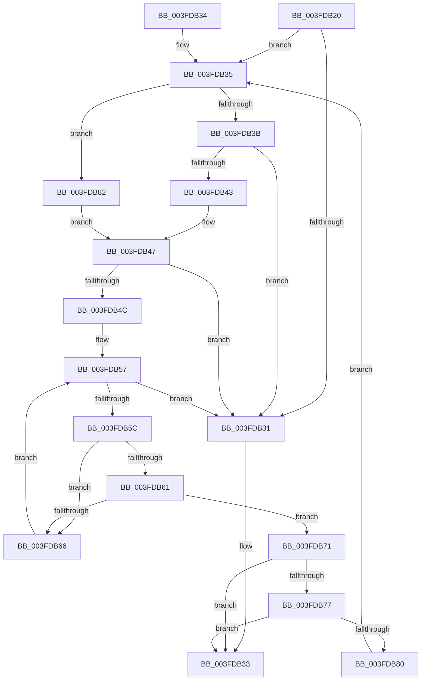

# SeGetTrustLabelAce

- RVA: `0x003FDB20`–`0x003FDB88` (길이 `104` bytes)
- VA: `0x00000001403FDB20`
- 실행 섹션: `.text`
- PDB 이름 있음: `예`; PDB Function 태그: `아니요`
- unwind 정보 RVA: `0x000DB714`
- 디코드: `37`개 명령, `104/104` bytes 표시
- 미해석 바이트: `0` (있으면 어셈블리에 `.byte`로 보존)

> 이 문서는 커널 이미지의 기계어와 PDB 기호를 분석해 생성했습니다. 4번과 5번은 함수 원형과 자료형을 바이너리 사용 방식에서 추정한 C 해석이며 원본 소스 복구 결과는 아닙니다.

## 1. Dependencies

- 직접 호출 지점: **0**; 고유 호출 대상: **0**
- 직접 호출자로 확인된 함수: **5**
- RIP 상대 이미지 참조: **0**

### Outgoing calls
- 직접 디코드된 call 명령이 없습니다.

### Direct callers
- [SepVerifyDesktopAppxImage](../60/SepVerifyDesktopAppxImage_function_0060885C.md) at `0x00608A13`
- [MiAllowImageMap](../../page/8C/MiAllowImageMap_function_008C8B10.md) at `0x008C8D19`
- [sub_00947E60](../../page/94/Unknown_function_00947E60.md) at `0x00947EB0`
- [sub_009A907B](../../page/9A/Unknown_function_009A907B.md) at `0x009A90D1`
- [SeShouldCheckForAccessRightsFromParent](../../page/9C/SeShouldCheckForAccessRightsFromParent_function_009C40D0.md) at `0x009C40F5`

### Static image references
- 디코드된 RIP-relative 메모리 참조가 없습니다.

## 2. Other-region calls and transfers

- 다른 실행 섹션으로 향하는 call: **0**
- 별도 외부 분기/꼬리 이동을 확인하지 못했습니다.

## 3. Assembly (complete function range)

```asm
003FDB20  44 0F B7 51 02                  movzx r10d, word ptr [rcx + 2]
003FDB25  45 33 C0                        xor r8d, r8d
003FDB28  4C 8B C9                        mov r9, rcx
003FDB2B  41 F6 C2 10                     test r10b, 0x10
003FDB2F  75 04                           jne 0x1403fdb35
003FDB31  33 C0                           xor eax, eax
003FDB33  C3                              ret
003FDB34  CC                              int3
003FDB35  66 45 85 D2                     test r10w, r10w
003FDB39  79 47                           jns 0x1403fdb82
003FDB3B  41 8B 41 0C                     mov eax, dword ptr [r9 + 0xc]
003FDB3F  85 C0                           test eax, eax
003FDB41  74 EE                           je 0x1403fdb31
003FDB43  49 8D 0C 01                     lea rcx, [r9 + rax]
003FDB47  48 85 C9                        test rcx, rcx
003FDB4A  74 E5                           je 0x1403fdb31
003FDB4C  44 0F B7 59 04                  movzx r11d, word ptr [rcx + 4]
003FDB51  48 8D 41 08                     lea rax, [rcx + 8]
003FDB55  33 D2                           xor edx, edx
003FDB57  41 3B D3                        cmp edx, r11d
003FDB5A  73 D5                           jae 0x1403fdb31
003FDB5C  41 3B D0                        cmp edx, r8d
003FDB5F  72 05                           jb 0x1403fdb66
003FDB61  80 38 14                        cmp byte ptr [rax], 0x14
003FDB64  74 0B                           je 0x1403fdb71
003FDB66  0F B7 48 02                     movzx ecx, word ptr [rax + 2]
003FDB6A  FF C2                           inc edx
003FDB6C  48 03 C1                        add rax, rcx
003FDB6F  EB E6                           jmp 0x1403fdb57
003FDB71  F6 40 01 08                     test byte ptr [rax + 1], 8
003FDB75  74 BC                           je 0x1403fdb33
003FDB77  44 8D 42 01                     lea r8d, [rdx + 1]
003FDB7B  48 85 C0                        test rax, rax
003FDB7E  74 B3                           je 0x1403fdb33
003FDB80  EB B3                           jmp 0x1403fdb35
003FDB82  49 8B 49 18                     mov rcx, qword ptr [r9 + 0x18]
003FDB86  EB BF                           jmp 0x1403fdb47
```

## 4. C-style interpretation (structured pseudocode)

```c
__int64 __fastcall SeGetTrustLabelAce(__int64 a1, int a2, int a3)
{
    __int64 result;

    a3 = 0;
    if ((((unsigned __int8)(*(unsigned __int16 *)(a1 + 2))) & (16)) != 0) goto loc_003FDB35;
loc_003FDB31:
    result = 0;
loc_003FDB33:
    return result;
loc_003FDB35:
    if (!sign_flag) goto loc_003FDB82;
    if ((unsigned int)((unsigned int)(*(unsigned int *)(a1 + 12))) == 0) goto loc_003FDB31;
loc_003FDB47:
    if (a1 + (unsigned int)(*(unsigned int *)(a1 + 12)) * 1 == 0) goto loc_003FDB31;
    a2 = 0;
loc_003FDB57:
    if (0 >= ((unsigned int)(*(unsigned __int16 *)(a1 + (unsigned int)(*(unsigned int *)(a1 + 12)) * 1 + 4)))) goto loc_003FDB31;
    if (0 < 0) goto loc_003FDB66;
    if ((*(unsigned __int8 *)(a1 + (unsigned int)(*(unsigned int *)(a1 + 12)) * 1 + 8)) == 20) goto loc_003FDB71;
loc_003FDB66:
    a2 = (unsigned int)((a2) + 1);
    result = (a1 + (unsigned int)(*(unsigned int *)(a1 + 12)) * 1 + 8) + (*(unsigned __int16 *)(a1 + (unsigned int)(*(unsigned int *)(a1 + 12)) * 1 + 8 + 2));
    goto loc_003FDB57;
loc_003FDB71:
    if (((*(unsigned __int8 *)(result + 1)) & (8)) == 0) goto loc_003FDB33;
    if (result == 0) goto loc_003FDB33;
    goto loc_003FDB35;
loc_003FDB82:
    goto loc_003FDB47;
}
```

## 5. (Beta) C Style

```c
int64_t SeGetTrustLabelAce(void *Arg1, int32_t Arg2, int32_t Arg3)
{
    uint8_t *arg1 = (uint8_t *)Arg1;

    int64_t result;

    Arg3 = 0;
    if ((((uint8_t)(*(uint16_t *)(arg1 + 0x2))) & (16)) != 0) goto loc_003FDB35;
loc_003FDB31:
    result = 0;
loc_003FDB33:
    return result;
loc_003FDB35:
    if (!sign_flag) goto loc_003FDB82;
    if ((uint32_t)((uint32_t)(*(uint32_t *)(arg1 + 0xC))) == 0) goto loc_003FDB31;
loc_003FDB47:
    if (Arg1 + (uint32_t)(*(uint32_t *)(arg1 + 0xC)) * 1 == 0) goto loc_003FDB31;
    Arg2 = 0;
loc_003FDB57:
    if (0 >= ((uint32_t)(*(uint16_t *)(arg1 + (uint32_t)(*(uint32_t *)(arg1 + 0xC)) * 1 + 0x4)))) goto loc_003FDB31;
    if (0 < 0) goto loc_003FDB66;
    if ((*(uint8_t *)(arg1 + (uint32_t)(*(uint32_t *)(arg1 + 0xC)) * 1 + 0x8)) == 20) goto loc_003FDB71;
loc_003FDB66:
    Arg2 = (uint32_t)((Arg2) + 1);
    result = (Arg1 + (uint32_t)(*(uint32_t *)(arg1 + 0xC)) * 1 + 8) + (*(uint16_t *)(arg1 + (uint32_t)(*(uint32_t *)(arg1 + 0xC)) * 1 + 0x8 + 0x2));
    goto loc_003FDB57;
loc_003FDB71:
    if (((*(uint8_t *)(result + 0x1)) & (8)) == 0) goto loc_003FDB33;
    if (result == 0) goto loc_003FDB33;
    goto loc_003FDB35;
loc_003FDB82:
    goto loc_003FDB47;
}
```

### 관측된 메모리 오프셋

구조체 형식이 확인되지 않은 접근은 인자 기준의 오프셋으로만 기록했습니다.

| 기준 인자 | 오프셋 표현 | 폭 (bit) | 접근 |
|---|---:|---:|---|
| `Arg1` | `+ 0x0 + rax*1` | `64` | `R` |
| `Arg1` | `+ 0x2` | `16` | `R` |
| `Arg1` | `+ 0xC` | `32` | `R` |
| `Arg1` | `+ 0x18` | `64` | `R` |

## 6. Execution-region graph

[열기: 2D/3D 그래프와 함수 탐색 컨트롤 패널](../../../control-panel.html?section=text&rva=0x003FDB20&view=graph)

- 2D 그래프는 위에서 아래로 흐르고, 3D 그래프는 빈 공간을 드래그해 회전합니다. Shift+드래그는 이동, 휠은 확대·축소, 함수 노드 선택은 대상 보고서 이동입니다.

### Static fallback


