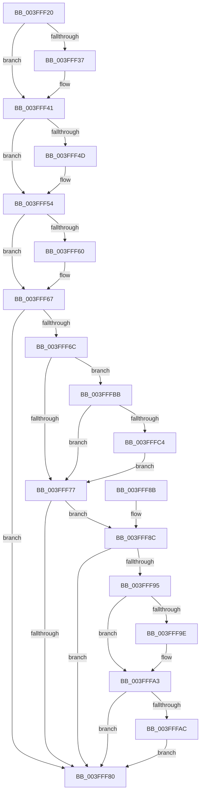

# SepDeleteAccessState

- RVA: `0x003FFF20`–`0x003FFFCB` (길이 `171` bytes)
- VA: `0x00000001403FFF20`
- 실행 섹션: `.text`
- PDB 이름 있음: `예`; PDB Function 태그: `아니요`
- unwind 정보 RVA: `0x0009A1A0`
- 디코드: `51`개 명령, `171/171` bytes 표시
- 미해석 바이트: `0` (있으면 어셈블리에 `.byte`로 보존)

> 이 문서는 커널 이미지의 기계어와 PDB 기호를 분석해 생성했습니다. 4번과 5번은 함수 원형과 자료형을 바이너리 사용 방식에서 추정한 C 해석이며 원본 소스 복구 결과는 아닙니다.

## 1. Dependencies

- 직접 호출 지점: **6**; 고유 호출 대상: **3**
- 직접 호출자로 확인된 함수: **5**
- RIP 상대 이미지 참조: **0**

### Outgoing calls
- `0x003FFF3C` → [ExFreePoolWithTag](../../poolcode/B8/ExFreePoolWithTag_function_00B82870.md) (function, `0x00B82870`)
- `0x003FFF4F` → [ExFreePoolWithTag](../../poolcode/B8/ExFreePoolWithTag_function_00B82870.md) (function, `0x00B82870`)
- `0x003FFF62` → [ExFreePoolWithTag](../../poolcode/B8/ExFreePoolWithTag_function_00B82870.md) (function, `0x00B82870`)
- `0x003FFF9E` → [guard_dispatch_icall](../6B/guard_dispatch_icall_function_006BAAD0.md) (function, `0x006BAAD0`)
- `0x003FFFB4` → [guard_dispatch_icall](../6B/guard_dispatch_icall_function_006BAAD0.md) (function, `0x006BAAD0`)
- `0x003FFFC4` → [SeDeassignSecurity](../../page/A3/SeDeassignSecurity_function_00A305A0.md) (function, `0x00A305A0`)

### Direct callers
- [sub_0089A903](../../page/89/Unknown_function_0089A903.md) at `0x0089AD12`
- [sub_008B756E](../../page/8B/Unknown_function_008B756E.md) at `0x008B7606`
- [ObInsertObjectEx](../../page/8B/ObInsertObjectEx_function_008B97A0.md) at `0x008B9C4A`
- [SeDeleteAccessState](../../page/8C/SeDeleteAccessState_function_008C5F70.md) at `0x008C5F7D`
- [SeSubProcessToken](../../page/AA/SeSubProcessToken_function_00AAD570.md) at `0x00AAD9EF`

### Static image references
- 디코드된 RIP-relative 메모리 참조가 없습니다.

## 2. Other-region calls and transfers

- 다른 실행 섹션으로 향하는 call: **4**
  - `0x003FFF3C` → [ExFreePoolWithTag](../../poolcode/B8/ExFreePoolWithTag_function_00B82870.md) (`.text` → `POOLCODE`)
  - `0x003FFF4F` → [ExFreePoolWithTag](../../poolcode/B8/ExFreePoolWithTag_function_00B82870.md) (`.text` → `POOLCODE`)
  - `0x003FFF62` → [ExFreePoolWithTag](../../poolcode/B8/ExFreePoolWithTag_function_00B82870.md) (`.text` → `POOLCODE`)
  - `0x003FFFC4` → [SeDeassignSecurity](../../page/A3/SeDeassignSecurity_function_00A305A0.md) (`.text` → `PAGE`)
- 별도 외부 분기/꼬리 이동을 확인하지 못했습니다.

## 3. Assembly (complete function range)

```asm
003FFF20  48 89 5C 24 08                  mov qword ptr [rsp + 8], rbx
003FFF25  57                              push rdi
003FFF26  48 83 EC 20                     sub rsp, 0x20
003FFF2A  80 79 0B 00                     cmp byte ptr [rcx + 0xb], 0
003FFF2E  48 8B D9                        mov rbx, rcx
003FFF31  48 8B 79 48                     mov rdi, qword ptr [rcx + 0x48]
003FFF35  74 0A                           je 0x1403fff41
003FFF37  48 8B 0F                        mov rcx, qword ptr [rdi]
003FFF3A  33 D2                           xor edx, edx
003FFF3C  E8 2F 29 78 00                  call 0x140b82870
003FFF41  48 8B 8B 88 00 00 00            mov rcx, qword ptr [rbx + 0x88]
003FFF48  48 85 C9                        test rcx, rcx
003FFF4B  74 07                           je 0x1403fff54
003FFF4D  33 D2                           xor edx, edx
003FFF4F  E8 1C 29 78 00                  call 0x140b82870
003FFF54  48 8B 8B 98 00 00 00            mov rcx, qword ptr [rbx + 0x98]
003FFF5B  48 85 C9                        test rcx, rcx
003FFF5E  74 07                           je 0x1403fff67
003FFF60  33 D2                           xor edx, edx
003FFF62  E8 09 29 78 00                  call 0x140b82870
003FFF67  48 85 FF                        test rdi, rdi
003FFF6A  74 14                           je 0x1403fff80
003FFF6C  48 83 7F 30 00                  cmp qword ptr [rdi + 0x30], 0
003FFF71  48 8D 4F 30                     lea rcx, [rdi + 0x30]
003FFF75  75 44                           jne 0x1403fffbb
003FFF77  48 8B 47 48                     mov rax, qword ptr [rdi + 0x48]
003FFF7B  48 85 C0                        test rax, rax
003FFF7E  75 0C                           jne 0x1403fff8c
003FFF80  48 8B 5C 24 30                  mov rbx, qword ptr [rsp + 0x30]
003FFF85  48 83 C4 20                     add rsp, 0x20
003FFF89  5F                              pop rdi
003FFF8A  C3                              ret
003FFF8B  CC                              int3
003FFF8C  48 8B 4F 50                     mov rcx, qword ptr [rdi + 0x50]
003FFF90  48 85 C9                        test rcx, rcx
003FFF93  74 EB                           je 0x1403fff80
003FFF95  48 8B 57 38                     mov rdx, qword ptr [rdi + 0x38]
003FFF99  48 85 D2                        test rdx, rdx
003FFF9C  74 05                           je 0x1403fffa3
003FFF9E  E8 2D AB 2B 00                  call 0x1406baad0
003FFFA3  48 8B 57 40                     mov rdx, qword ptr [rdi + 0x40]
003FFFA7  48 85 D2                        test rdx, rdx
003FFFAA  74 D4                           je 0x1403fff80
003FFFAC  48 8B 47 48                     mov rax, qword ptr [rdi + 0x48]
003FFFB0  48 8B 4F 50                     mov rcx, qword ptr [rdi + 0x50]
003FFFB4  E8 17 AB 2B 00                  call 0x1406baad0
003FFFB9  EB C5                           jmp 0x1403fff80
003FFFBB  F7 43 0C 00 00 00 04            test dword ptr [rbx + 0xc], 0x4000000
003FFFC2  75 B3                           jne 0x1403fff77
003FFFC4  E8 D7 05 63 00                  call 0x140a305a0
003FFFC9  EB AC                           jmp 0x1403fff77
```

## 4. C-style interpretation (structured pseudocode)

```c
__int64 __fastcall SepDeleteAccessState(__int64 a1, int a2)
{
    __int64 result;
    __int64 v_rsp;
    unsigned __int64 v_stack_p8;

    v_stack_p8 = v_rbx;
    v_rsp = (v_rsp) - (32);
    if ((*(unsigned __int8 *)(a1 + 11)) != 0) {
        a1 = *(unsigned __int64 *)(*(unsigned __int64 *)(a1 + 72));
        a2 = 0;
        result = ExFreePoolWithTag(a1, a2, a3, a4);
    }
    if (*(unsigned __int64 *)(a1 + 136) != 0) {
        a2 = 0;
        result = ExFreePoolWithTag(*(unsigned __int64 *)(a1 + 136), a2, a3, a4);
    }
    if (*(unsigned __int64 *)(a1 + 152) != 0) {
        a2 = 0;
        result = ExFreePoolWithTag(*(unsigned __int64 *)(a1 + 152), a2, a3, a4);
    }
    if (*(unsigned __int64 *)(a1 + 72) == 0) goto loc_003FFF80;
    if ((*(unsigned __int64 *)(*(unsigned __int64 *)(a1 + 72) + 48)) != 0) goto loc_003FFFBB;
loc_003FFF77:
    if (*(unsigned __int64 *)(*(unsigned __int64 *)(a1 + 72) + 72) != 0) goto loc_003FFF8C;
loc_003FFF80:
    v_rsp = (v_rsp) + (32);
    return *(unsigned __int64 *)(*(unsigned __int64 *)(a1 + 72) + 72);
loc_003FFF8C:
    if (*(unsigned __int64 *)(*(unsigned __int64 *)(a1 + 72) + 80) == 0) goto loc_003FFF80;
    result = *(unsigned __int64 *)(*(unsigned __int64 *)(a1 + 72) + 72);
    if (*(unsigned __int64 *)(*(unsigned __int64 *)(a1 + 72) + 56) != 0) {
        result = guard_dispatch_icall(*(unsigned __int64 *)(*(unsigned __int64 *)(a1 + 72) + 80), *(unsigned __int64 *)(*(unsigned __int64 *)(a1 + 72) + 56), a3, a4);
    }
    if (*(unsigned __int64 *)(*(unsigned __int64 *)(a1 + 72) + 64) == 0) goto loc_003FFF80;
    result = guard_dispatch_icall(*(unsigned __int64 *)(*(unsigned __int64 *)(a1 + 72) + 80), *(unsigned __int64 *)(*(unsigned __int64 *)(a1 + 72) + 64), a3, a4);
    goto loc_003FFF80;
loc_003FFFBB:
    if (((*(unsigned int *)(v_stack_p8 + 12)) & (0x4000000ULL)) != 0) goto loc_003FFF77;
    result = SeDeassignSecurity(*(unsigned __int64 *)(*(unsigned __int64 *)(a1 + 72) + 80), *(unsigned __int64 *)(*(unsigned __int64 *)(a1 + 72) + 64), a3, a4);
    goto loc_003FFF77;
}
```

## 5. (Beta) C Style

```c
int64_t SepDeleteAccessState(void *Arg1, int32_t Arg2)
{
    uint8_t *arg1 = (uint8_t *)Arg1;

    int64_t result;
    int64_t local_rsp;
    uint64_t v_stack_p8;

    v_stack_p8 = local_rbx;
    local_rsp = (local_rsp) - (32);
    if ((*(uint8_t *)(arg1 + 0xB)) != 0) {
        Arg1 = *(uint64_t *)(*(uint64_t *)(arg1 + 0x48));
        Arg2 = 0;
        result = ExFreePoolWithTag(Arg1, Arg2, a3, a4);
    }
    if (*(uint64_t *)(arg1 + 0x88) != 0) {
        Arg2 = 0;
        result = ExFreePoolWithTag(*(uint64_t *)(arg1 + 0x88), Arg2, a3, a4);
    }
    if (*(uint64_t *)(arg1 + 0x98) != 0) {
        Arg2 = 0;
        result = ExFreePoolWithTag(*(uint64_t *)(arg1 + 0x98), Arg2, a3, a4);
    }
    if (*(uint64_t *)(arg1 + 0x48) == 0) goto loc_003FFF80;
    if ((*(uint64_t *)(*(uint64_t *)(arg1 + 0x48) + 0x30)) != 0) goto loc_003FFFBB;
loc_003FFF77:
    if (*(uint64_t *)(*(uint64_t *)(arg1 + 0x48) + 0x48) != 0) goto loc_003FFF8C;
loc_003FFF80:
    local_rsp = (local_rsp) + (32);
    return *(uint64_t *)(*(uint64_t *)(arg1 + 0x48) + 0x48);
loc_003FFF8C:
    if (*(uint64_t *)(*(uint64_t *)(arg1 + 0x48) + 0x50) == 0) goto loc_003FFF80;
    result = *(uint64_t *)(*(uint64_t *)(arg1 + 0x48) + 0x48);
    if (*(uint64_t *)(*(uint64_t *)(arg1 + 0x48) + 0x38) != 0) {
        result = guard_dispatch_icall(*(uint64_t *)(*(uint64_t *)(arg1 + 0x48) + 0x50), *(uint64_t *)(*(uint64_t *)(arg1 + 0x48) + 0x38), a3, a4);
    }
    if (*(uint64_t *)(*(uint64_t *)(arg1 + 0x48) + 0x40) == 0) goto loc_003FFF80;
    result = guard_dispatch_icall(*(uint64_t *)(*(uint64_t *)(arg1 + 0x48) + 0x50), *(uint64_t *)(*(uint64_t *)(arg1 + 0x48) + 0x40), a3, a4);
    goto loc_003FFF80;
loc_003FFFBB:
    if (((*(uint32_t *)(v_stack_p8 + 0xC)) & (0x4000000ULL)) != 0) goto loc_003FFF77;
    result = SeDeassignSecurity(*(uint64_t *)(*(uint64_t *)(arg1 + 0x48) + 0x50), *(uint64_t *)(*(uint64_t *)(arg1 + 0x48) + 0x40), a3, a4);
    goto loc_003FFF77;
}
```

### 관측된 메모리 오프셋

구조체 형식이 확인되지 않은 접근은 인자 기준의 오프셋으로만 기록했습니다.

| 기준 인자 | 오프셋 표현 | 폭 (bit) | 접근 |
|---|---:|---:|---|
| `Arg1` | `+ 0xB` | `8` | `R` |
| `Arg1` | `+ 0xC` | `32` | `R` |
| `Arg1` | `+ 0x48` | `64` | `R` |
| `Arg1` | `+ 0x88` | `64` | `R` |
| `Arg1` | `+ 0x98` | `64` | `R` |

## 6. Execution-region graph

[열기: 2D/3D 그래프와 함수 탐색 컨트롤 패널](../../../control-panel.html?section=text&rva=0x003FFF20&view=graph)

- 2D 그래프는 위에서 아래로 흐르고, 3D 그래프는 빈 공간을 드래그해 회전합니다. Shift+드래그는 이동, 휠은 확대·축소, 함수 노드 선택은 대상 보고서 이동입니다.

### Static fallback


