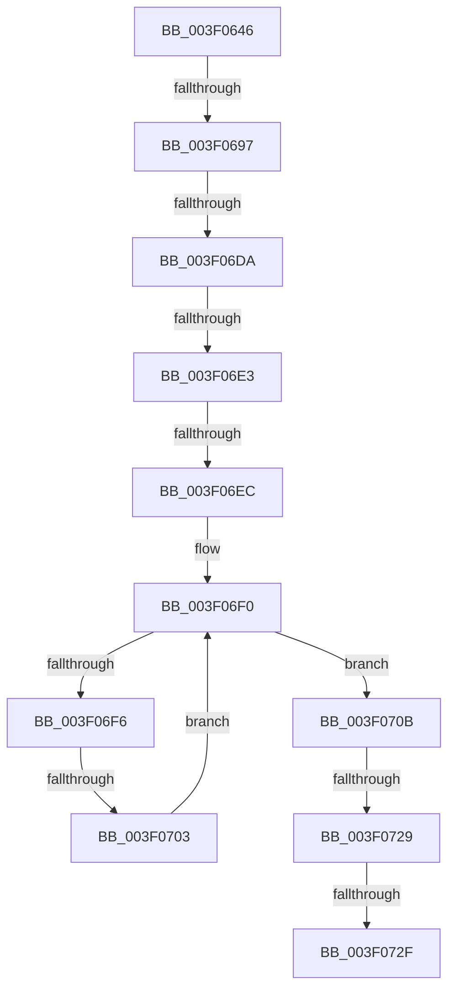

# sub_003F0646

- RVA: `0x003F0646`–`0x003F0754` (길이 `270` bytes)
- VA: `0x00000001403F0646`
- 실행 섹션: `.text`
- PDB 이름 있음: `아니요`; PDB Function 태그: `아니요`
- unwind 정보 RVA: `0x00096C08`
- 디코드: `80`개 명령, `270/270` bytes 표시
- 미해석 바이트: `0` (있으면 어셈블리에 `.byte`로 보존)

> 이 문서는 커널 이미지의 기계어와 PDB 기호를 분석해 생성했습니다. 4번과 5번은 함수 원형과 자료형을 바이너리 사용 방식에서 추정한 C 해석이며 원본 소스 복구 결과는 아닙니다.

## 1. Dependencies

- 직접 호출 지점: **0**; 고유 호출 대상: **0**
- 직접 호출자로 확인된 함수: **0**
- RIP 상대 이미지 참조: **0**

### Outgoing calls
- 직접 디코드된 call 명령이 없습니다.

### Direct callers
- 이 함수 시작 RVA로 연결되는 직접 call은 확인되지 않았습니다. 간접 호출은 완전히 역산할 수 없습니다.

### Static image references
- 디코드된 RIP-relative 메모리 참조가 없습니다.

## 2. Other-region calls and transfers

- 다른 실행 섹션으로 향하는 call: **0**
- call이 아닌 외부 분기/꼬리 이동: **7**
  - `0x003F0691` → [sub_003F09DB + 0x63](Unknown_function_003F09DB.md) (`tail-transfer`)
  - `0x003F06D4` → [sub_003F0755 + 0x12C](Unknown_function_003F0755.md) (`tail-transfer`)
  - `0x003F06DD` → [sub_003F0755 + 0xDB](Unknown_function_003F0755.md) (`tail-transfer`)
  - `0x003F06E6` → [sub_003F0755 + 0x63](Unknown_function_003F0755.md) (`tail-transfer`)
  - `0x003F06FD` → [sub_003F0755 + 0x32](Unknown_function_003F0755.md) (`tail-transfer`)
  - `0x003F0723` → [sub_003F0755 + 0x5B](Unknown_function_003F0755.md) (`tail-transfer`)
  - `0x003F072D` → [sub_003F0755 + 0x38](Unknown_function_003F0755.md) (`tail-transfer`)

## 3. Assembly (complete function range)

```asm
003F0646  48 89 5C 24 58                  mov qword ptr [rsp + 0x58], rbx
003F064B  48 89 6C 24 10                  mov qword ptr [rsp + 0x10], rbp
003F0650  49 8B E8                        mov rbp, r8
003F0653  83 E5 04                        and ebp, 4
003F0656  48 89 7C 24 08                  mov qword ptr [rsp + 8], rdi
003F065B  8B C5                           mov eax, ebp
003F065D  4C 89 3C 24                     mov qword ptr [rsp], r15
003F0661  48 F7 D8                        neg rax
003F0664  1B DB                           sbb ebx, ebx
003F0666  83 E3 20                        and ebx, 0x20
003F0669  48 8B C5                        mov rax, rbp
003F066C  44 89 5C 24 48                  mov dword ptr [rsp + 0x48], r11d
003F0671  48 F7 D8                        neg rax
003F0674  46 8D 14 0B                     lea r10d, [rbx + r9]
003F0678  42 8D 14 33                     lea edx, [rbx + r14]
003F067C  41 8B C2                        mov eax, r10d
003F067F  48 1B C9                        sbb rcx, rcx
003F0682  4D 8B F8                        mov r15, r8
003F0685  83 E1 04                        and ecx, 4
003F0688  2B C2                           sub eax, edx
003F068A  4C 2B F9                        sub r15, rcx
003F068D  FF C0                           inc eax
003F068F  3B C6                           cmp eax, esi
003F0691  0F 82 A7 03 00 00               jb 0x1403f0a3e
003F0697  8B CA                           mov ecx, edx
003F0699  41 8B FA                        mov edi, r10d
003F069C  80 E1 3F                        and cl, 0x3f
003F069F  2B FE                           sub edi, esi
003F06A1  FF C7                           inc edi
003F06A3  41 B8 01 00 00 00               mov r8d, 1
003F06A9  49 D3 E0                        shl r8, cl
003F06AC  49 FF C8                        dec r8
003F06AF  8B C7                           mov eax, edi
003F06B1  48 C1 E8 06                     shr rax, 6
003F06B5  89 7C 24 48                     mov dword ptr [rsp + 0x48], edi
003F06B9  4D 8D 0C C7                     lea r9, [r15 + rax*8]
003F06BD  8B C2                           mov eax, edx
003F06BF  48 C1 E8 06                     shr rax, 6
003F06C3  49 8B 0C C7                     mov rcx, qword ptr [r15 + rax*8]
003F06C7  49 8D 04 C7                     lea rax, [r15 + rax*8]
003F06CB  48 F7 D1                        not rcx
003F06CE  4C 0B C1                        or r8, rcx
003F06D1  83 FE 7F                        cmp esi, 0x7f
003F06D4  0F 87 A7 01 00 00               ja 0x1403f0881
003F06DA  83 FE 40                        cmp esi, 0x40
003F06DD  0F 83 4D 01 00 00               jae 0x1403f0830
003F06E3  83 FE 01                        cmp esi, 1
003F06E6  0F 87 CC 00 00 00               ja 0x1403f07b8
003F06EC  0F 1F 40 00                     nop dword ptr [rax]
003F06F0  49 83 F8 FF                     cmp r8, -1
003F06F4  75 15                           jne 0x1403f070b
003F06F6  48 83 C0 08                     add rax, 8
003F06FA  49 3B C1                        cmp rax, r9
003F06FD  0F 87 84 00 00 00               ja 0x1403f0787
003F0703  4C 8B 00                        mov r8, qword ptr [rax]
003F0706  49 F7 D0                        not r8
003F0709  EB E5                           jmp 0x1403f06f0
003F070B  49 2B C7                        sub rax, r15
003F070E  49 F7 D0                        not r8
003F0711  48 C1 F8 03                     sar rax, 3
003F0715  49 0F BC C8                     bsf rcx, r8
003F0719  C1 E0 06                        shl eax, 6
003F071C  03 C1                           add eax, ecx
003F071E  44 8B D0                        mov r10d, eax
003F0721  3B C7                           cmp eax, edi
003F0723  0F 87 87 00 00 00               ja 0x1403f07b0
003F0729  41 83 FA FF                     cmp r10d, -1
003F072D  74 5E                           je 0x1403f078d
003F072F  44 2B D3                        sub r10d, ebx
003F0732  4C 8B 3C 24                     mov r15, qword ptr [rsp]
003F0736  41 8B C2                        mov eax, r10d
003F0739  48 8B 7C 24 08                  mov rdi, qword ptr [rsp + 8]
003F073E  48 8B 6C 24 10                  mov rbp, qword ptr [rsp + 0x10]
003F0743  48 8B 5C 24 58                  mov rbx, qword ptr [rsp + 0x58]
003F0748  48 83 C4 18                     add rsp, 0x18
003F074C  41 5E                           pop r14
003F074E  41 5D                           pop r13
003F0750  41 5C                           pop r12
003F0752  5E                              pop rsi
003F0753  C3                              ret
```

## 4. C-style interpretation (structured pseudocode)

```c
__int64 __fastcall sub_003F0646(__int64 a1, __int64 a2, __int64 a3, __int64 a4, __int64 a5, __int64 a6, __int64 a7, __int64 a8, __int64 a9, __int64 a10, __int64 a11)
{
    __int64 result;
    __int64 v_r10;
    __int64 v_r15;
    __int64 v_rbp;
    __int64 v_rbx;
    __int64 v_rdi;
    __int64 v_rsp;
    unsigned __int64 v_stack_p0;
    unsigned __int64 v_stack_p10;
    unsigned int v_stack_p48;
    unsigned __int64 v_stack_p58;
    unsigned __int64 v_stack_p8;

    v_stack_p58 = v_rbx;
    v_stack_p10 = v_rbp;
    v_rbp = (unsigned int)((a3) & (4));
    v_stack_p8 = v_rdi;
    v_stack_p0 = v_r15;
    result = -((unsigned int)((unsigned int)(v_rbp)));
    v_rbx = (unsigned int)((v_rbx) & (32));
    v_stack_p48 = (unsigned int)(v_r11);
    result = -(v_rbp);
    a1 = (unsigned int)((a1) & (4));
    result = (unsigned int)(((unsigned int)((unsigned int)(v_rbx + a4 * 1))) - ((unsigned int)(v_rbx + v_r14 * 1)));
    v_r15 = (a3) - (a1);
    result = (unsigned int)((result) + 1);
    a1 = (unsigned __int8)(((unsigned int)((unsigned int)(v_rbx + v_r14 * 1))) & (63));
    v_rdi = (unsigned int)(((unsigned int)((unsigned int)(v_rbx + a4 * 1))) - ((unsigned int)(v_rsi)));
    v_rdi = (unsigned int)((v_rdi) + 1);
    a3 = (1) << ((unsigned __int8)(a1));
    a3 = (a3) - 1;
    result = ((unsigned int)((unsigned int)(v_rdi))) >> (6);
    v_stack_p48 = (unsigned int)(v_rdi);
    result = ((unsigned int)((unsigned int)(v_rbx + v_r14 * 1))) >> (6);
    a1 = ~(*(unsigned __int64 *)(v_r15 + result * 8));
    a3 = (a3) | (a1);
loc_003F06F0:
    if (a3 != -1) goto loc_003F070B;
    result = (v_r15 + result * 8) + (8);
    a3 = ~(*(unsigned __int64 *)(result));
    goto loc_003F06F0;
loc_003F070B:
    result = (result) - (v_r15);
    a3 = ~(a3);
    result = (result) >> (3);
    result = (unsigned int)((result) << (6));
    result = (unsigned int)((result) + ((unsigned int)(a1)));
    v_r10 = (unsigned int)(((unsigned int)((unsigned int)(result))) - ((unsigned int)(v_rbx)));
    v_rsp = (v_rsp) + (24);
    return (unsigned int)((unsigned int)(v_r10));
}
```

## 5. (Beta) C Style

```c
int64_t sub_003F0646(int64_t Arg1, int64_t Arg2, void *Arg3, int64_t Arg4, uint64_t Arg5, uint64_t Arg6, uint64_t Arg7, uint64_t Arg8, uint64_t Arg9, uint64_t Arg10, int64_t Arg11)
{
    uint8_t *arg3 = (uint8_t *)Arg3;

    int64_t result;
    int64_t local_r10;
    int64_t local_r15;
    int64_t local_rbp;
    int64_t local_rbx;
    int64_t local_rdi;
    int64_t local_rsp;
    uint64_t v_stack_p0;
    uint64_t v_stack_p10;
    uint32_t v_stack_p48;
    uint64_t v_stack_p58;
    uint64_t v_stack_p8;

    v_stack_p58 = local_rbx;
    v_stack_p10 = local_rbp;
    local_rbp = (uint32_t)((Arg3) & (4));
    v_stack_p8 = local_rdi;
    v_stack_p0 = local_r15;
    result = -((uint32_t)((uint32_t)(local_rbp)));
    local_rbx = (uint32_t)((local_rbx) & (32));
    v_stack_p48 = (uint32_t)(local_r11);
    result = -(local_rbp);
    Arg1 = (uint32_t)((Arg1) & (4));
    result = (uint32_t)(((uint32_t)((uint32_t)(local_rbx + Arg4 * 1))) - ((uint32_t)(local_rbx + local_r14 * 1)));
    local_r15 = (Arg3) - (Arg1);
    result = (uint32_t)((result) + 1);
    Arg1 = (uint8_t)(((uint32_t)((uint32_t)(local_rbx + local_r14 * 1))) & (63));
    local_rdi = (uint32_t)(((uint32_t)((uint32_t)(local_rbx + Arg4 * 1))) - ((uint32_t)(local_rsi)));
    local_rdi = (uint32_t)((local_rdi) + 1);
    Arg3 = (1) << ((uint8_t)(Arg1));
    Arg3 = (Arg3) - 1;
    result = ((uint32_t)((uint32_t)(local_rdi))) >> (6);
    v_stack_p48 = (uint32_t)(local_rdi);
    result = ((uint32_t)((uint32_t)(local_rbx + local_r14 * 1))) >> (6);
    Arg1 = ~(*(uint64_t *)(local_r15 + result * 8));
    Arg3 = (Arg3) | (Arg1);
loc_003F06F0:
    if (Arg3 != -1) goto loc_003F070B;
    result = (local_r15 + result * 8) + (8);
    Arg3 = ~(*(uint64_t *)(result));
    goto loc_003F06F0;
loc_003F070B:
    result = (result) - (local_r15);
    Arg3 = ~(Arg3);
    result = (result) >> (3);
    result = (uint32_t)((result) << (6));
    result = (uint32_t)((result) + ((uint32_t)(Arg1)));
    local_r10 = (uint32_t)(((uint32_t)((uint32_t)(result))) - ((uint32_t)(local_rbx)));
    local_rsp = (local_rsp) + (24);
    return (uint32_t)((uint32_t)(local_r10));
}
```

### 관측된 메모리 오프셋

구조체 형식이 확인되지 않은 접근은 인자 기준의 오프셋으로만 기록했습니다.

| 기준 인자 | 오프셋 표현 | 폭 (bit) | 접근 |
|---|---:|---:|---|
| `Arg3` | `+ 0x0` | `32` | `R` |
| `Arg3` | `+ 0x0 + rax*8` | `64` | `R` |

## 6. Execution-region graph

[열기: 2D/3D 그래프와 함수 탐색 컨트롤 패널](../../../control-panel.html?section=text&rva=0x003F0646&view=graph)

- 2D 그래프는 위에서 아래로 흐르고, 3D 그래프는 빈 공간을 드래그해 회전합니다. Shift+드래그는 이동, 휠은 확대·축소, 함수 노드 선택은 대상 보고서 이동입니다.

### Static fallback


