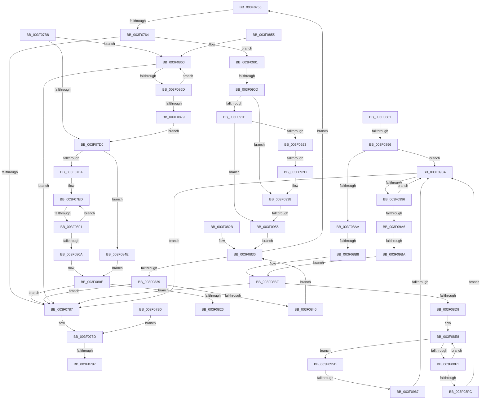

# sub_003F0755

- RVA: `0x003F0755`–`0x003F09C7` (길이 `626` bytes)
- VA: `0x00000001403F0755`
- 실행 섹션: `.text`
- PDB 이름 있음: `아니요`; PDB Function 태그: `아니요`
- unwind 정보 RVA: `0x00096C3C`
- 디코드: `165`개 명령, `626/626` bytes 표시
- 미해석 바이트: `0` (있으면 어셈블리에 `.byte`로 보존)

> 이 문서는 커널 이미지의 기계어와 PDB 기호를 분석해 생성했습니다. 4번과 5번은 함수 원형과 자료형을 바이너리 사용 방식에서 추정한 C 해석이며 원본 소스 복구 결과는 아닙니다.

## 1. Dependencies

- 직접 호출 지점: **0**; 고유 호출 대상: **0**
- 직접 호출자로 확인된 함수: **0**
- RIP 상대 이미지 참조: **0**

### Outgoing calls
- 직접 디코드된 call 명령이 없습니다.

### Direct callers
- 이 함수 시작 RVA로 연결되는 직접 call은 확인되지 않았습니다. 간접 호출은 완전히 역산할 수 없습니다.

### Static image references
- 디코드된 RIP-relative 메모리 참조가 없습니다.

## 2. Other-region calls and transfers

- 다른 실행 섹션으로 향하는 call: **0**
- call이 아닌 외부 분기/꼬리 이동: **13**
  - `0x003F075E` → [sub_003F09DB + 0x1B](Unknown_function_003F09DB.md) (`tail-transfer`)
  - `0x003F0795` → [sub_003F0646 + 0xEC](Unknown_function_003F0646.md) (`tail-transfer`)
  - `0x003F07AB` → [sub_003F0646 + 0x23](Unknown_function_003F0646.md) (`tail-transfer`)
  - `0x003F07FB` → [sub_003F09DB + 0x25](Unknown_function_003F09DB.md) (`tail-transfer`)
  - `0x003F0826` → [sub_003F0646 + 0xE3](Unknown_function_003F0646.md) (`tail-transfer`)
  - `0x003F0890` → [sub_003F09DB](Unknown_function_003F09DB.md) (`tail-transfer`)
  - `0x003F08B2` → [sub_003F09DB + 0x7](Unknown_function_003F09DB.md) (`tail-transfer`)
  - `0x003F0907` → [sub_003F0646 + 0xE3](Unknown_function_003F0646.md) (`tail-transfer`)
  - `0x003F0927` → [sub_003F0646 + 0xE3](Unknown_function_003F0646.md) (`tail-transfer`)
  - `0x003F094F` → [sub_003F0646 + 0xE3](Unknown_function_003F0646.md) (`tail-transfer`)
  - `0x003F0961` → [sub_003F0646 + 0xE3](Unknown_function_003F0646.md) (`tail-transfer`)
  - `0x003F0984` → [sub_003F0646 + 0xE3](Unknown_function_003F0646.md) (`tail-transfer`)
  - `0x003F09B8` → [sub_003F09DB + 0x11](Unknown_function_003F09DB.md) (`tail-transfer`)

## 3. Assembly (complete function range)

```asm
003F0755  49 0F BD C8                     bsr rcx, r8
003F0759  44 89 5C 24 48                  mov dword ptr [rsp + 0x48], r11d
003F075E  0F 84 92 02 00 00               je 0x1403f09f6
003F0764  BA 3F 00 00 00                  mov edx, 0x3f
003F0769  2B D1                           sub edx, ecx
003F076B  48 8B C8                        mov rcx, rax
003F076E  49 2B CF                        sub rcx, r15
003F0771  48 C1 F9 03                     sar rcx, 3
003F0775  FF C1                           inc ecx
003F0777  C1 E1 06                        shl ecx, 6
003F077A  2B CA                           sub ecx, edx
003F077C  44 8B D1                        mov r10d, ecx
003F077F  3B CF                           cmp ecx, edi
003F0781  0F 86 7A 01 00 00               jbe 0x1403f0901
003F0787  41 BA FF FF FF FF               mov r10d, 0xffffffff
003F078D  4C 8B 44 24 40                  mov r8, qword ptr [rsp + 0x40]
003F0792  45 85 F6                        test r14d, r14d
003F0795  74 9B                           je 0x1403f0732
003F0797  46 8D 0C 26                     lea r9d, [rsi + r12]
003F079B  45 3B CD                        cmp r9d, r13d
003F079E  45 0F 47 CD                     cmova r9d, r13d
003F07A2  41 FF C9                        dec r9d
003F07A5  45 33 DB                        xor r11d, r11d
003F07A8  45 8B F3                        mov r14d, r11d
003F07AB  E9 B9 FE FF FF                  jmp 0x1403f0669
003F07B0  41 BA FF FF FF FF               mov r10d, 0xffffffff
003F07B6  EB D5                           jmp 0x1403f078d
003F07B8  41 8B CA                        mov ecx, r10d
003F07BB  41 8B D3                        mov edx, r11d
003F07BE  48 C1 E9 06                     shr rcx, 6
003F07C2  49 8D 3C CF                     lea rdi, [r15 + rcx*8]
003F07C6  49 83 F8 FF                     cmp r8, -1
003F07CA  0F 84 90 00 00 00               je 0x1403f0860
003F07D0  49 0F BC C8                     bsf rcx, r8
003F07D4  41 BA 40 00 00 00               mov r10d, 0x40
003F07DA  41 0F 44 CA                     cmove ecx, r10d
003F07DE  03 CA                           add ecx, edx
003F07E0  3B CE                           cmp ecx, esi
003F07E2  73 6A                           jae 0x1403f084e
003F07E4  4D 8B D0                        mov r10, r8
003F07E7  44 8B DE                        mov r11d, esi
003F07EA  49 F7 D2                        not r10
003F07ED  49 8B D2                        mov rdx, r10
003F07F0  41 8B CB                        mov ecx, r11d
003F07F3  D1 E9                           shr ecx, 1
003F07F5  48 D3 EA                        shr rdx, cl
003F07F8  4C 23 D2                        and r10, rdx
003F07FB  0F 84 FF 01 00 00               je 0x1403f0a00
003F0801  44 2B D9                        sub r11d, ecx
003F0804  41 83 FB 01                     cmp r11d, 1
003F0808  77 E3                           ja 0x1403f07ed
003F080A  4D 0F BC D2                     bsf r10, r10
003F080E  49 2B C7                        sub rax, r15
003F0811  48 C1 F8 03                     sar rax, 3
003F0815  C1 E0 06                        shl eax, 6
003F0818  44 03 D0                        add r10d, eax
003F081B  44 3B 54 24 48                  cmp r10d, dword ptr [rsp + 0x48]
003F0820  0F 87 61 FF FF FF               ja 0x1403f0787
003F0826  E9 FE FE FF FF                  jmp 0x1403f0729
003F082B  0F 1F 44 00 00                  nop dword ptr [rax + rax]
003F0830  4D 85 C0                        test r8, r8
003F0833  0F 89 1C FF FF FF               jns 0x1403f0755
003F0839  48 83 C0 08                     add rax, 8
003F083D  49 3B C1                        cmp rax, r9
003F0840  0F 87 41 FF FF FF               ja 0x1403f0787
003F0846  4C 8B 00                        mov r8, qword ptr [rax]
003F0849  49 F7 D0                        not r8
003F084C  EB E2                           jmp 0x1403f0830
003F084E  F7 DA                           neg edx
003F0850  44 8B D2                        mov r10d, edx
003F0853  EB B9                           jmp 0x1403f080e
003F0855  66 66 66 0F 1F 84 00 00 00 00 00  nop word ptr [rax + rax]
003F0860  48 83 C0 08                     add rax, 8
003F0864  49 3B C1                        cmp rax, r9
003F0867  0F 87 1A FF FF FF               ja 0x1403f0787
003F086D  4C 8B 00                        mov r8, qword ptr [rax]
003F0870  49 F7 D0                        not r8
003F0873  49 83 F8 FF                     cmp r8, -1
003F0877  74 E7                           je 0x1403f0860
003F0879  41 8B D3                        mov edx, r11d
003F087C  E9 4F FF FF FF                  jmp 0x1403f07d0
003F0881  40 F6 C7 3F                     test dil, 0x3f
003F0885  4D 8D 59 08                     lea r11, [r9 + 8]
003F0889  4D 0F 44 D9                     cmove r11, r9
003F088D  4D 85 C0                        test r8, r8
003F0890  0F 84 45 01 00 00               je 0x1403f09db
003F0896  48 8B 48 08                     mov rcx, qword ptr [rax + 8]
003F089A  48 83 C0 08                     add rax, 8
003F089E  48 F7 D1                        not rcx
003F08A1  48 85 C9                        test rcx, rcx
003F08A4  0F 85 E0 00 00 00               jne 0x1403f098a
003F08AA  89 4C 24 48                     mov dword ptr [rsp + 0x48], ecx
003F08AE  49 0F BD C8                     bsr rcx, r8
003F08B2  0F 84 2A 01 00 00               je 0x1403f09e2
003F08B8  BA 3F 00 00 00                  mov edx, 0x3f
003F08BD  2B D1                           sub edx, ecx
003F08BF  4C 8B D0                        mov r10, rax
003F08C2  4D 2B D7                        sub r10, r15
003F08C5  49 C1 FA 03                     sar r10, 3
003F08C9  41 C1 E2 06                     shl r10d, 6
003F08CD  44 2B D2                        sub r10d, edx
003F08D0  44 3B D7                        cmp r10d, edi
003F08D3  0F 87 AE FE FF FF               ja 0x1403f0787
003F08D9  8B CE                           mov ecx, esi
003F08DB  2B CA                           sub ecx, edx
003F08DD  44 8B C1                        mov r8d, ecx
003F08E0  48 C1 E9 06                     shr rcx, 6
003F08E4  48 8D 14 C8                     lea rdx, [rax + rcx*8]
003F08E8  48 83 C0 08                     add rax, 8
003F08EC  48 3B C2                        cmp rax, rdx
003F08EF  74 6C                           je 0x1403f095d
003F08F1  48 8B 08                        mov rcx, qword ptr [rax]
003F08F4  48 F7 D1                        not rcx
003F08F7  48 85 C9                        test rcx, rcx
003F08FA  74 EC                           je 0x1403f08e8
003F08FC  E9 89 00 00 00                  jmp 0x1403f098a
003F0901  44 8B DE                        mov r11d, esi
003F0904  44 2B DA                        sub r11d, edx
003F0907  0F 84 1C FE FF FF               je 0x1403f0729
003F090D  4C 8B 40 08                     mov r8, qword ptr [rax + 8]
003F0911  48 83 C0 08                     add rax, 8
003F0915  49 F7 D0                        not r8
003F0918  41 83 FB 40                     cmp r11d, 0x40
003F091C  72 1A                           jb 0x1403f0938
003F091E  4D 85 C0                        test r8, r8
003F0921  75 32                           jne 0x1403f0955
003F0923  41 83 C3 C0                     add r11d, -0x40
003F0927  0F 84 FC FD FF FF               je 0x1403f0729
003F092D  4C 8B 40 08                     mov r8, qword ptr [rax + 8]
003F0931  48 83 C0 08                     add rax, 8
003F0935  49 F7 D0                        not r8
003F0938  49 0F BC C8                     bsf rcx, r8
003F093C  BA 40 00 00 00                  mov edx, 0x40
003F0941  C7 44 24 48 00 00 00 00         mov dword ptr [rsp + 0x48], 0
003F0949  0F 44 CA                        cmove ecx, edx
003F094C  41 3B CB                        cmp ecx, r11d
003F094F  0F 83 D4 FD FF FF               jae 0x1403f0729
003F0955  45 33 DB                        xor r11d, r11d
003F0958  E9 D3 FE FF FF                  jmp 0x1403f0830
003F095D  41 83 E0 3F                     and r8d, 0x3f
003F0961  0F 84 C2 FD FF FF               je 0x1403f0729
003F0967  48 8B 08                        mov rcx, qword ptr [rax]
003F096A  48 F7 D1                        not rcx
003F096D  C7 44 24 48 00 00 00 00         mov dword ptr [rsp + 0x48], 0
003F0975  48 0F BC D1                     bsf rdx, rcx
003F0979  B9 40 00 00 00                  mov ecx, 0x40
003F097E  0F 44 D1                        cmove edx, ecx
003F0981  41 3B D0                        cmp edx, r8d
003F0984  0F 83 9F FD FF FF               jae 0x1403f0729
003F098A  48 8B D0                        mov rdx, rax
003F098D  49 3B C3                        cmp rax, r11
003F0990  0F 87 F1 FD FF FF               ja 0x1403f0787
003F0996  48 8B 48 08                     mov rcx, qword ptr [rax + 8]
003F099A  48 83 C0 08                     add rax, 8
003F099E  48 F7 D1                        not rcx
003F09A1  48 85 C9                        test rcx, rcx
003F09A4  75 E4                           jne 0x1403f098a
003F09A6  48 8B 0A                        mov rcx, qword ptr [rdx]
003F09A9  48 F7 D1                        not rcx
003F09AC  C7 44 24 48 00 00 00 00         mov dword ptr [rsp + 0x48], 0
003F09B4  4C 0F BD C1                     bsr r8, rcx
003F09B8  74 32                           je 0x1403f09ec
003F09BA  BA 3F 00 00 00                  mov edx, 0x3f
003F09BF  41 2B D0                        sub edx, r8d
003F09C2  E9 F8 FE FF FF                  jmp 0x1403f08bf
```

## 4. C-style interpretation (structured pseudocode)

```c
__int64 __fastcall sub_003F0755(__int64 a1, __int64 a2, __int64 a3, __int64 a4, __int64 a5, __int64 a6, __int64 a7, __int64 a8)
{
    __int64 result;
    __int64 v_r11;
    unsigned int v_stack_p48;

    v_stack_p48 = (unsigned int)(v_r11);
    a2 = (unsigned int)((63) - ((unsigned int)(a1)));
    a1 = (result) - (v_r15);
    a1 = (a1) >> (3);
    a1 = (unsigned int)((a1) + 1);
    a1 = (unsigned int)((a1) << (6));
    a1 = (unsigned int)((a1) - ((unsigned int)(a2)));
    if (((unsigned int)(a1)) <= ((unsigned int)(v_rdi))) goto loc_003F0901;
loc_003F0787:
loc_003F078D:
    a4 = v_rsi + v_r12 * 1;
    if (((unsigned int)(v_rsi + v_r12 * 1)) > ((unsigned int)(v_r13))) { a4 = (unsigned int)(v_r13); }
    a4 = (unsigned int)((a4) - 1);
    v_r11 = 0;
loc_003F0830:
    if (!sign_flag) goto loc_003F0755;
    result = (result) + (8);
    if (result > a4) goto loc_003F0787;
    a3 = ~(*(unsigned __int64 *)(result));
    goto loc_003F0830;
loc_003F0901:
    v_r11 = (unsigned int)(((unsigned int)((unsigned int)(v_rsi))) - ((unsigned int)(a2)));
    result = (result) + (8);
    a3 = ~(*(unsigned __int64 *)(result + 8));
    if (((unsigned int)(v_r11)) < 64) goto loc_003F0938;
    if (a3 != 0) goto loc_003F0955;
    v_r11 = (unsigned int)((v_r11) + (-64));
    result = (result) + (8);
    a3 = ~(*(unsigned __int64 *)(result + 8));
loc_003F0938:
    v_stack_p48 = 0;
    if (condition_is_equal) { a1 = 64; }
loc_003F0955:
    v_r11 = 0;
    goto loc_003F0830;
}
```

## 5. (Beta) C Style

```c
int64_t sub_003F0755(int64_t Arg1, int64_t Arg2, int64_t Arg3, int64_t Arg4, uint64_t Arg5, uint64_t Arg6, uint64_t Arg7, int64_t Arg8)
{
    int64_t result;
    int64_t local_r11;
    uint32_t v_stack_p48;

    v_stack_p48 = (uint32_t)(local_r11);
    Arg2 = (uint32_t)((63) - ((uint32_t)(Arg1)));
    Arg1 = (result) - (local_r15);
    Arg1 = (Arg1) >> (3);
    Arg1 = (uint32_t)((Arg1) + 1);
    Arg1 = (uint32_t)((Arg1) << (6));
    Arg1 = (uint32_t)((Arg1) - ((uint32_t)(Arg2)));
    if (((uint32_t)(Arg1)) <= ((uint32_t)(local_rdi))) goto loc_003F0901;
loc_003F0787:
loc_003F078D:
    Arg4 = local_rsi + local_r12 * 1;
    if (((uint32_t)(local_rsi + local_r12 * 1)) > ((uint32_t)(local_r13))) { Arg4 = (uint32_t)(local_r13); }
    Arg4 = (uint32_t)((Arg4) - 1);
    local_r11 = 0;
loc_003F0830:
    if (!sign_flag) goto loc_003F0755;
    result = (result) + (8);
    if (result > Arg4) goto loc_003F0787;
    Arg3 = ~(*(uint64_t *)(result));
    goto loc_003F0830;
loc_003F0901:
    local_r11 = (uint32_t)(((uint32_t)((uint32_t)(local_rsi))) - ((uint32_t)(Arg2)));
    result = (result) + (8);
    Arg3 = ~(*(uint64_t *)(result + 0x8));
    if (((uint32_t)(local_r11)) < 64) goto loc_003F0938;
    if (Arg3 != 0) goto loc_003F0955;
    local_r11 = (uint32_t)((local_r11) + (-64));
    result = (result) + (8);
    Arg3 = ~(*(uint64_t *)(result + 0x8));
loc_003F0938:
    v_stack_p48 = 0;
    if (condition_is_equal) { Arg1 = 64; }
loc_003F0955:
    local_r11 = 0;
    goto loc_003F0830;
}
```

## 6. Execution-region graph

[열기: 2D/3D 그래프와 함수 탐색 컨트롤 패널](../../../control-panel.html?section=text&rva=0x003F0755&view=graph)

- 2D 그래프는 위에서 아래로 흐르고, 3D 그래프는 빈 공간을 드래그해 회전합니다. Shift+드래그는 이동, 휠은 확대·축소, 함수 노드 선택은 대상 보고서 이동입니다.

### Static fallback


