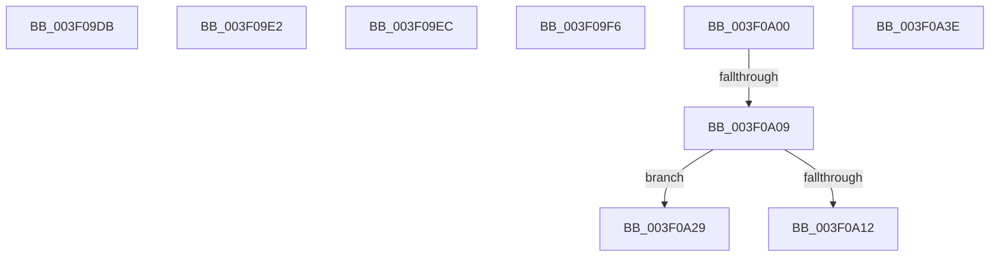

# sub_003F09DB

- RVA: `0x003F09DB`–`0x003F0A49` (길이 `110` bytes)
- VA: `0x00000001403F09DB`
- 실행 섹션: `.text`
- PDB 이름 있음: `아니요`; PDB Function 태그: `아니요`
- unwind 정보 RVA: `0x00096C70`
- 디코드: `26`개 명령, `110/110` bytes 표시
- 미해석 바이트: `0` (있으면 어셈블리에 `.byte`로 보존)

> 이 문서는 커널 이미지의 기계어와 PDB 기호를 분석해 생성했습니다. 4번과 5번은 함수 원형과 자료형을 바이너리 사용 방식에서 추정한 C 해석이며 원본 소스 복구 결과는 아닙니다.

## 1. Dependencies

- 직접 호출 지점: **0**; 고유 호출 대상: **0**
- 직접 호출자로 확인된 함수: **0**
- RIP 상대 이미지 참조: **0**

### Outgoing calls
- 직접 디코드된 call 명령이 없습니다.

### Direct callers
- 이 함수 시작 RVA로 연결되는 직접 call은 확인되지 않았습니다. 간접 호출은 완전히 역산할 수 없습니다.

### Static image references
- 디코드된 RIP-relative 메모리 참조가 없습니다.

## 2. Other-region calls and transfers

- 다른 실행 섹션으로 향하는 call: **0**
- call이 아닌 외부 분기/꼬리 이동: **8**
  - `0x003F09DD` → [sub_003F0755 + 0x16A](Unknown_function_003F0755.md) (`tail-transfer`)
  - `0x003F09E7` → [sub_003F0755 + 0x16A](Unknown_function_003F0755.md) (`tail-transfer`)
  - `0x003F09F1` → [sub_003F0755 + 0x16A](Unknown_function_003F0755.md) (`tail-transfer`)
  - `0x003F09FB` → [sub_003F0755 + 0x16](Unknown_function_003F0755.md) (`tail-transfer`)
  - `0x003F0A03` → [sub_003F0755 + 0x32](Unknown_function_003F0755.md) (`tail-transfer`)
  - `0x003F0A24` → [sub_003F0755 + 0x71](Unknown_function_003F0755.md) (`tail-transfer`)
  - `0x003F0A39` → [sub_003F0755 + 0x71](Unknown_function_003F0755.md) (`tail-transfer`)
  - `0x003F0A44` → [sub_003F0755 + 0x3D](Unknown_function_003F0755.md) (`tail-transfer`)

## 3. Assembly (complete function range)

```asm
003F09DB  33 D2                           xor edx, edx
003F09DD  E9 DD FE FF FF                  jmp 0x1403f08bf
003F09E2  BA 40 00 00 00                  mov edx, 0x40
003F09E7  E9 D3 FE FF FF                  jmp 0x1403f08bf
003F09EC  BA 40 00 00 00                  mov edx, 0x40
003F09F1  E9 C9 FE FF FF                  jmp 0x1403f08bf
003F09F6  BA 40 00 00 00                  mov edx, 0x40
003F09FB  E9 6B FD FF FF                  jmp 0x1403f076b
003F0A00  48 3B C7                        cmp rax, rdi
003F0A03  0F 84 7E FD FF FF               je 0x1403f0787
003F0A09  45 33 DB                        xor r11d, r11d
003F0A0C  49 0F BD C8                     bsr rcx, r8
003F0A10  74 17                           je 0x1403f0a29
003F0A12  4C 8B 40 08                     mov r8, qword ptr [rax + 8]
003F0A16  BA 3F 00 00 00                  mov edx, 0x3f
003F0A1B  2B D1                           sub edx, ecx
003F0A1D  49 F7 D0                        not r8
003F0A20  48 83 C0 08                     add rax, 8
003F0A24  E9 9D FD FF FF                  jmp 0x1403f07c6
003F0A29  4C 8B 40 08                     mov r8, qword ptr [rax + 8]
003F0A2D  48 83 C0 08                     add rax, 8
003F0A31  49 F7 D0                        not r8
003F0A34  BA 40 00 00 00                  mov edx, 0x40
003F0A39  E9 88 FD FF FF                  jmp 0x1403f07c6
003F0A3E  41 BA FF FF FF FF               mov r10d, 0xffffffff
003F0A44  E9 49 FD FF FF                  jmp 0x1403f0792
```

## 4. C-style interpretation (structured pseudocode)

```c
__int64 __fastcall sub_003F09DB(__int64 a1, int a2, __int64 a3)
{
    a2 = 0;
}
```

## 5. (Beta) C Style

```c
int64_t sub_003F09DB(int64_t Arg1, int32_t Arg2, int64_t Arg3)
{
    Arg2 = 0;
}
```

## 6. Execution-region graph

[열기: 2D/3D 그래프와 함수 탐색 컨트롤 패널](../../../control-panel.html?section=text&rva=0x003F09DB&view=graph)

- 2D 그래프는 위에서 아래로 흐르고, 3D 그래프는 빈 공간을 드래그해 회전합니다. Shift+드래그는 이동, 휠은 확대·축소, 함수 노드 선택은 대상 보고서 이동입니다.

### Static fallback


