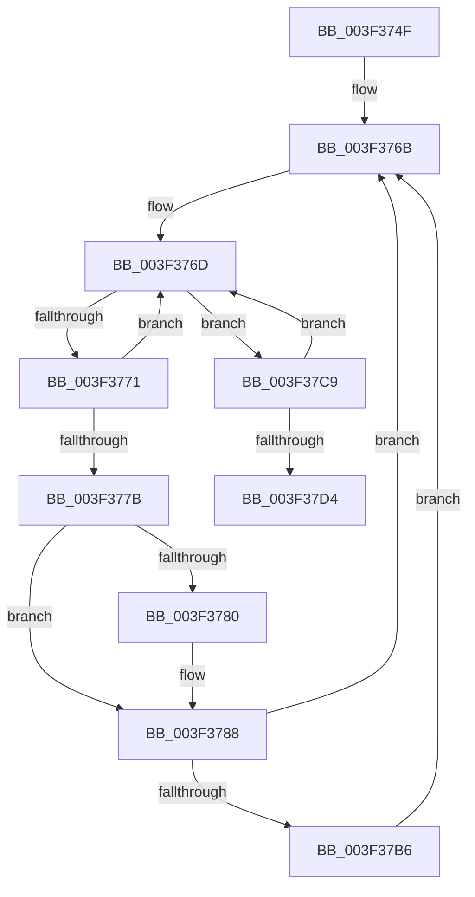

# sub_003F374F

- RVA: `0x003F374F`–`0x003F37E3` (길이 `148` bytes)
- VA: `0x00000001403F374F`
- 실행 섹션: `.text`
- PDB 이름 있음: `아니요`; PDB Function 태그: `아니요`
- unwind 정보 RVA: `0x000970D4`
- 디코드: `40`개 명령, `148/148` bytes 표시
- 미해석 바이트: `0` (있으면 어셈블리에 `.byte`로 보존)

> 이 문서는 커널 이미지의 기계어와 PDB 기호를 분석해 생성했습니다. 4번과 5번은 함수 원형과 자료형을 바이너리 사용 방식에서 추정한 C 해석이며 원본 소스 복구 결과는 아닙니다.

## 1. Dependencies

- 직접 호출 지점: **3**; 고유 호출 대상: **3**
- 직접 호출자로 확인된 함수: **0**
- RIP 상대 이미지 참조: **0**

### Outgoing calls
- `0x003F3783` → [KeAbPreWait](../20/KeAbPreWait_function_0020E560.md) (function, `0x0020E560`)
- `0x003F379F` → [KeWaitForSingleObject](../20/KeWaitForSingleObject_function_0020E6B0.md) (function, `0x0020E6B0`)
- `0x003F37BF` → [KeAbPreAcquire](../21/KeAbPreAcquire_function_00210230.md) (function, `0x00210230`)

### Direct callers
- 이 함수 시작 RVA로 연결되는 직접 call은 확인되지 않았습니다. 간접 호출은 완전히 역산할 수 없습니다.

### Static image references
- 디코드된 RIP-relative 메모리 참조가 없습니다.

## 2. Other-region calls and transfers

- 다른 실행 섹션으로 향하는 call: **0**
- 별도 외부 분기/꼬리 이동을 확인하지 못했습니다.

## 3. Assembly (complete function range)

```asm
003F374F  48 89 7C 24 50                  mov qword ptr [rsp + 0x50], rdi
003F3754  48 8B F8                        mov rdi, rax
003F3757  4C 89 74 24 58                  mov qword ptr [rsp + 0x58], r14
003F375C  4C 89 7C 24 60                  mov qword ptr [rsp + 0x60], r15
003F3761  41 BF 01 00 00 00               mov r15d, 1
003F3767  45 8D 77 03                     lea r14d, [r15 + 3]
003F376B  8B 03                           mov eax, dword ptr [rbx]
003F376D  A8 01                           test al, 1
003F376F  75 58                           jne 0x1403f37c9
003F3771  41 8D 0C 06                     lea ecx, [r14 + rax]
003F3775  F0 0F B1 0B                     lock cmpxchg dword ptr [rbx], ecx
003F3779  75 F2                           jne 0x1403f376d
003F377B  48 85 FF                        test rdi, rdi
003F377E  74 08                           je 0x1403f3788
003F3780  48 8B CF                        mov rcx, rdi
003F3783  E8 D8 AD E1 FF                  call 0x14020e560
003F3788  45 33 C9                        xor r9d, r9d
003F378B  48 C7 44 24 20 00 00 00 00      mov qword ptr [rsp + 0x20], 0
003F3794  48 8D 4B 18                     lea rcx, [rbx + 0x18]
003F3798  45 33 C0                        xor r8d, r8d
003F379B  41 8D 51 22                     lea edx, [r9 + 0x22]
003F379F  E8 0C AF E1 FF                  call 0x14020e6b0
003F37A4  0F 0D 0B                        prefetchw byte ptr [rbx]
003F37A7  41 BF 03 00 00 00               mov r15d, 3
003F37AD  45 8D 77 FF                     lea r14d, [r15 - 1]
003F37B1  48 85 FF                        test rdi, rdi
003F37B4  74 B5                           je 0x1403f376b
003F37B6  45 33 C0                        xor r8d, r8d
003F37B9  48 8B D7                        mov rdx, rdi
003F37BC  48 8B CB                        mov rcx, rbx
003F37BF  E8 6C CA E1 FF                  call 0x140210230
003F37C4  48 8B F8                        mov rdi, rax
003F37C7  EB A2                           jmp 0x1403f376b
003F37C9  8B C8                           mov ecx, eax
003F37CB  41 33 CF                        xor ecx, r15d
003F37CE  F0 0F B1 0B                     lock cmpxchg dword ptr [rbx], ecx
003F37D2  75 99                           jne 0x1403f376d
003F37D4  4C 8B 74 24 58                  mov r14, qword ptr [rsp + 0x58]
003F37D9  48 8B 7C 24 50                  mov rdi, qword ptr [rsp + 0x50]
003F37DE  4C 8B 7C 24 60                  mov r15, qword ptr [rsp + 0x60]
```

## 4. C-style interpretation (structured pseudocode)

```c
__int64 __fastcall sub_003F374F(__int64 a1, __int64 a2, int a3, int a4, __int64 a5, __int64 a6, __int64 a7, __int64 a8, __int64 a9, __int64 a10, __int64 a11, __int64 a12)
{
    __int64 result;
    unsigned __int64 v_stack_p20;
    unsigned __int64 v_stack_p50;
    unsigned __int64 v_stack_p58;
    unsigned __int64 v_stack_p60;

    v_stack_p50 = v_rdi;
    v_stack_p58 = v_r14;
    v_stack_p60 = v_r15;
loc_003F376B:
loc_003F376D:
    if ((((unsigned __int8)((unsigned int)(*(unsigned int *)(v_rbx)))) & (1)) != 0) goto loc_003F37C9;
    if ((((unsigned __int8)((unsigned int)(*(unsigned int *)(v_rbx)))) & (1)) != 0) goto loc_003F376D;
    result = (unsigned int)(*(unsigned int *)(v_rbx));
    if (result != 0) {
        a1 = result;
        result = KeAbPreWait(a1, a2, a3, a4);
    }
    a4 = 0;
    v_stack_p20 = 0;
    a3 = 0;
    result = KeWaitForSingleObject(v_rbx + 24, a4 + 34, a3, a4);
    if (result == 0) goto loc_003F376B;
    a3 = 0;
    result = KeAbPreAcquire(v_rbx, result, a3, a4);
    goto loc_003F376B;
loc_003F37C9:
    a1 = (unsigned int)(((unsigned int)((unsigned int)(result))) ^ (3));
    if (condition_is_not_equal) goto loc_003F376D;
    return result;
}
```

## 5. (Beta) C Style

```c
int64_t sub_003F374F(int64_t Arg1, int64_t Arg2, int32_t Arg3, int32_t Arg4, uint64_t Arg5, uint64_t Arg6, uint64_t Arg7, uint64_t Arg8, uint64_t Arg9, int64_t Arg10, int64_t Arg11, int64_t Arg12)
{
    int64_t result;
    uint64_t v_stack_p20;
    uint64_t v_stack_p50;
    uint64_t v_stack_p58;
    uint64_t v_stack_p60;

    v_stack_p50 = local_rdi;
    v_stack_p58 = local_r14;
    v_stack_p60 = local_r15;
loc_003F376B:
loc_003F376D:
    if ((((uint8_t)((uint32_t)(*(uint32_t *)(local_rbx)))) & (1)) != 0) goto loc_003F37C9;
    if ((((uint8_t)((uint32_t)(*(uint32_t *)(local_rbx)))) & (1)) != 0) goto loc_003F376D;
    result = (uint32_t)(*(uint32_t *)(local_rbx));
    if (result != 0) {
        Arg1 = result;
        result = KeAbPreWait(Arg1, Arg2, Arg3, Arg4);
    }
    Arg4 = 0;
    v_stack_p20 = 0;
    Arg3 = 0;
    result = KeWaitForSingleObject(local_rbx + 24, Arg4 + 34, Arg3, Arg4);
    if (result == 0) goto loc_003F376B;
    Arg3 = 0;
    result = KeAbPreAcquire(local_rbx, result, Arg3, Arg4);
    goto loc_003F376B;
loc_003F37C9:
    Arg1 = (uint32_t)(((uint32_t)((uint32_t)(result))) ^ (3));
    if (condition_is_not_equal) goto loc_003F376D;
    return result;
}
```

## 6. Execution-region graph

[열기: 2D/3D 그래프와 함수 탐색 컨트롤 패널](../../../control-panel.html?section=text&rva=0x003F374F&view=graph)

- 2D 그래프는 위에서 아래로 흐르고, 3D 그래프는 빈 공간을 드래그해 회전합니다. Shift+드래그는 이동, 휠은 확대·축소, 함수 노드 선택은 대상 보고서 이동입니다.

### Static fallback


