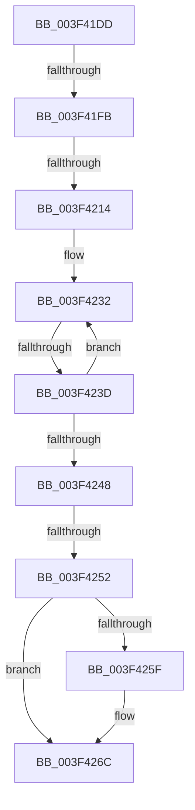

# sub_003F41DD

- RVA: `0x003F41DD`–`0x003F4279` (길이 `156` bytes)
- VA: `0x00000001403F41DD`
- 실행 섹션: `.text`
- PDB 이름 있음: `아니요`; PDB Function 태그: `아니요`
- unwind 정보 RVA: `0x0009716C`
- 디코드: `35`개 명령, `156/156` bytes 표시
- 미해석 바이트: `0` (있으면 어셈블리에 `.byte`로 보존)

> 이 문서는 커널 이미지의 기계어와 PDB 기호를 분석해 생성했습니다. 4번과 5번은 함수 원형과 자료형을 바이너리 사용 방식에서 추정한 C 해석이며 원본 소스 복구 결과는 아닙니다.

## 1. Dependencies

- 직접 호출 지점: **1**; 고유 호출 대상: **1**
- 직접 호출자로 확인된 함수: **0**
- RIP 상대 이미지 참조: **1**

### Outgoing calls
- `0x003F4267` → [KiLowerIrqlProcessIrqlFlags](../4F/KiLowerIrqlProcessIrqlFlags_function_004F5698.md) (function, `0x004F5698`)

### Direct callers
- 이 함수 시작 RVA로 연결되는 직접 call은 확인되지 않았습니다. 간접 호출은 완전히 역산할 수 없습니다.

### Static image references
- `0x003F41EF` → RVA `0x00FC6D20` (`ALMOSTRO`; read)

## 2. Other-region calls and transfers

- 다른 실행 섹션으로 향하는 call: **0**
- call이 아닌 외부 분기/꼬리 이동: **4**
  - `0x003F41F5` → [sub_003F4306](Unknown_function_003F4306.md) (`tail-transfer`)
  - `0x003F420E` → [sub_003F433F](Unknown_function_003F433F.md) (`tail-transfer`)
  - `0x003F423B` → [sub_003F42A2](Unknown_function_003F42A2.md) (`tail-transfer`)
  - `0x003F424C` → [sub_003F4306 + 0x11](Unknown_function_003F4306.md) (`tail-transfer`)

## 3. Assembly (complete function range)

```asm
003F41DD  4C 89 74 24 70                  mov qword ptr [rsp + 0x70], r14
003F41E2  45 0F 20 C6                     mov r14, cr8
003F41E6  B8 02 00 00 00                  mov eax, 2
003F41EB  44 0F 22 C0                     mov cr8, rax
003F41EF  39 1D 2B 2B BD 00               cmp dword ptr [rip + 0xbd2b2b], ebx
003F41F5  0F 85 0B 01 00 00               jne 0x1403f4306
003F41FB  48 8B 86 80 02 00 00            mov rax, qword ptr [rsi + 0x280]
003F4202  4C 6B D5 68                     imul r10, rbp, 0x68
003F4206  49 8B 54 02 48                  mov rdx, qword ptr [r10 + rax + 0x48]
003F420B  48 85 D2                        test rdx, rdx
003F420E  0F 84 2B 01 00 00               je 0x1403f433f
003F4214  44 0F B7 84 24 90 00 00 00      movzx r8d, word ptr [rsp + 0x90]
003F421D  41 B9 FF 00 00 00               mov r9d, 0xff
003F4223  0F B6 4A 01                     movzx ecx, byte ptr [rdx + 1]
003F4227  41 0F B7 C0                     movzx eax, r8w
003F422B  66 D3 C8                        ror ax, cl
003F422E  66 23 42 02                     and ax, word ptr [rdx + 2]
003F4232  0F B7 C8                        movzx ecx, ax
003F4235  66 44 3B 44 8A 08               cmp r8w, word ptr [rdx + rcx*4 + 8]
003F423B  74 65                           je 0x1403f42a2
003F423D  0F B6 44 8A 06                  movzx eax, byte ptr [rdx + rcx*4 + 6]
003F4242  66 41 3B C1                     cmp ax, r9w
003F4246  75 EA                           jne 0x1403f4232
003F4248  32 C0                           xor al, al
003F424A  38 02                           cmp byte ptr [rdx], al
003F424C  0F 84 C5 00 00 00               je 0x1403f4317
003F4252  88 5C 24 40                     mov byte ptr [rsp + 0x40], bl
003F4256  83 3D C3 2A BD 00 00            cmp dword ptr [rip + 0xbd2ac3], 0
003F425D  74 0D                           je 0x1403f426c
003F425F  44 0F 20 C1                     mov rcx, cr8
003F4263  41 0F B6 D6                     movzx edx, r14b
003F4267  E8 2C 14 10 00                  call 0x1404f5698
003F426C  41 0F B6 C6                     movzx eax, r14b
003F4270  44 0F 22 C0                     mov cr8, rax
003F4274  4C 8B 74 24 70                  mov r14, qword ptr [rsp + 0x70]
```

## 4. C-style interpretation (structured pseudocode)

```c
__int64 __fastcall sub_003F41DD(__int64 a1, __int64 a2, __int64 a3, __int64 a4, __int64 a5, __int64 a6, __int64 a7, __int64 a8, __int64 a9, __int64 a10, __int64 a11, __int64 a12, __int64 a13, __int64 a14, __int64 a15, __int64 a16, __int64 a17, unsigned __int16 a18)
{
    __int64 result;
    __int64 v_r10;
    unsigned __int8 v_stack_p40;
    unsigned __int64 v_stack_p70;

    v_stack_p70 = v_r14;
    v_r10 = (v_r10) * (v_rbp);
    result = (unsigned __int16)((a18) & (*(unsigned __int16 *)(*(unsigned __int64 *)(v_r10 + *(unsigned __int64 *)(v_rsi + 640) * 1 + 72) + 2)));
loc_003F4232:
    if (((unsigned __int16)(*(unsigned __int8 *)(*(unsigned __int64 *)(v_r10 + *(unsigned __int64 *)(v_rsi + 640) * 1 + 72) + (unsigned __int16)(result) * 4 + 6))) != 255) goto loc_003F4232;
    result = 0;
    v_stack_p40 = (unsigned __int8)(v_rbx);
    if ((*(unsigned int *)(v_rip + 12397251)) != 0) {
        a1 = 2;
        a2 = (unsigned __int8)(v_cr8);
        result = KiLowerIrqlProcessIrqlFlags(a1, a2, a18, 255);
    }
    return (unsigned __int8)(v_cr8);
}
```

## 5. (Beta) C Style

```c
int64_t sub_003F41DD(int64_t Arg1, int64_t Arg2, int64_t Arg3, int64_t Arg4, uint64_t Arg5, uint64_t Arg6, uint64_t Arg7, uint64_t Arg8, uint64_t Arg9, uint64_t Arg10, uint64_t Arg11, uint64_t Arg12, uint64_t Arg13, int64_t Arg14, uint64_t Arg15, uint64_t Arg16, uint64_t Arg17, uint16_t Arg18)
{
    int64_t result;
    int64_t local_r10;
    uint8_t v_stack_p40;
    uint64_t v_stack_p70;

    v_stack_p70 = local_r14;
    local_r10 = (local_r10) * (local_rbp);
    result = (uint16_t)((Arg18) & (*(uint16_t *)(*(uint64_t *)(local_r10 + *(uint64_t *)(local_rsi + 0x280) * 1 + 0x48) + 0x2)));
loc_003F4232:
    if (((uint16_t)(*(uint8_t *)(*(uint64_t *)(local_r10 + *(uint64_t *)(local_rsi + 0x280) * 1 + 0x48) + (uint16_t)(result) * 4 + 0x6))) != 255) goto loc_003F4232;
    result = 0;
    v_stack_p40 = (uint8_t)(local_rbx);
    if ((*(uint32_t *)(v_rip + 0xBD2AC3)) != 0) {
        Arg1 = 2;
        Arg2 = (uint8_t)(v_cr8);
        result = KiLowerIrqlProcessIrqlFlags(Arg1, Arg2, Arg18, 255);
    }
    return (uint8_t)(v_cr8);
}
```

## 6. Execution-region graph

[열기: 2D/3D 그래프와 함수 탐색 컨트롤 패널](../../../control-panel.html?section=text&rva=0x003F41DD&view=graph)

- 2D 그래프는 위에서 아래로 흐르고, 3D 그래프는 빈 공간을 드래그해 회전합니다. Shift+드래그는 이동, 휠은 확대·축소, 함수 노드 선택은 대상 보고서 이동입니다.

### Static fallback


