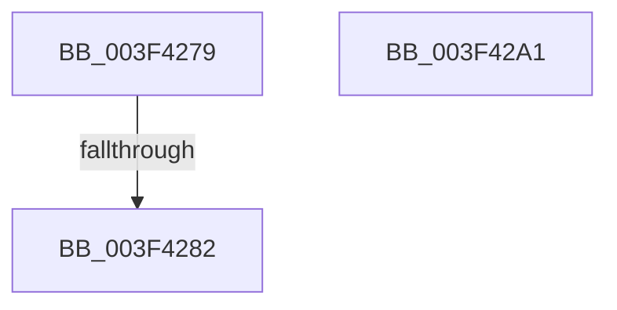

# sub_003F4279

- RVA: `0x003F4279`–`0x003F42A2` (길이 `41` bytes)
- VA: `0x00000001403F4279`
- 실행 섹션: `.text`
- PDB 이름 있음: `아니요`; PDB Function 태그: `아니요`
- unwind 정보 RVA: `0x00097180`
- 디코드: `13`개 명령, `41/41` bytes 표시
- 미해석 바이트: `0` (있으면 어셈블리에 `.byte`로 보존)

> 이 문서는 커널 이미지의 기계어와 PDB 기호를 분석해 생성했습니다. 4번과 5번은 함수 원형과 자료형을 바이너리 사용 방식에서 추정한 C 해석이며 원본 소스 복구 결과는 아닙니다.

## 1. Dependencies

- 직접 호출 지점: **0**; 고유 호출 대상: **0**
- 직접 호출자로 확인된 함수: **0**
- RIP 상대 이미지 참조: **0**

### Outgoing calls
- 직접 디코드된 call 명령이 없습니다.

### Direct callers
- 이 함수 시작 RVA로 연결되는 직접 call은 확인되지 않았습니다. 간접 호출은 완전히 역산할 수 없습니다.

### Static image references
- 디코드된 RIP-relative 메모리 참조가 없습니다.

## 2. Other-region calls and transfers

- 다른 실행 섹션으로 향하는 call: **0**
- call이 아닌 외부 분기/꼬리 이동: **1**
  - `0x003F427C` → [sub_003F434B](Unknown_function_003F434B.md) (`tail-transfer`)

## 3. Assembly (complete function range)

```asm
003F4279  48 85 DB                        test rbx, rbx
003F427C  0F 85 C9 00 00 00               jne 0x1403f434b
003F4282  0F B6 44 24 40                  movzx eax, byte ptr [rsp + 0x40]
003F4287  4C 8D 5C 24 50                  lea r11, [rsp + 0x50]
003F428C  49 8B 5B 28                     mov rbx, qword ptr [r11 + 0x28]
003F4290  49 8B 6B 30                     mov rbp, qword ptr [r11 + 0x30]
003F4294  49 8B 73 38                     mov rsi, qword ptr [r11 + 0x38]
003F4298  49 8B E3                        mov rsp, r11
003F429B  41 5F                           pop r15
003F429D  41 5C                           pop r12
003F429F  5F                              pop rdi
003F42A0  C3                              ret
003F42A1  CC                              int3
```

## 4. C-style interpretation (structured pseudocode)

```c
__int64 __fastcall sub_003F4279(__int64 a1, __int64 a2, __int64 a3, __int64 a4, __int64 a5, __int64 a6, __int64 a7, unsigned __int8 a8, __int64 a9, __int64 a10)
{
    return a8;
}
```

## 5. (Beta) C Style

```c
int64_t sub_003F4279(int64_t Arg1, int64_t Arg2, int64_t Arg3, int64_t Arg4, uint64_t Arg5, uint64_t Arg6, uint64_t Arg7, uint8_t Arg8, uint64_t Arg9, int64_t Arg10)
{
    return Arg8;
}
```

## 6. Execution-region graph

[열기: 2D/3D 그래프와 함수 탐색 컨트롤 패널](../../../control-panel.html?section=text&rva=0x003F4279&view=graph)

- 2D 그래프는 위에서 아래로 흐르고, 3D 그래프는 빈 공간을 드래그해 회전합니다. Shift+드래그는 이동, 휠은 확대·축소, 함수 노드 선택은 대상 보고서 이동입니다.

### Static fallback


