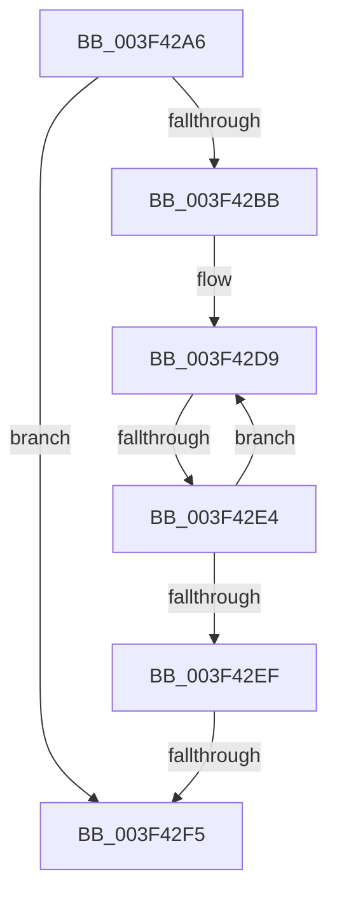

# sub_003F42A6

- RVA: `0x003F42A6`–`0x003F4306` (길이 `96` bytes)
- VA: `0x00000001403F42A6`
- 실행 섹션: `.text`
- PDB 이름 있음: `아니요`; PDB Function 태그: `아니요`
- unwind 정보 RVA: `0x000971A8`
- 디코드: `23`개 명령, `96/96` bytes 표시
- 미해석 바이트: `0` (있으면 어셈블리에 `.byte`로 보존)

> 이 문서는 커널 이미지의 기계어와 PDB 기호를 분석해 생성했습니다. 4번과 5번은 함수 원형과 자료형을 바이너리 사용 방식에서 추정한 C 해석이며 원본 소스 복구 결과는 아닙니다.

## 1. Dependencies

- 직접 호출 지점: **0**; 고유 호출 대상: **0**
- 직접 호출자로 확인된 함수: **0**
- RIP 상대 이미지 참조: **0**

### Outgoing calls
- 직접 디코드된 call 명령이 없습니다.

### Direct callers
- 이 함수 시작 RVA로 연결되는 직접 call은 확인되지 않았습니다. 간접 호출은 완전히 역산할 수 없습니다.

### Static image references
- 디코드된 RIP-relative 메모리 참조가 없습니다.

## 2. Other-region calls and transfers

- 다른 실행 섹션으로 향하는 call: **0**
- call이 아닌 외부 분기/꼬리 이동: **3**
  - `0x003F42E2` → [sub_003F4334](Unknown_function_003F4334.md) (`tail-transfer`)
  - `0x003F42F3` → [sub_003F4334 + 0x4](Unknown_function_003F4334.md) (`tail-transfer`)
  - `0x003F4301` → [sub_003F4279](Unknown_function_003F4279.md) (`tail-transfer`)

## 3. Assembly (complete function range)

```asm
003F42A6  48 8B 81 80 02 00 00            mov rax, qword ptr [rcx + 0x280]
003F42AD  48 6B DD 68                     imul rbx, rbp, 0x68
003F42B1  48 8B 54 03 48                  mov rdx, qword ptr [rbx + rax + 0x48]
003F42B6  48 85 D2                        test rdx, rdx
003F42B9  74 3A                           je 0x1403f42f5
003F42BB  44 0F B7 84 24 90 00 00 00      movzx r8d, word ptr [rsp + 0x90]
003F42C4  41 B9 FF 00 00 00               mov r9d, 0xff
003F42CA  0F B6 4A 01                     movzx ecx, byte ptr [rdx + 1]
003F42CE  41 0F B7 C0                     movzx eax, r8w
003F42D2  66 D3 C8                        ror ax, cl
003F42D5  66 23 42 02                     and ax, word ptr [rdx + 2]
003F42D9  0F B7 C8                        movzx ecx, ax
003F42DC  66 44 3B 44 8A 08               cmp r8w, word ptr [rdx + rcx*4 + 8]
003F42E2  74 50                           je 0x1403f4334
003F42E4  0F B6 44 8A 06                  movzx eax, byte ptr [rdx + rcx*4 + 6]
003F42E9  66 41 3B C1                     cmp ax, r9w
003F42ED  75 EA                           jne 0x1403f42d9
003F42EF  32 C0                           xor al, al
003F42F1  38 02                           cmp byte ptr [rdx], al
003F42F3  75 43                           jne 0x1403f4338
003F42F5  48 8B 86 80 02 00 00            mov rax, qword ptr [rsi + 0x280]
003F42FC  48 8B 5C 18 50                  mov rbx, qword ptr [rax + rbx + 0x50]
003F4301  E9 73 FF FF FF                  jmp 0x1403f4279
```

## 4. C-style interpretation (structured pseudocode)

```c
__int64 __fastcall sub_003F42A6(__int64 a1, __int64 a2, __int64 a3, __int64 a4, __int64 a5, __int64 a6, __int64 a7, __int64 a8, __int64 a9, __int64 a10, __int64 a11, __int64 a12, __int64 a13, __int64 a14, __int64 a15, __int64 a16, __int64 a17, unsigned __int16 a18)
{
    __int64 result;
    __int64 v_rbx;

    v_rbx = (v_rbx) * (v_rbp);
    if (*(unsigned __int64 *)(v_rbx + *(unsigned __int64 *)(a1 + 640) * 1 + 72) == 0) goto loc_003F42F5;
    result = (unsigned __int16)((a18) & (*(unsigned __int16 *)(*(unsigned __int64 *)(v_rbx + *(unsigned __int64 *)(a1 + 640) * 1 + 72) + 2)));
loc_003F42D9:
    if (((unsigned __int16)(*(unsigned __int8 *)(*(unsigned __int64 *)(v_rbx + *(unsigned __int64 *)(a1 + 640) * 1 + 72) + (unsigned __int16)(result) * 4 + 6))) != 255) goto loc_003F42D9;
    result = 0;
loc_003F42F5:
}
```

## 5. (Beta) C Style

```c
int64_t sub_003F42A6(void *Arg1, int64_t Arg2, int64_t Arg3, int64_t Arg4, uint64_t Arg5, uint64_t Arg6, uint64_t Arg7, uint64_t Arg8, uint64_t Arg9, uint64_t Arg10, uint64_t Arg11, uint64_t Arg12, uint64_t Arg13, uint64_t Arg14, uint64_t Arg15, uint64_t Arg16, uint64_t Arg17, uint16_t Arg18)
{
    uint8_t *arg1 = (uint8_t *)Arg1;

    int64_t result;
    int64_t local_rbx;

    local_rbx = (local_rbx) * (local_rbp);
    if (*(uint64_t *)(local_rbx + *(uint64_t *)(arg1 + 0x280) * 1 + 0x48) == 0) goto loc_003F42F5;
    result = (uint16_t)((Arg18) & (*(uint16_t *)(*(uint64_t *)(local_rbx + *(uint64_t *)(arg1 + 0x280) * 1 + 0x48) + 0x2)));
loc_003F42D9:
    if (((uint16_t)(*(uint8_t *)(*(uint64_t *)(local_rbx + *(uint64_t *)(arg1 + 0x280) * 1 + 0x48) + (uint16_t)(result) * 4 + 0x6))) != 255) goto loc_003F42D9;
    result = 0;
loc_003F42F5:
}
```

### 관측된 메모리 오프셋

구조체 형식이 확인되지 않은 접근은 인자 기준의 오프셋으로만 기록했습니다.

| 기준 인자 | 오프셋 표현 | 폭 (bit) | 접근 |
|---|---:|---:|---|
| `Arg1` | `+ 0x280` | `64` | `R` |

## 6. Execution-region graph

[열기: 2D/3D 그래프와 함수 탐색 컨트롤 패널](../../../control-panel.html?section=text&rva=0x003F42A6&view=graph)

- 2D 그래프는 위에서 아래로 흐르고, 3D 그래프는 빈 공간을 드래그해 회전합니다. Shift+드래그는 이동, 휠은 확대·축소, 함수 노드 선택은 대상 보고서 이동입니다.

### Static fallback


