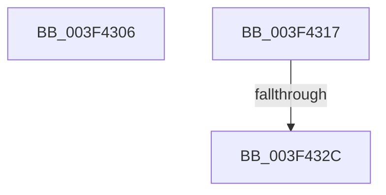

# sub_003F4306

- RVA: `0x003F4306`–`0x003F4334` (길이 `46` bytes)
- VA: `0x00000001403F4306`
- 실행 섹션: `.text`
- PDB 이름 있음: `아니요`; PDB Function 태그: `아니요`
- unwind 정보 RVA: `0x000971B8`
- 디코드: `10`개 명령, `46/46` bytes 표시
- 미해석 바이트: `0` (있으면 어셈블리에 `.byte`로 보존)

> 이 문서는 커널 이미지의 기계어와 PDB 기호를 분석해 생성했습니다. 4번과 5번은 함수 원형과 자료형을 바이너리 사용 방식에서 추정한 C 해석이며 원본 소스 복구 결과는 아닙니다.

## 1. Dependencies

- 직접 호출 지점: **1**; 고유 호출 대상: **1**
- 직접 호출자로 확인된 함수: **0**
- RIP 상대 이미지 참조: **0**

### Outgoing calls
- `0x003F430D` → [KiRaiseIrqlProcessIrqlFlags](../4F/KiRaiseIrqlProcessIrqlFlags_function_004F56FC.md) (function, `0x004F56FC`)

### Direct callers
- 이 함수 시작 RVA로 연결되는 직접 call은 확인되지 않았습니다. 간접 호출은 완전히 역산할 수 없습니다.

### Static image references
- 디코드된 RIP-relative 메모리 참조가 없습니다.

## 2. Other-region calls and transfers

- 다른 실행 섹션으로 향하는 call: **0**
- call이 아닌 외부 분기/꼬리 이동: **3**
  - `0x003F4312` → [sub_003F41DD + 0x1E](Unknown_function_003F41DD.md) (`tail-transfer`)
  - `0x003F4326` → [sub_003F41DD + 0x79](Unknown_function_003F41DD.md) (`tail-transfer`)
  - `0x003F432F` → [sub_003F41DD + 0x79](Unknown_function_003F41DD.md) (`tail-transfer`)

## 3. Assembly (complete function range)

```asm
003F4306  0F B6 D0                        movzx edx, al
003F4309  41 0F B6 CE                     movzx ecx, r14b
003F430D  E8 EA 13 10 00                  call 0x1404f56fc
003F4312  E9 E4 FE FF FF                  jmp 0x1403f41fb
003F4317  48 8B 86 80 02 00 00            mov rax, qword ptr [rsi + 0x280]
003F431E  4A 8B 5C 10 50                  mov rbx, qword ptr [rax + r10 + 0x50]
003F4323  48 85 DB                        test rbx, rbx
003F4326  0F 84 2A FF FF FF               je 0x1403f4256
003F432C  F0 FF 03                        lock inc dword ptr [rbx]
003F432F  E9 22 FF FF FF                  jmp 0x1403f4256
```

## 4. C-style interpretation (structured pseudocode)

```c
__int64 __fastcall sub_003F4306(void)
{
    __int64 result;

    result = KiRaiseIrqlProcessIrqlFlags((unsigned __int8)(v_r14), (unsigned __int8)(result), a3, a4);
}
```

## 5. (Beta) C Style

```c
void sub_003F4306(void)
{
    int64_t result;

    result = KiRaiseIrqlProcessIrqlFlags((uint8_t)(local_r14), (uint8_t)(result), a3, a4);
}
```

## 6. Execution-region graph

[열기: 2D/3D 그래프와 함수 탐색 컨트롤 패널](../../../control-panel.html?section=text&rva=0x003F4306&view=graph)

- 2D 그래프는 위에서 아래로 흐르고, 3D 그래프는 빈 공간을 드래그해 회전합니다. Shift+드래그는 이동, 휠은 확대·축소, 함수 노드 선택은 대상 보고서 이동입니다.

### Static fallback


