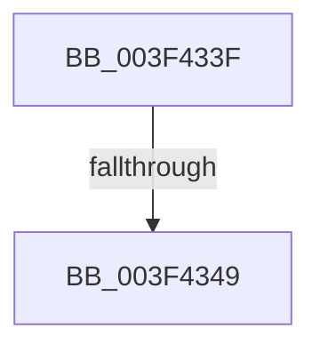

# sub_003F433F

- RVA: `0x003F433F`–`0x003F434B` (길이 `12` bytes)
- VA: `0x00000001403F433F`
- 실행 섹션: `.text`
- PDB 이름 있음: `아니요`; PDB Function 태그: `아니요`
- unwind 정보 RVA: `0x000971DC`
- 디코드: `3`개 명령, `12/12` bytes 표시
- 미해석 바이트: `0` (있으면 어셈블리에 `.byte`로 보존)

> 이 문서는 커널 이미지의 기계어와 PDB 기호를 분석해 생성했습니다. 4번과 5번은 함수 원형과 자료형을 바이너리 사용 방식에서 추정한 C 해석이며 원본 소스 복구 결과는 아닙니다.

## 1. Dependencies

- 직접 호출 지점: **0**; 고유 호출 대상: **0**
- 직접 호출자로 확인된 함수: **0**
- RIP 상대 이미지 참조: **0**

### Outgoing calls
- 직접 디코드된 call 명령이 없습니다.

### Direct callers
- 이 함수 시작 RVA로 연결되는 직접 call은 확인되지 않았습니다. 간접 호출은 완전히 역산할 수 없습니다.

### Static image references
- 디코드된 RIP-relative 메모리 참조가 없습니다.

## 2. Other-region calls and transfers

- 다른 실행 섹션으로 향하는 call: **0**
- call이 아닌 외부 분기/꼬리 이동: **2**
  - `0x003F4343` → [sub_003F41DD + 0x79](Unknown_function_003F41DD.md) (`tail-transfer`)
  - `0x003F4349` → [sub_003F4306 + 0x11](Unknown_function_003F4306.md) (`tail-transfer`)

## 3. Assembly (complete function range)

```asm
003F433F  38 5C 24 40                     cmp byte ptr [rsp + 0x40], bl
003F4343  0F 84 0D FF FF FF               je 0x1403f4256
003F4349  EB CC                           jmp 0x1403f4317
```

## 4. C-style interpretation (structured pseudocode)

```c
void __fastcall sub_003F433F(__int64 a1, __int64 a2, __int64 a3, __int64 a4, __int64 a5, __int64 a6, __int64 a7, unsigned __int8 a8)
{
}
```

## 5. (Beta) C Style

```c
void sub_003F433F(int64_t Arg1, int64_t Arg2, int64_t Arg3, int64_t Arg4, uint64_t Arg5, uint64_t Arg6, uint64_t Arg7, uint8_t Arg8)
{
}
```

## 6. Execution-region graph

[열기: 2D/3D 그래프와 함수 탐색 컨트롤 패널](../../../control-panel.html?section=text&rva=0x003F433F&view=graph)

- 2D 그래프는 위에서 아래로 흐르고, 3D 그래프는 빈 공간을 드래그해 회전합니다. Shift+드래그는 이동, 휠은 확대·축소, 함수 노드 선택은 대상 보고서 이동입니다.

### Static fallback


