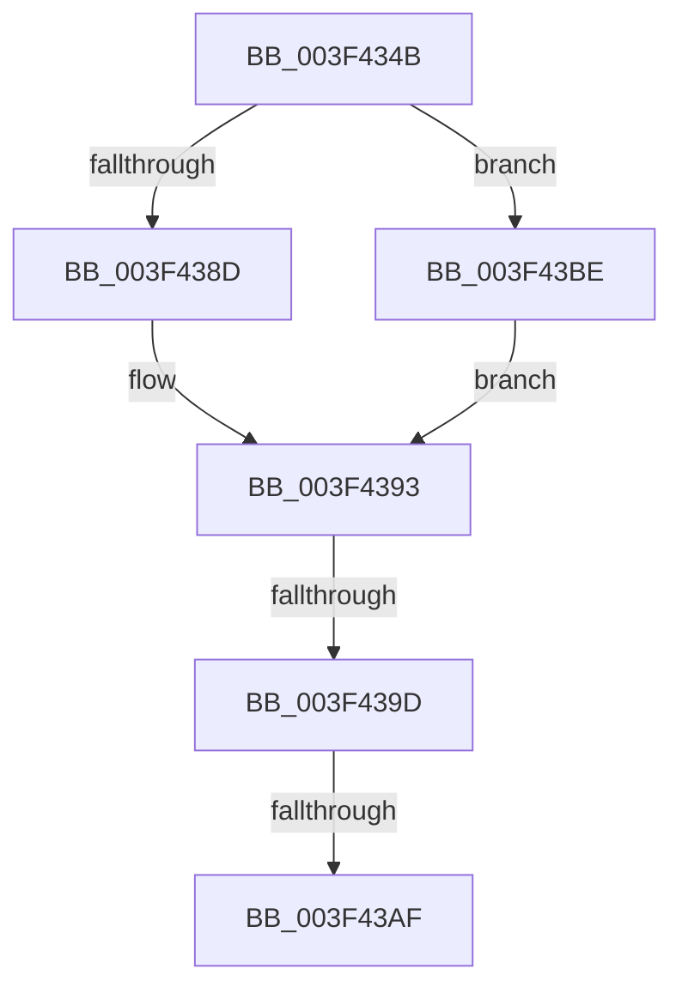

# sub_003F434B

- RVA: `0x003F434B`–`0x003F43C5` (길이 `122` bytes)
- VA: `0x00000001403F434B`
- 실행 섹션: `.text`
- PDB 이름 있음: `아니요`; PDB Function 태그: `아니요`
- unwind 정보 RVA: `0x000971F0`
- 디코드: `28`개 명령, `122/122` bytes 표시
- 미해석 바이트: `0` (있으면 어셈블리에 `.byte`로 보존)

> 이 문서는 커널 이미지의 기계어와 PDB 기호를 분석해 생성했습니다. 4번과 5번은 함수 원형과 자료형을 바이너리 사용 방식에서 추정한 C 해석이며 원본 소스 복구 결과는 아닙니다.

## 1. Dependencies

- 직접 호출 지점: **2**; 고유 호출 대상: **2**
- 직접 호출자로 확인된 함수: **0**
- RIP 상대 이미지 참조: **0**

### Outgoing calls
- `0x003F4384` → [EtwpApplyPayloadFilterInternal](EtwpApplyPayloadFilterInternal_function_003F43D0.md) (function, `0x003F43D0`)
- `0x003F43B4` → [ExFreePoolWithTag](../../poolcode/B8/ExFreePoolWithTag_function_00B82870.md) (function, `0x00B82870`)

### Direct callers
- 이 함수 시작 RVA로 연결되는 직접 call은 확인되지 않았습니다. 간접 호출은 완전히 역산할 수 없습니다.

### Static image references
- 디코드된 RIP-relative 메모리 참조가 없습니다.

## 2. Other-region calls and transfers

- 다른 실행 섹션으로 향하는 call: **1**
  - `0x003F43B4` → [ExFreePoolWithTag](../../poolcode/B8/ExFreePoolWithTag_function_00B82870.md) (`.text` → `POOLCODE`)
- call이 아닌 외부 분기/꼬리 이동: **3**
  - `0x003F4397` → [sub_003F4279 + 0xE](Unknown_function_003F4279.md) (`tail-transfer`)
  - `0x003F43A9` → [sub_003F4279 + 0x9](Unknown_function_003F4279.md) (`tail-transfer`)
  - `0x003F43B9` → [sub_003F4279 + 0x9](Unknown_function_003F4279.md) (`tail-transfer`)

## 3. Assembly (complete function range)

```asm
003F434B  44 0F B6 8C 24 A8 00 00 00      movzx r9d, byte ptr [rsp + 0xa8]
003F4354  48 8D 54 24 40                  lea rdx, [rsp + 0x40]
003F4359  4C 8B 84 24 A0 00 00 00         mov r8, qword ptr [rsp + 0xa0]
003F4361  48 8D 4B 08                     lea rcx, [rbx + 8]
003F4365  48 89 54 24 30                  mov qword ptr [rsp + 0x30], rdx
003F436A  66 45 85 E4                     test r12w, r12w
003F436E  8B 94 24 98 00 00 00            mov edx, dword ptr [rsp + 0x98]
003F4375  48 89 4C 24 28                  mov qword ptr [rsp + 0x28], rcx
003F437A  0F 94 C0                        sete al
003F437D  49 8B CF                        mov rcx, r15
003F4380  88 44 24 20                     mov byte ptr [rsp + 0x20], al
003F4384  E8 47 00 00 00                  call 0x1403f43d0
003F4389  85 C0                           test eax, eax
003F438B  79 31                           jns 0x1403f43be
003F438D  B0 01                           mov al, 1
003F438F  88 44 24 40                     mov byte ptr [rsp + 0x40], al
003F4393  40 80 FF 02                     cmp dil, 2
003F4397  0F 83 EA FE FF FF               jae 0x1403f4287
003F439D  B8 FF FF FF FF                  mov eax, 0xffffffff
003F43A2  F0 0F C1 03                     lock xadd dword ptr [rbx], eax
003F43A6  83 F8 01                        cmp eax, 1
003F43A9  0F 85 D3 FE FF FF               jne 0x1403f4282
003F43AF  33 D2                           xor edx, edx
003F43B1  48 8B CB                        mov rcx, rbx
003F43B4  E8 B7 E4 78 00                  call 0x140b82870
003F43B9  E9 C4 FE FF FF                  jmp 0x1403f4282
003F43BE  0F B6 44 24 40                  movzx eax, byte ptr [rsp + 0x40]
003F43C3  EB CE                           jmp 0x1403f4393
```

## 4. C-style interpretation (structured pseudocode)

```c
__int64 __fastcall sub_003F434B(__int64 a1, __int64 a2, __int64 a3, __int64 a4, __int64 a5, __int64 a6, __int64 a7, unsigned __int8 a8, __int64 a9, __int64 a10, __int64 a11, __int64 a12, __int64 a13, __int64 a14, __int64 a15, __int64 a16, __int64 a17, __int64 a18, unsigned int a19, __int64 a20, unsigned __int8 a21)
{
    __int64 result;
    unsigned __int8 v_stack_p20;
    unsigned __int64 v_stack_p28;
    unsigned __int64 v_stack_p30;
    unsigned __int8 v_stack_p40;

    v_stack_p30 = a8;
    v_stack_p28 = v_rbx + 8;
    result = ((unsigned __int16)(v_r12) == 0) ? 1 : 0;
    v_stack_p20 = (unsigned __int8)(result);
    result = EtwpApplyPayloadFilterInternal(v_r15, (unsigned int)(a19), a20, a21);
    if (!sign_flag) goto loc_003F43BE;
    v_stack_p40 = 1;
loc_003F4393:
    a2 = 0;
    result = ExFreePoolWithTag(v_rbx, a2, a20, a21);
loc_003F43BE:
    goto loc_003F4393;
}
```

## 5. (Beta) C Style

```c
int64_t sub_003F434B(int64_t Arg1, int64_t Arg2, int64_t Arg3, int64_t Arg4, uint64_t Arg5, uint64_t Arg6, uint64_t Arg7, uint8_t Arg8, uint64_t Arg9, uint64_t Arg10, uint64_t Arg11, uint64_t Arg12, uint64_t Arg13, uint64_t Arg14, uint64_t Arg15, uint64_t Arg16, uint64_t Arg17, uint64_t Arg18, uint32_t Arg19, int64_t Arg20, uint8_t Arg21)
{
    int64_t result;
    uint8_t v_stack_p20;
    uint64_t v_stack_p28;
    uint64_t v_stack_p30;
    uint8_t v_stack_p40;

    v_stack_p30 = Arg8;
    v_stack_p28 = local_rbx + 8;
    result = ((uint16_t)(local_r12) == 0) ? 1 : 0;
    v_stack_p20 = (uint8_t)(result);
    result = EtwpApplyPayloadFilterInternal(local_r15, (uint32_t)(Arg19), Arg20, Arg21);
    if (!sign_flag) goto loc_003F43BE;
    v_stack_p40 = 1;
loc_003F4393:
    Arg2 = 0;
    result = ExFreePoolWithTag(local_rbx, Arg2, Arg20, Arg21);
loc_003F43BE:
    goto loc_003F4393;
}
```

## 6. Execution-region graph

[열기: 2D/3D 그래프와 함수 탐색 컨트롤 패널](../../../control-panel.html?section=text&rva=0x003F434B&view=graph)

- 2D 그래프는 위에서 아래로 흐르고, 3D 그래프는 빈 공간을 드래그해 회전합니다. Shift+드래그는 이동, 휠은 확대·축소, 함수 노드 선택은 대상 보고서 이동입니다.

### Static fallback


