# sub_003F4E8A

- RVA: `0x003F4E8A`–`0x003F511A` (길이 `656` bytes)
- VA: `0x00000001403F4E8A`
- 실행 섹션: `.text`
- PDB 이름 있음: `아니요`; PDB Function 태그: `아니요`
- unwind 정보 RVA: `0x000973DC`
- 디코드: `140`개 명령, `656/656` bytes 표시
- 미해석 바이트: `0` (있으면 어셈블리에 `.byte`로 보존)

> 이 문서는 커널 이미지의 기계어와 PDB 기호를 분석해 생성했습니다. 4번과 5번은 함수 원형과 자료형을 바이너리 사용 방식에서 추정한 C 해석이며 원본 소스 복구 결과는 아닙니다.

## 1. Dependencies

- 직접 호출 지점: **1**; 고유 호출 대상: **1**
- 직접 호출자로 확인된 함수: **0**
- RIP 상대 이미지 참조: **0**

### Outgoing calls
- `0x003F5100` → [RtlpCopyXStateChunk](RtlpCopyXStateChunk_function_003F51D4.md) (function, `0x003F51D4`)

### Direct callers
- 이 함수 시작 RVA로 연결되는 직접 call은 확인되지 않았습니다. 간접 호출은 완전히 역산할 수 없습니다.

### Static image references
- 디코드된 RIP-relative 메모리 참조가 없습니다.

## 2. Other-region calls and transfers

- 다른 실행 섹션으로 향하는 call: **0**
- call이 아닌 외부 분기/꼬리 이동: **5**
  - `0x003F4EBB` → [sub_003F512F + 0xE](Unknown_function_003F512F.md) (`tail-transfer`)
  - `0x003F4EC7` → [sub_003F512F + 0xE](Unknown_function_003F512F.md) (`tail-transfer`)
  - `0x003F4EDE` → [sub_003F512F](Unknown_function_003F512F.md) (`tail-transfer`)
  - `0x003F4EE9` → [sub_003F518A](Unknown_function_003F518A.md) (`tail-transfer`)
  - `0x003F510D` → [sub_003F518A + 0x1C](Unknown_function_003F518A.md) (`tail-transfer`)

## 3. Assembly (complete function range)

```asm
003F4E8A  48 89 7C 24 50                  mov qword ptr [rsp + 0x50], rdi
003F4E8F  48 8B 7C 24 70                  mov rdi, qword ptr [rsp + 0x70]
003F4E94  48 8B DE                        mov rbx, rsi
003F4E97  49 0F 45 D9                     cmovne rbx, r9
003F4E9B  4C 39 7C 24 78                  cmp qword ptr [rsp + 0x78], r15
003F4EA0  48 0F 45 7C 24 78               cmovne rdi, qword ptr [rsp + 0x78]
003F4EA6  41 F6 C6 01                     test r14b, 1
003F4EAA  0F 84 36 02 00 00               je 0x1403f50e6
003F4EB0  48 63 4B 08                     movsxd rcx, dword ptr [rbx + 8]
003F4EB4  4C 63 47 08                     movsxd r8, dword ptr [rdi + 8]
003F4EB8  41 3B C8                        cmp ecx, r8d
003F4EBB  0F 85 7C 02 00 00               jne 0x1403f513d
003F4EC1  8B 47 0C                        mov eax, dword ptr [rdi + 0xc]
003F4EC4  39 43 0C                        cmp dword ptr [rbx + 0xc], eax
003F4EC7  0F 82 70 02 00 00               jb 0x1403f513d
003F4ECD  4D 8B C8                        mov r9, r8
003F4ED0  48 8D 14 0E                     lea rdx, [rsi + rcx]
003F4ED4  4C 03 4C 24 70                  add r9, qword ptr [rsp + 0x70]
003F4ED9  41 0F BA E2 10                  bt r10d, 0x10
003F4EDE  0F 82 4B 02 00 00               jb 0x1403f512f
003F4EE4  41 0F BA E2 14                  bt r10d, 0x14
003F4EE9  0F 83 9B 02 00 00               jae 0x1403f518a
003F4EEF  41 8B C2                        mov eax, r10d
003F4EF2  25 FF FF FF 67                  and eax, 0x67ffffff
003F4EF7  89 42 30                        mov dword ptr [rdx + 0x30], eax
003F4EFA  40 84 ED                        test bpl, bpl
003F4EFD  0F 84 E3 01 00 00               je 0x1403f50e6
003F4F03  41 0F BA E2 1E                  bt r10d, 0x1e
003F4F08  73 14                           jae 0x1403f4f1e
003F4F0A  41 8B 41 30                     mov eax, dword ptr [r9 + 0x30]
003F4F0E  8B C8                           mov ecx, eax
003F4F10  41 33 CA                        xor ecx, r10d
003F4F13  81 E1 FF FF FF 67               and ecx, 0x67ffffff
003F4F19  33 C8                           xor ecx, eax
003F4F1B  89 4A 30                        mov dword ptr [rdx + 0x30], ecx
003F4F1E  41 8B C2                        mov eax, r10d
003F4F21  25 01 00 10 00                  and eax, 0x100001
003F4F26  3D 01 00 10 00                  cmp eax, 0x100001
003F4F2B  75 35                           jne 0x1403f4f62
003F4F2D  49 8B 81 F8 00 00 00            mov rax, qword ptr [r9 + 0xf8]
003F4F34  48 89 82 F8 00 00 00            mov qword ptr [rdx + 0xf8], rax
003F4F3B  41 0F B7 41 38                  movzx eax, word ptr [r9 + 0x38]
003F4F40  66 89 42 38                     mov word ptr [rdx + 0x38], ax
003F4F44  41 0F B7 41 42                  movzx eax, word ptr [r9 + 0x42]
003F4F49  66 89 42 42                     mov word ptr [rdx + 0x42], ax
003F4F4D  49 8B 81 98 00 00 00            mov rax, qword ptr [r9 + 0x98]
003F4F54  48 89 82 98 00 00 00            mov qword ptr [rdx + 0x98], rax
003F4F5B  41 8B 41 44                     mov eax, dword ptr [r9 + 0x44]
003F4F5F  89 42 44                        mov dword ptr [rdx + 0x44], eax
003F4F62  41 8B C2                        mov eax, r10d
003F4F65  25 02 00 10 00                  and eax, 0x100002
003F4F6A  3D 02 00 10 00                  cmp eax, 0x100002
003F4F6F  75 74                           jne 0x1403f4fe5
003F4F71  41 0F 10 41 78                  movups xmm0, xmmword ptr [r9 + 0x78]
003F4F76  0F 11 42 78                     movups xmmword ptr [rdx + 0x78], xmm0
003F4F7A  41 0F 10 89 88 00 00 00         movups xmm1, xmmword ptr [r9 + 0x88]
003F4F82  0F 11 8A 88 00 00 00            movups xmmword ptr [rdx + 0x88], xmm1
003F4F89  41 0F 10 81 A0 00 00 00         movups xmm0, xmmword ptr [r9 + 0xa0]
003F4F91  0F 11 82 A0 00 00 00            movups xmmword ptr [rdx + 0xa0], xmm0
003F4F98  41 0F 10 89 B0 00 00 00         movups xmm1, xmmword ptr [r9 + 0xb0]
003F4FA0  0F 11 8A B0 00 00 00            movups xmmword ptr [rdx + 0xb0], xmm1
003F4FA7  41 0F 10 81 C0 00 00 00         movups xmm0, xmmword ptr [r9 + 0xc0]
003F4FAF  0F 11 82 C0 00 00 00            movups xmmword ptr [rdx + 0xc0], xmm0
003F4FB6  41 0F 10 89 D0 00 00 00         movups xmm1, xmmword ptr [r9 + 0xd0]
003F4FBE  0F 11 8A D0 00 00 00            movups xmmword ptr [rdx + 0xd0], xmm1
003F4FC5  41 0F 10 81 E0 00 00 00         movups xmm0, xmmword ptr [r9 + 0xe0]
003F4FCD  0F 11 82 E0 00 00 00            movups xmmword ptr [rdx + 0xe0], xmm0
003F4FD4  F2 41 0F 10 89 F0 00 00 00      movsd xmm1, qword ptr [r9 + 0xf0]
003F4FDD  F2 0F 11 8A F0 00 00 00         movsd qword ptr [rdx + 0xf0], xmm1
003F4FE5  41 8B C2                        mov eax, r10d
003F4FE8  25 04 00 10 00                  and eax, 0x100004
003F4FED  3D 04 00 10 00                  cmp eax, 0x100004
003F4FF2  75 24                           jne 0x1403f5018
003F4FF4  41 0F B7 41 40                  movzx eax, word ptr [r9 + 0x40]
003F4FF9  66 89 42 40                     mov word ptr [rdx + 0x40], ax
003F4FFD  41 0F B7 41 3E                  movzx eax, word ptr [r9 + 0x3e]
003F5002  66 89 42 3E                     mov word ptr [rdx + 0x3e], ax
003F5006  41 0F B7 41 3C                  movzx eax, word ptr [r9 + 0x3c]
003F500B  66 89 42 3C                     mov word ptr [rdx + 0x3c], ax
003F500F  41 0F B7 41 3A                  movzx eax, word ptr [r9 + 0x3a]
003F5014  66 89 42 3A                     mov word ptr [rdx + 0x3a], ax
003F5018  41 8B C2                        mov eax, r10d
003F501B  25 08 00 10 00                  and eax, 0x100008
003F5020  3D 08 00 10 00                  cmp eax, 0x100008
003F5025  75 76                           jne 0x1403f509d
003F5027  41 8B 41 34                     mov eax, dword ptr [r9 + 0x34]
003F502B  49 8D 89 00 01 00 00            lea rcx, [r9 + 0x100]
003F5032  89 42 34                        mov dword ptr [rdx + 0x34], eax
003F5035  48 8D 82 00 01 00 00            lea rax, [rdx + 0x100]
003F503C  48 8D 80 80 00 00 00            lea rax, [rax + 0x80]
003F5043  0F 10 01                        movups xmm0, xmmword ptr [rcx]
003F5046  48 8D 89 80 00 00 00            lea rcx, [rcx + 0x80]
003F504D  0F 11 40 80                     movups xmmword ptr [rax - 0x80], xmm0
003F5051  0F 10 49 90                     movups xmm1, xmmword ptr [rcx - 0x70]
003F5055  0F 11 48 90                     movups xmmword ptr [rax - 0x70], xmm1
003F5059  0F 10 41 A0                     movups xmm0, xmmword ptr [rcx - 0x60]
003F505D  0F 11 40 A0                     movups xmmword ptr [rax - 0x60], xmm0
003F5061  0F 10 49 B0                     movups xmm1, xmmword ptr [rcx - 0x50]
003F5065  0F 11 48 B0                     movups xmmword ptr [rax - 0x50], xmm1
003F5069  0F 10 41 C0                     movups xmm0, xmmword ptr [rcx - 0x40]
003F506D  0F 11 40 C0                     movups xmmword ptr [rax - 0x40], xmm0
003F5071  0F 10 49 D0                     movups xmm1, xmmword ptr [rcx - 0x30]
003F5075  0F 11 48 D0                     movups xmmword ptr [rax - 0x30], xmm1
003F5079  0F 10 41 E0                     movups xmm0, xmmword ptr [rcx - 0x20]
003F507D  0F 11 40 E0                     movups xmmword ptr [rax - 0x20], xmm0
003F5081  0F 10 49 F0                     movups xmm1, xmmword ptr [rcx - 0x10]
003F5085  0F 11 48 F0                     movups xmmword ptr [rax - 0x10], xmm1
003F5089  49 83 EB 01                     sub r11, 1
003F508D  75 AD                           jne 0x1403f503c
003F508F  0F 10 01                        movups xmm0, xmmword ptr [rcx]
003F5092  0F 11 00                        movups xmmword ptr [rax], xmm0
003F5095  0F 10 49 10                     movups xmm1, xmmword ptr [rcx + 0x10]
003F5099  0F 11 48 10                     movups xmmword ptr [rax + 0x10], xmm1
003F509D  41 81 E2 10 00 10 00            and r10d, 0x100010
003F50A4  41 81 FA 10 00 10 00            cmp r10d, 0x100010
003F50AB  75 39                           jne 0x1403f50e6
003F50AD  41 0F 10 41 48                  movups xmm0, xmmword ptr [r9 + 0x48]
003F50B2  0F 11 42 48                     movups xmmword ptr [rdx + 0x48], xmm0
003F50B6  41 0F 10 49 58                  movups xmm1, xmmword ptr [r9 + 0x58]
003F50BB  0F 11 4A 58                     movups xmmword ptr [rdx + 0x58], xmm1
003F50BF  41 0F 10 41 68                  movups xmm0, xmmword ptr [r9 + 0x68]
003F50C4  0F 11 42 68                     movups xmmword ptr [rdx + 0x68], xmm0
003F50C8  41 0F 10 81 B0 04 00 00         movups xmm0, xmmword ptr [r9 + 0x4b0]
003F50D0  0F 11 82 B0 04 00 00            movups xmmword ptr [rdx + 0x4b0], xmm0
003F50D7  41 0F 10 89 C0 04 00 00         movups xmm1, xmmword ptr [r9 + 0x4c0]
003F50DF  0F 11 8A C0 04 00 00            movups xmmword ptr [rdx + 0x4c0], xmm1
003F50E6  41 F6 C6 02                     test r14b, 2
003F50EA  74 1D                           je 0x1403f5109
003F50EC  4C 8B 4C 24 70                  mov r9, qword ptr [rsp + 0x70]
003F50F1  4C 8B C3                        mov r8, rbx
003F50F4  48 8B D6                        mov rdx, rsi
003F50F7  48 89 7C 24 20                  mov qword ptr [rsp + 0x20], rdi
003F50FC  40 0F B6 CD                     movzx ecx, bpl
003F5100  E8 CF 00 00 00                  call 0x1403f51d4
003F5105  85 C0                           test eax, eax
003F5107  78 0C                           js 0x1403f5115
003F5109  41 F6 C6 04                     test r14b, 4
003F510D  0F 85 93 00 00 00               jne 0x1403f51a6
003F5113  33 C0                           xor eax, eax
003F5115  48 8B 7C 24 50                  mov rdi, qword ptr [rsp + 0x50]
```

## 4. C-style interpretation (structured pseudocode)

```c
__int64 __fastcall sub_003F4E8A(__int64 a1, __int64 a2, __int64 a3, __int64 a4, __int64 a5, __int64 a6, __int64 a7, __int64 a8, __int64 a9, __int64 a10, __int64 a11, __int64 a12, __int64 a13, __int64 a14, __int64 a15)
{
    __int64 result;
    __int64 v_r10;
    __int64 v_r11;
    __int64 v_rbx;
    unsigned __int64 v_stack_p20;
    unsigned __int64 v_stack_p50;

    v_stack_p50 = v_rdi;
    v_rbx = v_rsi;
    if (condition_is_not_equal) { v_rbx = a4; }
    if (a15 != v_r15) { a14 = a15; }
    if ((((unsigned __int8)(v_r14)) & (1)) == 0) goto loc_003F50E6;
    a4 = ((int)(*(unsigned int *)(a14 + 8))) + (a14);
    result = (unsigned int)(((unsigned int)((unsigned int)(v_r10))) & (0x67FFFFFFULL));
    *(unsigned int *)(v_rsi + (int)(*(unsigned int *)(v_rbx + 8)) * 1 + 48) = (unsigned int)(result);
    if ((unsigned __int8)(v_rbp) == 0) goto loc_003F50E6;
    if (!(condition_is_above_or_equal)) {
        result = *(unsigned int *)(a4 + 48);
        a1 = (unsigned int)(result);
        a1 = (unsigned int)((a1) ^ ((unsigned int)(v_r10)));
        a1 = (unsigned int)((a1) & (0x67FFFFFFULL));
        a1 = (unsigned int)((a1) ^ ((unsigned int)(result)));
        *(unsigned int *)(v_rsi + (int)(*(unsigned int *)(v_rbx + 8)) * 1 + 48) = (unsigned int)(a1);
    }
    result = (unsigned int)(((unsigned int)((unsigned int)(v_r10))) & (0x100001ULL));
    if (((unsigned int)(result)) == 0x100001ULL) {
        result = *(unsigned __int64 *)(a4 + 248);
        *(unsigned __int64 *)(v_rsi + (int)(*(unsigned int *)(v_rbx + 8)) * 1 + 248) = result;
        result = *(unsigned __int16 *)(a4 + 56);
        *(unsigned __int16 *)(v_rsi + (int)(*(unsigned int *)(v_rbx + 8)) * 1 + 56) = (unsigned __int16)(result);
        result = *(unsigned __int16 *)(a4 + 66);
        *(unsigned __int16 *)(v_rsi + (int)(*(unsigned int *)(v_rbx + 8)) * 1 + 66) = (unsigned __int16)(result);
        result = *(unsigned __int64 *)(a4 + 152);
        *(unsigned __int64 *)(v_rsi + (int)(*(unsigned int *)(v_rbx + 8)) * 1 + 152) = result;
        result = *(unsigned int *)(a4 + 68);
        *(unsigned int *)(v_rsi + (int)(*(unsigned int *)(v_rbx + 8)) * 1 + 68) = (unsigned int)(result);
    }
    result = (unsigned int)(((unsigned int)((unsigned int)(v_r10))) & (0x100002ULL));
    if (((unsigned int)(result)) == 0x100002ULL) {
        *(unsigned __int64 *)(v_rsi + (int)(*(unsigned int *)(v_rbx + 8)) * 1 + 120) = v_xmm0;
        *(unsigned __int64 *)(v_rsi + (int)(*(unsigned int *)(v_rbx + 8)) * 1 + 136) = v_xmm1;
        *(unsigned __int64 *)(v_rsi + (int)(*(unsigned int *)(v_rbx + 8)) * 1 + 160) = v_xmm0;
        *(unsigned __int64 *)(v_rsi + (int)(*(unsigned int *)(v_rbx + 8)) * 1 + 176) = v_xmm1;
        *(unsigned __int64 *)(v_rsi + (int)(*(unsigned int *)(v_rbx + 8)) * 1 + 192) = v_xmm0;
        *(unsigned __int64 *)(v_rsi + (int)(*(unsigned int *)(v_rbx + 8)) * 1 + 208) = v_xmm1;
        *(unsigned __int64 *)(v_rsi + (int)(*(unsigned int *)(v_rbx + 8)) * 1 + 224) = v_xmm0;
        *(unsigned __int64 *)(v_rsi + (int)(*(unsigned int *)(v_rbx + 8)) * 1 + 240) = v_xmm1;
    }
    result = (unsigned int)(((unsigned int)((unsigned int)(v_r10))) & (0x100004ULL));
    if (((unsigned int)(result)) == 0x100004ULL) {
        result = *(unsigned __int16 *)(a4 + 64);
        *(unsigned __int16 *)(v_rsi + (int)(*(unsigned int *)(v_rbx + 8)) * 1 + 64) = (unsigned __int16)(result);
        result = *(unsigned __int16 *)(a4 + 62);
        *(unsigned __int16 *)(v_rsi + (int)(*(unsigned int *)(v_rbx + 8)) * 1 + 62) = (unsigned __int16)(result);
        result = *(unsigned __int16 *)(a4 + 60);
        *(unsigned __int16 *)(v_rsi + (int)(*(unsigned int *)(v_rbx + 8)) * 1 + 60) = (unsigned __int16)(result);
        result = *(unsigned __int16 *)(a4 + 58);
        *(unsigned __int16 *)(v_rsi + (int)(*(unsigned int *)(v_rbx + 8)) * 1 + 58) = (unsigned __int16)(result);
    }
    result = (unsigned int)(((unsigned int)((unsigned int)(v_r10))) & (0x100008ULL));
    if (((unsigned int)(result)) != 0x100008ULL) goto loc_003F509D;
    *(unsigned int *)(v_rsi + (int)(*(unsigned int *)(v_rbx + 8)) * 1 + 52) = (unsigned int)((unsigned int)(*(unsigned int *)(a4 + 52)));
loc_003F503C:
    *(unsigned __int64 *)(v_rsi + (int)(*(unsigned int *)(v_rbx + 8)) * 1 + 256 + 128 - 128) = v_xmm0;
    *(unsigned __int64 *)(v_rsi + (int)(*(unsigned int *)(v_rbx + 8)) * 1 + 256 + 128 - 112) = v_xmm1;
    *(unsigned __int64 *)(v_rsi + (int)(*(unsigned int *)(v_rbx + 8)) * 1 + 256 + 128 - 96) = v_xmm0;
    *(unsigned __int64 *)(v_rsi + (int)(*(unsigned int *)(v_rbx + 8)) * 1 + 256 + 128 - 80) = v_xmm1;
    *(unsigned __int64 *)(v_rsi + (int)(*(unsigned int *)(v_rbx + 8)) * 1 + 256 + 128 - 64) = v_xmm0;
    *(unsigned __int64 *)(v_rsi + (int)(*(unsigned int *)(v_rbx + 8)) * 1 + 256 + 128 - 48) = v_xmm1;
    *(unsigned __int64 *)(v_rsi + (int)(*(unsigned int *)(v_rbx + 8)) * 1 + 256 + 128 - 32) = v_xmm0;
    *(unsigned __int64 *)(v_rsi + (int)(*(unsigned int *)(v_rbx + 8)) * 1 + 256 + 128 - 16) = v_xmm1;
    v_r11 = (v_r11) - (1);
    if (condition_is_not_equal) goto loc_003F503C;
    *(unsigned __int64 *)(v_rsi + (int)(*(unsigned int *)(v_rbx + 8)) * 1 + 256 + 128) = v_xmm0;
    *(unsigned __int64 *)(v_rsi + (int)(*(unsigned int *)(v_rbx + 8)) * 1 + 256 + 128 + 16) = v_xmm1;
loc_003F509D:
    v_r10 = (unsigned int)((v_r10) & (0x100010ULL));
    if (((unsigned int)(v_r10)) == 0x100010ULL) {
        *(unsigned __int64 *)(v_rsi + (int)(*(unsigned int *)(v_rbx + 8)) * 1 + 72) = v_xmm0;
        *(unsigned __int64 *)(v_rsi + (int)(*(unsigned int *)(v_rbx + 8)) * 1 + 88) = v_xmm1;
        *(unsigned __int64 *)(v_rsi + (int)(*(unsigned int *)(v_rbx + 8)) * 1 + 104) = v_xmm0;
        *(unsigned __int64 *)(v_rsi + (int)(*(unsigned int *)(v_rbx + 8)) * 1 + 1200) = v_xmm0;
        *(unsigned __int64 *)(v_rsi + (int)(*(unsigned int *)(v_rbx + 8)) * 1 + 1216) = v_xmm1;
    }
    if ((((unsigned __int8)(v_r14)) & (2)) == 0) goto loc_003F5109;
    v_stack_p20 = a14;
    result = RtlpCopyXStateChunk((unsigned __int8)(v_rbp), v_rsi, v_rbx, a14);
    if (sign_flag) goto loc_003F5115;
loc_003F5109:
    result = 0;
loc_003F5115:
    return result;
}
```

## 5. (Beta) C Style

```c
int64_t sub_003F4E8A(int64_t Arg1, int64_t Arg2, int64_t Arg3, int64_t Arg4, uint64_t Arg5, uint64_t Arg6, uint64_t Arg7, uint64_t Arg8, uint64_t Arg9, int64_t Arg10, uint64_t Arg11, uint64_t Arg12, uint64_t Arg13, int64_t Arg14, int64_t Arg15)
{
    int64_t result;
    int64_t local_r10;
    int64_t local_r11;
    int64_t local_rbx;
    uint64_t v_stack_p20;
    uint64_t v_stack_p50;

    v_stack_p50 = local_rdi;
    local_rbx = local_rsi;
    if (condition_is_not_equal) { local_rbx = Arg4; }
    if (Arg15 != local_r15) { Arg14 = Arg15; }
    if ((((uint8_t)(local_r14)) & (1)) == 0) goto loc_003F50E6;
    Arg4 = ((int32_t)(*(uint32_t *)(Arg14 + 0x8))) + (Arg14);
    result = (uint32_t)(((uint32_t)((uint32_t)(local_r10))) & (0x67FFFFFFULL));
    *(uint32_t *)(local_rsi + (int32_t)(*(uint32_t *)(local_rbx + 0x8)) * 1 + 0x30) = (uint32_t)(result);
    if ((uint8_t)(local_rbp) == 0) goto loc_003F50E6;
    if (!(condition_is_above_or_equal)) {
        result = *(uint32_t *)(Arg4 + 0x30);
        Arg1 = (uint32_t)(result);
        Arg1 = (uint32_t)((Arg1) ^ ((uint32_t)(local_r10)));
        Arg1 = (uint32_t)((Arg1) & (0x67FFFFFFULL));
        Arg1 = (uint32_t)((Arg1) ^ ((uint32_t)(result)));
        *(uint32_t *)(local_rsi + (int32_t)(*(uint32_t *)(local_rbx + 0x8)) * 1 + 0x30) = (uint32_t)(Arg1);
    }
    result = (uint32_t)(((uint32_t)((uint32_t)(local_r10))) & (0x100001ULL));
    if (((uint32_t)(result)) == 0x100001ULL) {
        result = *(uint64_t *)(Arg4 + 0xF8);
        *(uint64_t *)(local_rsi + (int32_t)(*(uint32_t *)(local_rbx + 0x8)) * 1 + 0xF8) = result;
        result = *(uint16_t *)(Arg4 + 0x38);
        *(uint16_t *)(local_rsi + (int32_t)(*(uint32_t *)(local_rbx + 0x8)) * 1 + 0x38) = (uint16_t)(result);
        result = *(uint16_t *)(Arg4 + 0x42);
        *(uint16_t *)(local_rsi + (int32_t)(*(uint32_t *)(local_rbx + 0x8)) * 1 + 0x42) = (uint16_t)(result);
        result = *(uint64_t *)(Arg4 + 0x98);
        *(uint64_t *)(local_rsi + (int32_t)(*(uint32_t *)(local_rbx + 0x8)) * 1 + 0x98) = result;
        result = *(uint32_t *)(Arg4 + 0x44);
        *(uint32_t *)(local_rsi + (int32_t)(*(uint32_t *)(local_rbx + 0x8)) * 1 + 0x44) = (uint32_t)(result);
    }
    result = (uint32_t)(((uint32_t)((uint32_t)(local_r10))) & (0x100002ULL));
    if (((uint32_t)(result)) == 0x100002ULL) {
        *(uint64_t *)(local_rsi + (int32_t)(*(uint32_t *)(local_rbx + 0x8)) * 1 + 0x78) = v_xmm0;
        *(uint64_t *)(local_rsi + (int32_t)(*(uint32_t *)(local_rbx + 0x8)) * 1 + 0x88) = v_xmm1;
        *(uint64_t *)(local_rsi + (int32_t)(*(uint32_t *)(local_rbx + 0x8)) * 1 + 0xA0) = v_xmm0;
        *(uint64_t *)(local_rsi + (int32_t)(*(uint32_t *)(local_rbx + 0x8)) * 1 + 0xB0) = v_xmm1;
        *(uint64_t *)(local_rsi + (int32_t)(*(uint32_t *)(local_rbx + 0x8)) * 1 + 0xC0) = v_xmm0;
        *(uint64_t *)(local_rsi + (int32_t)(*(uint32_t *)(local_rbx + 0x8)) * 1 + 0xD0) = v_xmm1;
        *(uint64_t *)(local_rsi + (int32_t)(*(uint32_t *)(local_rbx + 0x8)) * 1 + 0xE0) = v_xmm0;
        *(uint64_t *)(local_rsi + (int32_t)(*(uint32_t *)(local_rbx + 0x8)) * 1 + 0xF0) = v_xmm1;
    }
    result = (uint32_t)(((uint32_t)((uint32_t)(local_r10))) & (0x100004ULL));
    if (((uint32_t)(result)) == 0x100004ULL) {
        result = *(uint16_t *)(Arg4 + 0x40);
        *(uint16_t *)(local_rsi + (int32_t)(*(uint32_t *)(local_rbx + 0x8)) * 1 + 0x40) = (uint16_t)(result);
        result = *(uint16_t *)(Arg4 + 0x3E);
        *(uint16_t *)(local_rsi + (int32_t)(*(uint32_t *)(local_rbx + 0x8)) * 1 + 0x3E) = (uint16_t)(result);
        result = *(uint16_t *)(Arg4 + 0x3C);
        *(uint16_t *)(local_rsi + (int32_t)(*(uint32_t *)(local_rbx + 0x8)) * 1 + 0x3C) = (uint16_t)(result);
        result = *(uint16_t *)(Arg4 + 0x3A);
        *(uint16_t *)(local_rsi + (int32_t)(*(uint32_t *)(local_rbx + 0x8)) * 1 + 0x3A) = (uint16_t)(result);
    }
    result = (uint32_t)(((uint32_t)((uint32_t)(local_r10))) & (0x100008ULL));
    if (((uint32_t)(result)) != 0x100008ULL) goto loc_003F509D;
    *(uint32_t *)(local_rsi + (int32_t)(*(uint32_t *)(local_rbx + 0x8)) * 1 + 0x34) = (uint32_t)((uint32_t)(*(uint32_t *)(Arg4 + 0x34)));
loc_003F503C:
    *(uint64_t *)(local_rsi + (int32_t)(*(uint32_t *)(local_rbx + 0x8)) * 1 + 0x100 + 0x80 - 0x80) = v_xmm0;
    *(uint64_t *)(local_rsi + (int32_t)(*(uint32_t *)(local_rbx + 0x8)) * 1 + 0x100 + 0x80 - 0x70) = v_xmm1;
    *(uint64_t *)(local_rsi + (int32_t)(*(uint32_t *)(local_rbx + 0x8)) * 1 + 0x100 + 0x80 - 0x60) = v_xmm0;
    *(uint64_t *)(local_rsi + (int32_t)(*(uint32_t *)(local_rbx + 0x8)) * 1 + 0x100 + 0x80 - 0x50) = v_xmm1;
    *(uint64_t *)(local_rsi + (int32_t)(*(uint32_t *)(local_rbx + 0x8)) * 1 + 0x100 + 0x80 - 0x40) = v_xmm0;
    *(uint64_t *)(local_rsi + (int32_t)(*(uint32_t *)(local_rbx + 0x8)) * 1 + 0x100 + 0x80 - 0x30) = v_xmm1;
    *(uint64_t *)(local_rsi + (int32_t)(*(uint32_t *)(local_rbx + 0x8)) * 1 + 0x100 + 0x80 - 0x20) = v_xmm0;
    *(uint64_t *)(local_rsi + (int32_t)(*(uint32_t *)(local_rbx + 0x8)) * 1 + 0x100 + 0x80 - 0x10) = v_xmm1;
    local_r11 = (local_r11) - (1);
    if (condition_is_not_equal) goto loc_003F503C;
    *(uint64_t *)(local_rsi + (int32_t)(*(uint32_t *)(local_rbx + 0x8)) * 1 + 0x100 + 0x80) = v_xmm0;
    *(uint64_t *)(local_rsi + (int32_t)(*(uint32_t *)(local_rbx + 0x8)) * 1 + 0x100 + 0x80 + 0x10) = v_xmm1;
loc_003F509D:
    local_r10 = (uint32_t)((local_r10) & (0x100010ULL));
    if (((uint32_t)(local_r10)) == 0x100010ULL) {
        *(uint64_t *)(local_rsi + (int32_t)(*(uint32_t *)(local_rbx + 0x8)) * 1 + 0x48) = v_xmm0;
        *(uint64_t *)(local_rsi + (int32_t)(*(uint32_t *)(local_rbx + 0x8)) * 1 + 0x58) = v_xmm1;
        *(uint64_t *)(local_rsi + (int32_t)(*(uint32_t *)(local_rbx + 0x8)) * 1 + 0x68) = v_xmm0;
        *(uint64_t *)(local_rsi + (int32_t)(*(uint32_t *)(local_rbx + 0x8)) * 1 + 0x4B0) = v_xmm0;
        *(uint64_t *)(local_rsi + (int32_t)(*(uint32_t *)(local_rbx + 0x8)) * 1 + 0x4C0) = v_xmm1;
    }
    if ((((uint8_t)(local_r14)) & (2)) == 0) goto loc_003F5109;
    v_stack_p20 = Arg14;
    result = RtlpCopyXStateChunk((uint8_t)(local_rbp), local_rsi, local_rbx, Arg14);
    if (sign_flag) goto loc_003F5115;
loc_003F5109:
    result = 0;
loc_003F5115:
    return result;
}
```

## 6. Execution-region graph

[열기: 2D/3D 그래프와 함수 탐색 컨트롤 패널](../../../control-panel.html?section=text&rva=0x003F4E8A&view=graph)

- 2D 그래프는 위에서 아래로 흐르고, 3D 그래프는 빈 공간을 드래그해 회전합니다. Shift+드래그는 이동, 휠은 확대·축소, 함수 노드 선택은 대상 보고서 이동입니다.

### Static fallback

```mermaid
flowchart TD
  bb_003F4E8A[BB_003F4E8A]
  bb_003F4EB0[BB_003F4EB0]
  bb_003F4EC1[BB_003F4EC1]
  bb_003F4ECD[BB_003F4ECD]
  bb_003F4EE4[BB_003F4EE4]
  bb_003F4EEF[BB_003F4EEF]
  bb_003F4F03[BB_003F4F03]
  bb_003F4F0A[BB_003F4F0A]
  bb_003F4F1E[BB_003F4F1E]
  bb_003F4F2D[BB_003F4F2D]
  bb_003F4F62[BB_003F4F62]
  bb_003F4F71[BB_003F4F71]
  bb_003F4FE5[BB_003F4FE5]
  bb_003F4FF4[BB_003F4FF4]
  bb_003F5018[BB_003F5018]
  bb_003F5027[BB_003F5027]
  bb_003F503C[BB_003F503C]
  bb_003F508F[BB_003F508F]
  bb_003F509D[BB_003F509D]
  bb_003F50AD[BB_003F50AD]
  bb_003F50E6[BB_003F50E6]
  bb_003F50EC[BB_003F50EC]
  bb_003F5109[BB_003F5109]
  bb_003F5113[BB_003F5113]
  bb_003F5115[BB_003F5115]
  bb_003F4E8A -->|branch| bb_003F50E6
  bb_003F4E8A -->|fallthrough| bb_003F4EB0
  bb_003F4EB0 -->|fallthrough| bb_003F4EC1
  bb_003F4EC1 -->|fallthrough| bb_003F4ECD
  bb_003F4ECD -->|fallthrough| bb_003F4EE4
  bb_003F4EE4 -->|fallthrough| bb_003F4EEF
  bb_003F4EEF -->|branch| bb_003F50E6
  bb_003F4EEF -->|fallthrough| bb_003F4F03
  bb_003F4F03 -->|branch| bb_003F4F1E
  bb_003F4F03 -->|fallthrough| bb_003F4F0A
  bb_003F4F0A -->|flow| bb_003F4F1E
  bb_003F4F1E -->|branch| bb_003F4F62
  bb_003F4F1E -->|fallthrough| bb_003F4F2D
  bb_003F4F2D -->|flow| bb_003F4F62
  bb_003F4F62 -->|branch| bb_003F4FE5
  bb_003F4F62 -->|fallthrough| bb_003F4F71
  bb_003F4F71 -->|flow| bb_003F4FE5
  bb_003F4FE5 -->|branch| bb_003F5018
  bb_003F4FE5 -->|fallthrough| bb_003F4FF4
  bb_003F4FF4 -->|flow| bb_003F5018
  bb_003F5018 -->|branch| bb_003F509D
  bb_003F5018 -->|fallthrough| bb_003F5027
  bb_003F5027 -->|flow| bb_003F503C
  bb_003F503C -->|branch| bb_003F503C
  bb_003F503C -->|fallthrough| bb_003F508F
  bb_003F508F -->|flow| bb_003F509D
  bb_003F509D -->|branch| bb_003F50E6
  bb_003F509D -->|fallthrough| bb_003F50AD
  bb_003F50AD -->|flow| bb_003F50E6
  bb_003F50E6 -->|branch| bb_003F5109
  bb_003F50E6 -->|fallthrough| bb_003F50EC
  bb_003F50EC -->|branch| bb_003F5115
  bb_003F50EC -->|fallthrough| bb_003F5109
  bb_003F5109 -->|fallthrough| bb_003F5113
  bb_003F5113 -->|flow| bb_003F5115
```


