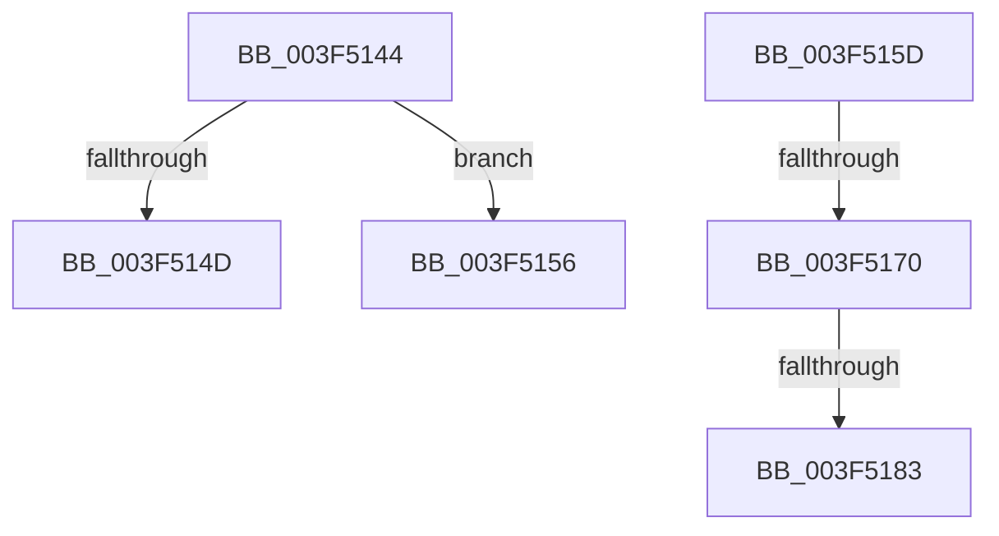

# sub_003F5144

- RVA: `0x003F5144`–`0x003F518A` (길이 `70` bytes)
- VA: `0x00000001403F5144`
- 실행 섹션: `.text`
- PDB 이름 있음: `아니요`; PDB Function 태그: `아니요`
- unwind 정보 RVA: `0x00097418`
- 디코드: `16`개 명령, `70/70` bytes 표시
- 미해석 바이트: `0` (있으면 어셈블리에 `.byte`로 보존)

> 이 문서는 커널 이미지의 기계어와 PDB 기호를 분석해 생성했습니다. 4번과 5번은 함수 원형과 자료형을 바이너리 사용 방식에서 추정한 C 해석이며 원본 소스 복구 결과는 아닙니다.

## 1. Dependencies

- 직접 호출 지점: **0**; 고유 호출 대상: **0**
- 직접 호출자로 확인된 함수: **0**
- RIP 상대 이미지 참조: **1**

### Outgoing calls
- 직접 디코드된 call 명령이 없습니다.

### Direct callers
- 이 함수 시작 RVA로 연결되는 직접 call은 확인되지 않았습니다. 간접 호출은 완전히 역산할 수 없습니다.

### Static image references
- `0x003F5144` → RVA `0x01201841` (`CFGRO`; read)

## 2. Other-region calls and transfers

- 다른 실행 섹션으로 향하는 call: **0**
- call이 아닌 외부 분기/꼬리 이동: **5**
  - `0x003F5151` → [RtlpCopyExtendedContext + 0xB7](RtlpCopyExtendedContext_function_003F4DD0.md) (`tail-transfer`)
  - `0x003F515B` → [sub_003F511A](Unknown_function_003F511A.md) (`tail-transfer`)
  - `0x003F516A` → [RtlpCopyExtendedContext + 0x4B](RtlpCopyExtendedContext_function_003F4DD0.md) (`tail-transfer`)
  - `0x003F517D` → [RtlpCopyExtendedContext + 0x4B](RtlpCopyExtendedContext_function_003F4DD0.md) (`tail-transfer`)
  - `0x003F5188` → [sub_003F511A](Unknown_function_003F511A.md) (`tail-transfer`)

## 3. Assembly (complete function range)

```asm
003F5144  44 38 3D F6 C6 E0 00            cmp byte ptr [rip + 0xe0c6f6], r15b
003F514B  74 09                           je 0x1403f5156
003F514D  41 83 CE 04                     or r14d, 4
003F5151  E9 31 FD FF FF                  jmp 0x1403f4e87
003F5156  B8 BB 00 00 C0                  mov eax, 0xc00000bb
003F515B  EB BD                           jmp 0x1403f511a
003F515D  41 8B C2                        mov eax, r10d
003F5160  25 F0 FF FF 07                  and eax, 0x7fffff0
003F5165  3D 00 00 20 00                  cmp eax, 0x200000
003F516A  0F 84 AB FC FF FF               je 0x1403f4e1b
003F5170  41 8B C2                        mov eax, r10d
003F5173  25 00 FF FF 07                  and eax, 0x7ffff00
003F5178  3D 00 00 40 00                  cmp eax, 0x400000
003F517D  0F 84 98 FC FF FF               je 0x1403f4e1b
003F5183  B8 0D 00 00 C0                  mov eax, 0xc000000d
003F5188  EB 90                           jmp 0x1403f511a
```

## 4. C-style interpretation (structured pseudocode)

```c
__int64 __fastcall sub_003F5144(void)
{
    __int64 v_r14;

    if ((*(unsigned __int8 *)(v_rip + 14730998)) == ((unsigned __int8)(v_r15))) goto loc_003F5156;
    v_r14 = (unsigned int)((v_r14) | (4));
loc_003F5156:
}
```

## 5. (Beta) C Style

```c
void sub_003F5144(void)
{
    int64_t local_r14;

    if ((*(uint8_t *)(v_rip + 0xE0C6F6)) == ((uint8_t)(local_r15))) goto loc_003F5156;
    local_r14 = (uint32_t)((local_r14) | (4));
loc_003F5156:
}
```

## 6. Execution-region graph

[열기: 2D/3D 그래프와 함수 탐색 컨트롤 패널](../../../control-panel.html?section=text&rva=0x003F5144&view=graph)

- 2D 그래프는 위에서 아래로 흐르고, 3D 그래프는 빈 공간을 드래그해 회전합니다. Shift+드래그는 이동, 휠은 확대·축소, 함수 노드 선택은 대상 보고서 이동입니다.

### Static fallback


