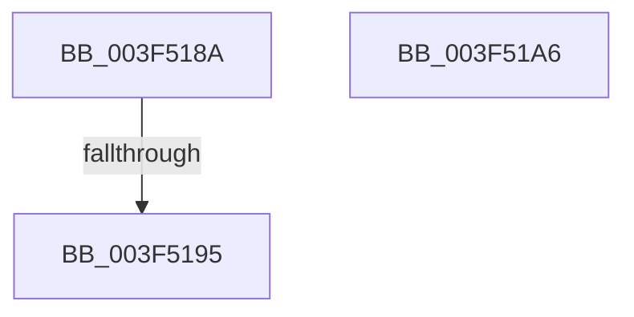

# sub_003F518A

- RVA: `0x003F518A`–`0x003F51CD` (길이 `67` bytes)
- VA: `0x00000001403F518A`
- 실행 섹션: `.text`
- PDB 이름 있음: `아니요`; PDB Function 태그: `아니요`
- unwind 정보 RVA: `0x00097428`
- 디코드: `16`개 명령, `67/67` bytes 표시
- 미해석 바이트: `0` (있으면 어셈블리에 `.byte`로 보존)

> 이 문서는 커널 이미지의 기계어와 PDB 기호를 분석해 생성했습니다. 4번과 5번은 함수 원형과 자료형을 바이너리 사용 방식에서 추정한 C 해석이며 원본 소스 복구 결과는 아닙니다.

## 1. Dependencies

- 직접 호출 지점: **2**; 고유 호출 대상: **2**
- 직접 호출자로 확인된 함수: **0**
- RIP 상대 이미지 참조: **0**

### Outgoing calls
- `0x003F519C` → [RtlpCopyLegacyContextArm](../5E/RtlpCopyLegacyContextArm_function_005E8684.md) (function, `0x005E8684`)
- `0x003F51BA` → [RtlpCopyKernelCetChunk](../5E/RtlpCopyKernelCetChunk_function_005E863C.md) (function, `0x005E863C`)

### Direct callers
- 이 함수 시작 RVA로 연결되는 직접 call은 확인되지 않았습니다. 간접 호출은 완전히 역산할 수 없습니다.

### Static image references
- 디코드된 RIP-relative 메모리 참조가 없습니다.

## 2. Other-region calls and transfers

- 다른 실행 섹션으로 향하는 call: **0**
- call이 아닌 외부 분기/꼬리 이동: **3**
  - `0x003F518F` → [sub_006EB35E](../6E/Unknown_function_006EB35E.md) (`tail-transfer`)
  - `0x003F51A1` → [sub_003F4E8A + 0x25C](Unknown_function_003F4E8A.md) (`tail-transfer`)
  - `0x003F51C8` → [sub_003F4E8A + 0x28B](Unknown_function_003F4E8A.md) (`tail-transfer`)

## 3. Assembly (complete function range)

```asm
003F518A  41 0F BA E2 15                  bt r10d, 0x15
003F518F  0F 83 C9 61 2F 00               jae 0x1406eb35e
003F5195  45 8B C2                        mov r8d, r10d
003F5198  40 0F B6 CD                     movzx ecx, bpl
003F519C  E8 E3 34 1F 00                  call 0x1405e8684
003F51A1  E9 40 FF FF FF                  jmp 0x1403f50e6
003F51A6  4C 8B 4C 24 70                  mov r9, qword ptr [rsp + 0x70]
003F51AB  4C 8B C3                        mov r8, rbx
003F51AE  48 8B D6                        mov rdx, rsi
003F51B1  48 89 7C 24 20                  mov qword ptr [rsp + 0x20], rdi
003F51B6  40 0F B6 CD                     movzx ecx, bpl
003F51BA  E8 7D 34 1F 00                  call 0x1405e863c
003F51BF  85 C0                           test eax, eax
003F51C1  44 0F 48 F8                     cmovs r15d, eax
003F51C5  41 8B C7                        mov eax, r15d
003F51C8  E9 48 FF FF FF                  jmp 0x1403f5115
```

## 4. C-style interpretation (structured pseudocode)

```c
__int64 __fastcall sub_003F518A(void)
{
    __int64 result;
    unsigned __int64 v_stack_p20;
    unsigned __int64 v_stack_p70;

    result = RtlpCopyLegacyContextArm((unsigned __int8)(v_rbp), a2, (unsigned int)((unsigned int)(v_r10)), a4);
}
```

## 5. (Beta) C Style

```c
void sub_003F518A(void)
{
    int64_t result;
    uint64_t v_stack_p20;
    uint64_t v_stack_p70;

    result = RtlpCopyLegacyContextArm((uint8_t)(local_rbp), a2, (uint32_t)((uint32_t)(local_r10)), a4);
}
```

## 6. Execution-region graph

[열기: 2D/3D 그래프와 함수 탐색 컨트롤 패널](../../../control-panel.html?section=text&rva=0x003F518A&view=graph)

- 2D 그래프는 위에서 아래로 흐르고, 3D 그래프는 빈 공간을 드래그해 회전합니다. Shift+드래그는 이동, 휠은 확대·축소, 함수 노드 선택은 대상 보고서 이동입니다.

### Static fallback


