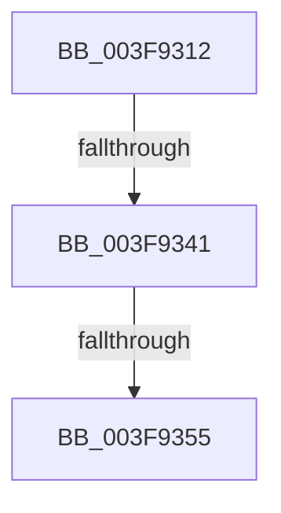

# sub_003F9312

- RVA: `0x003F9312`–`0x003F9357` (길이 `69` bytes)
- VA: `0x00000001403F9312`
- 실행 섹션: `.text`
- PDB 이름 있음: `아니요`; PDB Function 태그: `아니요`
- unwind 정보 RVA: `0x000983C0`
- 디코드: `12`개 명령, `69/69` bytes 표시
- 미해석 바이트: `0` (있으면 어셈블리에 `.byte`로 보존)

> 이 문서는 커널 이미지의 기계어와 PDB 기호를 분석해 생성했습니다. 4번과 5번은 함수 원형과 자료형을 바이너리 사용 방식에서 추정한 C 해석이며 원본 소스 복구 결과는 아닙니다.

## 1. Dependencies

- 직접 호출 지점: **0**; 고유 호출 대상: **0**
- 직접 호출자로 확인된 함수: **0**
- RIP 상대 이미지 참조: **0**

### Outgoing calls
- 직접 디코드된 call 명령이 없습니다.

### Direct callers
- 이 함수 시작 RVA로 연결되는 직접 call은 확인되지 않았습니다. 간접 호출은 완전히 역산할 수 없습니다.

### Static image references
- 디코드된 RIP-relative 메모리 참조가 없습니다.

## 2. Other-region calls and transfers

- 다른 실행 섹션으로 향하는 call: **0**
- call이 아닌 외부 분기/꼬리 이동: **2**
  - `0x003F933B` → [sub_003F9430](Unknown_function_003F9430.md) (`tail-transfer`)
  - `0x003F934F` → [sub_003F9430](Unknown_function_003F9430.md) (`tail-transfer`)

## 3. Assembly (complete function range)

```asm
003F9312  48 89 5C 24 10                  mov qword ptr [rsp + 0x10], rbx
003F9317  48 B8 D8 03 00 00 80 F7 FF FF   movabs rax, 0xfffff780000003d8
003F9321  48 8D 99 D0 04 00 00            lea rbx, [rcx + 0x4d0]
003F9328  48 B9 08 07 00 00 80 F7 FF FF   movabs rcx, 0xfffff78000000708
003F9332  8B 09                           mov ecx, dword ptr [rcx]
003F9334  0B 08                           or ecx, dword ptr [rax]
003F9336  48 0F BA E1 0B                  bt rcx, 0xb
003F933B  0F 83 EF 00 00 00               jae 0x1403f9430
003F9341  A1 EC 03 00 00 80 F7 FF FF      movabs eax, dword ptr [0xfffff780000003ec]
003F934A  A9 F8 FF FF FF                  test eax, 0xfffffff8
003F934F  0F 85 DB 00 00 00               jne 0x1403f9430
003F9355  8B 13                           mov edx, dword ptr [rbx]
```

## 4. C-style interpretation (structured pseudocode)

```c
__int64 __fastcall sub_003F9312(__int64 a1)
{
    unsigned __int64 v_stack_p10;

    v_stack_p10 = v_rbx;
    a1 = (unsigned int)(((unsigned int)(*(unsigned int *)(a1))) | (*(unsigned int *)(result)));
    return result;
}
```

## 5. (Beta) C Style

```c
int64_t sub_003F9312(void *Arg1)
{
    uint8_t *arg1 = (uint8_t *)Arg1;

    uint64_t v_stack_p10;

    v_stack_p10 = local_rbx;
    Arg1 = (uint32_t)(((uint32_t)(*(uint32_t *)(arg1))) | (*(uint32_t *)(result)));
    return result;
}
```

### 관측된 메모리 오프셋

구조체 형식이 확인되지 않은 접근은 인자 기준의 오프셋으로만 기록했습니다.

| 기준 인자 | 오프셋 표현 | 폭 (bit) | 접근 |
|---|---:|---:|---|
| `Arg1` | `+ 0x0` | `32` | `R` |
| `Arg1` | `+ 0x4D0` | `64` | `R` |

## 6. Execution-region graph

[열기: 2D/3D 그래프와 함수 탐색 컨트롤 패널](../../../control-panel.html?section=text&rva=0x003F9312&view=graph)

- 2D 그래프는 위에서 아래로 흐르고, 3D 그래프는 빈 공간을 드래그해 회전합니다. Shift+드래그는 이동, 휠은 확대·축소, 함수 노드 선택은 대상 보고서 이동입니다.

### Static fallback


