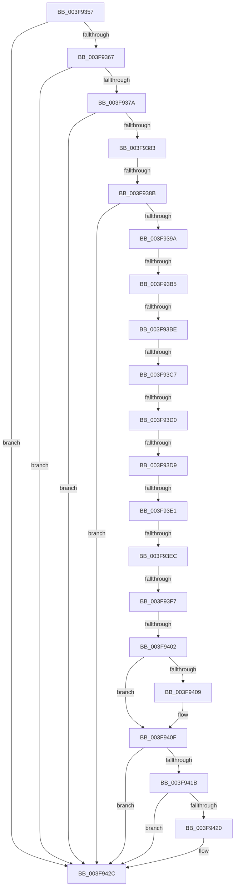

# sub_003F9357

- RVA: `0x003F9357`–`0x003F9430` (길이 `217` bytes)
- VA: `0x00000001403F9357`
- 실행 섹션: `.text`
- PDB 이름 있음: `아니요`; PDB Function 태그: `아니요`
- unwind 정보 RVA: `0x000983D4`
- 디코드: `49`개 명령, `217/217` bytes 표시
- 미해석 바이트: `0` (있으면 어셈블리에 `.byte`로 보존)

> 이 문서는 커널 이미지의 기계어와 PDB 기호를 분석해 생성했습니다. 4번과 5번은 함수 원형과 자료형을 바이너리 사용 방식에서 추정한 C 해석이며 원본 소스 복구 결과는 아닙니다.

## 1. Dependencies

- 직접 호출 지점: **0**; 고유 호출 대상: **0**
- 직접 호출자로 확인된 함수: **0**
- RIP 상대 이미지 참조: **0**

### Outgoing calls
- 직접 디코드된 call 명령이 없습니다.

### Direct callers
- 이 함수 시작 RVA로 연결되는 직접 call은 확인되지 않았습니다. 간접 호출은 완전히 역산할 수 없습니다.

### Static image references
- 디코드된 RIP-relative 메모리 참조가 없습니다.

## 2. Other-region calls and transfers

- 다른 실행 섹션으로 향하는 call: **0**
- call이 아닌 외부 분기/꼬리 이동: **10**
  - `0x003F9385` → [sub_003F943A + 0xFA](Unknown_function_003F943A.md) (`tail-transfer`)
  - `0x003F93AF` → [sub_003F943A](Unknown_function_003F943A.md) (`tail-transfer`)
  - `0x003F93B8` → [sub_003F943A + 0x10](Unknown_function_003F943A.md) (`tail-transfer`)
  - `0x003F93C1` → [sub_003F943A + 0x2D](Unknown_function_003F943A.md) (`tail-transfer`)
  - `0x003F93CA` → [sub_003F943A + 0x4A](Unknown_function_003F943A.md) (`tail-transfer`)
  - `0x003F93D3` → [sub_003F943A + 0x67](Unknown_function_003F943A.md) (`tail-transfer`)
  - `0x003F93DB` → [sub_003F943A + 0x84](Unknown_function_003F943A.md) (`tail-transfer`)
  - `0x003F93E6` → [sub_003F943A + 0xA0](Unknown_function_003F943A.md) (`tail-transfer`)
  - `0x003F93F1` → [sub_003F943A + 0xBE](Unknown_function_003F943A.md) (`tail-transfer`)
  - `0x003F93FC` → [sub_003F943A + 0xDC](Unknown_function_003F943A.md) (`tail-transfer`)

## 3. Assembly (complete function range)

```asm
003F9357  48 89 3C 24                     mov qword ptr [rsp], rdi
003F935B  48 63 7B 10                     movsxd rdi, dword ptr [rbx + 0x10]
003F935F  3B D7                           cmp edx, edi
003F9361  0F 8F C5 00 00 00               jg 0x1403f942c
003F9367  44 8B 43 14                     mov r8d, dword ptr [rbx + 0x14]
003F936B  03 53 04                        add edx, dword ptr [rbx + 4]
003F936E  44 03 C7                        add r8d, edi
003F9371  41 3B D0                        cmp edx, r8d
003F9374  0F 8C B2 00 00 00               jl 0x1403f942c
003F937A  48 03 FB                        add rdi, rbx
003F937D  0F 84 A9 00 00 00               je 0x1403f942c
003F9383  A8 02                           test al, 2
003F9385  0F 84 A9 01 00 00               je 0x1403f9534
003F938B  48 8B 4F 08                     mov rcx, qword ptr [rdi + 8]
003F938F  48 0F BA E1 0B                  bt rcx, 0xb
003F9394  0F 83 92 00 00 00               jae 0x1403f942c
003F939A  BA 40 02 00 00                  mov edx, 0x240
003F939F  49 B8 F8 05 00 00 80 F7 FF FF   movabs r8, 0xfffff780000005f8
003F93A9  4D 8B 00                        mov r8, qword ptr [r8]
003F93AC  F6 C1 04                        test cl, 4
003F93AF  0F 85 85 00 00 00               jne 0x1403f943a
003F93B5  F6 C1 08                        test cl, 8
003F93B8  0F 85 8C 00 00 00               jne 0x1403f944a
003F93BE  F6 C1 10                        test cl, 0x10
003F93C1  0F 85 A0 00 00 00               jne 0x1403f9467
003F93C7  F6 C1 20                        test cl, 0x20
003F93CA  0F 85 B4 00 00 00               jne 0x1403f9484
003F93D0  F6 C1 40                        test cl, 0x40
003F93D3  0F 85 C8 00 00 00               jne 0x1403f94a1
003F93D9  84 C9                           test cl, cl
003F93DB  0F 88 DD 00 00 00               js 0x1403f94be
003F93E1  48 0F BA E1 08                  bt rcx, 8
003F93E6  0F 82 EE 00 00 00               jb 0x1403f94da
003F93EC  48 0F BA E1 09                  bt rcx, 9
003F93F1  0F 82 01 01 00 00               jb 0x1403f94f8
003F93F7  48 0F BA E1 0A                  bt rcx, 0xa
003F93FC  0F 82 14 01 00 00               jb 0x1403f9516
003F9402  49 0F BA E0 0B                  bt r8, 0xb
003F9407  73 06                           jae 0x1403f940f
003F9409  83 C2 3F                        add edx, 0x3f
003F940C  83 E2 C0                        and edx, 0xffffffc0
003F940F  48 03 D7                        add rdx, rdi
003F9412  48 81 C2 00 FE FF FF            add rdx, -0x200
003F9419  74 11                           je 0x1403f942c
003F941B  F6 02 01                        test byte ptr [rdx], 1
003F941E  74 0C                           je 0x1403f942c
003F9420  42 8D 0C DD 00 00 00 00         lea ecx, [r11*8]
003F9428  48 01 4A 08                     add qword ptr [rdx + 8], rcx
003F942C  48 8B 3C 24                     mov rdi, qword ptr [rsp]
```

## 4. C-style interpretation (structured pseudocode)

```c
void __fastcall sub_003F9357(__int64 a1, int a2)
{
    __int64 v_rdi;
    unsigned __int64 v_stack_p0;

    v_stack_p0 = v_rdi;
    if (a2 > ((unsigned int)((int)(*(unsigned int *)(v_rbx + 16))))) goto loc_003F942C;
    a2 = (unsigned int)((a2) + (*(unsigned int *)(v_rbx + 4)));
    a3 = (unsigned int)(((unsigned int)(*(unsigned int *)(v_rbx + 20))) + ((unsigned int)((int)(*(unsigned int *)(v_rbx + 16)))));
    if (a2 < ((unsigned int)(a3))) goto loc_003F942C;
    v_rdi = ((int)(*(unsigned int *)(v_rbx + 16))) + (v_rbx);
    if (condition_is_equal) goto loc_003F942C;
    if (condition_is_above_or_equal) goto loc_003F942C;
    if (!(condition_is_above_or_equal)) {
        a2 = (unsigned int)((576) + (63));
        a2 = (unsigned int)((a2) & (0xFFFFFFC0ULL));
    }
    a2 = (a2) + (v_rdi);
    a2 = (a2) + (-512);
    if (condition_is_equal) goto loc_003F942C;
    if (((*(unsigned __int8 *)(a2)) & (1)) != 0) {
        a1 = v_r11 * 8;
    }
    return;
}
```

## 5. (Beta) C Style

```c
void sub_003F9357(int64_t Arg1, int32_t Arg2)
{
    int64_t local_rdi;
    uint64_t v_stack_p0;

    v_stack_p0 = local_rdi;
    if (Arg2 > ((uint32_t)((int32_t)(*(uint32_t *)(local_rbx + 0x10))))) goto loc_003F942C;
    Arg2 = (uint32_t)((Arg2) + (*(uint32_t *)(local_rbx + 0x4)));
    a3 = (uint32_t)(((uint32_t)(*(uint32_t *)(local_rbx + 0x14))) + ((uint32_t)((int32_t)(*(uint32_t *)(local_rbx + 0x10)))));
    if (Arg2 < ((uint32_t)(a3))) goto loc_003F942C;
    local_rdi = ((int32_t)(*(uint32_t *)(local_rbx + 0x10))) + (local_rbx);
    if (condition_is_equal) goto loc_003F942C;
    if (condition_is_above_or_equal) goto loc_003F942C;
    if (!(condition_is_above_or_equal)) {
        Arg2 = (uint32_t)((576) + (63));
        Arg2 = (uint32_t)((Arg2) & (0xFFFFFFC0ULL));
    }
    Arg2 = (Arg2) + (local_rdi);
    Arg2 = (Arg2) + (-512);
    if (condition_is_equal) goto loc_003F942C;
    if (((*(uint8_t *)(Arg2)) & (1)) != 0) {
        Arg1 = local_r11 * 8;
    }
    return;
}
```

## 6. Execution-region graph

[열기: 2D/3D 그래프와 함수 탐색 컨트롤 패널](../../../control-panel.html?section=text&rva=0x003F9357&view=graph)

- 2D 그래프는 위에서 아래로 흐르고, 3D 그래프는 빈 공간을 드래그해 회전합니다. Shift+드래그는 이동, 휠은 확대·축소, 함수 노드 선택은 대상 보고서 이동입니다.

### Static fallback


