# sub_003F943A

- RVA: `0x003F943A`–`0x003F9545` (길이 `267` bytes)
- VA: `0x00000001403F943A`
- 실행 섹션: `.text`
- PDB 이름 있음: `아니요`; PDB Function 태그: `아니요`
- unwind 정보 RVA: `0x000983F8`
- 디코드: `62`개 명령, `267/267` bytes 표시
- 미해석 바이트: `0` (있으면 어셈블리에 `.byte`로 보존)

> 이 문서는 커널 이미지의 기계어와 PDB 기호를 분석해 생성했습니다. 4번과 5번은 함수 원형과 자료형을 바이너리 사용 방식에서 추정한 C 해석이며 원본 소스 복구 결과는 아닙니다.

## 1. Dependencies

- 직접 호출 지점: **0**; 고유 호출 대상: **0**
- 직접 호출자로 확인된 함수: **0**
- RIP 상대 이미지 참조: **0**

### Outgoing calls
- 직접 디코드된 call 명령이 없습니다.

### Direct callers
- 이 함수 시작 RVA로 연결되는 직접 call은 확인되지 않았습니다. 간접 호출은 완전히 역산할 수 없습니다.

### Static image references
- 디코드된 RIP-relative 메모리 참조가 없습니다.

## 2. Other-region calls and transfers

- 다른 실행 섹션으로 향하는 call: **0**
- call이 아닌 외부 분기/꼬리 이동: **10**
  - `0x003F9445` → [sub_003F9357 + 0x5E](Unknown_function_003F9357.md) (`tail-transfer`)
  - `0x003F9462` → [sub_003F9357 + 0x67](Unknown_function_003F9357.md) (`tail-transfer`)
  - `0x003F947F` → [sub_003F9357 + 0x70](Unknown_function_003F9357.md) (`tail-transfer`)
  - `0x003F949C` → [sub_003F9357 + 0x79](Unknown_function_003F9357.md) (`tail-transfer`)
  - `0x003F94B9` → [sub_003F9357 + 0x82](Unknown_function_003F9357.md) (`tail-transfer`)
  - `0x003F94D5` → [sub_003F9357 + 0x8A](Unknown_function_003F9357.md) (`tail-transfer`)
  - `0x003F94F3` → [sub_003F9357 + 0x95](Unknown_function_003F9357.md) (`tail-transfer`)
  - `0x003F9511` → [sub_003F9357 + 0xA0](Unknown_function_003F9357.md) (`tail-transfer`)
  - `0x003F952F` → [sub_003F9357 + 0xAB](Unknown_function_003F9357.md) (`tail-transfer`)
  - `0x003F9540` → [sub_003F9357 + 0xB8](Unknown_function_003F9357.md) (`tail-transfer`)

## 3. Assembly (complete function range)

```asm
003F943A  A1 0C 06 00 00 80 F7 FF FF      movabs eax, dword ptr [0xfffff7800000060c]
003F9443  03 D0                           add edx, eax
003F9445  E9 6B FF FF FF                  jmp 0x1403f93b5
003F944A  41 F6 C0 08                     test r8b, 8
003F944E  74 06                           je 0x1403f9456
003F9450  83 C2 3F                        add edx, 0x3f
003F9453  83 E2 C0                        and edx, 0xffffffc0
003F9456  48 B8 10 06 00 00 80 F7 FF FF   movabs rax, 0xfffff78000000610
003F9460  03 10                           add edx, dword ptr [rax]
003F9462  E9 57 FF FF FF                  jmp 0x1403f93be
003F9467  41 F6 C0 10                     test r8b, 0x10
003F946B  74 06                           je 0x1403f9473
003F946D  83 C2 3F                        add edx, 0x3f
003F9470  83 E2 C0                        and edx, 0xffffffc0
003F9473  48 B8 14 06 00 00 80 F7 FF FF   movabs rax, 0xfffff78000000614
003F947D  03 10                           add edx, dword ptr [rax]
003F947F  E9 43 FF FF FF                  jmp 0x1403f93c7
003F9484  41 F6 C0 20                     test r8b, 0x20
003F9488  74 06                           je 0x1403f9490
003F948A  83 C2 3F                        add edx, 0x3f
003F948D  83 E2 C0                        and edx, 0xffffffc0
003F9490  48 B8 18 06 00 00 80 F7 FF FF   movabs rax, 0xfffff78000000618
003F949A  03 10                           add edx, dword ptr [rax]
003F949C  E9 2F FF FF FF                  jmp 0x1403f93d0
003F94A1  41 F6 C0 40                     test r8b, 0x40
003F94A5  74 06                           je 0x1403f94ad
003F94A7  83 C2 3F                        add edx, 0x3f
003F94AA  83 E2 C0                        and edx, 0xffffffc0
003F94AD  48 B8 1C 06 00 00 80 F7 FF FF   movabs rax, 0xfffff7800000061c
003F94B7  03 10                           add edx, dword ptr [rax]
003F94B9  E9 1B FF FF FF                  jmp 0x1403f93d9
003F94BE  45 84 C0                        test r8b, r8b
003F94C1  79 06                           jns 0x1403f94c9
003F94C3  83 C2 3F                        add edx, 0x3f
003F94C6  83 E2 C0                        and edx, 0xffffffc0
003F94C9  48 B8 20 06 00 00 80 F7 FF FF   movabs rax, 0xfffff78000000620
003F94D3  03 10                           add edx, dword ptr [rax]
003F94D5  E9 07 FF FF FF                  jmp 0x1403f93e1
003F94DA  49 0F BA E0 08                  bt r8, 8
003F94DF  73 06                           jae 0x1403f94e7
003F94E1  83 C2 3F                        add edx, 0x3f
003F94E4  83 E2 C0                        and edx, 0xffffffc0
003F94E7  48 B8 24 06 00 00 80 F7 FF FF   movabs rax, 0xfffff78000000624
003F94F1  03 10                           add edx, dword ptr [rax]
003F94F3  E9 F4 FE FF FF                  jmp 0x1403f93ec
003F94F8  49 0F BA E0 09                  bt r8, 9
003F94FD  73 06                           jae 0x1403f9505
003F94FF  83 C2 3F                        add edx, 0x3f
003F9502  83 E2 C0                        and edx, 0xffffffc0
003F9505  48 B8 28 06 00 00 80 F7 FF FF   movabs rax, 0xfffff78000000628
003F950F  03 10                           add edx, dword ptr [rax]
003F9511  E9 E1 FE FF FF                  jmp 0x1403f93f7
003F9516  49 0F BA E0 0A                  bt r8, 0xa
003F951B  73 06                           jae 0x1403f9523
003F951D  83 C2 3F                        add edx, 0x3f
003F9520  83 E2 C0                        and edx, 0xffffffc0
003F9523  48 B8 2C 06 00 00 80 F7 FF FF   movabs rax, 0xfffff7800000062c
003F952D  03 10                           add edx, dword ptr [rax]
003F952F  E9 CE FE FF FF                  jmp 0x1403f9402
003F9534  48 B8 48 04 00 00 80 F7 FF FF   movabs rax, 0xfffff78000000448
003F953E  8B 10                           mov edx, dword ptr [rax]
003F9540  E9 CA FE FF FF                  jmp 0x1403f940f
```

## 4. C-style interpretation (structured pseudocode)

```c
__int64 __fastcall sub_003F943A(__int64 a1, int a2, __int64 a3)
{
    a2 = (unsigned int)((a2) + ((unsigned int)(result)));
}
```

## 5. (Beta) C Style

```c
int64_t sub_003F943A(int64_t Arg1, int32_t Arg2, int64_t Arg3)
{
    Arg2 = (uint32_t)((Arg2) + ((uint32_t)(result)));
}
```

## 6. Execution-region graph

[열기: 2D/3D 그래프와 함수 탐색 컨트롤 패널](../../../control-panel.html?section=text&rva=0x003F943A&view=graph)

- 2D 그래프는 위에서 아래로 흐르고, 3D 그래프는 빈 공간을 드래그해 회전합니다. Shift+드래그는 이동, 휠은 확대·축소, 함수 노드 선택은 대상 보고서 이동입니다.

### Static fallback

```mermaid
flowchart TD
  bb_003F943A[BB_003F943A]
  bb_003F944A[BB_003F944A]
  bb_003F9450[BB_003F9450]
  bb_003F9456[BB_003F9456]
  bb_003F9467[BB_003F9467]
  bb_003F946D[BB_003F946D]
  bb_003F9473[BB_003F9473]
  bb_003F9484[BB_003F9484]
  bb_003F948A[BB_003F948A]
  bb_003F9490[BB_003F9490]
  bb_003F94A1[BB_003F94A1]
  bb_003F94A7[BB_003F94A7]
  bb_003F94AD[BB_003F94AD]
  bb_003F94BE[BB_003F94BE]
  bb_003F94C3[BB_003F94C3]
  bb_003F94C9[BB_003F94C9]
  bb_003F94DA[BB_003F94DA]
  bb_003F94E1[BB_003F94E1]
  bb_003F94E7[BB_003F94E7]
  bb_003F94F8[BB_003F94F8]
  bb_003F94FF[BB_003F94FF]
  bb_003F9505[BB_003F9505]
  bb_003F9516[BB_003F9516]
  bb_003F951D[BB_003F951D]
  bb_003F9523[BB_003F9523]
  bb_003F9534[BB_003F9534]
  bb_003F944A -->|branch| bb_003F9456
  bb_003F944A -->|fallthrough| bb_003F9450
  bb_003F9450 -->|flow| bb_003F9456
  bb_003F9467 -->|branch| bb_003F9473
  bb_003F9467 -->|fallthrough| bb_003F946D
  bb_003F946D -->|flow| bb_003F9473
  bb_003F9484 -->|branch| bb_003F9490
  bb_003F9484 -->|fallthrough| bb_003F948A
  bb_003F948A -->|flow| bb_003F9490
  bb_003F94A1 -->|branch| bb_003F94AD
  bb_003F94A1 -->|fallthrough| bb_003F94A7
  bb_003F94A7 -->|flow| bb_003F94AD
  bb_003F94BE -->|branch| bb_003F94C9
  bb_003F94BE -->|fallthrough| bb_003F94C3
  bb_003F94C3 -->|flow| bb_003F94C9
  bb_003F94DA -->|branch| bb_003F94E7
  bb_003F94DA -->|fallthrough| bb_003F94E1
  bb_003F94E1 -->|flow| bb_003F94E7
  bb_003F94F8 -->|branch| bb_003F9505
  bb_003F94F8 -->|fallthrough| bb_003F94FF
  bb_003F94FF -->|flow| bb_003F9505
  bb_003F9516 -->|branch| bb_003F9523
  bb_003F9516 -->|fallthrough| bb_003F951D
  bb_003F951D -->|flow| bb_003F9523
```


