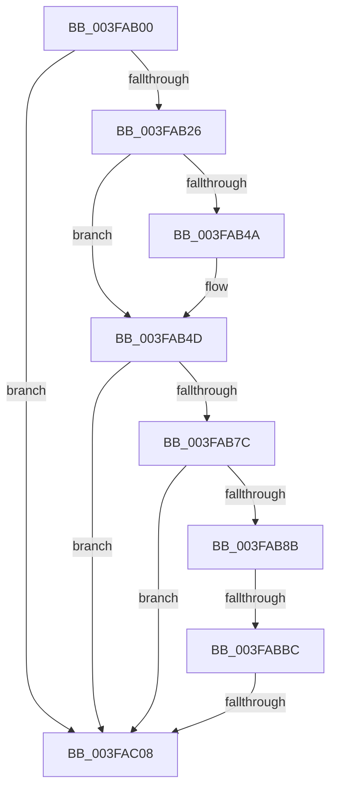

# sub_003FAB00

- RVA: `0x003FAB00`–`0x003FAC55` (길이 `341` bytes)
- VA: `0x00000001403FAB00`
- 실행 섹션: `.text`
- PDB 이름 있음: `아니요`; PDB Function 태그: `아니요`
- unwind 정보 RVA: `0x000984C8`
- 디코드: `75`개 명령, `341/341` bytes 표시
- 미해석 바이트: `0` (있으면 어셈블리에 `.byte`로 보존)

> 이 문서는 커널 이미지의 기계어와 PDB 기호를 분석해 생성했습니다. 4번과 5번은 함수 원형과 자료형을 바이너리 사용 방식에서 추정한 C 해석이며 원본 소스 복구 결과는 아닙니다.

## 1. Dependencies

- 직접 호출 지점: **1**; 고유 호출 대상: **1**
- 직접 호출자로 확인된 함수: **0**
- RIP 상대 이미지 참조: **3**

### Outgoing calls
- `0x003FAB28` → [KeQueryPerformanceCounter](../37/KeQueryPerformanceCounter_function_0037E7E0.md) (function, `0x0037E7E0`)

### Direct callers
- 이 함수 시작 RVA로 연결되는 직접 call은 확인되지 않았습니다. 간접 호출은 완전히 역산할 수 없습니다.

### Static image references
- `0x003FAB6F` → RVA `0x00FC6A95` (`ALMOSTRO`; read)
- `0x003FABC5` → RVA `0x00FC6BC6` (`ALMOSTRO`; read)
- `0x003FABDA` → RVA `0x00FC7318` (`ALMOSTRO`; read)

## 2. Other-region calls and transfers

- 다른 실행 섹션으로 향하는 call: **0**
- call이 아닌 외부 분기/꼬리 이동: **3**
  - `0x003FABB6` → [sub_003FAD5F + 0x11](Unknown_function_003FAD5F.md) (`tail-transfer`)
  - `0x003FAC02` → [sub_003FAD5F](Unknown_function_003FAD5F.md) (`tail-transfer`)
  - `0x003FAC4F` → [sub_003FAD1B + 0x2C](Unknown_function_003FAD1B.md) (`tail-transfer`)

## 3. Assembly (complete function range)

```asm
003FAB00  48 89 6C 24 58                  mov qword ptr [rsp + 0x58], rbp
003FAB05  48 89 74 24 30                  mov qword ptr [rsp + 0x30], rsi
003FAB0A  8B EF                           mov ebp, edi
003FAB0C  8B F7                           mov esi, edi
003FAB0E  4C 89 74 24 20                  mov qword ptr [rsp + 0x20], r14
003FAB13  44 8B F7                        mov r14d, edi
003FAB16  44 8B DF                        mov r11d, edi
003FAB19  40 38 B1 DC 86 00 00            cmp byte ptr [rcx + 0x86dc], sil
003FAB20  0F 84 E2 00 00 00               je 0x1403fac08
003FAB26  33 C9                           xor ecx, ecx
003FAB28  E8 B3 3C F8 FF                  call 0x14037e7e0
003FAB2D  0F B6 8B AC 00 00 00            movzx ecx, byte ptr [rbx + 0xac]
003FAB34  48 8B F0                        mov rsi, rax
003FAB37  48 8B 83 B0 00 00 00            mov rax, qword ptr [rbx + 0xb0]
003FAB3E  48 8B D6                        mov rdx, rsi
003FAB41  48 89 7C 24 68                  mov qword ptr [rsp + 0x68], rdi
003FAB46  84 C9                           test cl, cl
003FAB48  74 03                           je 0x1403fab4d
003FAB4A  48 D3 E2                        shl rdx, cl
003FAB4D  48 F7 E2                        mul rdx
003FAB50  4C 8B F6                        mov r14, rsi
003FAB53  48 8B EA                        mov rbp, rdx
003FAB56  48 89 54 24 68                  mov qword ptr [rsp + 0x68], rdx
003FAB5B  48 8B 93 F8 86 00 00            mov rdx, qword ptr [rbx + 0x86f8]
003FAB62  4C 8B DD                        mov r11, rbp
003FAB65  4C 2B 9B 80 86 00 00            sub r11, qword ptr [rbx + 0x8680]
003FAB6C  4C 2B F2                        sub r14, rdx
003FAB6F  40 38 3D 1F BF BC 00            cmp byte ptr [rip + 0xbcbf1f], dil
003FAB76  0F 84 8C 00 00 00               je 0x1403fac08
003FAB7C  48 B8 00 03 00 00 80 F7 FF FF   movabs rax, 0xfffff78000000300
003FAB86  48 39 38                        cmp qword ptr [rax], rdi
003FAB89  74 7D                           je 0x1403fac08
003FAB8B  A0 69 03 00 00 80 F7 FF FF      movabs al, byte ptr [0xfffff78000000369]
003FAB94  49 B9 60 03 00 00 80 F7 FF FF   movabs r9, 0xfffff78000000360
003FAB9E  0F B6 C8                        movzx ecx, al
003FABA1  48 89 7C 24 50                  mov qword ptr [rsp + 0x50], rdi
003FABA6  84 C0                           test al, al
003FABA8  48 89 7C 24 60                  mov qword ptr [rsp + 0x60], rdi
003FABAD  4C 8B C6                        mov r8, rsi
003FABB0  4D 8B 09                        mov r9, qword ptr [r9]
003FABB3  49 8B C1                        mov rax, r9
003FABB6  0F 84 B4 01 00 00               je 0x1403fad70
003FABBC  48 D3 E2                        shl rdx, cl
003FABBF  48 F7 E2                        mul rdx
003FABC2  49 D3 E0                        shl r8, cl
003FABC5  0F BE 0D FA BF BC 00            movsx ecx, byte ptr [rip + 0xbcbffa]
003FABCC  4C 8B D2                        mov r10, rdx
003FABCF  48 89 54 24 50                  mov qword ptr [rsp + 0x50], rdx
003FABD4  49 8B C1                        mov rax, r9
003FABD7  49 F7 E0                        mul r8
003FABDA  48 8B 05 37 C7 BC 00            mov rax, qword ptr [rip + 0xbcc737]
003FABE1  4C 8B CA                        mov r9, rdx
003FABE4  48 89 54 24 60                  mov qword ptr [rsp + 0x60], rdx
003FABE9  49 F7 E2                        mul r10
003FABEC  48 8B 05 25 C7 BC 00            mov rax, qword ptr [rip + 0xbcc725]
003FABF3  4C 8B D2                        mov r10, rdx
003FABF6  49 F7 E1                        mul r9
003FABF9  49 D3 EA                        shr r10, cl
003FABFC  48 D3 EA                        shr rdx, cl
003FABFF  41 2B D2                        sub edx, r10d
003FAC02  0F 85 57 01 00 00               jne 0x1403fad5f
003FAC08  48 8B 83 00 87 00 00            mov rax, qword ptr [rbx + 0x8700]
003FAC0F  49 03 C6                        add rax, r14
003FAC12  4C 8B 74 24 20                  mov r14, qword ptr [rsp + 0x20]
003FAC17  48 89 83 00 87 00 00            mov qword ptr [rbx + 0x8700], rax
003FAC1E  48 8B 83 78 87 00 00            mov rax, qword ptr [rbx + 0x8778]
003FAC25  49 03 C3                        add rax, r11
003FAC28  48 89 83 78 87 00 00            mov qword ptr [rbx + 0x8778], rax
003FAC2F  48 89 B3 F8 86 00 00            mov qword ptr [rbx + 0x86f8], rsi
003FAC36  48 8B 74 24 30                  mov rsi, qword ptr [rsp + 0x30]
003FAC3B  48 89 AB 80 86 00 00            mov qword ptr [rbx + 0x8680], rbp
003FAC42  48 8B 43 08                     mov rax, qword ptr [rbx + 8]
003FAC46  48 8B 6C 24 58                  mov rbp, qword ptr [rsp + 0x58]
003FAC4B  F6 40 02 72                     test byte ptr [rax + 2], 0x72
003FAC4F  0F 84 F2 00 00 00               je 0x1403fad47
```

## 4. C-style interpretation (structured pseudocode)

```c
__int64 __fastcall sub_003FAB00(__int64 a1, __int64 a2, __int64 a3, __int64 a4, __int64 a5, __int64 a6, __int64 a7, __int64 a8, __int64 a9, __int64 a10, __int64 a11)
{
    __int64 result;
    __int64 v_r10;
    __int64 v_r11;
    __int64 v_r14;
    unsigned __int64 v_stack_p20;
    unsigned __int64 v_stack_p30;
    unsigned __int64 v_stack_p50;
    unsigned __int64 v_stack_p58;
    unsigned __int64 v_stack_p60;
    unsigned __int64 v_stack_p68;

    v_stack_p58 = v_rbp;
    v_stack_p30 = v_rsi;
    v_stack_p20 = v_r14;
    if ((*(unsigned __int8 *)(a1 + 34524)) == ((unsigned __int8)((unsigned int)((unsigned int)(v_rdi))))) goto loc_003FAC08;
    a1 = 0;
    result = KeQueryPerformanceCounter(a1, a2, a3, a4);
    v_stack_p68 = v_rdi;
    if ((unsigned __int8)(*(unsigned __int8 *)(v_rbx + 172)) != 0) {
        a2 = (result) << ((unsigned __int8)(*(unsigned __int8 *)(v_rbx + 172)));
    }
    v_stack_p68 = a2;
    v_r11 = (a2) - (*(unsigned __int64 *)(v_rbx + 34432));
    v_r14 = (result) - (*(unsigned __int64 *)(v_rbx + 34552));
    if ((*(unsigned __int8 *)(v_rip + 12369695)) == ((unsigned __int8)(v_rdi))) goto loc_003FAC08;
    if ((*(unsigned __int64 *)(*(unsigned __int64 *)(v_rbx + 176))) == v_rdi) goto loc_003FAC08;
    v_stack_p50 = v_rdi;
    v_stack_p60 = v_rdi;
    a2 = (*(unsigned __int64 *)(v_rbx + 34552)) << ((unsigned __int8)((unsigned __int8)(*(unsigned __int64 *)(v_rbx + 176))));
    a3 = (result) << ((unsigned __int8)((unsigned __int8)(*(unsigned __int64 *)(v_rbx + 176))));
    v_stack_p50 = a2;
    v_stack_p60 = a2;
    v_r10 = (a2) >> ((unsigned __int8)((__int8)(*(unsigned __int8 *)(v_rip + 12369914))));
    a2 = (a2) >> ((unsigned __int8)((__int8)(*(unsigned __int8 *)(v_rip + 12369914))));
    a2 = (unsigned int)((a2) - ((unsigned int)(v_r10)));
loc_003FAC08:
    result = (*(unsigned __int64 *)(v_rbx + 34560)) + (v_r14);
    *(unsigned __int64 *)(v_rbx + 34560) = result;
    result = (*(unsigned __int64 *)(v_rbx + 34680)) + (v_r11);
    *(unsigned __int64 *)(v_rbx + 34680) = result;
    *(unsigned __int64 *)(v_rbx + 34552) = result;
    *(unsigned __int64 *)(v_rbx + 34432) = a2;
}
```

## 5. (Beta) C Style

```c
int64_t sub_003FAB00(void *Arg1, int64_t Arg2, int64_t Arg3, int64_t Arg4, uint64_t Arg5, int64_t Arg6, uint64_t Arg7, uint64_t Arg8, uint64_t Arg9, uint64_t Arg10, int64_t Arg11)
{
    uint8_t *arg1 = (uint8_t *)Arg1;

    int64_t result;
    int64_t local_r10;
    int64_t local_r11;
    int64_t local_r14;
    uint64_t v_stack_p20;
    uint64_t v_stack_p30;
    uint64_t v_stack_p50;
    uint64_t v_stack_p58;
    uint64_t v_stack_p60;
    uint64_t v_stack_p68;

    v_stack_p58 = local_rbp;
    v_stack_p30 = local_rsi;
    v_stack_p20 = local_r14;
    if ((*(uint8_t *)(arg1 + 0x86DC)) == ((uint8_t)((uint32_t)((uint32_t)(local_rdi))))) goto loc_003FAC08;
    Arg1 = 0;
    result = KeQueryPerformanceCounter(Arg1, Arg2, Arg3, Arg4);
    v_stack_p68 = local_rdi;
    if ((uint8_t)(*(uint8_t *)(local_rbx + 0xAC)) != 0) {
        Arg2 = (result) << ((uint8_t)(*(uint8_t *)(local_rbx + 0xAC)));
    }
    v_stack_p68 = Arg2;
    local_r11 = (Arg2) - (*(uint64_t *)(local_rbx + 0x8680));
    local_r14 = (result) - (*(uint64_t *)(local_rbx + 0x86F8));
    if ((*(uint8_t *)(v_rip + 0xBCBF1F)) == ((uint8_t)(local_rdi))) goto loc_003FAC08;
    if ((*(uint64_t *)(*(uint64_t *)(local_rbx + 0xB0))) == local_rdi) goto loc_003FAC08;
    v_stack_p50 = local_rdi;
    v_stack_p60 = local_rdi;
    Arg2 = (*(uint64_t *)(local_rbx + 0x86F8)) << ((uint8_t)((uint8_t)(*(uint64_t *)(local_rbx + 0xB0))));
    Arg3 = (result) << ((uint8_t)((uint8_t)(*(uint64_t *)(local_rbx + 0xB0))));
    v_stack_p50 = Arg2;
    v_stack_p60 = Arg2;
    local_r10 = (Arg2) >> ((uint8_t)((int8_t)(*(uint8_t *)(v_rip + 0xBCBFFA))));
    Arg2 = (Arg2) >> ((uint8_t)((int8_t)(*(uint8_t *)(v_rip + 0xBCBFFA))));
    Arg2 = (uint32_t)((Arg2) - ((uint32_t)(local_r10)));
loc_003FAC08:
    result = (*(uint64_t *)(local_rbx + 0x8700)) + (local_r14);
    *(uint64_t *)(local_rbx + 0x8700) = result;
    result = (*(uint64_t *)(local_rbx + 0x8778)) + (local_r11);
    *(uint64_t *)(local_rbx + 0x8778) = result;
    *(uint64_t *)(local_rbx + 0x86F8) = result;
    *(uint64_t *)(local_rbx + 0x8680) = Arg2;
}
```

### 관측된 메모리 오프셋

구조체 형식이 확인되지 않은 접근은 인자 기준의 오프셋으로만 기록했습니다.

| 기준 인자 | 오프셋 표현 | 폭 (bit) | 접근 |
|---|---:|---:|---|
| `Arg1` | `+ 0x86DC` | `8` | `R` |

## 6. Execution-region graph

[열기: 2D/3D 그래프와 함수 탐색 컨트롤 패널](../../../control-panel.html?section=text&rva=0x003FAB00&view=graph)

- 2D 그래프는 위에서 아래로 흐르고, 3D 그래프는 빈 공간을 드래그해 회전합니다. Shift+드래그는 이동, 휠은 확대·축소, 함수 노드 선택은 대상 보고서 이동입니다.

### Static fallback


