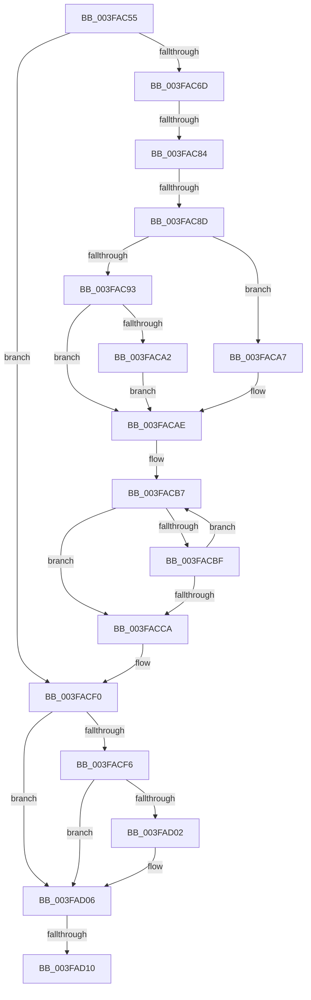

# sub_003FAC55

- RVA: `0x003FAC55`–`0x003FAD1B` (길이 `198` bytes)
- VA: `0x00000001403FAC55`
- 실행 섹션: `.text`
- PDB 이름 있음: `아니요`; PDB Function 태그: `아니요`
- unwind 정보 RVA: `0x000984E4`
- 디코드: `49`개 명령, `198/198` bytes 표시
- 미해석 바이트: `0` (있으면 어셈블리에 `.byte`로 보존)

> 이 문서는 커널 이미지의 기계어와 PDB 기호를 분석해 생성했습니다. 4번과 5번은 함수 원형과 자료형을 바이너리 사용 방식에서 추정한 C 해석이며 원본 소스 복구 결과는 아닙니다.

## 1. Dependencies

- 직접 호출 지점: **0**; 고유 호출 대상: **0**
- 직접 호출자로 확인된 함수: **0**
- RIP 상대 이미지 참조: **0**

### Outgoing calls
- 직접 디코드된 call 명령이 없습니다.

### Direct callers
- 이 함수 시작 RVA로 연결되는 직접 call은 확인되지 않았습니다. 간접 호출은 완전히 역산할 수 없습니다.

### Static image references
- 디코드된 RIP-relative 메모리 참조가 없습니다.

## 2. Other-region calls and transfers

- 다른 실행 섹션으로 향하는 call: **0**
- call이 아닌 외부 분기/꼬리 이동: **4**
  - `0x003FAC7E` → [sub_003FAD78](Unknown_function_003FAD78.md) (`tail-transfer`)
  - `0x003FAC87` → [sub_003FAD78](Unknown_function_003FAD78.md) (`tail-transfer`)
  - `0x003FAD0E` → [sub_003FAD78 + 0xB](Unknown_function_003FAD78.md) (`tail-transfer`)
  - `0x003FAD19` → [sub_003FAD1B + 0xB](Unknown_function_003FAD1B.md) (`tail-transfer`)

## 3. Assembly (complete function range)

```asm
003FAC55  65 4C 8B 14 25 88 01 00 00      mov r10, qword ptr gs:[0x188]
003FAC5E  45 0F B6 4A 02                  movzx r9d, byte ptr [r10 + 2]
003FAC63  41 F6 C1 20                     test r9b, 0x20
003FAC67  0F 84 83 00 00 00               je 0x1403facf0
003FAC6D  48 8B 83 B0 89 00 00            mov rax, qword ptr [rbx + 0x89b0]
003FAC74  4C 8B 83 B8 89 00 00            mov r8, qword ptr [rbx + 0x89b8]
003FAC7B  48 85 C0                        test rax, rax
003FAC7E  0F 84 F4 00 00 00               je 0x1403fad78
003FAC84  4D 85 C0                        test r8, r8
003FAC87  0F 84 EB 00 00 00               je 0x1403fad78
003FAC8D  41 38 78 70                     cmp byte ptr [r8 + 0x70], dil
003FAC91  75 14                           jne 0x1403faca7
003FAC93  45 8B 40 50                     mov r8d, dword ptr [r8 + 0x50]
003FAC97  8B 88 10 02 00 00               mov ecx, dword ptr [rax + 0x210]
003FAC9D  44 3B C1                        cmp r8d, ecx
003FACA0  72 0C                           jb 0x1403facae
003FACA2  44 8B C1                        mov r8d, ecx
003FACA5  EB 07                           jmp 0x1403facae
003FACA7  45 8B 80 84 00 00 00            mov r8d, dword ptr [r8 + 0x84]
003FACAE  8B CF                           mov ecx, edi
003FACB0  48 8D 93 6A 8A 00 00            lea rdx, [rbx + 0x8a6a]
003FACB7  0F B7 02                        movzx eax, word ptr [rdx]
003FACBA  44 3B C0                        cmp r8d, eax
003FACBD  76 0B                           jbe 0x1403facca
003FACBF  FF C1                           inc ecx
003FACC1  48 83 C2 02                     add rdx, 2
003FACC5  83 F9 03                        cmp ecx, 3
003FACC8  72 ED                           jb 0x1403facb7
003FACCA  40 38 BB 08 8A 00 00            cmp byte ptr [rbx + 0x8a08], dil
003FACD1  8B C1                           mov eax, ecx
003FACD3  40 0F 95 C7                     setne dil
003FACD7  48 81 C7 F0 10 00 00            add rdi, 0x10f0
003FACDE  48 8D 04 47                     lea rax, [rdi + rax*2]
003FACE2  48 8B 0C C3                     mov rcx, qword ptr [rbx + rax*8]
003FACE6  48 8D 14 C3                     lea rdx, [rbx + rax*8]
003FACEA  49 03 CB                        add rcx, r11
003FACED  48 89 0A                        mov qword ptr [rdx], rcx
003FACF0  41 F6 C1 40                     test r9b, 0x40
003FACF4  74 10                           je 0x1403fad06
003FACF6  49 8B 82 C8 03 00 00            mov rax, qword ptr [r10 + 0x3c8]
003FACFD  48 85 C0                        test rax, rax
003FAD00  74 04                           je 0x1403fad06
003FAD02  C6 40 40 01                     mov byte ptr [rax + 0x40], 1
003FAD06  C6 43 20 00                     mov byte ptr [rbx + 0x20], 0
003FAD0A  41 F6 C1 02                     test r9b, 2
003FAD0E  75 73                           jne 0x1403fad83
003FAD10  80 7B 20 00                     cmp byte ptr [rbx + 0x20], 0
003FAD14  48 8B 7C 24 28                  mov rdi, qword ptr [rsp + 0x28]
003FAD19  74 0B                           je 0x1403fad26
```

## 4. C-style interpretation (structured pseudocode)

```c
__int64 __fastcall sub_003FAC55(__int64 a1, __int64 a2, __int64 a3, __int64 a4, __int64 a5)
{
    __int64 v_rdi;

    if ((((unsigned __int8)(*(unsigned __int8 *)(*(unsigned __int64 *)(gs_base + (0 + 392)) + 2))) & (32)) == 0) goto loc_003FACF0;
    if ((*(unsigned __int8 *)(*(unsigned __int64 *)(v_rbx + 35256) + 112)) != ((unsigned __int8)(v_rdi))) goto loc_003FACA7;
    if (((unsigned int)((unsigned int)(*(unsigned int *)(*(unsigned __int64 *)(v_rbx + 35256) + 80)))) < ((unsigned int)((unsigned int)(*(unsigned int *)(*(unsigned __int64 *)(v_rbx + 35248) + 528))))) goto loc_003FACAE;
    goto loc_003FACAE;
loc_003FACA7:
loc_003FACAE:
loc_003FACB7:
    if (((unsigned int)((unsigned int)(*(unsigned int *)((unsigned int)((unsigned int)((unsigned int)(*(unsigned int *)(*(unsigned __int64 *)(v_rbx + 35248) + 528)))) + 132)))) <= ((unsigned int)(*(unsigned __int16 *)(v_rbx + 35434)))) goto loc_003FACCA;
    a1 = (unsigned int)(((unsigned int)((unsigned int)(v_rdi))) + 1);
    a2 = (v_rbx + 35434) + (2);
    if (((unsigned int)(a1)) < 3) goto loc_003FACB7;
loc_003FACCA:
    v_rdi = ((*(unsigned __int8 *)(v_rbx + 35336)) != ((unsigned __int8)(v_rdi))) ? 1 : 0;
    v_rdi = (v_rdi) + (0x10F0ULL);
    a1 = (*(unsigned __int64 *)(v_rbx + v_rdi + (unsigned int)((unsigned int)(a1)) * 2 * 8)) + (v_r11);
    *(unsigned __int64 *)(v_rbx + v_rdi + (unsigned int)((unsigned int)(a1)) * 2 * 8) = a1;
loc_003FACF0:
    if ((((unsigned __int8)(*(unsigned __int8 *)(*(unsigned __int64 *)(gs_base + (0 + 392)) + 2))) & (64)) == 0) goto loc_003FAD06;
    if (*(unsigned __int64 *)(*(unsigned __int64 *)(gs_base + (0 + 392)) + 968) != 0) {
        *(unsigned __int8 *)(*(unsigned __int64 *)(*(unsigned __int64 *)(gs_base + (0 + 392)) + 968) + 64) = 1;
    }
    *(unsigned __int8 *)(v_rbx + 32) = 0;
}
```

## 5. (Beta) C Style

```c
int64_t sub_003FAC55(int64_t Arg1, int64_t Arg2, int64_t Arg3, int64_t Arg4, int64_t Arg5)
{
    int64_t local_rdi;

    if ((((uint8_t)(*(uint8_t *)(*(uint64_t *)(gs_base + (0 + 0x188)) + 0x2))) & (32)) == 0) goto loc_003FACF0;
    if ((*(uint8_t *)(*(uint64_t *)(local_rbx + 0x89B8) + 0x70)) != ((uint8_t)(local_rdi))) goto loc_003FACA7;
    if (((uint32_t)((uint32_t)(*(uint32_t *)(*(uint64_t *)(local_rbx + 0x89B8) + 0x50)))) < ((uint32_t)((uint32_t)(*(uint32_t *)(*(uint64_t *)(local_rbx + 0x89B0) + 0x210))))) goto loc_003FACAE;
    goto loc_003FACAE;
loc_003FACA7:
loc_003FACAE:
loc_003FACB7:
    if (((uint32_t)((uint32_t)(*(uint32_t *)((uint32_t)((uint32_t)((uint32_t)(*(uint32_t *)(*(uint64_t *)(local_rbx + 0x89B0) + 0x210)))) + 0x84)))) <= ((uint32_t)(*(uint16_t *)(local_rbx + 0x8A6A)))) goto loc_003FACCA;
    Arg1 = (uint32_t)(((uint32_t)((uint32_t)(local_rdi))) + 1);
    Arg2 = (local_rbx + 35434) + (2);
    if (((uint32_t)(Arg1)) < 3) goto loc_003FACB7;
loc_003FACCA:
    local_rdi = ((*(uint8_t *)(local_rbx + 0x8A08)) != ((uint8_t)(local_rdi))) ? 1 : 0;
    local_rdi = (local_rdi) + (0x10F0ULL);
    Arg1 = (*(uint64_t *)(local_rbx + local_rdi + (uint32_t)((uint32_t)(Arg1)) * 2 * 8)) + (local_r11);
    *(uint64_t *)(local_rbx + local_rdi + (uint32_t)((uint32_t)(Arg1)) * 2 * 8) = Arg1;
loc_003FACF0:
    if ((((uint8_t)(*(uint8_t *)(*(uint64_t *)(gs_base + (0 + 0x188)) + 0x2))) & (64)) == 0) goto loc_003FAD06;
    if (*(uint64_t *)(*(uint64_t *)(gs_base + (0 + 0x188)) + 0x3C8) != 0) {
        *(uint8_t *)(*(uint64_t *)(*(uint64_t *)(gs_base + (0 + 0x188)) + 0x3C8) + 0x40) = 1;
    }
    *(uint8_t *)(local_rbx + 0x20) = 0;
}
```

## 6. Execution-region graph

[열기: 2D/3D 그래프와 함수 탐색 컨트롤 패널](../../../control-panel.html?section=text&rva=0x003FAC55&view=graph)

- 2D 그래프는 위에서 아래로 흐르고, 3D 그래프는 빈 공간을 드래그해 회전합니다. Shift+드래그는 이동, 휠은 확대·축소, 함수 노드 선택은 대상 보고서 이동입니다.

### Static fallback


